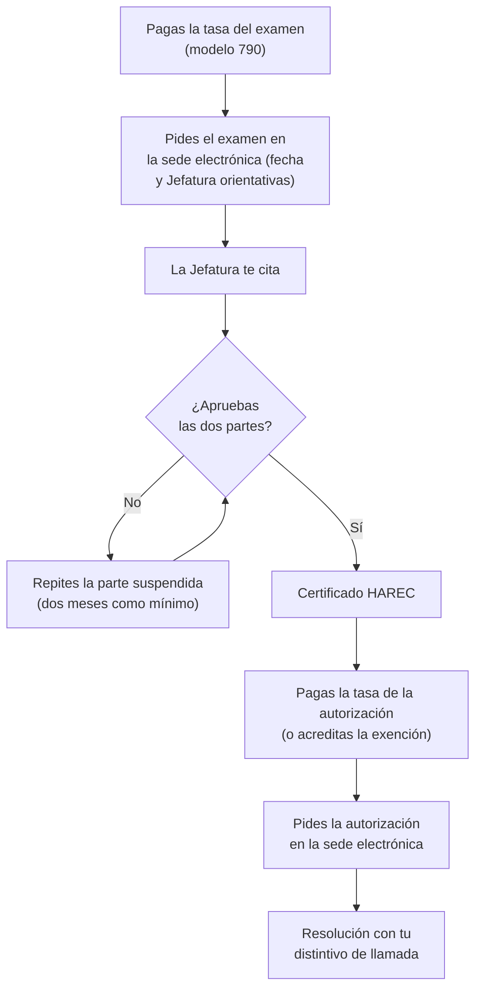

# La autorización en España

Para transmitir en las bandas de aficionado necesitas una autorización de la Administración. En este capítulo verás quién puede obtenerla, cómo es el examen y qué entra en él, cómo se pide la cita y se paga, qué caminos hay para obtener la autorización sin examinarte, cómo se pide la autorización y se recibe el indicativo, cuánto cuesta y qué trámites tendrás que hacer después. Son pasos administrativos sencillos, pero conviene conocerlos antes de empezar a estudiar: saber cómo es el examen te ayuda a prepararlo.

Las reglas que se aplican **una vez que tienes la autorización** (qué te permite, clases de estación, uso del indicativo, inspección y sanciones) están en el [capítulo 9](09-reglamentacion/index.md). Aquí solo se enlazan.

## Qué es la autorización y quién puede obtenerla

### La autorización de radioaficionado

Las bandas de aficionado son parte del espectro radioeléctrico, que es dominio público. Para usarlas hace falta una **autorización de radioaficionado**: una autorización administrativa individual que otorga la Secretaría de Estado de Telecomunicaciones e Infraestructuras Digitales (artículo 5.1 del reglamento aprobado por la [Orden IET/1311/2013, de 9 de julio, por la que se aprueba el Reglamento de uso del dominio público radioeléctrico por radioaficionados](https://www.boe.es/buscar/act.php?id=BOE-A-2013-7624); comprobado en noviembre de 2026). En adelante, «la orden». La orden aún llama «SETSI» a la Administración; el [capítulo 9](09-reglamentacion/index.md#por-que-la-orden-habla-de-organismos-que-ya-no-existen) explica por qué.

Hay una sola autorización, sin clases ni niveles: todos los titulares tienen las mismas bandas y potencias. Qué te permite exactamente está en el [nivel español del capítulo 9](09-reglamentacion/espanol.md#tu-autorizacion).

No confundas la autorización con la **licencia de estación fija**. La autorización te habilita a ti como operador; la licencia ampara una instalación concreta en un domicilio. Puedes tener la primera sin la segunda y transmitir con equipos móviles o portátiles. La licencia de estación fija se trata en el [capítulo 6](06-antenas-lineas.md#el-derecho-a-instalar-antenas-en-espana).

### Quién puede obtenerla

La regla general es aprobar la **prueba de capacitación**, es decir, el examen (artículo 5.2 de la orden; comprobado en noviembre de 2026). Pueden presentarse tanto españoles como extranjeros: la resolución que regula el examen prevé que los extranjeros se identifiquen con un documento equivalente al DNI (base segunda de la Resolución de 3 de junio de 2014, que verás enseguida; comprobado en noviembre de 2026).

Hay dos excepciones, que verás en la sección de [alternativas al examen](#alternativas-al-examen): los extranjeros residentes en España con un certificado HAREC y los que tienen la licencia de un país con el que España tiene un acuerdo de reciprocidad.

También pueden ser titulares las **asociaciones de radioaficionados**, para sus estaciones colectivas; lo verás en el [capítulo 9](09-reglamentacion/espanol.md#estaciones-colectivas).

### El camino completo

*Figura 1.1. Pasos para obtener la autorización por la vía del examen.*

## El examen

### La norma que lo regula

El artículo 10 de la orden fija las dos partes del examen y su temario, y deja a una resolución de la Secretaría de Estado las condiciones concretas (comprobado en noviembre de 2026). Esa resolución es la [Resolución de 3 de junio de 2014, de la Secretaría de Estado de Telecomunicaciones y para la Sociedad de la Información, por la que se establece el procedimiento para la realización del examen de capacitación para operar estaciones de radioaficionado](https://www.boe.es/buscar/doc.php?id=BOE-A-2014-6461). Está vigente: el BOE no recoge ninguna norma posterior que la derogue o la modifique (comprobado en noviembre de 2026). En esta sección, «la resolución».

### Formato

Según la base primera de la resolución (comprobado en noviembre de 2026):

| | Parte primera | Parte segunda |
|---|---|---|
| Materia | Electricidad y radioelectricidad para operar una estación | Normativa sobre estaciones de radioaficionado |
| Preguntas | 30, tipo test, con cuatro respuestas | 30, tipo test, con cuatro respuestas |
| Para aprobar | 15 respuestas correctas | 15 respuestas correctas |
| Tiempo | 45 minutos | 45 minutos |

En total son **60 preguntas** y **90 minutos**. Cada parte se califica como **apto** o **no apto**, y el examen se aprueba al aprobar las dos. Hacen falta 15 aciertos de 30, el 50 %. La resolución no dice que los errores resten.

El examen se hace **en ordenador**, en la Jefatura Provincial de Inspección de Telecomunicaciones, con un funcionario presente como testigo y asistente. Te comunican la calificación provisional al terminar las dos partes; luego un tribunal único de la Secretaría de Estado resuelve las incidencias y reclamaciones y eleva los resultados a definitivos (base segunda de la resolución; comprobado en noviembre de 2026).

### Si apruebas solo una parte

La parte aprobada **no se pierde**. Si apruebas una parte y suspendes la otra, en el siguiente examen puedes pedir la **convalidación** de la que ya tienes y examinarte solo de la pendiente. Lo mismo vale para una parte aprobada en exámenes anteriores. Para repetir una parte suspendida tienen que pasar **dos meses** como mínimo (base primera de la resolución; comprobado en noviembre de 2026).

**Ejemplo.** Te examinas el 10 de marzo y apruebas la parte de normativa, pero sacas 13 aciertos en la técnica. No puedes repetirla hasta el 10 de mayo. Cuando pidas el nuevo examen, pides también la convalidación de la parte de normativa, y ese día solo haces las 30 preguntas técnicas, en 45 minutos.

!!! tip "Para el examen"
    Dos partes independientes, **30 preguntas** cada una con **cuatro** respuestas, **15 aciertos** para aprobar cada parte, **45 minutos** por parte (**90** en total). La parte aprobada se **convalida** a petición tuya, y para repetir una parte suspendida esperas **dos meses** como mínimo. La resolución no incluye ninguna prueba de telegrafía (Resolución de 3 de junio de 2014, base primera; comprobado en noviembre de 2026).

### El temario

Las materias de las dos partes están en el **anexo II de la orden**. El artículo 10.2 dispone que el programa se ajuste al temario común del certificado HAREC, que viste en el [capítulo 9](09-reglamentacion/europeo.md#el-temario-comun) (comprobado en noviembre de 2026). La telegrafía no figura en él: el [capítulo 11](11-telegrafia.md#exige-el-examen-saber-telegrafia) lo explica.

Esta tabla resume los apartados del anexo II y dice qué capítulo del manual los trata (anexo II de la orden; comprobado en noviembre de 2026):

**Parte primera: electricidad y radioelectricidad**

| Apartado del anexo II | Contenido | Dónde está |
|---|---|---|
| 1. Teoría de la electricidad, electromagnetismo y radio | Magnitudes y leyes básicas, campos, ondas, señales, modulaciones, decibelios y procesado digital | Capítulos [2](02-electricidad-electronica.md) y [4](04-teoria-radio.md) |
| 2. Componentes | Resistencias, condensadores, bobinas, transformadores, diodos, transistores, circuitos integrados | [Capítulo 2](02-electricidad-electronica.md#componentes) |
| 3. Circuitos | Serie y paralelo, filtros, fuentes de alimentación, amplificadores, detectores, osciladores, sintetizadores, DSP | Capítulos [2](02-electricidad-electronica.md) y [4](04-teoria-radio.md#circuitos-basicos-de-radio) |
| 4. Receptores | Tipos, diagramas de bloques, etapas y características | Capítulos [4](04-teoria-radio.md#receptores) y [7](07-equipos.md) |
| 5. Transmisores | Tipos, diagramas de bloques, etapas y características; repetidores | Capítulos [4](04-teoria-radio.md#transmisores) y [7](07-equipos.md) |
| 6. Antenas y líneas de transmisión | Tipos y características de antenas, líneas, ROE, acopladores | [Capítulo 6](06-antenas-lineas.md) |
| 7. Propagación | Ionosfera, frecuencias crítica y máxima utilizable, salto, troposfera, modos esporádicos | [Capítulo 5](05-propagacion-bandas.md) |
| 8. Medidas | Medida de tensión, corriente, potencia, ROE y frecuencia; instrumentos | Capítulos [2](02-electricidad-electronica.md) y [6](06-antenas-lineas.md#adaptacion-de-impedancias-y-roe) |
| 9. Interferencia e inmunidad | Causas, compatibilidad electromagnética, filtrado y apantallamiento | [Capítulo 8](08-interferencias.md) |
| 10. Seguridad | Riesgo eléctrico, puesta a tierra, rayos | [Capítulo 3](03-seguridad.md) |

**Parte segunda: normativa**

| Apartado del anexo II | Contenido | Dónde está |
|---|---|---|
| 1. Alfabeto fonético internacional | Deletreo de letras y cifras | [Capítulo 10](10-operacion.md) |
| 2. Código Q | Grupos más usados | [Capítulo 10](10-operacion.md) |
| 3. Abreviaturas | Las más usuales | Capítulos [10](10-operacion.md) y [11](11-telegrafia.md#abreviaturas-y-senales-de-procedimiento) |
| 4. Socorro, urgencia, seguridad y catástrofes | Señales, tráfico de emergencia y bandas atribuidas | Capítulos [15](15-emergencias/index.md) y [5](05-propagacion-bandas.md#bandas-de-radioaficionado-en-espana) |
| 5. Distintivos de llamada | Composición, uso y prefijos | [Capítulo 9, nivel internacional](09-reglamentacion/internacional.md#distintivos-de-llamada-y-prefijos) y [nivel español](09-reglamentacion/espanol.md#el-distintivo-de-llamada) |
| 6. Planes de bandas de la IARU | Contenido y objetivos | [Capítulo 9](09-reglamentacion/index.md#los-planes-de-bandas-de-la-iaru) |
| 7. Responsabilidad social y procedimientos operativos | Cómo se opera | [Capítulo 10](10-operacion.md) |
| 8. Reglamentación nacional e internacional | Normas españolas, CEPT y UIT | [Capítulo 9](09-reglamentacion/index.md) y, para las antenas, [capítulo 6](06-antenas-lineas.md#el-derecho-a-instalar-antenas-en-espana) |
| 9. Inspección y régimen sancionador | Órganos competentes, infracciones y sanciones | [Capítulo 9](09-reglamentacion/espanol.md#inspeccion) |

El anexo II se redactó en 2013 y algunas de sus referencias han envejecido: cita la «Ley General de Telecomunicaciones» de entonces y la Resolución 640 del Reglamento de Radiocomunicaciones, que ya no figura en su edición de 2024. El [capítulo 9](09-reglamentacion/index.md) usa las normas vigentes.

### Fechas: no hay convocatorias

El examen **no tiene convocatorias** con fecha fija para todos. Se hace de forma individual: lo pides, indicas en la solicitud la fecha y la Jefatura Provincial que prefieres, y la Jefatura, una vez comprobada la solicitud, te comunica la hora, el día y el lugar. Las pruebas se hacen preferentemente en días laborables, de 9 a 14 h (base segunda de la resolución; comprobado en noviembre de 2026). La fecha que propones es orientativa: la decide la Jefatura.

### Cómo se pide

La [página de exámenes del Ministerio para la Transformación Digital y de la Función Pública](https://digital.gob.es/telecomunicaciones-infraestructuras-digitales/areas-interes/espectro-radioelectrico/radioaficionados-cb27/examenes-radioaficionado) describe estos pasos (comprobado en noviembre de 2026):

1. **Paga la tasa** con el modelo 790, código 041, que se genera en la sede electrónica del ministerio. Al terminar el pago obtienes un número de referencia completo (NRC), que es el justificante (apartado cuarto de la [Resolución de 10 de marzo de 2026, de la Subsecretaría, sobre el pago por vía electrónica de las tasas de telecomunicaciones](https://www.boe.es/buscar/doc.php?id=BOE-A-2026-7042); comprobado en noviembre de 2026). El importe está en la sección de [tasas](#tasas).
2. **Rellena la solicitud** «Solicitud de participación en pruebas de examen de radioaficionado» en la [página de procedimientos de radioaficionados](https://digital.gob.es/ministerio/servicios-a-la-ciudadania/procedimientos-y-servicios/telecomunicaciones-e-infraestructuras-digitales/espectro-radioelectrico/Radioaficionados) de la sede. Indica la fecha que propones, la provincia y, si procede, la convalidación de una parte ya aprobada.
3. **Preséntala** por vía electrónica, con certificado electrónico reconocido.

Si tienes una discapacidad que requiera adaptaciones, indícalo en la solicitud con el tipo de adaptación que necesitas y adjunta el dictamen técnico facultativo o un certificado médico del organismo competente. La Jefatura estudiará contigo las adaptaciones (página de exámenes del ministerio; comprobado en noviembre de 2026).

!!! example "En la práctica"
    Antes de pedir el examen, consigue un certificado electrónico o actívalo si ya lo tienes, porque lo vas a necesitar para todos los trámites. Pide la fecha con margen: las Jefaturas organizan las pruebas según su disponibilidad. Si tienes dudas sobre el procedimiento, la Jefatura Provincial de tu provincia es quien las resuelve.

### Lo que obtienes al aprobar

Quien aprueba las dos partes recibe el **certificado de examen armonizado** (HAREC), expedido conforme a la Recomendación T/R 61-02 de la CEPT, y queda habilitado para pedir la autorización, previo pago de la tasa (artículo 10.3 de la orden; comprobado en noviembre de 2026). El HAREC no te deja transmitir por sí solo: es la prueba de que aprobaste. Lo que te permite transmitir es la autorización.

## Alternativas al examen

### Extranjeros residentes con HAREC o con reciprocidad

Si eres extranjero y acreditas documentalmente que **resides en España**, puedes obtener la autorización española **sin examinarte** en dos casos (artículo 5.2 de la orden; comprobado en noviembre de 2026):

- Si tienes un **certificado HAREC** expedido por cualquier país que aplique la Recomendación T/R 61-02 (letra a).
- Si España tiene un **acuerdo o convenio de reciprocidad** con el país que te dio tu licencia original (letra b).

La solicitud es la misma que para una autorización nueva, y la tasa también. El [capítulo 9](09-reglamentacion/europeo.md#el-harec-en-espana) explica el HAREC y la Recomendación T/R 61-02.

### Visitantes

Si no resides en España, no necesitas la autorización española para operar aquí durante una estancia temporal: te basta la licencia CEPT de tu país o, si tu país no aplica la Recomendación T/R 61-01, una autorización temporal de hasta 90 días. Las dos cosas están en el [capítulo 9](09-reglamentacion/europeo.md#si-el-visitante-no-tiene-licencia-cept).

### La práctica internacional no sustituye al examen

La **acreditación de la práctica internacional** de la radioafición, con tarjetas QSL, no es un camino para obtener la autorización. Sirve para pedir un indicativo con sufijo de una o dos letras cuando ya eres radioaficionado español con años de antigüedad. Se explica en la sección de [sufijos cortos](#sufijos-de-una-y-dos-letras).

## Solicitud de la autorización y del distintivo

### Cómo se pide

La autorización se pide después de aprobar el examen, o directamente si estás en uno de los casos sin examen. Según la [página de nueva autorización del ministerio](https://digital.gob.es/telecomunicaciones-infraestructuras-digitales/areas-interes/espectro-radioelectrico/radioaficionados-cb27/autorizaciones/autorizacion-administrativa-radioaficionado), los pasos son (comprobado en noviembre de 2026):

1. **Paga la tasa** de tramitación con el modelo 790, salvo que estés exento (ver [tasas](#tasas)).
2. **Rellena la solicitud** «Nueva autorización administrativa de radioaficionado» en la [página de procedimientos de radioaficionados](https://digital.gob.es/ministerio/servicios-a-la-ciudadania/procedimientos-y-servicios/telecomunicaciones-e-infraestructuras-digitales/espectro-radioelectrico/Radioaficionados) de la sede. Si estás exento por edad, el formulario lo deduce de tu fecha de nacimiento; si lo estás por pensión o discapacidad, adjuntas el justificante.
3. **Preséntala** por vía electrónica, con certificado electrónico reconocido.

La orden dice que la solicitud se presenta preferentemente por vía electrónica, con el justificante de la tasa y la documentación que corresponda (artículo 6 de la orden; comprobado en noviembre de 2026).

### La resolución

La Secretaría de Estado dicta una resolución que **otorga la autorización junto con el distintivo de llamada**, o la deniega de forma motivada. Puede expedirte además un **documento acreditativo** de la autorización (artículo 7.1 de la orden). Si vives en una comunidad autónoma con lengua cooficial, puedes pedir la autorización en formato **bilingüe** (artículo 7.4 de la orden; ambos comprobados en noviembre de 2026).

El plazo para resolver y notificar es de **seis semanas** desde que la solicitud entra en el registro. Si pasa ese plazo sin respuesta, la solicitud se entiende **desestimada** (silencio negativo), aunque la Administración sigue obligada a resolver (artículo 4 de la orden; comprobado en noviembre de 2026). El mismo artículo permite recurrir la resolución en reposición, en el plazo de un mes, o ir directamente a la Sala de lo Contencioso-administrativo de la Audiencia Nacional, en el de dos meses, pero no las dos cosas a la vez. La orden aún cita la Ley 30/1992 para el recurso de reposición; hoy lo regula la [Ley 39/2015, de 1 de octubre, del Procedimiento Administrativo Común de las Administraciones Públicas](https://www.boe.es/buscar/act.php?id=BOE-A-2015-10565), que mantiene el plazo de un mes cuando el acto es expreso (artículo 124.1 de la Ley 39/2015; comprobado en noviembre de 2026).

El **documento acreditativo** es una hoja DIN A4 que puedes imprimir tú mismo y que lleva un localizador electrónico con el que la Inspección comprueba que la autorización existe. Si lo pierdes, pide otro a tu Jefatura Provincial, preferentemente por la sede electrónica: el trámite no tiene tasa ([página del documento acreditativo](https://digital.gob.es/telecomunicaciones-infraestructuras-digitales/areas-interes/espectro-radioelectrico/radioaficionados-cb27/autorizaciones/documento-acreditativo-radioaficionado); comprobado en noviembre de 2026).

### Cómo se asigna el distintivo

No eliges tu indicativo: te lo asignan. Los distintivos se asignan **por distritos** y por **orden de fecha de presentación** de las solicitudes, salvo los de sufijo de una y dos letras, que tienen su propio régimen (artículo 28 de la orden; comprobado en noviembre de 2026). Dentro de cada distrito, los sufijos de tres letras se van dando por orden alfabético a partir del último asignado, primero con el prefijo EA y, cuando se agotan, con EB y EC (artículo 27.3 de la orden; comprobado en noviembre de 2026).

El distintivo es **único** y **no se cambia**, salvo para pasar a un sufijo de menos letras por el procedimiento correspondiente. Excepcionalmente, por razones de organización del servicio, un titular puede tener más de uno (artículo 28 de la orden; comprobado en noviembre de 2026).

## Distritos y estructura del indicativo

Tu indicativo tiene tres partes: **prefijo**, **cifra de distrito** y **sufijo**. Toma como ejemplo el indicativo ficticio **EA0ZZZ**:

| Parte | En el ejemplo | Qué indica |
|---|---|---|
| Prefijo | EA | Una de las series de España; EA, EB y EC son las de las autorizaciones individuales |
| Distrito | 0 | El distrito en el que **residías cuando te dieron la autorización** |
| Sufijo | ZZZ | Hasta tres letras; como norma general, tres |

(Artículo 27 de la orden; comprobado en noviembre de 2026.) La cifra 0 del ejemplo es deliberada: en la realidad se reserva para distintivos temporales en circunstancias muy especiales, así que ningún titular ordinario la lleva y el ejemplo no puede coincidir con un indicativo real.

Hay nueve distritos, del 1 al 9, que agrupan provincias. La tabla completa, los prefijos temporales, los sufijos reservados y los distintivos temporales están en el [nivel español del capítulo 9](09-reglamentacion/espanol.md#el-distrito). Recuerda dos ideas:

- La cifra depende de dónde vivías **al obtener** la autorización. Si te mudas a otro distrito, **tu indicativo no cambia**.
- El formato general de los indicativos lo fija la UIT, como viste en el [nivel internacional del capítulo 9](09-reglamentacion/internacional.md#distintivos-de-llamada-y-prefijos).

## Sufijos de una y dos letras

### Los requisitos del artículo 27

Los indicativos con **sufijo de dos letras** o de **una letra** se reservan a radioaficionados con autorización española de **cinco años** de antigüedad como mínimo, que acrediten **cinco** (dos letras) o **quince** (una letra) **años de práctica en la radioafición internacional** y que no hayan tenido **expediente sancionador** en los últimos cinco años. Los de una letra se reservan también para concursos internacionales de alta competitividad y para concursos dentro del año natural de la solicitud (artículo 27.3 de la orden; comprobado en noviembre de 2026).

### El procedimiento para los de una letra

Desde el **19 de septiembre de 2026** se aplica la [Resolución de 29 de julio de 2026, de la Secretaría de Estado de Telecomunicaciones e Infraestructuras Digitales, por la que se establece el procedimiento administrativo para la asignación de distintivos de llamada de radioaficionado con sufijo de una letra](https://www.boe.es/buscar/doc.php?id=BOE-A-2026-17504) (comprobado en noviembre de 2026). Sustituye al procedimiento de 2019, que tuvo un plazo cerrado de solicitudes. Como ya no se espera más demanda que distintivos disponibles, el nuevo es un **procedimiento ordinario**: el plazo está **siempre abierto** y los distintivos se asignan **por orden de presentación** (preámbulo y apartado primero de la Resolución de 29 de julio de 2026; comprobado en noviembre de 2026). Si algún día la demanda volviera a superar la oferta, la Secretaría de Estado establecería un procedimiento con plazos y méritos.

**Requisitos** (apartado segundo de la Resolución de 29 de julio de 2026; comprobado en noviembre de 2026):

- Ser **persona física** con autorización española **en vigor**.
- Cinco años de antigüedad, quince de práctica internacional (aunque hayas cambiado de indicativo en ese tiempo) y ningún expediente sancionador en los últimos cinco años. Todos los plazos se cuentan a la **fecha de la solicitud**.
- La práctica se acredita con **dos QSL de contactos internacionales por año**, en **quince de los últimos veinte años**, contando el año de la solicitud.

**Qué QSL valen** (mismo apartado; comprobado en noviembre de 2026):

- Las **de papel**, con una **declaración responsable** tuya, firmada electrónicamente, sobre su autenticidad e integridad. No hace falta la declaración si los contactos ya los ha certificado el organismo responsable del sistema correspondiente.
- Las **electrónicas** de sistemas con garantía de autenticidad que haya comprobado la Secretaría de Estado, o la certificación de los contactos que expida el organismo responsable de cada sistema.

Para saber qué sistemas electrónicos se admiten, la resolución remite a las **Instrucciones para la acreditación de la práctica internacional de la radioafición**, publicadas en la [página de acreditación de la práctica internacional del ministerio](https://digital.gob.es/telecomunicaciones-infraestructuras-digitales/areas-interes/espectro-radioelectrico/radioaficionados-cb27/acreditacion-internacional-radioaficion). Son unas instrucciones de 2017, fruto de una consulta pública al sector, y dicen (comprobado en noviembre de 2026):

- Se admiten los sistemas electrónicos que garanticen la autenticidad, que identifiquen al usuario (con copia de su autorización de radioaficionado) y que tengan el reconocimiento del sector.
- Cumplen esas condiciones el **Logbook of The World** (LoTW) de la ARRL, **eQSL.cc** con usuario autenticado y el **GDURE** de la Unión de Radioaficionados Españoles. Más tarde se validó también el **EurobureauQSL** de la EURAO. Cualquier asociación reconocida puede pedir que se valide otro sistema.
- Presentas una copia de los registros del sistema que identifiquen cada contacto, con el indicativo del corresponsal, o la eQSL con su sello de autenticidad, y una declaración de que reflejan contactos reales. La Administración puede comprobarlos.

**Cómo se pide.** Solo por vía electrónica, en la sede del ministerio (apartado tercero de la Resolución de 29 de julio de 2026). La [página del procedimiento de una letra](https://digital.gob.es/telecomunicaciones-infraestructuras-digitales/areas-interes/espectro-radioelectrico/radioaficionados-cb27/prodecimiento-otorgamiento-distintivos-radioaficionados-sufijo-una-letra) concreta que se usa el trámite «Modificación de autorización administrativa de radioaficionado», con un formulario propio y toda la documentación unida en **un solo PDF** (comprobado en noviembre de 2026).

**Cómo se asigna** (apartado cuarto de la Resolución de 29 de julio de 2026; comprobado en noviembre de 2026):

- Por distritos y por estricto orden de presentación. Te asocian al distrito de tu indicativo actual.
- Puedes indicar **hasta diez** indicativos por orden de preferencia. Si ninguno está libre, te asignan el siguiente libre por orden alfabético en tu distrito, salvo que hayas pedido **desistir** en ese caso.
- El orden alfabético recorre las series EA, EB y EC. En el distrito ficticio 0 de nuestros ejemplos sería: EA0A, EA0B… EA0Z, EB0A… EB0Z, EC0A… EC0Z.
- El nuevo indicativo **sustituye** al que tenías: no lo conservas.

**Ejemplo con indicativos ficticios.** El titular de EA0ZZZ cumple los requisitos y pide, por este orden, EA0Q y EA0X, sin marcar la opción de desistir. Si los dos están asignados, recibirá el primer indicativo libre de la serie, empezando por EA0A. Desde ese momento ya no puede usar EA0ZZZ.

### Los de dos letras

Para los sufijos de dos letras **no hay hoy un procedimiento específico publicado**. No figura ninguno en el BOE ni entre los trámites de radioaficionados de la sede del ministerio, que solo ofrece el de una letra (comprobado en noviembre de 2026). Se aplican los requisitos del artículo 27.3 de la orden, y la página de acreditación del ministerio añade que, para estos sufijos, se mantiene la exigencia de acreditar **al menos un contacto internacional al año durante los últimos cinco años** (comprobado en noviembre de 2026). Si te interesa uno, consulta en tu Jefatura Provincial cómo presentarlo.

## Tasas

Las tasas de los trámites de radioaficionado son tasas de telecomunicaciones del apartado 4 del anexo I de la [Ley 11/2022, de 28 de junio, General de Telecomunicaciones](https://www.boe.es/buscar/act.php?id=BOE-A-2022-10757). Según la ley, la cuantía la fija la Ley de Presupuestos Generales del Estado; mientras no lo haga, se aplican las cuantías de su disposición transitoria séptima (comprobado en noviembre de 2026):

| Trámite | Importe | Exenciones |
|---|---|---|
| Presentarse al examen | **23,67 €** (letra h) | Ninguna |
| Tramitar la autorización | **114,36 €** (letra g) | Mayores de 65 años, pensionistas y personas con discapacidad del 33 % o más |
| Duplicado del documento acreditativo | Sin tasa | — |

Ninguna Ley de Presupuestos ha fijado otras cuantías. Desde la Ley 11/2022 solo se ha aprobado una, la [Ley 31/2022, de 23 de diciembre, de Presupuestos Generales del Estado para el año 2023](https://www.boe.es/buscar/doc.php?id=BOE-A-2022-22128), que no las fija, y desde entonces los presupuestos se han prorrogado (comprobado en el BOE en noviembre de 2026). Las páginas informativas del ministerio no indican el importe. En el formulario del modelo 790 seleccionas la tasa que corresponde a tu trámite: comprueba que el importe que aparece coincide con el de esta tabla antes de pagar.

**Las exenciones** solo valen para la tasa de la autorización. Estás exento si cumples **65 años** en el año de la solicitud o los has cumplido antes, si cobras una **pensión pública** o si tienes reconocida una **discapacidad** igual o superior al **33 %** (apartado 4.5 del anexo I de la Ley 11/2022; comprobado en noviembre de 2026). Las instrucciones del ministerio para presentar solicitudes confirman que la tasa del examen no tiene ninguna exención (comprobado en noviembre de 2026).

**Ejemplo.** Una persona de 40 años, sin pensión ni discapacidad, aprueba a la primera: paga 23,67 € + 114,36 € = 138,03 €. Si suspende una parte y tiene que volver a presentarse, paga otra vez la tasa del examen: 23,67 € × 2 + 114,36 € = 161,70 €. Una persona jubilada con pensión pública paga solo el examen, porque está exenta de la tasa de la autorización.

## Renovación, modificación y baja

### No hay que renovar

La autorización **no caduca**: conserva su vigencia mientras no renuncies a ella o no te la revoquen (artículo 5.4 de la orden). La orden suprimió la antigua obligación de comunicar cada cinco años que seguías usando el espectro (disposición adicional primera de la orden; ambos comprobados en noviembre de 2026). Si encuentras una autorización antigua con fecha de caducidad, la orden dispuso que las autorizaciones vigentes en 2013 conservaran su vigencia con las nuevas reglas (disposición transitoria única de la orden; comprobado en noviembre de 2026), y el ministerio las fue actualizando de oficio.

### Modificaciones

Lo que sí tienes que hacer es **comunicar tus cambios de domicilio** a efectos de notificaciones (artículo 7.3 de la orden; comprobado en noviembre de 2026). Los cambios de datos y las peticiones como el sufijo de una letra se tramitan con el procedimiento «Modificación de autorización administrativa de radioaficionado» de la sede: eliges el tipo de modificación y adjuntas un documento que la explique (instrucciones del ministerio para presentar solicitudes; comprobado en noviembre de 2026).

Recuerda que el cambio de domicilio **no cambia tu indicativo**, aunque te mudes a otro distrito. Si tienes una estación fija, el cambio de emplazamiento afecta a su licencia, que se trata aparte: lo verás en el [capítulo 6](06-antenas-lineas.md#el-derecho-a-instalar-antenas-en-espana).

### Baja

La autorización termina de tres maneras (artículos 5.4 y 8 de la orden; comprobados en noviembre de 2026):

- Por **renuncia** del titular. Se pide en la sede con el procedimiento «Cancelación de autorización administrativa de radioaficionado».
- Por **revocación**, tras un expediente, por las causas de la normativa general del espectro o por hacer emisiones con fines comerciales, publicitarios o lucrativos. El [capítulo 9](09-reglamentacion/espanol.md#que-caracteristicas-tiene) lo trata.
- **Automáticamente**, por fallecimiento del titular o por extinción de la asociación titular.

Un indicativo dado de baja no se reasigna hasta que se agoten todas las combinaciones posibles, con dos excepciones: se puede volver a dar a su **anterior titular** si obtiene una nueva autorización tras la revocación de la primera, y a sus **familiares en primer grado** si la baja fue por fallecimiento, salvo que el sufijo sea de una letra (artículo 28 de la orden; comprobado en noviembre de 2026).

## Resumen

- Para transmitir necesitas la **autorización de radioaficionado**, que es única, personal, intransferible y **no caduca**.
- La vía normal es el **examen**: dos partes de **30 preguntas** tipo test con cuatro respuestas, **15 aciertos** por parte, **45 minutos** por parte. La parte aprobada se **convalida**, y para repetir la suspendida esperas **dos meses**.
- El temario es el del **anexo II de la orden**, acorde con el del HAREC. No hay telegrafía.
- **No hay convocatorias**: pides el examen en la sede, propones fecha y Jefatura, y la Jefatura te cita.
- Al aprobar recibes el **HAREC** y pides la autorización. Los extranjeros residentes con HAREC o con licencia de un país con reciprocidad no tienen que examinarse.
- La resolución te asigna el **distintivo**: por distritos y por orden de solicitud. La cifra del distrito es la de tu residencia al obtener la autorización, y no cambia si te mudas.
- Los sufijos de **una letra** tienen desde el 19 de septiembre de 2026 un procedimiento con plazo siempre abierto: cinco años de antigüedad, quince de práctica internacional acreditada con QSL y ningún expediente sancionador en cinco años. Para los de **dos letras** no hay procedimiento propio publicado.
- Tasas: **23,67 €** el examen, sin exenciones, y **114,36 €** la autorización, con exención para mayores de 65 años, pensionistas y personas con discapacidad del 33 % o más.
- Tienes que comunicar los **cambios de domicilio**. La baja se pide en la sede como cancelación.

## Autoevaluación

**1.** En la parte técnica del examen aciertas 16 preguntas, fallas 9 y dejas 5 en blanco. ¿Cuál es el resultado de esa parte?

a) No apto, porque has fallado más de 5 preguntas.  
b) Apto, porque has acertado más de 15 preguntas.  
c) No apto, porque las preguntas en blanco cuentan como fallos.  
d) Depende de la nota de la parte de normativa.

??? success "Solución"
    **b)** Cada parte se aprueba con 15 aciertos de 30, y la Resolución de 3 de junio de 2014 no establece que los fallos o los blancos resten. Con 16 aciertos eres apto en esa parte, con independencia de lo que pase en la otra, que se califica por separado.

**2.** Apruebas la parte de normativa y suspendes la técnica en un examen que haces el 15 de octubre. ¿Qué es correcto?

a) Tienes que repetir las dos partes en el próximo examen.  
b) Puedes repetir la parte técnica cuando quieras, pidiendo la convalidación de la de normativa.  
c) Puedes repetir la parte técnica a partir del 15 de diciembre, pidiendo la convalidación de la de normativa.  
d) La parte de normativa se convalida solo si repites antes de seis meses.

??? success "Solución"
    **c)** La parte aprobada no se pierde: se convalida a petición tuya en exámenes posteriores. Pero entre un intento y el siguiente de una parte suspendida tienen que pasar al menos dos meses. La resolución no pone un plazo máximo a la convalidación.

**3.** ¿Cuánto paga en tasas una persona de 67 años que se examina dos veces (suspende la primera) y después pide la autorización?

a) 0 €, porque los mayores de 65 años están exentos de todas las tasas.  
b) 23,67 €.  
c) 47,34 €.  
d) 161,70 €.

??? success "Solución"
    **c)** La exención por edad del apartado 4.5 del anexo I de la Ley 11/2022 solo se aplica a la tasa de la autorización. La del examen se paga en cada intento: 2 × 23,67 € = 47,34 €.

**4.** Obtuviste la autorización viviendo en Sevilla, con un indicativo ficticio del distrito 7. Diez años después te mudas a Bilbao. ¿Qué tienes que hacer?

a) Pedir un indicativo nuevo del distrito 2.  
b) Comunicar el cambio de domicilio; el indicativo no cambia.  
c) Nada: la autorización no tiene domicilio asociado.  
d) Renovar la autorización en la Jefatura de Bizkaia.

??? success "Solución"
    **b)** El artículo 7.3 de la orden te obliga a comunicar los cambios de domicilio a efectos de notificaciones. La cifra del indicativo corresponde al distrito en el que vivías al obtener la autorización, y el artículo 28 dice que el distintivo es único y no se modifica. Tampoco hay que renovar nada, porque la autorización no caduca.

**5.** Una ciudadana alemana que vive en Valencia tiene un HAREC expedido en Alemania. ¿Cómo obtiene la autorización española?

a) Aprobando solo la parte de normativa.  
b) Pidiéndola sin examen, si acredita su residencia en España.  
c) No puede: el HAREC solo sirve para estancias de hasta tres meses.  
d) Con su licencia CEPT, que equivale a la autorización española.

??? success "Solución"
    **b)** El artículo 5.2.a) de la orden permite a los extranjeros residentes en España con un HAREC de un país que aplique la Recomendación T/R 61-02 obtener la autorización sin examinarse, previa solicitud. La licencia CEPT sirve para estancias temporales de quienes no residen en el país, no para quien vive aquí.

**6.** Quieres hacer el examen en tu provincia la segunda semana de mayo. ¿Qué es correcto?

a) Tienes que esperar a la convocatoria anual que publica el BOE.  
b) Lo pides en la sede, indicando esa fecha y la Jefatura que prefieres; la Jefatura te comunica la fecha definitiva.  
c) Te presentas ese día en la Jefatura con el justificante de la tasa.  
d) Solo se puede hacer en Madrid, ante el tribunal único.

??? success "Solución"
    **b)** No hay convocatorias: el examen se hace de forma individual. Según la Resolución de 3 de junio de 2014, indicas en la solicitud, con carácter orientativo, la fecha y la Jefatura que prefieres, y la Jefatura te comunica la hora, la fecha y el lugar. El tribunal único resuelve incidencias y reclamaciones; no examina en persona.

**7.** El titular del indicativo ficticio EA0ZZZ obtiene un indicativo con sufijo de una letra por el procedimiento de 2026. ¿Qué pasa con EA0ZZZ?

a) Lo conserva como segundo indicativo.  
b) Puede usarlo solo en concursos.  
c) Deja de ser suyo: el nuevo indicativo lo sustituye.  
d) Pasa automáticamente a un familiar en primer grado.

??? success "Solución"
    **c)** La Resolución de 29 de julio de 2026 dice que el indicativo de una letra que se asigne sustituye al que tuviera el titular en la fecha de la solicitud. La reasignación a familiares del artículo 28 de la orden se refiere a los indicativos dados de baja por fallecimiento.

**8.** ¿Cuál de estas personas **no** cumple los requisitos para pedir un indicativo con sufijo de una letra? (Todas son ficticias y tienen autorización española en vigor.)

a) Radioaficionada desde hace 22 años, con dos QSL internacionales por año en 16 de los últimos 20 años y sin sanciones.  
b) Radioaficionado desde hace 18 años, con QSL suficientes en 15 de los últimos 20 años y una sanción leve hace siete años.  
c) Radioaficionada desde hace 16 años, con QSL suficientes en 15 de los últimos 20 años, que cambió de indicativo hace tres años y sin sanciones.  
d) Radioaficionado desde hace 12 años, con QSL suficientes en 12 de los últimos 20 años y sin sanciones.

??? success "Solución"
    **d)** La Resolución de 29 de julio de 2026 exige dos QSL internacionales por año durante quince de los últimos veinte años; doce no bastan. La sanción de b) es anterior a los últimos cinco años, así que no impide la solicitud. En c), la práctica internacional cuenta aunque haya cambiado de indicativo en ese tiempo, como dice expresamente la resolución.
