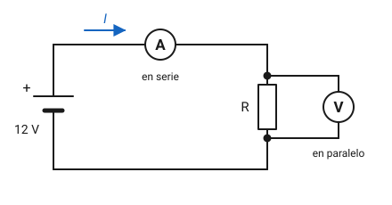
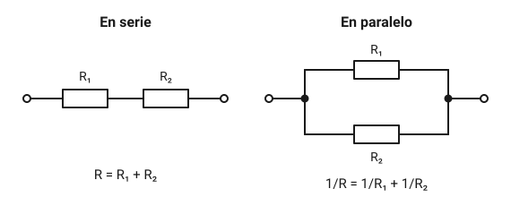
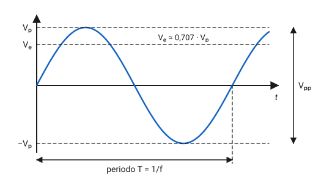
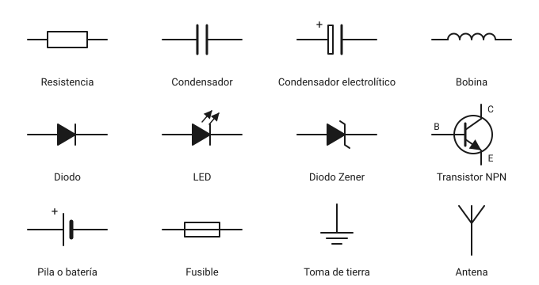
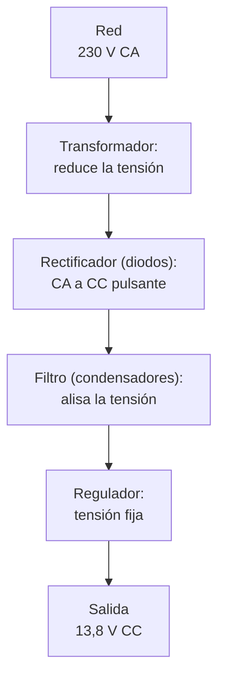

# Electricidad y electrónica básica

Una emisora no es más que un conjunto de circuitos que mueven corriente de forma ordenada. Para elegir una fuente de alimentación, montar una antena o entender por qué se calienta un cable, necesitas manejar unas pocas magnitudes y relaciones. En este capítulo aprenderás qué son la tensión, la corriente y la resistencia, cómo se relacionan con la ley de Ohm y la potencia, qué son los decibelios y para qué sirve cada componente que vas a encontrar en un esquema.

## Magnitudes eléctricas

### Carga, corriente y tensión

La materia contiene cargas eléctricas: los electrones tienen carga negativa y los protones, positiva. Cuando muchas cargas se desplazan en el mismo sentido por un material, hablamos de **corriente eléctrica**. Su intensidad se mide en **amperios** (A) y se representa con la letra $I$. Un amperio equivale a que pase un culombio de carga por segundo.

Para que haya corriente hace falta algo que empuje las cargas. Ese empuje es la **tensión** o **diferencia de potencial**, se mide en **voltios** (V) y se representa con $V$ (en algunos textos, $U$). Una pila de 1,5 V, la batería de 12 V de un coche o el enchufe de 230 V de casa son fuentes de tensión. En la calle se oye *voltaje*; en este manual usamos *tensión*.

La tensión siempre se mide **entre dos puntos**. Decir que un punto «tiene 5 V» solo tiene sentido si se sobrentiende la referencia, que normalmente es la masa o el negativo del circuito.

### Resistencia, conductores y aislantes

Todo material se opone en alguna medida al paso de la corriente. Esa oposición es la **resistencia**, se mide en **ohmios** (Ω) y se representa con $R$.

- Los **conductores**, como el cobre, el aluminio o la plata, tienen muy poca resistencia. Por eso los cables son de cobre.
- Los **aislantes**, como el plástico, el vidrio, la cerámica o el aire seco, apenas dejan pasar corriente. Recubren los cables y sujetan las antenas.
- Los **semiconductores**, como el silicio, quedan en medio y su comportamiento se puede controlar. Con ellos se fabrican los diodos y los transistores.

La resistencia de un cable crece con su longitud y baja con su sección. Por eso un cable de alimentación largo y fino desperdicia tensión: un equipo que consume mucha corriente necesita cables cortos y de bastante sección, medida en mm².

### Corriente continua y corriente alterna

- En la **corriente continua** (CC) la tensión mantiene siempre la misma polaridad y la corriente circula en un solo sentido. La dan las pilas, las baterías y las fuentes de alimentación de los equipos.
- En la **corriente alterna** (CA) la polaridad se invierte periódicamente y la corriente cambia de sentido. Es la de la red eléctrica y, a frecuencias mucho más altas, la de las señales de radio.

### Resumen de magnitudes

| Magnitud | Símbolo | Unidad | Se mide con |
|---|---|---|---|
| Intensidad de corriente | $I$ | amperio (A) | amperímetro |
| Tensión | $V$ | voltio (V) | voltímetro |
| Resistencia | $R$ | ohmio (Ω) | óhmetro |
| Potencia | $P$ | vatio (W) | vatímetro |
| Frecuencia | $f$ | hercio (Hz) | frecuencímetro |

### Prefijos del Sistema Internacional

En radio aparecen a la vez valores enormes y diminutos: frecuencias de cientos de megahercios y condensadores de unos pocos picofaradios. Los prefijos evitan escribir muchos ceros.

| Prefijo | Símbolo | Factor | Ejemplo en radio |
|---|---|---|---|
| giga | G | $10^{9}$ | 1,2 GHz (banda de 23 cm) |
| mega | M | $10^{6}$ | 145 MHz (banda de 2 m) |
| kilo | k | $10^{3}$ | 4,7 kΩ; 7 100 kHz |
| mili | m | $10^{-3}$ | 250 mA de consumo en escucha |
| micro | µ | $10^{-6}$ | 10 µH; 1 µV de señal en antena |
| nano | n | $10^{-9}$ | 100 nF |
| pico | p | $10^{-12}$ | 47 pF |

Cada salto de prefijo equivale a mil: 1 MHz son 1 000 kHz y 1 nF son 1 000 pF.

!!! tip "Para el examen"
    Muchos fallos en los cálculos no son de fórmula, sino de prefijos. Antes de operar, pasa todo a la unidad base (A, V, Ω, Hz, F, H) usando potencias de diez, y al final elige el prefijo que deje un número cómodo. Practica conversiones como 0,022 µF = 22 nF o 3 500 kHz = 3,5 MHz hasta hacerlas sin pensar.

## Ley de Ohm

En una resistencia, la corriente es proporcional a la tensión aplicada e inversamente proporcional a la resistencia:

$$
I = \frac{V}{R}
$$

donde $I$ es la corriente en amperios, $V$ la tensión en voltios y $R$ la resistencia en ohmios. Despejando se obtienen las otras dos formas:

$$
V = I \cdot R \qquad\qquad R = \frac{V}{I}
$$

Con dos de las tres magnitudes siempre puedes calcular la tercera.

**Ejemplo 1.** Conectas una resistencia de 470 Ω a una pila de 9 V. ¿Qué corriente circula?

$$
I = \frac{9\ \text{V}}{470\ \Omega} \approx 0{,}0191\ \text{A} = 19{,}1\ \text{mA}
$$

**Ejemplo 2.** Por una resistencia de 2,2 kΩ pasan 5 mA. ¿Qué tensión hay entre sus extremos?

$$
V = 0{,}005\ \text{A} \cdot 2\,200\ \Omega = 11\ \text{V}
$$

**Ejemplo 3.** Un receptor alimentado a 13,8 V consume 0,6 A. Visto desde la fuente, se comporta como una resistencia de

$$
R = \frac{13{,}8\ \text{V}}{0{,}6\ \text{A}} = 23\ \Omega
$$

### Cómo se mide

*Figura 2.1. El amperímetro se intercala en el circuito (en serie); el voltímetro se conecta entre los dos puntos cuya tensión quieres conocer (en paralelo).*

- El **amperímetro** tiene que ver pasar toda la corriente, así que se coloca **en serie**: abres el circuito y lo intercalas. Su resistencia interna es casi nula.
- El **voltímetro** compara dos puntos, así que se coloca **en paralelo**, tocando ambos extremos del componente. Su resistencia interna es muy alta para no alterar el circuito.
- El **óhmetro** inyecta su propia corriente, por lo que solo se usa **con el circuito sin alimentación**.

!!! example "En la práctica"
    El instrumento que usarás a diario es el **polímetro** (o multímetro), que reúne las tres funciones y suele añadir prueba de continuidad y de diodos. El error típico es dejarlo en la posición de amperímetro y luego medir la tensión de una batería: como un amperímetro es casi un cortocircuito, saltará el fusible interno del polímetro, si tiene suerte. Acostúmbrate a devolver el selector y las puntas a la posición de voltios al terminar.

Además del polímetro, en la estación se usan el vatímetro y el medidor de ROE, que se presentan en el [capítulo 7](07-equipos.md).

??? note "Para saber más: medir corriente con una resistencia *shunt*"
    Para medir corrientes grandes sin pasar todo por el polímetro se intercala en el circuito una resistencia muy pequeña y precisa, llamada *shunt* o derivación, y se mide la tensión que cae en ella. Con un *shunt* de 0,01 Ω, una corriente de 15 A produce $V = 15 \cdot 0{,}01 = 0{,}15\ \text{V}$, que cualquier voltímetro mide sin problema. Muchos amperímetros de panel y los medidores de consumo de las fuentes de alimentación funcionan así.

## Potencia y energía

La **potencia** es la rapidez con la que se entrega o se consume energía. Se mide en **vatios** (W). En un circuito de continua:

$$
P = V \cdot I
$$

Combinándola con la ley de Ohm salen otras dos expresiones muy útiles:

$$
P = I^{2} \cdot R \qquad\qquad P = \frac{V^{2}}{R}
$$

Usa la que corresponda a los datos que tengas.

**Ejemplo 4.** Un transceptor de HF de 100 W toma unos 20 A de una fuente de 13,8 V mientras transmite. La potencia que consume es

$$
P = 13{,}8\ \text{V} \cdot 20\ \text{A} = 276\ \text{W}
$$

De esos 276 W, 100 W salen por la antena como radiofrecuencia y el resto se convierte en calor en el equipo. Por eso los transmisores llevan radiadores y ventiladores.

**Ejemplo 5.** Una carga artificial de 50 Ω recibe 100 W. ¿Qué tensión hay en sus bornes? De $P = V^2/R$:

$$
V = \sqrt{P \cdot R} = \sqrt{100 \cdot 50} \approx 70{,}7\ \text{V}
$$

Toda resistencia tiene una **potencia nominal**, la máxima que puede disipar sin dañarse. Una resistencia de 0,25 W no sirve para disipar 1 W, aunque su valor en ohmios sea el correcto.

### Energía y capacidad de las baterías

La **energía** es potencia por tiempo. En el ámbito eléctrico se mide en **vatios hora** (Wh) o kilovatios hora (kWh). La capacidad de una batería suele indicarse en **amperios hora** (Ah) o miliamperios hora (mAh); multiplicada por la tensión da la energía almacenada.

- Una batería de plomo de 12 V y 7 Ah guarda unos $12 \cdot 7 = 84\ \text{Wh}$.
- La batería de 7,4 V y 1 800 mAh de un portátil de mano guarda unos $7{,}4 \cdot 1{,}8 \approx 13{,}3\ \text{Wh}$.

Si un equipo consume de media 1,5 A, una batería de 7 Ah le dura en teoría unas 4,7 horas. En la práctica, menos: no conviene descargar del todo una batería de plomo y la capacidad baja con el frío y con las corrientes altas.

!!! danger "Peligro"
    Una batería de coche o de gel puede entregar cientos de amperios en un cortocircuito: suficiente para fundir un anillo, quemar un cable o provocar un incendio. Pon siempre un **fusible** en el cable positivo, lo más cerca posible de la batería, y protege los bornes para que nada metálico los toque.

## Circuitos en serie y en paralelo

*Figura 2.2. Asociación de resistencias en serie y en paralelo.*

### En serie

Los componentes están uno a continuación de otro y **por todos pasa la misma corriente**. La tensión total se reparte entre ellos y la resistencia total es la suma:

$$
R_{\text{total}} = R_1 + R_2 + R_3 + \dots
$$

La resistencia total en serie siempre es **mayor** que la mayor de las resistencias.

### En paralelo

Los componentes están conectados entre los mismos dos puntos y **todos tienen la misma tensión**. La corriente total se reparte entre ellos y la resistencia total se obtiene sumando las inversas:

$$
\frac{1}{R_{\text{total}}} = \frac{1}{R_1} + \frac{1}{R_2} + \frac{1}{R_3} + \dots
$$

Para solo dos resistencias es más cómodo usar

$$
R_{\text{total}} = \frac{R_1 \cdot R_2}{R_1 + R_2}
$$

La resistencia total en paralelo siempre es **menor** que la menor de las resistencias. Si las dos son iguales, el resultado es la mitad de una de ellas: dos de 100 Ω en paralelo dan 50 Ω.

**Ejemplo 6.** Dos resistencias de 1 kΩ en paralelo y, en serie con el conjunto, otra de 500 Ω. El paralelo vale 500 Ω y, sumado a la de 500 Ω, da 1 000 Ω en total.

### Las leyes de Kirchhoff

Las dos reglas anteriores son casos particulares de dos leyes generales:

- **Ley de las corrientes.** En un punto de unión (un nudo), la suma de las corrientes que entran es igual a la suma de las que salen. La corriente no se acumula ni desaparece.
- **Ley de las tensiones.** En cualquier recorrido cerrado (una malla), la suma de las tensiones de las fuentes es igual a la suma de las caídas de tensión en los componentes.

### El divisor de tensión

Dos resistencias en serie conectadas a una fuente reparten la tensión en proporción a su valor. La tensión en $R_2$ es

$$
V_{\text{salida}} = V_{\text{entrada}} \cdot \frac{R_2}{R_1 + R_2}
$$

**Ejemplo 7.** Con 12 V de entrada, $R_1 = 10\ \text{k}\Omega$ y $R_2 = 4{,}7\ \text{k}\Omega$:

$$
V_{\text{salida}} = 12 \cdot \frac{4{,}7}{10 + 4{,}7} \approx 3{,}84\ \text{V}
$$

Así se adapta la tensión de una batería de 12 V a la entrada de 5 V o de 3,3 V de un microcontrolador para vigilar su carga, siempre que lo que se conecte a la salida consuma muy poca corriente.

!!! example "En la práctica"
    Las pilas y baterías también se asocian. **En serie** se suman las tensiones: cuatro pilas de 1,5 V dan 6 V. **En paralelo** la tensión no cambia, pero se suma la capacidad: dos baterías iguales de 12 V y 7 Ah en paralelo equivalen a una de 12 V y 14 Ah. Solo se conectan en paralelo baterías iguales y con la misma carga.

## Corriente alterna

*Figura 2.3. Una onda senoidal y sus valores característicos.*

La forma más sencilla de corriente alterna es la **onda senoidal**. Para describirla se usan:

- El **periodo** $T$: lo que tarda en repetirse un ciclo completo, en segundos.
- La **frecuencia** $f$: cuántos ciclos se producen en un segundo, en **hercios** (Hz). Es la inversa del periodo:

    $$
    f = \frac{1}{T}
    $$

    La red eléctrica europea funciona a 50 Hz, así que cada ciclo dura 20 ms. Las señales de radio oscilan entre miles y miles de millones de veces por segundo: kilohercios, megahercios y gigahercios.

- El **valor de pico** $V_p$: el máximo que alcanza la tensión.
- El **valor pico a pico** $V_{pp}$: la distancia entre el máximo positivo y el negativo, $V_{pp} = 2 \cdot V_p$.
- El **valor eficaz** $V_e$ (en inglés, *RMS*): el valor de una tensión continua que produciría el mismo calor en una resistencia. En una senoide:

    $$
    V_e = \frac{V_p}{\sqrt{2}} \approx 0{,}707 \cdot V_p \qquad\qquad V_p = \sqrt{2} \cdot V_e \approx 1{,}414 \cdot V_e
    $$

Cuando se da una tensión o una corriente alterna sin más precisión, se trata de su valor eficaz. Los 230 V de la red son eficaces: su valor de pico es de unos $230 \cdot 1{,}414 \approx 325\ \text{V}$ y su valor pico a pico, de unos 650 V. Las fórmulas de la potencia de los apartados anteriores valen en alterna si usas valores eficaces.

Qué es una onda de radio, cómo se relacionan frecuencia y longitud de onda y cómo se reparte el espectro se explica en el [capítulo 4](04-teoria-radio.md).

!!! tip "Para el examen"
    Ten claras las tres conversiones de la senoide: de eficaz a pico (×1,414), de pico a eficaz (×0,707) y de pico a pico a pico (÷2). Un enunciado puede darte la tensión pico a pico leída en un osciloscopio y pedirte la potencia: primero pasa a pico, luego a eficaz y solo entonces aplica $P = V^2/R$.

## Decibelios

En radio se comparan potencias que van de billonésimas de vatio en la antena del receptor a cientos de vatios en el transmisor. En lugar de multiplicar y dividir números con muchos ceros, se usa una escala logarítmica: el **decibelio** (dB).

La relación entre dos potencias en decibelios es

$$
G_{\text{dB}} = 10 \cdot \log_{10}\!\left(\frac{P_2}{P_1}\right)
$$

donde $P_1$ es la potencia de referencia (por ejemplo, la de entrada) y $P_2$ la que se compara con ella (por ejemplo, la de salida). Un valor positivo indica **ganancia** y uno negativo, **pérdida** o **atenuación**.

La ventaja es que las ganancias y pérdidas en cadena, que en potencias se multiplican, en decibelios **se suman**.

| dB | Relación de potencias |
|---|---|
| 0 dB | ×1 (igual) |
| 1 dB | ×1,26 |
| 3 dB | ×2 (el doble) |
| 6 dB | ×4 |
| 10 dB | ×10 |
| 13 dB | ×20 |
| 20 dB | ×100 |
| 30 dB | ×1 000 |
| −3 dB | ×0,5 (la mitad) |
| −10 dB | ×0,1 (la décima parte) |

**Ejemplo 8.** Un portátil de 5 W ataca un amplificador de 10 dB de ganancia, y entre el amplificador y la antena hay un cable con 3 dB de pérdidas. El balance es $+10 - 3 = +7\ \text{dB}$. Como 7 dB son 10 dB menos 3 dB, la potencia se multiplica por 10 y se divide por 2, es decir, por 5: llegan **25 W** a la antena. Comprobación paso a paso: 5 W × 10 = 50 W a la salida del amplificador; la mitad, 25 W, al final del cable.

### Tensiones en decibelios

Como la potencia es proporcional al cuadrado de la tensión, para relaciones de tensión (o de corriente) medidas sobre la misma impedancia se usa un factor 20:

$$
G_{\text{dB}} = 20 \cdot \log_{10}\!\left(\frac{V_2}{V_1}\right)
$$

Duplicar la tensión equivale a 6 dB, es decir, a multiplicar la potencia por cuatro.

### Valores absolutos: dBm y dBW

Si la referencia es una potencia fija, el decibelio se convierte en una unidad absoluta:

- **dBm**: decibelios respecto a **1 mW**. 0 dBm = 1 mW; 30 dBm = 1 W; 50 dBm = 100 W.
- **dBW**: decibelios respecto a **1 W**. 0 dBW = 1 W; 20 dBW = 100 W.

Las hojas de características de los receptores dan las señales en dBm, a menudo muy negativos: −120 dBm es una billonésima de milivatio, una señal muy débil pero todavía útil.

!!! tip "Para el examen"
    Con solo dos datos, **3 dB = ×2** y **10 dB = ×10**, resuelves casi cualquier cálculo de decibelios sin calculadora: descompón la cifra en sumas de 10 y de 3. Por ejemplo, 16 dB = 10 + 3 + 3, que equivale a ×10 ×2 ×2 = ×40. Y recuerda el signo: una pérdida de 3 dB deja la mitad, no «3 vatios menos».

## Componentes

*Figura 2.4. Símbolos de los componentes más habituales según la norma IEC 60617, la que se usa en Europa.*

Los libros y esquemas estadounidenses dibujan la resistencia en zigzag y la bobina de forma algo distinta. Ambos estilos son fáciles de reconocer, pero en este manual se usa la simbología europea.

### Resistencias

Las **resistencias** limitan la corriente, reparten tensiones y sirven de carga. Se caracterizan por tres datos: su **valor** en ohmios, su **tolerancia** (cuánto puede desviarse del valor nominal, en %) y su **potencia nominal**.

Las resistencias variables se llaman **potenciómetros** si las maneja el usuario (el mando de volumen) y **trimmers** o resistencias ajustables si se fijan una vez durante el ajuste del equipo.

En las resistencias con patillas, el valor se indica con bandas de colores; las de montaje superficial, diminutas, llevan un código numérico impreso. Cada color representa una cifra:

| Color | Cifra | Multiplicador | Tolerancia |
|---|---|---|---|
| negro | 0 | ×1 | |
| marrón | 1 | ×10 | ±1 % |
| rojo | 2 | ×100 | ±2 % |
| naranja | 3 | ×1 000 | |
| amarillo | 4 | ×10 000 | |
| verde | 5 | ×100 000 | |
| azul | 6 | ×1 000 000 | |
| violeta | 7 | | |
| gris | 8 | | |
| blanco | 9 | | |
| oro | | ×0,1 | ±5 % |
| plata | | ×0,01 | ±10 % |

En el código de cuatro bandas, las dos primeras son cifras, la tercera es el multiplicador y la cuarta, separada de las demás, la tolerancia. Una resistencia **amarillo, violeta, rojo, oro** vale $47 \cdot 100 = 4\,700\ \Omega = 4{,}7\ \text{k}\Omega$, con una tolerancia de ±5 %.

### Condensadores

Un **condensador** está formado por dos placas conductoras separadas por un aislante, el **dieléctrico**. Almacena energía en forma de campo eléctrico. Su **capacidad** se mide en **faradios** (F), una unidad tan grande que en la práctica se usan µF, nF y pF.

Los **condensadores electrolíticos** consiguen capacidades altas en poco espacio, pero tienen **polaridad**: el terminal positivo va marcado y conectarlo al revés puede hacerlo reventar.

El condensador **bloquea la corriente continua** y deja pasar la alterna, con más facilidad cuanto mayor es la frecuencia. Esa oposición a la alterna se llama **reactancia capacitiva**, se mide en ohmios y vale

$$
X_C = \frac{1}{2\pi f C}
$$

con $f$ en hercios y $C$ en faradios.

**Ejemplo 9.** Un condensador de 100 pF presenta a 7 MHz una reactancia de

$$
X_C = \frac{1}{2\pi \cdot 7 \times 10^{6} \cdot 100 \times 10^{-12}} \approx 227\ \Omega
$$

y a 145 MHz, unos 11 Ω. El mismo componente casi corta el paso en una banda y es casi un cortocircuito en otra.

Al asociar condensadores, las reglas son las contrarias a las de las resistencias: **en paralelo las capacidades se suman** y en serie se suman sus inversas.

### Bobinas

Una **bobina** o **inductor** es un hilo conductor arrollado, con núcleo de aire o de un material magnético como la ferrita. Almacena energía en forma de campo magnético. Su **inductancia** se mide en **henrios** (H); en radio son habituales los µH y los mH.

La bobina **deja pasar la corriente continua** y se opone a la alterna, tanto más cuanto mayor es la frecuencia. Esa oposición es la **reactancia inductiva**:

$$
X_L = 2\pi f L
$$

con $f$ en hercios y $L$ en henrios.

**Ejemplo 10.** Una bobina de 10 µH a 7 MHz presenta $X_L = 2\pi \cdot 7 \times 10^{6} \cdot 10 \times 10^{-6} \approx 440\ \Omega$.

Las bobinas se asocian como las resistencias: en serie, sus inductancias se suman.

### Reactancia, impedancia y resonancia

La resistencia disipa energía en forma de calor; la reactancia no, porque el condensador y la bobina la almacenan y la devuelven en cada ciclo. Cuando un circuito tiene resistencia y reactancia a la vez, su oposición total a la alterna se llama **impedancia** ($Z$) y también se mide en ohmios. Los 50 Ω de la salida de un transceptor, de un cable coaxial o de una antena bien adaptada son una impedancia.

Como $X_L$ sube con la frecuencia y $X_C$ baja, hay una frecuencia en la que ambas son iguales: la **frecuencia de resonancia** de la pareja formada por una bobina y un condensador.

$$
f_0 = \frac{1}{2\pi\sqrt{L \cdot C}}
$$

**Ejemplo 11.** Con $L = 10\ \mu\text{H}$ y $C = 50\ \text{pF}$:

$$
f_0 = \frac{1}{2\pi\sqrt{10 \times 10^{-6} \cdot 50 \times 10^{-12}}} \approx 7{,}12\ \text{MHz}
$$

que cae en la banda de 40 m.

Los **circuitos resonantes** o **sintonizados** son la base de la radio: seleccionan una frecuencia y rechazan las demás. Están en los filtros, en los osciladores, en las etapas de entrada de los receptores y en las trampas de las antenas multibanda. Fíjate en que $f_0$ depende de la raíz del producto $L \cdot C$: para bajar la frecuencia a la mitad hay que multiplicar ese producto por cuatro.

??? note "Para saber más: el factor de calidad Q"
    Un circuito resonante real tiene algo de resistencia, que lo «amortigua». El **factor de calidad** $Q$ mide lo selectivo que es: cuanto mayor es $Q$, más estrecha es la banda de frecuencias que deja pasar. El ancho de banda aproximado es $B = f_0 / Q$. Un circuito a 7 MHz con $Q = 70$ deja pasar unos 100 kHz.

### Transformadores

Un **transformador** son dos bobinas, el **primario** y el **secundario**, arrolladas sobre el mismo núcleo. La corriente alterna del primario crea un campo magnético variable que induce una tensión en el secundario. **Solo funciona con alterna.**

La relación de tensiones es la relación entre el número de espiras $N$:

$$
\frac{V_2}{V_1} = \frac{N_2}{N_1}
$$

En un transformador ideal la potencia de entrada y la de salida son iguales, así que si la tensión baja, la corriente sube en la misma proporción. Un transformador de 230 V a 12 V tiene una relación de espiras de unos 19:1; si el secundario entrega 2 A, el primario toma algo más de 0,1 A.

En radiofrecuencia se usan transformadores para adaptar impedancias, por ejemplo los *balun* de las antenas, que se tratan en el [capítulo 6](06-antenas-lineas.md).

### Diodos

Un **diodo** es un semiconductor con una unión entre dos zonas, P y N, que deja pasar la corriente **en un solo sentido**: del ánodo al cátodo, que en el componente se marca con una franja. Para empezar a conducir necesita una pequeña tensión, de unos 0,6–0,7 V en los diodos de silicio y de unos 0,2–0,3 V en los de tipo Schottky.

- **Diodo rectificador**: convierte alterna en continua en las fuentes de alimentación.
- **Diodo detector**: extrae la información de una señal de radio, como en las radios de galena.
- **LED** (diodo emisor de luz): emite luz al conducir. Tiene una caída de tensión de unos 2 V (más en los azules y blancos) y siempre necesita una resistencia en serie que limite la corriente.
- **Diodo Zener**: conectado al revés, mantiene una tensión casi constante entre sus extremos. Sirve como referencia de tensión.
- **Varicap** o **varactor**: su capacidad cambia con la tensión aplicada. Permite sintonizar un circuito sin piezas móviles.

**Ejemplo 12.** Para encender un LED rojo (2 V, 10 mA) con 12 V, la resistencia en serie debe absorber los 10 V sobrantes:

$$
R = \frac{12 - 2}{0{,}010} = 1\,000\ \Omega
$$

y disipará $P = 10 \cdot 0{,}010 = 0{,}1\ \text{W}$: una de 0,25 W va sobrada.

### Transistores y circuitos integrados

Un **transistor** permite que una corriente o tensión pequeña controle otra mucho mayor. Eso le permite **amplificar** señales y funcionar como **interruptor** electrónico.

- Los **bipolares** (BJT), del tipo NPN o PNP, tienen tres terminales: **base**, **colector** y **emisor**. Una pequeña corriente de base controla la corriente entre colector y emisor.
- Los **de efecto de campo** (FET y MOSFET) tienen **puerta**, **drenador** y **fuente**. La tensión de la puerta controla la corriente, casi sin consumir corriente de control. Muchos amplificadores de potencia modernos usan MOSFET.

Un **circuito integrado** (CI) reúne en un solo encapsulado muchos transistores, resistencias y condensadores: amplificadores operacionales, reguladores de tensión, microcontroladores o un receptor completo.

### Otros componentes

- **Interruptor**: abre o cierra un circuito a mano.
- **Relé**: interruptor accionado por un electroimán. Permite que una corriente pequeña conmute otra grande o aislada, por ejemplo para pasar la antena del receptor al amplificador al transmitir.
- **Fusible**: hilo calibrado que se funde si la corriente supera un valor, para proteger el circuito y el cableado. Se sustituye siempre por otro del mismo valor.

!!! tip "Para el examen"
    Aprende a reconocer de un vistazo los símbolos de la figura 2.4 y qué hace cada componente con la continua y con la alterna. Una regla que resuelve muchas preguntas: **el condensador bloquea la continua y su reactancia baja al subir la frecuencia; la bobina deja pasar la continua y su reactancia sube con la frecuencia.**

## Fuentes de alimentación

Casi todos los equipos de radioaficionado funcionan a **13,8 V** de continua, la tensión de una batería de plomo de «12 V» cargada. Para usarlos en casa hace falta una **fuente de alimentación** que obtenga esa tensión de la red de 230 V de alterna.

*Figura 2.5. Etapas de una fuente de alimentación lineal.*

1. El **transformador** baja la tensión de la red a unos pocos voltios más de los necesarios y aísla la salida de la red.
2. El **rectificador**, normalmente un puente de cuatro diodos, hace que la corriente circule siempre en el mismo sentido, aunque todavía a impulsos.
3. El **filtro**, formado por condensadores electrolíticos grandes, rellena los huecos entre impulsos y deja una tensión casi continua con un pequeño **rizado**.
4. El **regulador** mantiene la salida fija aunque cambien la tensión de la red o el consumo.

Esa es la estructura de una **fuente lineal**: robusta y silenciosa, pero pesada por el transformador. Las **fuentes conmutadas** rectifican la red directamente y trabajan a decenas de kilohercios, con transformadores mucho más pequeños; son ligeras y eficientes, pero las de mala calidad generan ruido que se oye en el receptor. Las interferencias se tratan en el [capítulo 8](08-interferencias.md).

!!! example "En la práctica"
    Elige la fuente por la **corriente máxima** que tu equipo pide al transmitir, con margen. Un portátil de VHF/UHF se conforma con 2–3 A, pero un transceptor de HF de 100 W necesita una fuente de 25–30 A. Comprueba también la sección del cable entre fuente y equipo: para 20 A y un par de metros, menos de 4 mm² ya provoca caídas de tensión apreciables.

!!! danger "Peligro"
    Dentro de una fuente de alimentación hay tensión de red, y los condensadores de filtro pueden conservar carga después de desenchufarla. No abras una fuente conectada ni toques su interior sin haber comprobado que los condensadores están descargados. La seguridad eléctrica se trata en el [capítulo 3](03-seguridad.md).

## Resumen

- La **corriente** (A) es el movimiento de cargas; la **tensión** (V) es lo que las empuja; la **resistencia** (Ω) se opone a su paso.
- **Ley de Ohm**: $V = I \cdot R$. **Potencia**: $P = V \cdot I = I^2 R = V^2 / R$.
- **En serie** la corriente es común y las resistencias se suman; **en paralelo** la tensión es común y se suman las inversas.
- En alterna, $f = 1/T$ y $V_e \approx 0{,}707 \cdot V_p$. Los 230 V de la red son eficaces.
- **Decibelios**: $10 \log (P_2/P_1)$. 3 dB = ×2, 10 dB = ×10; en cadena se suman. 0 dBm = 1 mW.
- El **condensador** bloquea la continua y su reactancia baja con la frecuencia; la **bobina**, al revés. Juntos resuenan a $f_0 = 1 / (2\pi\sqrt{LC})$.
- El **diodo** conduce en un sentido; el **transistor** amplifica y conmuta; el **transformador** cambia tensiones en alterna.
- Una fuente lineal tiene transformador, rectificador, filtro y regulador.

## Autoevaluación

**1.** Conectas una resistencia de 330 Ω a una pila de 9 V. ¿Qué corriente circula?

a) 2,7 mA  
b) 27 mA  
c) 0,27 A  
d) 36,7 A

??? success "Solución"
    **b)** $I = V/R = 9 / 330 \approx 0{,}027\ \text{A} = 27\ \text{mA}$. La d) sale de multiplicar en lugar de dividir.

**2.** Por una resistencia de 100 Ω circula una corriente de 0,5 A. ¿Qué potencia disipa?

a) 5 W  
b) 25 W  
c) 50 W  
d) 200 W

??? success "Solución"
    **b)** $P = I^2 \cdot R = 0{,}25 \cdot 100 = 25\ \text{W}$. Si eliges 50 W, has olvidado elevar la corriente al cuadrado.

**3.** Dos resistencias de 1 kΩ se conectan en paralelo y el conjunto se pone en serie con otra de 500 Ω. ¿Cuál es la resistencia total?

a) 500 Ω  
b) 1 000 Ω  
c) 1 500 Ω  
d) 2 500 Ω

??? success "Solución"
    **b)** Dos resistencias iguales en paralelo equivalen a la mitad de una: 500 Ω. En serie con otros 500 Ω, el total es 1 000 Ω.

**4.** ¿Cómo se conecta un amperímetro para medir la corriente que consume un equipo?

a) En paralelo con la alimentación del equipo.  
b) En serie con uno de los cables de alimentación.  
c) Entre el positivo de la fuente y la toma de tierra.  
d) Con el equipo apagado.

??? success "Solución"
    **b)** Toda la corriente del equipo tiene que pasar por el amperímetro, así que se intercala en el circuito. Conectarlo en paralelo con la fuente, como en a) o c), es hacer un cortocircuito a través del instrumento.

**5.** La tensión de la red es de 230 V eficaces. ¿Cuál es, aproximadamente, su valor de pico?

a) 163 V  
b) 230 V  
c) 325 V  
d) 460 V

??? success "Solución"
    **c)** $V_p = \sqrt{2} \cdot V_e \approx 1{,}414 \cdot 230 \approx 325\ \text{V}$. La a) resulta de multiplicar por 0,707, que es la conversión contraria. La d) sería el doble del eficaz, que no corresponde a ningún valor de la senoide.

**6.** Un amplificador tiene una ganancia de 13 dB. Si le entregas 2 W, ¿cuánto da a la salida?

a) 15 W  
b) 26 W  
c) 40 W  
d) 200 W

??? success "Solución"
    **c)** 13 dB = 10 dB + 3 dB, es decir, ×10 ×2 = ×20. Por tanto, $2 \cdot 20 = 40\ \text{W}$. La a) suma decibelios con vatios, que no tiene sentido.

**7.** ¿Qué le ocurre a la reactancia de un condensador si aumenta la frecuencia de la señal?

a) Aumenta.  
b) Disminuye.  
c) No cambia.  
d) Se hace igual a su resistencia.

??? success "Solución"
    **b)** En $X_C = 1/(2\pi f C)$ la frecuencia está en el denominador: cuanto mayor es, menor es la reactancia. Por eso el condensador deja pasar mejor las frecuencias altas.

**8.** Una resistencia tiene las bandas marrón, negro, naranja y oro. ¿Cuánto vale?

a) 103 Ω ±5 %  
b) 1 kΩ ±10 %  
c) 10 kΩ ±5 %  
d) 100 kΩ ±5 %

??? success "Solución"
    **c)** Marrón = 1 y negro = 0 dan 10; naranja es el multiplicador ×1 000. El resultado es $10 \cdot 1\,000 = 10\,000\ \Omega = 10\ \text{k}\Omega$, y el oro indica ±5 %.

**9.** En un circuito resonante formado por una bobina y un condensador, se cuadruplica la capacidad del condensador. ¿Qué pasa con la frecuencia de resonancia?

a) Se reduce a la mitad.  
b) Se reduce a la cuarta parte.  
c) Se duplica.  
d) No cambia.

??? success "Solución"
    **a)** La frecuencia depende de $1/\sqrt{LC}$. Si $C$ se multiplica por 4, la raíz se multiplica por 2 y la frecuencia queda dividida por 2.

**10.** Un transformador tiene 1 000 espiras en el primario y 100 en el secundario. Si se conecta el primario a 230 V de alterna, ¿qué tensión hay en el secundario?

a) 2,3 V  
b) 23 V  
c) 230 V  
d) 2 300 V

??? success "Solución"
    **b)** La relación de tensiones es la de espiras, 100/1 000 = 1/10. Por tanto, $V_2 = 230 / 10 = 23\ \text{V}$. Si lo conectaras a una batería de continua, no daría nada en el secundario.
