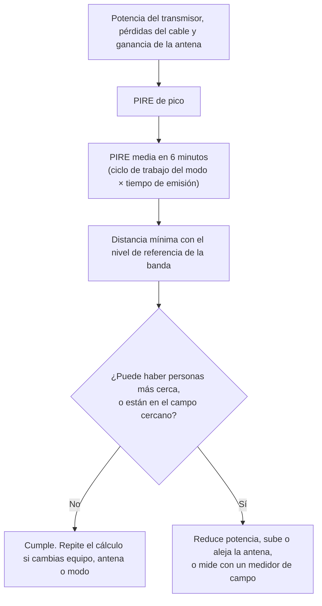

# Seguridad

En una estación de radioaficionado conviven la tensión de la red, baterías capaces de entregar cientos de amperios, antenas en lo alto de un tejado y un transmisor que emite energía hacia el entorno. Nada de eso es peligroso si sabes dónde está el riesgo. En este capítulo aprenderás qué efectos tiene la radiofrecuencia sobre el cuerpo y qué límites fija la normativa española, cómo protegerte de la corriente eléctrica, qué hacer con las antenas cuando hay tormenta, cómo montar un mástil sin accidentes y qué precauciones tomar en la mesa de soldar.

## Exposición a radiofrecuencias

### Radiación ionizante y no ionizante

La palabra *radiación* asusta porque se asocia a los rayos X o a la radiactividad. Pero no toda radiación es igual. La energía de cada fotón de una onda electromagnética es

$$
E = h \cdot f
$$

donde $E$ es la energía en julios, $h$ la constante de Planck ($6{,}626 \cdot 10^{-34}\ \text{J·s}$) y $f$ la frecuencia en hercios.

Para arrancar un electrón de un átomo y romper un enlace químico hacen falta del orden de 10 electronvoltios (eV) por fotón, una energía que solo alcanzan la luz ultravioleta de alta frecuencia, los rayos X y los rayos gamma. Esa es la **radiación ionizante**, la que puede dañar el ADN.

**Ejemplo 1.** Un fotón de la banda de 2 m, a 145 MHz, tiene una energía de

$$
E = 6{,}626 \cdot 10^{-34} \cdot 1{,}45 \cdot 10^{8} \approx 9{,}6 \cdot 10^{-26}\ \text{J} \approx 6 \cdot 10^{-7}\ \text{eV}
$$

Es decir, unos diez millones de veces menos de lo necesario para ionizar. Da igual cuántos fotones haya: ninguno tiene energía suficiente para romper un enlace. La radiofrecuencia es **radiación no ionizante**.

### Cómo actúa la radiofrecuencia sobre el cuerpo

El efecto comprobado de la radiofrecuencia es el **calentamiento**. El campo eléctrico hace oscilar las moléculas de agua y mueve los iones de los tejidos, y esa agitación se convierte en calor, igual que en un horno microondas. Si la potencia absorbida es pequeña, la circulación de la sangre reparte y elimina ese calor sin que lo notes. Si es grande, la temperatura de los tejidos sube y aparecen quemaduras, a menudo internas y sin aviso previo en la piel.

La magnitud que mide cuánta energía absorbe el cuerpo es la **tasa de absorción específica** (*SAR*, de *specific absorption rate*), en vatios por kilogramo de tejido (W/kg).

Algunas partes del cuerpo son más delicadas porque tienen poco riego sanguíneo y se refrigeran mal: los **ojos** (el cristalino) y los **testículos**.

La absorción no es igual a todas las frecuencias:

- **Por debajo de unos pocos megahercios**, el cuerpo es mucho más pequeño que la longitud de onda y absorbe poca energía.
- **Entre unos 30 y 300 MHz**, el cuerpo humano se comporta como una antena casi resonante: un adulto de pie mide del orden de media longitud de onda a esas frecuencias y absorbe energía con mucha eficacia. El máximo está hacia los 70–80 MHz para un adulto y es algo más alto para un niño, que es más pequeño.
- **Por encima de unos pocos gigahercios**, la energía se queda en la superficie de la piel y el riesgo pasa a ser de calentamiento superficial, sobre todo de los ojos.

Por eso los límites legales son más estrictos precisamente en la zona de las bandas de 6 m, 4 m y 2 m.

### Campo cercano y campo lejano

Lejos de la antena, a varias longitudes de onda, la onda está formada y los campos eléctrico y magnético guardan una relación fija. Es el **campo lejano**, y en él la densidad de potencia baja con el cuadrado de la distancia: si te alejas el doble, recibes la cuarta parte.

Cerca de la antena, a menos de una longitud de onda aproximadamente, está el **campo cercano**. Ahí los campos son irregulares, pueden ser mucho más intensos de lo que predicen las fórmulas sencillas y no basta con calcular: hay que medir o mantener las distancias con un margen amplio.

A frecuencias de HF el campo cercano es grande: a 7 MHz la longitud de onda es de unos 43 m. En VHF y UHF es pequeño: a 435 MHz, unos 70 cm.

### Potencia media y ciclo de trabajo

Los efectos térmicos dependen de la energía acumulada, no de un instante concreto. Por eso la normativa española promedia la exposición en **cualquier periodo de seis minutos** (para frecuencias entre 100 kHz y 10 GHz). Lo que cuenta es la potencia **media** en esos seis minutos, que depende de dos cosas:

- El **ciclo de trabajo del modo**: la fracción de la potencia de pico que el transmisor entrega de media mientras emite.
- El **tiempo de emisión**: qué parte de esos seis minutos estás transmitiendo y no escuchando.

| Modo | Ciclo de trabajo aproximado mientras transmites |
|---|---|
| BLU (*SSB*) en voz, sin procesador | 20 % |
| BLU en voz con procesador de voz | 30–50 % |
| Telegrafía (CW) | 40 % |
| FM, RTTY, FT8 y otros modos de amplitud constante | 100 % |
| Portadora continua (ajuste de un acoplador) | 100 % |

**Ejemplo 2.** Haces un QSO en FT8 a 30 W. El transmisor emite potencia constante durante unos 13 s de cada periodo de 15 s, y solo transmites en uno de cada dos periodos. En seis minutos, la fracción del tiempo con portadora es

$$
\frac{13}{30} \approx 0{,}43
$$

y la potencia media es $30 \cdot 0{,}43 \approx 13\ \text{W}$. Si dejas el programa llamando CQ en ambos periodos, cosa que no debes hacer, la media se duplicaría.

### PIRE y distancia de seguridad

Para estimar la exposición necesitas la potencia que la antena concentra en su dirección de máxima radiación. Es la **potencia isotrópica radiada equivalente** (**PIRE**, en inglés *EIRP*):

$$
\text{PIRE} = P_{\text{tx}} \cdot G_{\text{línea}} \cdot G_{\text{antena}}
$$

donde $P_{\text{tx}}$ es la potencia del transmisor en vatios, $G_{\text{línea}}$ la ganancia de la línea de transmisión (menor que 1, porque el cable pierde) y $G_{\text{antena}}$ la ganancia de la antena respecto a la antena isotrópica, ambas como factores, no en decibelios. Si trabajas en decibelios, sumas: PIRE en dBW = potencia en dBW − pérdidas del cable en dB + ganancia en dBi.

En campo lejano, la **densidad de potencia** $S$ a una distancia $d$ de la antena, en la dirección de máxima radiación, es

$$
S = \frac{\text{PIRE}}{4 \pi d^{2}}
$$

con $S$ en vatios por metro cuadrado (W/m²), PIRE en vatios y $d$ en metros. La intensidad de campo eléctrico correspondiente es

$$
E = \frac{\sqrt{30 \cdot \text{PIRE}}}{d}
$$

con $E$ en voltios por metro (V/m). Despejando $d$ de la primera fórmula obtienes la distancia a partir de la cual la densidad de potencia queda por debajo de un límite $S_{\text{lím}}$:

$$
d = \sqrt{\frac{\text{PIRE}}{4 \pi S_{\text{lím}}}}
$$

**Ejemplo 3.** Una emisora de 2 m entrega 40 W a una antena colineal de 7 dBi; el cable es corto y desprecias sus pérdidas. 7 dB equivalen a un factor de 5, así que la PIRE es de $40 \cdot 5 = 200\ \text{W}$. Hablas en FM y, en un turno de seis minutos, transmites la mitad del tiempo, con lo que la PIRE media es de 100 W. Como verás enseguida, el límite para el público a 145 MHz es de 2 W/m². La distancia mínima en el lóbulo principal es

$$
d = \sqrt{\frac{100}{4 \pi \cdot 2}} = \sqrt{3{,}98} \approx 2{,}0\ \text{m}
$$

Si alguien se pusiera delante con la emisora transmitiendo sin parar, la distancia sería $\sqrt{200 / 25{,}1} \approx 2{,}8\ \text{m}$. Una antena así en lo alto de un mástil de 6 m queda lejos de cualquiera; la misma antena en un balcón, a la altura de la cabeza de los vecinos, merece un cálculo cuidadoso.

!!! tip "Para el examen"
    Recuerda las tres relaciones: la densidad de potencia es proporcional a la PIRE, baja con el cuadrado de la distancia y se promedia en seis minutos. Si duplicas la distancia, la densidad de potencia queda en la cuarta parte; si duplicas la potencia, la distancia de seguridad crece por $\sqrt{2} \approx 1{,}41$, no se duplica.

### Los límites en España

Los límites de exposición del público a campos electromagnéticos están en el anexo II del [Real Decreto 1066/2001, de 28 de septiembre, por el que se aprueba el Reglamento que establece condiciones de protección del dominio público radioeléctrico, restricciones a las emisiones radioeléctricas y medidas de protección sanitaria frente a emisiones radioeléctricas](https://www.boe.es/buscar/act.php?id=BOE-A-2001-18256). Sus valores siguen la [Recomendación 1999/519/CE del Consejo, de 12 de julio de 1999](https://eur-lex.europa.eu/legal-content/ES/TXT/?uri=CELEX:31999H0519), relativa a la exposición del público en general a campos electromagnéticos.

El [Real Decreto 123/2017, de 24 de febrero, por el que se aprueba el Reglamento sobre el uso del dominio público radioeléctrico](https://www.boe.es/buscar/act.php?id=BOE-A-2017-2460), derogó buena parte del RD 1066/2001, pero dejó en vigor sus artículos 6 y 7 y el anexo II, que son los que fijan los límites. El artículo 6 exige que esos límites se cumplan en las zonas en las que puedan permanecer habitualmente personas (comprobado en noviembre de 2026).

El anexo II establece dos niveles:

- Las **restricciones básicas** son los límites de lo que de verdad importa: la energía absorbida dentro del cuerpo. Entre 100 kHz y 10 GHz se expresan como SAR: 0,08 W/kg de media en todo el cuerpo, 2 W/kg localizado en la cabeza y el tronco y 4 W/kg en las extremidades, promediados en seis minutos y, los localizados, en cualquier porción de 10 g de tejido.
- Los **niveles de referencia** son valores de campo fáciles de calcular o medir desde fuera del cuerpo. Si no se superan, se cumplen también las restricciones básicas. Si se superan, no significa necesariamente que se incumplan, pero hay que hacer una evaluación más detallada.

Estos son los niveles de referencia en las gamas donde están las bandas de aficionado ($f$ es la frecuencia en la unidad de la primera columna):

| Gama de frecuencias | Campo eléctrico $E$ (V/m) | Campo magnético $H$ (A/m) | Densidad de potencia $S$ (W/m²) |
|---|---|---|---|
| 1–10 MHz | $87 / \sqrt{f}$ | $0{,}73 / f$ | — |
| 10–400 MHz | 28 | 0,073 | 2 |
| 400–2 000 MHz | $1{,}375 \sqrt{f}$ | $0{,}0037 \sqrt{f}$ | $f / 200$ |
| 2–300 GHz | 61 | 0,16 | 10 |

Son valores eficaces y se promedian en seis minutos, como las restricciones básicas. Si consultas el PDF original del BOE de 2001, verás que la celda de $H$ entre 10 y 400 MHz dice «0,73/f»: es una errata, corregida en el [BOE núm. 91 de 2002](https://www.boe.es/buscar/doc.php?id=BOE-A-2002-7198) y en el [núm. 93](https://www.boe.es/buscar/doc.php?id=BOE-A-2002-7364). El valor vigente es 0,073 A/m.

*Figura 3.1. Nivel de referencia del campo eléctrico para el público según el anexo II del RD 1066/2001. El mínimo coincide con las frecuencias a las que el cuerpo absorbe mejor la energía.*

**Ejemplo 4.** ¿Qué nivel de referencia corresponde a la banda de 40 m, a 7,1 MHz? Está en la gama de 1 a 10 MHz:

$$
E = \frac{87}{\sqrt{7{,}1}} = \frac{87}{2{,}66} \approx 32{,}7\ \text{V/m}
$$

Y a 435 MHz, en la banda de 70 cm, la densidad de potencia de referencia es $S = 435 / 200 \approx 2{,}2\ \text{W/m}^2$, apenas un poco más permisiva que en 2 m.

??? note "Para saber más: estudios y certificados de niveles de exposición"
    El RD 123/2017 obliga a presentar un estudio previo de niveles de exposición (artículo 53) y a certificar cada año que se respetan los límites (artículo 105) a las estaciones fijas de más de 10 W de PIRE de ciertas redes públicas: radiodifusión, telefonía móvil, satélite, acceso inalámbrico y otras. Las medidas se hacen según la [Orden CTE/23/2002, de 11 de enero](https://www.boe.es/buscar/act.php?id=BOE-A-2002-694). Esos artículos no mencionan las estaciones de aficionado, y las condiciones propias de tu estación las fija la autorización y la norma específica del servicio de aficionados, que se trata en el [capítulo 9](09-reglamentacion.md). Lo que sí es seguro es que los límites del anexo II del RD 1066/2001 son los mismos para todos: que no tengas que presentar un estudio no te autoriza a superarlos.

### Cómo evaluar tu estación

*Figura 3.2. Pasos para estimar si una instalación respeta los niveles de referencia.*

Hazlo para cada banda en la que transmitas, con la antena y la potencia que uses realmente. Fíjate sobre todo en los lugares a los que llega el lóbulo principal de la antena: la ventana del vecino, la terraza de enfrente, el jardín.

### Cómo reducir la exposición

- **Usa la potencia mínima** que permita el contacto. Bajar de 100 W a 25 W divide por cuatro la densidad de potencia en cualquier punto.
- **Aleja la antena de las personas.** Ponla alta y fuera de las zonas de paso. Ganar distancia es la medida más eficaz, porque la densidad de potencia baja con el cuadrado.
- **No dirijas una antena directiva hacia zonas ocupadas**, y menos a poca distancia.
- **Con un portátil de mano**, sostén el equipo con la antena vertical y a unos centímetros de la cara, sin acercarla a los ojos. Si tienes que transmitir mucho rato, usa un micrófono externo y aleja el equipo del cuerpo. En un coche, monta la antena en el techo, fuera del habitáculo.
- **Nunca toques una antena ni su línea abierta mientras se transmite.** Aunque la potencia media sea moderada, en los extremos de una antena hay tensiones de RF altas que producen quemaduras dolorosas, profundas y lentas de curar.
- **Vigila las bandas de VHF bajas**, donde el cuerpo absorbe mejor la energía, y los amplificadores: con ellos los números cambian por completo.

!!! danger "Peligro"
    Una guía de ondas o una antena de microondas abiertas mientras el equipo transmite pueden lesionar los ojos en poco tiempo, sin que notes dolor ni calor. No mires nunca dentro de una guía, ni al frente de una antena parabólica o de bocina, si hay un transmisor conectado.

## Riesgo eléctrico

### Efectos de la corriente en el cuerpo

Lo que daña no es la tensión, sino la **corriente** que atraviesa el cuerpo. La tensión importa porque es la que empuja esa corriente a través de la resistencia de la piel y los tejidos. La referencia técnica internacional sobre los efectos de la corriente en el cuerpo humano es la norma **IEC 60479-1**. De ella proceden, redondeados, los umbrales de esta tabla para corriente alterna de 50 Hz entre una mano y los pies:

| Corriente | Efecto habitual |
|---|---|
| alrededor de 1 mA | Umbral de percepción: un cosquilleo. |
| alrededor de 10 mA | Los músculos se contraen y la mano ya no puede soltar el conductor. |
| a partir de unos 30 mA | Dificultad para respirar; peligro grave si dura. |
| a partir de unos 50–100 mA | Riesgo de **fibrilación ventricular**: el corazón deja de bombear. |

La gravedad depende también del **tiempo** que dure el paso de corriente y del **camino**: la corriente que pasa de una mano a la otra o de la mano a los pies atraviesa el tórax y el corazón.

La resistencia del cuerpo cambia mucho. Con la piel seca puede ser de varios kilohmios; con la piel mojada, sudada o si el contacto es amplio, puede bajar a alrededor de 1 kΩ.

**Ejemplo 5.** Tocas la fase de la red con la mano mojada mientras estás descalzo sobre un suelo húmedo, y la resistencia total del camino es de 1 300 Ω. La corriente es

$$
I = \frac{230\ \text{V}}{1\,300\ \Omega} \approx 0{,}18\ \text{A} = 180\ \text{mA}
$$

Muy por encima del umbral de fibrilación. Con la misma red y la piel seca, calzado aislante y suelo seco, la resistencia podría ser diez veces mayor y la corriente, diez veces menor. Por eso nunca se trabaja en instalaciones eléctricas con los pies mojados.

Recuerda además que los 230 V de la red son un valor eficaz: el valor de pico es de unos 325 V, como viste en el [capítulo 2](02-electricidad-electronica.md).

### La instalación eléctrica de la estación

Las instalaciones eléctricas de las viviendas se rigen en España por el [Real Decreto 842/2002, de 2 de agosto, por el que se aprueba el Reglamento electrotécnico para baja tensión](https://www.boe.es/buscar/act.php?id=BOE-A-2002-18099) (REBT). Las modificaciones del cuadro eléctrico o de la instalación fija las debe hacer un instalador autorizado. Lo que sí debes conocer son las protecciones:

- El **interruptor magnetotérmico** (o automático) corta cuando la corriente supera la que aguanta el cable del circuito, por una sobrecarga o un cortocircuito. Protege los **cables**, no a las personas.
- El **interruptor diferencial** compara la corriente que sale por la fase con la que vuelve por el neutro. Si no son iguales, es que una parte se va por otro camino (por ejemplo, a tierra a través de una persona) y corta en unas decenas de milisegundos. Los de **alta sensibilidad**, de 30 mA, son los que protegen a las personas. La instrucción ITC-BT-25 del REBT, sobre instalaciones interiores en viviendas, exige que todos los circuitos de una vivienda estén protegidos por diferenciales de 30 mA como máximo (apartado 2.1), con al menos un diferencial por cada cinco circuitos (apartado 2.3.2) (comprobado en noviembre de 2026). Pulsa su botón de prueba de vez en cuando.
- La **toma de tierra** une las carcasas metálicas de los aparatos con el terreno. Si un cable suelto toca la carcasa, la corriente se va a tierra, el diferencial lo detecta y corta, en lugar de esperar a que alguien toque el chasis.

En los cables de la red, el conductor de protección (tierra) es el **amarillo y verde**, el neutro es el **azul** y la fase va en **marrón, negro o gris**.

!!! danger "Peligro"
    No anules nunca la toma de tierra: ni enchufes un equipo con clavija de tierra en un ladrón sin ella, ni cortes el conductor amarillo y verde para quitar un zumbido o una interferencia. Si tienes un problema de ruido o de RF en la estación, la solución está en el [capítulo 8](08-interferencias.md), no en quitar la protección.

### Fuentes de alimentación y condensadores

Dentro de una fuente de alimentación hay tensión de red en el primario y, en las fuentes conmutadas, condensadores cargados a más de 300 V de continua. Un **condensador** puede conservar su carga minutos u horas después de desenchufar el aparato.

- Desenchufa el aparato de la red antes de abrirlo; no te fíes del interruptor.
- Espera y **descarga los condensadores grandes** a través de una resistencia de valor adecuado (por ejemplo, unos kilohmios y varios vatios), nunca con un destornillador en cortocircuito, que produce una chispa capaz de soldar la punta y dañar el condensador.
- Comprueba con el polímetro que no queda tensión antes de tocar.
- Trabaja con una sola mano cuando sea posible y la otra lejos del chasis, para que una descarga no te cruce el pecho.

Para medir el consumo de un aparato de red no necesitas abrir nada: una **pinza amperimétrica** rodea uno solo de los conductores y mide la corriente por el campo magnético que crea, sin contacto eléctrico. Si la cierras sobre el cable completo, la fase y el neutro anulan sus campos y lee cero.

### Baterías

Una batería de 12 V parece inofensiva porque esa tensión no atraviesa la piel. El peligro está en la **corriente de cortocircuito**: una batería de plomo de coche puede dar cientos de amperios. Una llave inglesa que toque los dos bornes se pone al rojo, y un anillo o una pulsera metálica pueden provocar una quemadura grave.

- **Pon un fusible en el positivo, lo más cerca posible de la batería**, de forma que un cable pelado en cualquier punto quede protegido. En una instalación móvil, lleva los dos conductores directamente a la batería con un fusible en cada uno, como indican la mayoría de los fabricantes de emisoras.
- Elige la sección del cable según la corriente y según la **caída de tensión**. A 12 V no basta con que el cable no se caliente: unas décimas de voltio perdidas en el cable son una parte apreciable de la alimentación, y muchas emisoras distorsionan o se reinician al transmitir si la tensión baja demasiado. Por ejemplo, con 20 A y 3 m de cable de ida y otros 3 m de vuelta, la resistencia del cobre ($\rho \approx 0{,}0172\ \Omega\cdot\text{mm}^2/\text{m}$) da una caída de unos 0,5 V con 4 mm² y de unos 0,34 V con 6 mm². Cuanto más largo sea el tramo, más sección necesitas.
- Quítate anillos y relojes metálicos antes de trabajar en los bornes.
- Las baterías de **plomo** desprenden hidrógeno al cargarse, que es explosivo: cárgalas en un lugar ventilado y sin chispas cerca. Su electrolito es ácido sulfúrico, que quema la piel y los ojos.
- Las baterías de **litio** (iones de litio y polímero de litio) pueden incendiarse si se perforan, se cortocircuitan, se sobrecargan o se cargan con un cargador inadecuado, y ese fuego es difícil de apagar. Las de litio-ferrofosfato (LiFePO₄), muy usadas en portable, son bastante más estables, pero también necesitan su cargador y su sistema de gestión. No cargues ninguna sin vigilancia ni sobre superficies inflamables.

!!! example "En la práctica"
    En la mesa de la estación, monta un único interruptor general (por ejemplo, una regleta con interruptor y toma de tierra) que corte la alimentación de todos los equipos. Si algo humea o alguien recibe una descarga, cualquier persona de la casa debe saber dónde está y poder cortarlo sin tocar los equipos. Si una persona queda pegada a un conductor, **no la toques**: corta primero la corriente y, si no puedes, sepárala con un objeto aislante y seco. Luego llama al 112.

## Antenas y rayos

Una antena exterior es el punto más alto de su entorno y un buen camino hacia tierra para un rayo. Un impacto directo libera una energía que ninguna instalación de aficionado puede absorber sin daños; pero lo más frecuente no es el impacto directo, sino las **sobretensiones inducidas** por rayos que caen cerca, que entran en casa por el cable coaxial y por la red eléctrica y destruyen los equipos.

### Antes y durante la tormenta

- **No operes con tormenta cerca.** Si oyes truenos, el rayo está a una distancia a la que puede alcanzarte.
- **Desconecta las antenas de los equipos** y deja los conectores fuera, lejos del equipo y de la mesa, o conectados a una toma de tierra. Desenchufa también la alimentación de la red: un interruptor abierto no basta frente a una sobretensión, porque el rayo salta los pocos milímetros de sus contactos.
- No te acerques al mástil, a los vientos ni a los cables de bajada durante la tormenta.
- Desenchufa también la red y el router si los equipos están conectados al ordenador.

### Puesta a tierra de la instalación de antena

- **Une el mástil a tierra** con un conductor grueso por el camino más corto y recto posible, sin curvas cerradas: la corriente de un rayo sube muy rápido y una curva cerrada se comporta como una bobina que la frena y la desvía.
- **Pon a tierra la malla del coaxial** a la entrada del edificio y, si es posible, intercala un **protector de sobretensiones coaxial** (con descargador de gas) unido a esa tierra.
- **Todas las tierras deben estar unidas.** La tierra de la antena y la de la instalación eléctrica del edificio tienen que conectarse entre sí. Si están separadas, durante una descarga aparece una diferencia de tensión enorme entre ellas, y esa diferencia pasa por el equipo que tienes conectado a ambas. Las instalaciones de puesta a tierra de los edificios están reguladas por el REBT, en su instrucción ITC-BT-18; pide a un instalador que haga esa unión.
- En un edificio de viviendas, la cubierta es un elemento común: necesitas la conformidad de la comunidad y respetar el pararrayos y la antena colectiva existentes.

La tierra de protección contra rayos no es lo mismo que la tierra de RF de la estación, aunque estén unidas. La segunda sirve para reducir interferencias y corrientes de RF en la mesa, y se trata en el [capítulo 8](08-interferencias.md).

## Mástiles, torres y trabajo en altura

La causa de muchos accidentes graves de radioaficionados no es la electricidad ni la RF, sino una caída o un mástil que se viene abajo.

### Líneas eléctricas

!!! danger "Peligro"
    Nunca montes una antena ni un mástil donde, al caer o al levantarlo, pueda tocar una línea eléctrica aérea. Las líneas de distribución tienen tensiones de miles de voltios y el arco puede saltar sin contacto directo. Como regla mínima, la distancia horizontal a la línea debe ser mayor que la altura total del mástil con la antena, más un margen amplio. Si una antena toca una línea, aléjate y llama a la compañía eléctrica o al 112; no intentes retirarla.

### Montaje del mástil

- **Planifica antes de subir.** Decide dónde irán los anclajes, cómo se levantará el mástil y quién hará cada cosa.
- **No trabajes nunca solo.** Hace falta al menos una persona en el suelo que pueda pasarte herramientas y pedir ayuda.
- Usa **arnés anticaídas** anclado a un punto resistente siempre que trabajes en un tejado o en una torre, y comprueba antes su estado. Un cinturón de herramientas no es un arnés.
- Quien esté abajo debe llevar **casco** y mantenerse fuera de la vertical de trabajo. Ata las herramientas o súbelas en una bolsa con una cuerda; una llave que cae desde 10 m puede matar.
- Asegura el mástil con **vientos** (riendas) en al menos tres direcciones, separadas unos 120°, con tensores y anclajes calculados para el esfuerzo. El viento empuja con mucha fuerza sobre una antena directiva grande: el anclaje en una chimenea o en un muro viejo puede no aguantarlo.
- No subas con viento, lluvia, hielo ni tormenta, ni con cansancio. Una escalera de mano debe apoyarse estable y sobresalir del borde del tejado.
- Al bajar una antena para revisarla, **desconecta antes el transmisor**: que nadie transmita mientras estás junto a ella.

## Soldadura y sustancias peligrosas

### En la mesa de soldar

- El soldador alcanza entre 300 y 400 °C. Déjalo siempre en su **soporte** y desenchúfalo al terminar.
- **Protégete los ojos.** Al cortar las patas de los componentes, al desoldar o al sacudir el estaño, una gota o un trozo de alambre pueden saltar a la cara.
- El humo que sale al soldar no es de estaño, sino del **fundente** (colofonia), que irrita las vías respiratorias y puede producir asma con la exposición repetida. **Ventila** y usa un extractor con filtro o, al menos, un ventilador que aleje el humo de tu cara.
- El **estaño con plomo** sigue siendo habitual en el taller de aficionado porque funde a menor temperatura. El plomo entra al cuerpo sobre todo por la boca: **no comas ni bebas** en la mesa de trabajo y **lávate las manos** al terminar. Las aleaciones sin plomo evitan este problema, aunque necesitan algo más de temperatura.
- Trabaja siempre con el circuito **sin alimentación**.

### Otras sustancias

- Algunos transistores de potencia de RF antiguos y ciertas piezas cerámicas contienen **óxido de berilio**, cuyo polvo es muy tóxico si se inhala. No los rompas, limes ni lijes; deséchalos intactos en un punto limpio.
- El **cloruro férrico** y otros productos para atacar placas de circuito impreso son corrosivos: usa guantes y gafas y no los tires por el desagüe.
- Lleva las **baterías** y los equipos electrónicos viejos a un punto limpio o a los contenedores de las tiendas; nunca a la basura.

## Resumen

- La radiofrecuencia es **radiación no ionizante**: su efecto comprobado es el **calentamiento** de los tejidos, que se mide con la tasa de absorción específica (SAR) en W/kg.
- El cuerpo absorbe más entre unos 30 y 300 MHz; por eso los niveles de referencia más estrictos están entre **10 y 400 MHz**: 28 V/m o 2 W/m².
- Los límites aplicables en España son los del **anexo II del RD 1066/2001**, que sigue en vigor tras el RD 123/2017. Se promedian en **seis minutos** y deben cumplirse donde puedan permanecer personas.
- La densidad de potencia en campo lejano es $S = \text{PIRE} / (4 \pi d^2)$: baja con el **cuadrado de la distancia**. En campo cercano hay que dejar un margen o medir.
- Para reducir la exposición: menos potencia, antena más lejos y más alta, y nunca tocar una antena que transmite.
- Daña la **corriente**: de unos 50–100 mA a 50 Hz a través del pecho pueden provocar fibrilación. El **diferencial** de 30 mA protege a las personas; el **magnetotérmico**, los cables; la **toma de tierra** da salida a las fugas.
- Los condensadores guardan su carga después de desenchufar; las baterías dan corrientes de cortocircuito enormes: **fusible en el positivo, junto a la batería**.
- Con tormenta, **no operes y desconecta** antenas y alimentación. Pon a tierra el mástil y el coaxial y **une todas las tierras**.
- Lejos de las **líneas eléctricas**, nunca solo, con arnés y casco.
- Al soldar: soporte, gafas, ventilación y manos limpias.

## Autoevaluación

**1.** ¿Por qué se dice que la radiofrecuencia de las bandas de aficionado es una radiación no ionizante?

a) Porque su potencia es demasiado baja.  
b) Porque la energía de cada fotón es muy inferior a la necesaria para arrancar electrones de los átomos.  
c) Porque las ondas de radio no atraviesan la piel.  
d) Porque solo se emite durante periodos cortos.

??? success "Solución"
    **b)** La capacidad de ionizar depende de la energía de cada fotón, $E = h f$, que a las frecuencias de radio es millones de veces menor que la necesaria. Aumentar la potencia añade más fotones, pero ninguno es capaz de ionizar; por eso la a) es falsa. La c) también lo es: la RF penetra en los tejidos, y por eso los calienta.

**2.** Un transmisor de 25 W alimenta, a través de un cable con 3 dB de pérdidas, una antena de 6 dBi. ¿Cuál es la PIRE?

a) 12,5 W  
b) 25 W  
c) 50 W  
d) 100 W

??? success "Solución"
    **c)** En decibelios, el sistema tiene $-3 + 6 = +3\ \text{dB}$ respecto a la salida del transmisor. 3 dB equivalen a multiplicar por 2, así que la PIRE es $25 \cdot 2 = 50\ \text{W}$. La a) olvida la ganancia de la antena y la d) olvida las pérdidas del cable.

**3.** ¿En qué gama de frecuencias son más bajos los niveles de referencia de campo eléctrico del RD 1066/2001?

a) Entre 1 y 10 MHz  
b) Entre 10 y 400 MHz  
c) Entre 400 y 2 000 MHz  
d) Por encima de 2 GHz

??? success "Solución"
    **b)** Entre 10 y 400 MHz el nivel de referencia es de 28 V/m, el mínimo de toda la gama de radio. Es la zona en la que el cuerpo humano se comporta como una antena casi resonante y absorbe mejor la energía.

**4.** Una estación de 70 cm, a 435 MHz, tiene una PIRE media en seis minutos de 50 W. ¿A partir de qué distancia aproximada, en la dirección de máxima radiación, la densidad de potencia queda por debajo del nivel de referencia?

a) 0,5 m  
b) 1,35 m  
c) 2,7 m  
d) 5,4 m

??? success "Solución"
    **b)** A 435 MHz el nivel de referencia es $S = 435 / 200 \approx 2{,}18\ \text{W/m}^2$. Entonces $d = \sqrt{50 / (4 \pi \cdot 2{,}18)} = \sqrt{50 / 27{,}4} \approx \sqrt{1{,}83} \approx 1{,}35\ \text{m}$. La c) es el doble de la distancia correcta, que corresponde a cuadruplicar la PIRE, no a duplicarla.

**5.** Si te alejas de una antena al triple de distancia, en campo lejano, ¿cómo cambia la densidad de potencia que recibes?

a) Se divide por 3.  
b) Se divide por 6.  
c) Se divide por 9.  
d) No cambia, porque depende solo de la PIRE.

??? success "Solución"
    **c)** La densidad de potencia es inversamente proporcional al cuadrado de la distancia: $3^2 = 9$. El campo eléctrico, en cambio, se divide solo por 3, porque es proporcional a $1/d$.

**6.** ¿Qué detecta un interruptor diferencial?

a) Que la corriente del circuito supera la que admite el cable.  
b) Que la tensión de la red sube por encima de 230 V.  
c) Que la corriente que sale por la fase no es igual a la que vuelve por el neutro.  
d) Que el aparato no tiene toma de tierra.

??? success "Solución"
    **c)** Si una parte de la corriente se va por otro camino, por ejemplo a tierra a través de una persona, la fase y el neutro dejan de llevar la misma corriente y el diferencial corta. La a) describe el magnetotérmico, que protege los cables pero no a las personas.

**7.** Una persona con las manos mojadas toca un conductor de 230 V, y la resistencia total del camino que sigue la corriente es de 1 150 Ω. ¿Qué corriente la atraviesa y qué riesgo supone?

a) 2 mA; apenas se percibe.  
b) 20 mA; no puede soltar el conductor, pero no hay riesgo vital.  
c) 200 mA; riesgo de fibrilación ventricular.  
d) 2 A; solo produce quemaduras en la piel.

??? success "Solución"
    **c)** $I = 230 / 1\,150 = 0{,}2\ \text{A} = 200\ \text{mA}$, por encima del umbral de fibrilación, que está en torno a 50–100 mA. Es el motivo por el que se insiste en no trabajar con la red con la piel o el suelo mojados.

**8.** Vas a alimentar una emisora en el coche directamente desde la batería. ¿Dónde pones el fusible del positivo?

a) Junto a la emisora, para poder cambiarlo con facilidad.  
b) En el centro del cable, para que quede a la misma distancia de ambos extremos.  
c) Lo más cerca posible de la batería.  
d) No hace falta, porque la emisora ya lleva su propio fusible.

??? success "Solución"
    **c)** El fusible protege el cable que queda detrás de él. Si está junto a la batería, un roce que pele el cable en cualquier punto del recorrido funde el fusible. Si está junto a la emisora, todo el tramo entre la batería y el fusible queda sin protección frente a un cortocircuito, que podría incendiar el coche.

**9.** Quieres instalar un mástil de 9 m con una antena directiva en un terreno por el que pasa una línea eléctrica aérea. ¿Qué condición mínima debe cumplir su ubicación?

a) Que el mástil quede a más de 3 m de la línea.  
b) Que la línea quede por encima de la antena.  
c) Que la distancia horizontal a la línea sea mayor que la altura total del mástil con la antena, con un margen amplio.  
d) Que el mástil esté puesto a tierra.

??? success "Solución"
    **c)** Lo que hay que evitar es que el mástil o la antena puedan tocar la línea al levantarlos o si se caen, y eso depende de su altura total. La puesta a tierra de la d) es necesaria por otros motivos, pero no evita la electrocución si el mástil cae sobre una línea de alta tensión.

**10.** Se acerca una tormenta. ¿Cuál es la medida más eficaz para proteger los equipos de la estación?

a) Apagar los equipos con su interruptor.  
b) Desconectar los cables de antena y desenchufar la alimentación de la red.  
c) Bajar la potencia del transmisor al mínimo.  
d) Conectar una carga artificial a la salida del transmisor.

??? success "Solución"
    **b)** Las sobretensiones entran por el coaxial y por la red. Un interruptor abierto deja una separación de pocos milímetros, que una descarga salta con facilidad; solo la desconexión física aleja el camino del rayo de los equipos.
