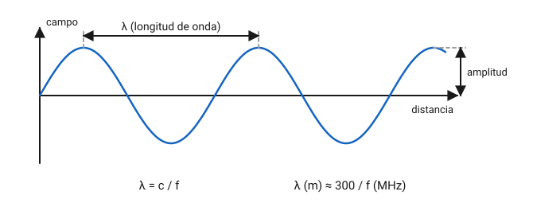
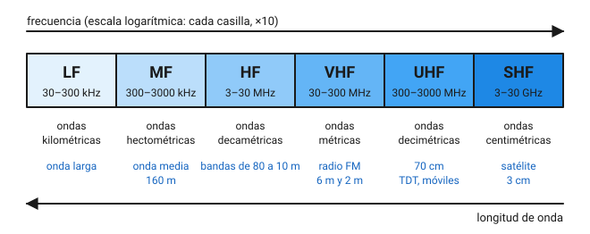
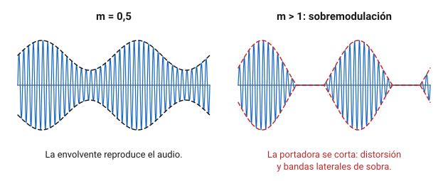
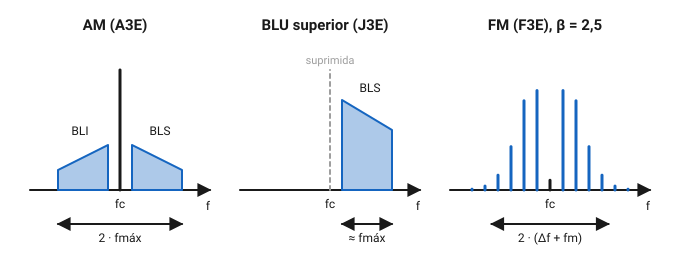
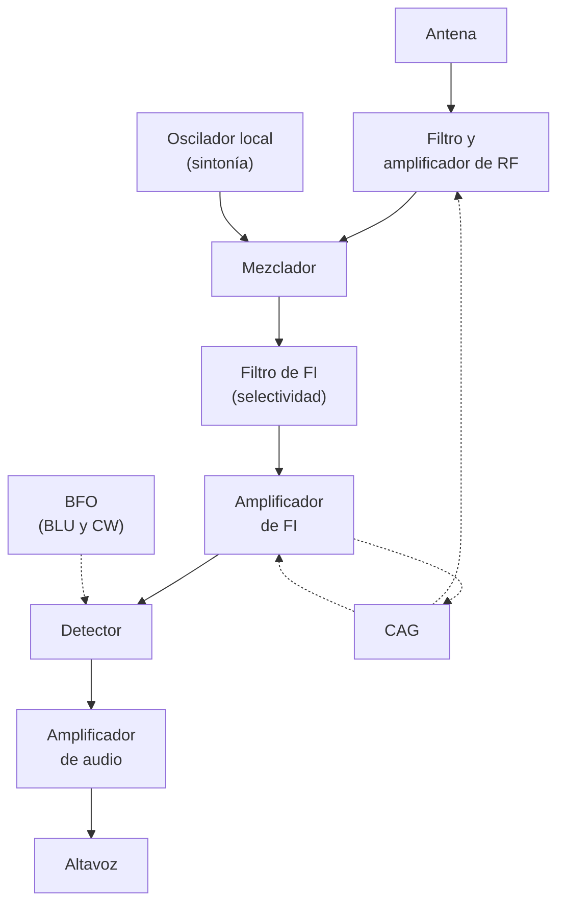
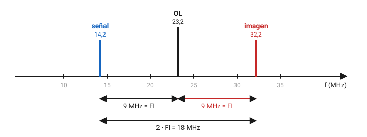
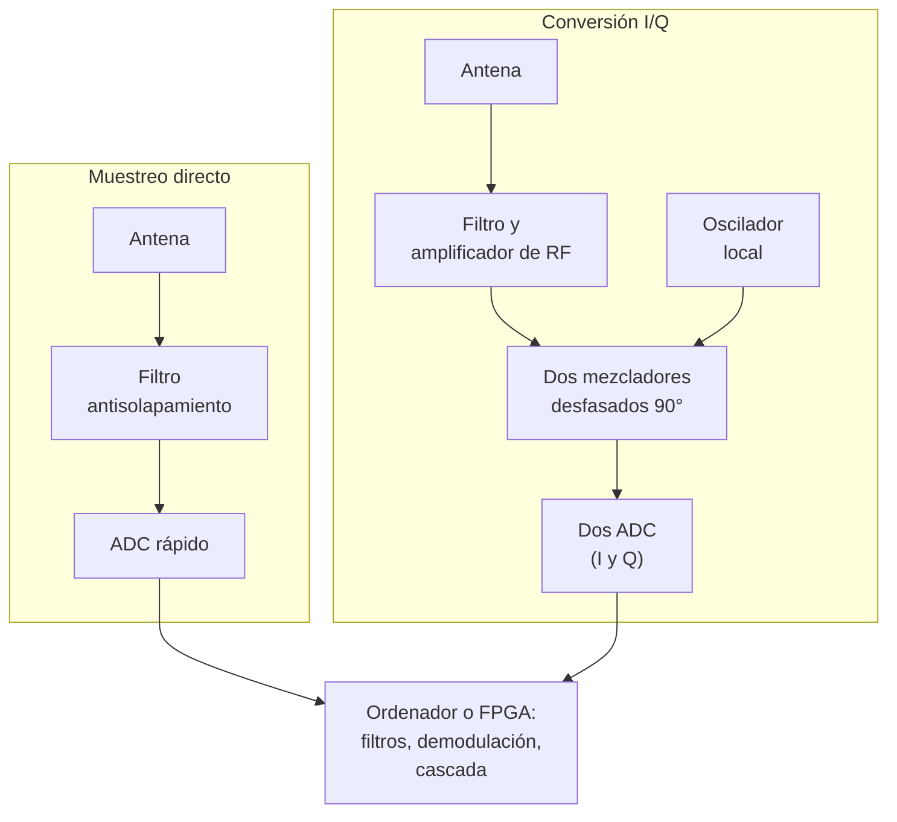
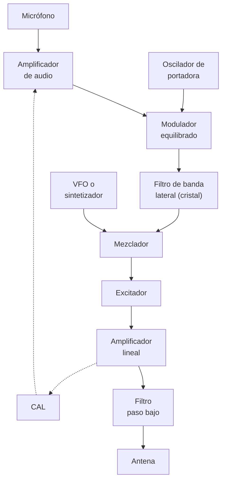
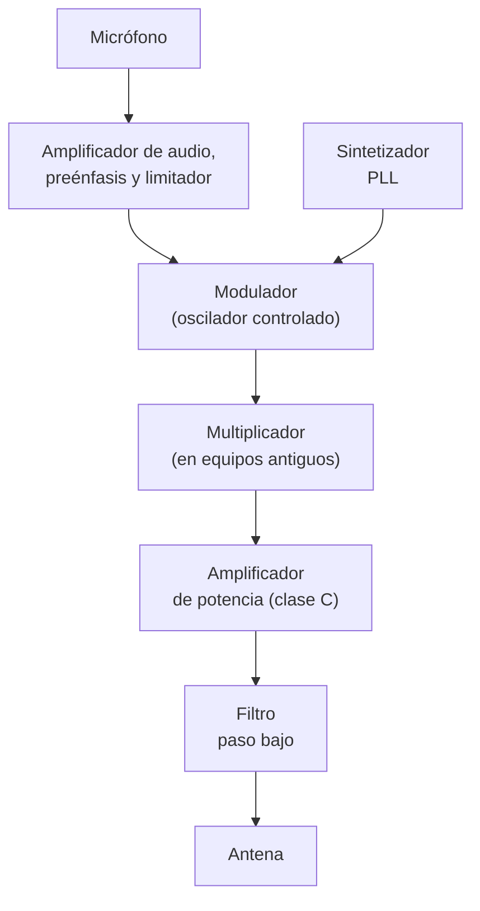

# Teoría de radio

Hablar por radio consiste en subir la voz, el Morse o unos datos a una onda de alta frecuencia, enviarla por el aire y recuperar la información en el otro extremo. En este capítulo aprenderás qué es una onda de radio y cómo se relacionan su frecuencia y su longitud de onda, cómo funcionan las modulaciones que vas a usar (CW, AM, BLU, FM y las digitales) y cómo las nombra la UIT, y qué hay dentro de un receptor, de un receptor definido por software (SDR) y de un transmisor. Con esto entenderás los mandos de tu equipo y sabrás por qué una señal suena limpia o molesta a los demás.

## Ondas de radio

### Qué es una onda electromagnética

Cuando una corriente alterna recorre un conductor, crea a su alrededor un campo eléctrico y un campo magnético que cambian al ritmo de la corriente. Si la frecuencia es suficientemente alta, esos campos se desprenden del conductor y viajan por el espacio: es una **onda electromagnética**. El conductor preparado para lanzarlas o captarlas es la **antena**.

Los dos campos son perpendiculares entre sí y a la dirección de avance. En el vacío, y casi igual en el aire, la onda viaja a la **velocidad de la luz**, $c \approx 3 \cdot 10^{8}\ \text{m/s}$, es decir, 300 000 km por segundo. La luz, el calor que notas al sol y las ondas de radio son el mismo fenómeno; solo cambia la frecuencia.

### Frecuencia, periodo y longitud de onda

La **frecuencia** $f$ es el número de ciclos completos por segundo y se mide en hercios (Hz). El **periodo** $T$ es lo que dura un ciclo:

$$
T = \frac{1}{f}
$$

con $T$ en segundos y $f$ en hercios. Una señal de 10 MHz repite su ciclo cada $1 / 10^{7} = 10^{-7}\ \text{s}$, es decir, cada 100 ns.

Mientras dura un ciclo, la onda avanza una distancia fija. Esa distancia, que es la que separa dos crestas consecutivas, es la **longitud de onda** $\lambda$ (la letra griega lambda):

$$
\lambda = \frac{c}{f}
$$

donde $\lambda$ va en metros, $c$ en metros por segundo y $f$ en hercios. Como en radio casi siempre se trabaja en megahercios, conviene la versión práctica:

$$
\lambda\,(\text{m}) \approx \frac{300}{f\,(\text{MHz})}
$$

*Figura 4.1. La longitud de onda es lo que avanza la onda durante un ciclo.*

**Ejemplo.** En 50,2 MHz la longitud de onda es $\lambda = 300 / 50{,}2 \approx 5{,}98\ \text{m}$. Por eso a esa banda se la llama «de 6 metros». Con el valor exacto de $c$ saldría 5,97 m; para el examen y para cortar antenas basta con 300.

**Ejemplo inverso.** Si una antena está pensada para una longitud de onda de 2,05 m, su frecuencia es $f = 300 / 2{,}05 \approx 146{,}3\ \text{MHz}$, dentro de la banda de 2 m.

Las bandas de radioaficionado se nombran por su longitud de onda aproximada: 80 m, 40 m, 20 m, 2 m, 70 cm. Cuanto más alta es la frecuencia, más corta es la onda y más pequeña la antena.

!!! tip "Para el examen"
    Frecuencia y longitud de onda son **inversamente proporcionales**: si una se duplica, la otra se reduce a la mitad. Recuerda la constante 300 con la frecuencia en MHz y comprueba siempre el resultado con una banda conocida: 7 MHz son unos 40 m; 145 MHz, unos 2 m.

### El espectro radioeléctrico

El conjunto de frecuencias que se usan para radiocomunicaciones es el **espectro radioeléctrico**. El artículo 2 del [Reglamento de Radiocomunicaciones de la UIT](https://www.itu.int/pub/R-REG-RR) (edición de 2024, comprobado en noviembre de 2026) lo divide en bandas que van de diez en diez: cada una empieza donde acaba la anterior y llega a una frecuencia diez veces mayor. Cada banda tiene un símbolo en inglés y un nombre métrico en español, según el tamaño de sus ondas.

*Figura 4.2. Bandas de la nomenclatura de la UIT que más te interesan, según el artículo 2 del Reglamento de Radiocomunicaciones (comprobado en noviembre de 2026). El límite inferior de cada banda queda fuera y el superior, dentro.*

Las que más vas a usar son la **HF** (*high frequency*, 3 a 30 MHz, ondas decamétricas), donde están las bandas que permiten contactos a miles de kilómetros, y la **VHF** (*very high frequency*) y la **UHF** (*ultra high frequency*), de 30 a 3 000 MHz,, donde operan los portátiles y los repetidores. La propagación de cada una se estudia en el capítulo 5.

## Información, ruido y ancho de banda

### Portadora y modulación

Una onda pura, siempre igual, no lleva información. Para transmitir algo hay que variar alguna de sus características al ritmo de la señal que queremos enviar. Esa onda de alta frecuencia se llama **portadora**, la señal que se le imprime (la voz del micrófono, los datos) es la **señal moduladora** o de **banda base**, y el proceso es la **modulación**. La operación inversa, que hace el receptor, es la **demodulación** o **detección**.

Una senoide solo tiene tres cosas que se puedan variar:

- La **amplitud**: modulación de amplitud (AM) y sus derivadas, como la BLU.
- La **frecuencia**: modulación de frecuencia (FM).
- La **fase**: modulación de fase (PM), muy parecida a la FM.

Las modulaciones digitales combinan esas mismas variaciones, pero con un número fijo de estados.

### Ancho de banda

Al modular una portadora aparecen nuevas frecuencias a su alrededor, las **bandas laterales**. El margen de frecuencias que ocupa la emisión es su **ancho de banda**. El Reglamento de Radiocomunicaciones define en su número 1.152 la **anchura de banda necesaria**: la estrictamente suficiente para transmitir la información con la velocidad y la calidad requeridas (comprobado en noviembre de 2026).

El ancho de banda importa por dos motivos. El primero es que el espectro es compartido: cuanto menos ocupa cada emisión, más estaciones caben en una banda. El segundo es el ruido, que se explica a continuación.

### Ruido y relación señal/ruido

Además de la señal, a la antena llega **ruido**: el de la atmósfera y las tormentas lejanas, el de los aparatos eléctricos del vecindario y el que generan los propios componentes del receptor. Lo que decide si entiendes o no una señal es la **relación señal/ruido** (S/R o *SNR*), que se expresa en decibelios.

**Ejemplo.** Si en la entrada del receptor la señal tiene 2 µV y el ruido 0,5 µV, la relación de tensiones es 4 y la relación señal/ruido vale $20 \log 4 \approx 12\ \text{dB}$.

El ruido se reparte por todas las frecuencias, así que un filtro más estrecho deja pasar menos ruido. La potencia de ruido es proporcional al ancho de banda: si en CW cambias un filtro de 2,4 kHz por uno de 500 Hz, el ruido baja en $10 \log (2\,400 / 500) \approx 6{,}8\ \text{dB}$ y la señal, que cabe entera en el filtro estrecho, no pierde nada. Por eso las modulaciones estrechas llegan más lejos con la misma potencia.

## Modulaciones

### Onda continua (CW)

La forma más sencilla de enviar información es encender y apagar la portadora siguiendo el código Morse. Es la **telegrafía** u **onda continua** (*CW*, *continuous wave*). Ocupa muy poco, unos cientos de hercios como mucho, y se entiende con señales débiles. La estudiarás en el capítulo 11.

Para oírla, el receptor mezcla la portadora recibida con un oscilador propio, el **oscilador de batido** (*BFO*, *beat frequency oscillator*), ligeramente desplazado. La diferencia entre las dos frecuencias, por ejemplo 600 Hz, sale como un pitido audible.

Si la portadora se enciende y se apaga de golpe, aparecen bandas laterales muy anchas que se oyen como chasquidos en las frecuencias vecinas: son los **clics de manipulación**. Los transmisores bien diseñados suavizan los flancos de cada pulso durante unos milisegundos para evitarlos.

### Modulación de amplitud (AM)

En **AM** la amplitud de la portadora sigue a la señal de audio. Su **envolvente**, la curva que une los picos, tiene la misma forma que el audio, y eso es lo que recupera un detector muy sencillo, el de diodo.

La profundidad de la modulación se mide con el **índice de modulación** $m$, que va de 0 (portadora sin modular) a 1 (la envolvente baja justo hasta cero). Si el audio es tan fuerte que $m$ supera 1, hay **sobremodulación**: la portadora se anula durante parte del ciclo, el audio sale distorsionado y la emisión se ensancha y salpica a las frecuencias vecinas (*splatter*).

*Figura 4.3. Modulación correcta y sobremodulación.*

Al modular en AM con un tono de frecuencia $f_m$ aparecen dos bandas laterales, una por encima y otra por debajo de la portadora $f_c$, en $f_c + f_m$ y $f_c - f_m$. Con voz, cada tono del audio produce su pareja de rayas, y el resultado son dos bandas laterales simétricas. El ancho de banda es el doble de la frecuencia de audio más alta:

$$
B_{\text{AM}} = 2 \cdot f_{\text{máx}}
$$

**Ejemplo.** Una portadora de 7 120 kHz modulada con audio de hasta 3,4 kHz ocupa $2 \cdot 3{,}4 = 6{,}8\ \text{kHz}$, de 7 116,6 a 7 123,4 kHz.

La AM desperdicia potencia. La portadora no lleva información y, sin embargo, se queda con la mayor parte. Con una portadora de potencia $P_c$, la potencia total es

$$
P_{\text{total}} = P_c \left(1 + \frac{m^2}{2}\right)
$$

y las dos bandas laterales juntas se llevan $P_c \cdot m^2 / 2$.

**Ejemplo.** Con una portadora de 40 W y $m = 1$, la emisión total tiene $40 \cdot 1{,}5 = 60\ \text{W}$, de los que cada banda lateral se lleva 10 W. Con $m = 0{,}6$, más habitual con voz, las dos bandas laterales suman solo $40 \cdot 0{,}36 / 2 = 7{,}2\ \text{W}$ de un total de 47,2 W.

### Banda lateral única (BLU)

Las dos bandas laterales de la AM llevan exactamente la misma información, y la portadora no lleva ninguna. La **banda lateral única** (**BLU**, en inglés *SSB*, de *single sideband*) elimina la portadora y una de las dos bandas. Se queda con la **banda lateral superior** (*USB*, *upper sideband*) o con la **inferior** (*LSB*, *lower sideband*).

Las ventajas son grandes:

- Ocupa la mitad que la AM, unos 2,5 kHz para voz.
- Toda la potencia del transmisor va a la información.
- Al no haber portadora, el transmisor apenas emite en las pausas de la voz.

A cambio, el receptor tiene que reponer la portadora con su BFO, y si no está bien sintonizado la voz suena aguda o grave, como de pato. Para eso sirve el mando de sintonía fina.

**Ejemplo.** Si sintonizas 14 250 kHz en USB y el audio va de 300 a 2 800 Hz, la emisión ocupa de 14 250,3 a 14 252,8 kHz, todo por encima de la frecuencia que marca el equipo. En LSB, en 3 690 kHz, ocuparía de 3 687,2 a 3 689,7 kHz, todo por debajo.

Por costumbre, en HF se usa LSB por debajo de 10 MHz (bandas de 160, 80 y 40 m) y USB por encima (20 m y superiores), y también en VHF y UHF. La excepción es la banda de 60 m, en 5 MHz: aunque está por debajo de 10 MHz, en ella se usa USB. Así lo recomienda el plan de bandas de HF de la IARU Región 1, recogido en su [manual para los responsables de HF](https://www.iaru-r1.org/reference/handbooks/) (*HF Manager's Handbook*) (comprobado en noviembre de 2026).

La potencia de un transmisor de BLU no es constante, porque sigue a la voz. Se indica como **potencia de cresta de la envolvente** (*PEP*, *peak envelope power*): la que se alcanza en los picos de la modulación.

### Modulación de frecuencia (FM) y de fase (PM)

En **FM** la amplitud no cambia: lo que varía es la frecuencia instantánea de la portadora, que sube y baja al ritmo del audio. Dos magnitudes la describen:

- La **desviación** $\Delta f$ es lo que se aparta la frecuencia como máximo de su valor central. Depende del **volumen** del audio.
- La **frecuencia moduladora** $f_m$ es la del audio, y fija **cuántas veces por segundo** se produce esa desviación.

Su cociente es el **índice de modulación** de FM:

$$
\beta = \frac{\Delta f}{f_m}
$$

y no tiene unidades. Una FM produce muchas rayas laterales, separadas entre sí $f_m$, y en teoría infinitas. En la práctica, casi toda la potencia queda dentro del ancho de banda que da la **regla de Carson**:

$$
B_{\text{FM}} \approx 2 \cdot (\Delta f + f_m)
$$

con todo en las mismas unidades, por ejemplo kHz.

**Ejemplo.** Un portátil de VHF con canalización estrecha trabaja con una desviación máxima de 2,5 kHz. Con audio de hasta 3 kHz, el índice de modulación es $\beta = 2{,}5 / 3 \approx 0{,}83$ y el ancho de banda, $2 \cdot (2{,}5 + 3) = 11\ \text{kHz}$, que cabe en un canal de 12,5 kHz.

*Figura 4.4. Cómo se reparte en frecuencia cada modulación. La FM está calculada para un índice de modulación de 2,5.*

La FM tiene ventajas que explican que domine en VHF y UHF:

- El ruido de los aparatos eléctricos afecta sobre todo a la amplitud, y el receptor de FM la ignora, porque recorta la señal con un **limitador** antes de demodularla.
- El **efecto captura**: si llegan dos señales en la misma frecuencia, el receptor reproduce casi solo la más fuerte, sin mezclarlas.
- El **silenciador** (*squelch*) funciona muy bien, porque cuando no hay señal el receptor solo oye ruido y es fácil de detectar.

Su inconveniente es que ocupa mucho más que la BLU. Por eso en HF apenas se usa: solo en la parte alta de la banda de 10 m, entre 29 000 y 29 700 kHz. Es el único tramo de HF en el que el plan de bandas de la IARU Región 1 admite emisiones de hasta 6 kHz y reserva canales de FM, según su [manual para los responsables de HF](https://www.iaru-r1.org/reference/handbooks/) (comprobado en noviembre de 2026); en el resto de la HF limita el ancho a 2,7 kHz o menos.

La **modulación de fase** (PM) varía la fase en lugar de la frecuencia. Como cambiar la fase obliga a cambiar momentáneamente la frecuencia, el resultado se parece tanto a la FM que se reciben con el mismo receptor. Muchos equipos de VHF modulan en realidad en fase.

Un error típico es la **sobredesviación**: hablar demasiado cerca del micrófono o subir su ganancia hasta que la desviación supera lo previsto. La señal se ensancha, invade el canal de al lado y en el receptor suena distorsionada y entrecortada.

### Modulaciones digitales

Para enviar datos, la portadora o un tono de audio salta entre un número fijo de estados:

- **FSK** (*frequency shift keying*): cambia entre dos o más frecuencias. La usan el RTTY o el FT8.
- **PSK** (*phase shift keying*): cambia la fase. La usa el PSK31.
- **QAM**: combina amplitud y fase para tener muchos estados. La usan los módems de alta velocidad y la televisión digital.

Conviene distinguir dos velocidades. La **velocidad de modulación** se mide en **baudios** y cuenta los cambios de estado, o **símbolos**, por segundo. La **velocidad binaria** se mide en **bit/s**. Si cada símbolo puede tomar $M$ estados, lleva $\log_2 M$ bits.

**Ejemplo.** Una señal con cuatro estados posibles lleva 2 bits por símbolo. A 50 baudios transmite $50 \cdot 2 = 100\ \text{bit/s}$.

En la estación, muchos modos digitales se generan como tonos de audio en el ordenador y se envían por un transmisor de BLU. Los verás en el capítulo 12.

### Designación de las emisiones según la UIT

El [Apéndice 1 del Reglamento de Radiocomunicaciones de la UIT](https://www.itu.int/pub/R-REG-RR) (edición de 2024, comprobado en noviembre de 2026) da a cada emisión un código. La **clase de emisión** básica tiene tres símbolos:

1. Una **letra** para el tipo de modulación de la portadora principal.
2. Una **cifra** para la naturaleza de la señal que la modula.
3. Una **letra** para el tipo de información.

Estos son los valores que más vas a ver:

| Posición | Símbolo | Significado |
|---|---|---|
| 1.º: modulación | N | Portadora sin modular |
| | A | Amplitud, doble banda lateral |
| | H | Banda lateral única, portadora completa |
| | R | Banda lateral única, portadora reducida o de nivel variable |
| | J | Banda lateral única, portadora suprimida |
| | F | Frecuencia |
| | G | Fase |
| 2.º: señal moduladora | 0 | Ninguna |
| | 1 | Un canal digital, sin subportadora moduladora |
| | 2 | Un canal digital, con subportadora moduladora |
| | 3 | Un canal analógico |
| 3.º: información | N | Ninguna |
| | A | Telegrafía para recepción auditiva |
| | B | Telegrafía para recepción automática |
| | C | Facsímil |
| | D | Datos, telemedida y telemando |
| | E | Telefonía (voz), incluida la radiodifusión sonora |
| | F | Televisión |

Con la tabla puedes descifrar las clases habituales en radioafición:

| Clase | Qué es |
|---|---|
| **A1A** | Morse manipulando la portadora, para oírlo |
| **A3E** | Voz en AM de doble banda lateral |
| **J3E** | Voz en BLU con portadora suprimida |
| **F3E** | Voz en FM |
| **G3E** | Voz en modulación de fase |
| **F1B** | Teletipo por desplazamiento de frecuencia, para recepción automática |

Un modo digital generado como tono de audio y enviado por BLU suele clasificarse con una J y un 2, porque el tono actúa como subportadora: por ejemplo, J2B para un teletipo leído por el ordenador.

La **denominación completa** antepone el ancho de banda necesario con cuatro caracteres: tres cifras y una letra que ocupa el lugar de la coma y da la unidad (H para hercios, K para kilohercios, M para megahercios y G para gigahercios). Así, 6K00A3E es una emisión de AM de 6,00 kHz, como la de audio hasta 3 kHz, y 11K0F3E es la FM estrecha del ejemplo anterior.

!!! tip "Para el examen"
    La primera letra dice **cómo** se modula, la cifra **qué** señal modula y la última letra **para qué** sirve la información. La confusión más frecuente es entre **A** (doble banda lateral, la AM clásica) y **J** (BLU sin portadora). Si te preguntan por la voz en BLU, la respuesta es J3E; en FM, F3E; y la telegrafía de toda la vida es A1A.

## Circuitos básicos de radio

Receptores y transmisores se construyen con unos pocos bloques que se repiten. Conviene conocerlos antes de verlos combinados.

### Osciladores

Un **oscilador** genera una señal alterna de frecuencia estable a partir de la alimentación continua. En esencia es un amplificador que se realimenta a sí mismo a través de un circuito que solo deja pasar una frecuencia.

- **Oscilador LC**: la frecuencia la fija un circuito resonante de bobina y condensador (capítulo 2). Si el condensador es variable, tienes un **oscilador de frecuencia variable** (*VFO*, *variable frequency oscillator*). Es sencillo, pero se desplaza con la temperatura.
- **Oscilador de cristal**: usa un cristal de cuarzo, que vibra mecánicamente a una frecuencia muy precisa. Es muy estable, pero solo da una frecuencia.
- **Sintetizador**: los equipos actuales obtienen todas sus frecuencias de un único oscilador de referencia de cuarzo. Un **bucle de enganche de fase** (*PLL*, *phase-locked loop*) corrige un oscilador variable hasta que su frecuencia es un múltiplo exacto de la referencia. Un **sintetizador digital directo** (*DDS*, *direct digital synthesizer*) calcula la senoide muestra a muestra y la convierte en tensión. En ambos casos el teclado y el mando de sintonía mandan sobre un número, no sobre un condensador.

La calidad de un oscilador se mide por su **estabilidad** (cuánto deriva su frecuencia) y su **pureza**: un oscilador ruidoso añade ruido de fase, que ensucia tanto lo que recibes como lo que emites.

### Mezcladores

Un **mezclador** recibe dos señales de frecuencias $f_1$ y $f_2$ y entrega, entre otras, su **suma** y su **diferencia**:

$$
f_{\text{salida}} = f_1 + f_2 \quad \text{y} \quad f_{\text{salida}} = \lvert f_1 - f_2 \rvert
$$

Es la pieza que permite cambiar una señal de frecuencia sin alterar la información que lleva. Un filtro a la salida se queda con el producto que interesa.

**Ejemplo.** Si mezclas una señal de 14 200 kHz con un oscilador de 5 200 kHz, salen 9 000 kHz y 19 400 kHz. Con un filtro de 9 MHz te quedas con la diferencia, que lleva la misma modulación que la señal original.

Un **modulador equilibrado** es un mezclador que, además, anula a su salida la señal del oscilador. Si le entra audio, entrega las dos bandas laterales sin portadora: es el primer paso para generar BLU.

### Filtros

Un **filtro** deja pasar unas frecuencias y atenúa otras. Según lo que dejan pasar, hay cuatro tipos:

- **Paso bajo**: deja pasar lo que está por debajo de una frecuencia de corte. Se pone a la salida de los transmisores para eliminar los armónicos.
- **Paso alto**: deja pasar lo que está por encima. Por ejemplo, el que se pone en la entrada de un televisor para que no le afecte la HF.
- **Paso banda**: deja pasar un margen alrededor de una frecuencia central. Es el filtro de FI de un receptor.
- **Banda eliminada**: suprime un margen y deja pasar el resto. Se usa contra una interferencia concreta.

Los filtros se hacen con bobinas y condensadores, con cristales de cuarzo (los **filtros de cristal**, muy selectivos y de flancos muy abruptos) o, en los equipos modernos, con cálculos: el **procesado digital de señal** (*DSP*, *digital signal processing*) filtra la señal convertida en números.

### Amplificadores

Un **amplificador** aumenta la potencia de una señal. Su **ganancia** se expresa en decibelios. Los de potencia se clasifican por la fracción del ciclo en que conduce el transistor:

| Clase | Conduce | Rendimiento | Uso |
|---|---|---|---|
| A | Todo el ciclo | Bajo: como mucho, el 50 % en teoría | Preamplificadores y etapas de poca señal |
| AB | Algo más de medio ciclo | Intermedio entre A y B | Etapas finales lineales de BLU |
| B | Medio ciclo, en parejas | Hasta el 78,5 % en teoría | Etapas finales en contrafase |
| C | Menos de medio ciclo | Alto, por encima del 70 % | FM y CW, que no necesitan linealidad |

Los porcentajes teóricos son máximos que no se alcanzan en un equipo real, pero el orden se mantiene: de la clase A a la C, el rendimiento sube y la linealidad empeora.

Un amplificador es **lineal** si su salida es una copia exacta y aumentada de la entrada. La BLU y la AM lo necesitan, porque la información está en la amplitud. La FM y la CW pueden usar clase C, que distorsiona la forma de onda pero conserva la frecuencia.

El **rendimiento** es el cociente entre la potencia de RF que entrega y la potencia de continua que consume. El resto se convierte en calor.

**Ejemplo.** Un transceptor alimentado a 13,8 V consume 9 A mientras entrega 50 W en BLU. Consume $13{,}8 \cdot 9 = 124{,}2\ \text{W}$, así que su rendimiento es $50 / 124{,}2 \approx 40{,}3\ \%$, y los 74,2 W restantes calientan el disipador.

!!! example "En la práctica"
    Ese calor es la razón de que los transceptores lleven disipadores con aletas y ventiladores, y de que las transmisiones largas en modos de portadora continua, como FM o FT8, obliguen a bajar la potencia en muchos equipos. Consulta en el manual del tuyo el ciclo de trabajo que admite a plena potencia.

### Multiplicadores y detectores

Un **multiplicador de frecuencia** es un amplificador que distorsiona a propósito para generar armónicos y un filtro que escoge el que interesa (el doble, el triple…). Se usaba para llevar un oscilador de cristal a VHF.

Un **detector** o **demodulador** recupera la información:

- El **detector de envolvente**, de diodo, sirve para la AM.
- El **detector de producto** es un mezclador que combina la señal con el BFO. Sirve para la BLU y la CW.
- El **discriminador** convierte las variaciones de frecuencia en variaciones de tensión. Sirve para la FM.

## Receptores

### Qué se le pide a un receptor

- **Sensibilidad**: capacidad de recibir señales débiles. Se da como la tensión en la entrada necesaria para conseguir una relación señal/ruido determinada, por ejemplo 0,2 µV para 10 dB. A partir de cierto punto no sirve de nada aumentarla, porque el ruido que llega por la antena es mayor que el del receptor. Eso pasa sobre todo en HF.
- **Selectividad**: capacidad de separar la señal deseada de las vecinas. La dan sobre todo los filtros de frecuencia intermedia.
- **Estabilidad**: que no se desplace la sintonía con el tiempo o la temperatura.
- **Margen dinámico**: capacidad de recibir una señal débil cuando hay otra muy fuerte cerca sin que el receptor se sature ni genere señales falsas.

### El receptor superheterodino

Amplificar y filtrar con mucha selectividad a cualquier frecuencia es difícil. El **receptor superheterodino** lo resuelve con un mezclador: convierte la señal sintonizada, sea cual sea, en una **frecuencia intermedia** (FI) fija. Así, los filtros y los amplificadores más exigentes se diseñan para una sola frecuencia.

*Figura 4.5. Diagrama de bloques de un receptor superheterodino. Las líneas discontinuas son el BFO, que solo se usa en BLU y CW, y el control automático de ganancia.*

1. El **filtro y amplificador de RF** deja pasar la banda que te interesa y refuerza la señal antes del mezclador.
2. El **oscilador local** (OL) se sintoniza para que esté siempre a una distancia igual a la FI de la señal deseada.
3. El **mezclador** produce la diferencia, que es siempre la FI.
4. El **filtro de FI** es el que da la selectividad: 2,4 kHz para BLU, 500 Hz para CW o 12 kHz para FM.
5. El **amplificador de FI** aporta la mayor parte de la ganancia.
6. El **detector** recupera el audio, con la ayuda del BFO en BLU y CW.
7. El **control automático de ganancia** (CAG, en inglés *AGC*, de *automatic gain control*) mide la intensidad de la señal y reduce la ganancia cuando es fuerte, para que el volumen no cambie con cada estación.

**Ejemplo.** Para recibir 14 200 kHz con una FI de 9 MHz, el oscilador local puede ir por encima, en $14\,200 + 9\,000 = 23\,200\ \text{kHz}$. El mezclador entrega $23\,200 - 14\,200 = 9\,000\ \text{kHz}$, que pasa por el filtro, y la suma, 37 400 kHz, que el filtro rechaza.

### La frecuencia imagen

El mezclador no distingue de qué lado del oscilador está la señal. En el ejemplo anterior, una emisión en 32 200 kHz también daría una diferencia de $32\,200 - 23\,200 = 9\,000\ \text{kHz}$ y pasaría por el filtro de FI como si fuera la buena. Esa segunda frecuencia es la **frecuencia imagen**, y está siempre a dos veces la FI de la deseada, al otro lado del oscilador local:

$$
f_{\text{imagen}} = f_{\text{señal}} \pm 2 \cdot \text{FI}
$$

con el signo más si el oscilador está por encima de la señal y el signo menos si está por debajo.

*Figura 4.6. La señal y su imagen están a la misma distancia del oscilador local, una a cada lado.*

La única defensa es el filtro de RF, que debe atenuar la imagen **antes** del mezclador. Después ya no hay manera de separarlas. Cuanto más alta es la FI, más lejos queda la imagen y más fácil es filtrarla.

**Ejemplo.** Un receptor de VHF sintonizado en 145,6 MHz, con FI de 10,7 MHz y el oscilador por debajo (134,9 MHz), tiene la imagen en $145{,}6 - 2 \cdot 10{,}7 = 124{,}2\ \text{MHz}$. Si su filtro de entrada es pobre, oirás de fondo las comunicaciones de aviación que hay en esa frecuencia.

Para tener a la vez una imagen lejana y mucha selectividad, muchos receptores usan **doble conversión**: una primera FI alta, que aleja la imagen, y una segunda más baja, por ejemplo de 455 kHz, donde es fácil hacer filtros estrechos.

!!! tip "Para el examen"
    Ten claras tres cuentas: la salida del mezclador es suma y diferencia; el oscilador local está a una FI de la señal; y la imagen, a dos FI de la señal, al otro lado del oscilador. Y una idea: la imagen la elimina el filtro de **RF**, mientras que la selectividad frente a las estaciones vecinas la da el filtro de **FI**.

### Receptor de conversión directa

Si el oscilador local se pone justo en la frecuencia de la señal, la diferencia ya es audio. Es el **receptor de conversión directa**, muy sencillo y apreciado en montajes caseros de CW y BLU. Su problema es que oye a la vez los dos lados del oscilador, porque no tiene una FI donde filtrar uno de ellos. Ese mismo principio, con la mejora que se explica en la sección del SDR, es la base de muchos receptores modernos.

### Mandos y ayudas del receptor

- **Atenuador** y **preamplificador**: quitan o añaden ganancia en la entrada. Con señales fuertes, el atenuador evita la saturación; el preamplificador solo ayuda cuando el ruido de la banda es bajo, como en VHF y UHF.
- **Ganancia de RF** y **CAG**: el CAG ajusta la ganancia solo, con constantes de tiempo rápida o lenta según el modo.
- **Clarificador** (*RIT*, *receiver incremental tuning*): desplaza un poco la frecuencia de recepción sin mover la de transmisión, para corregir a un corresponsal que está ligeramente desplazado.
- **Silenciador** (*squelch*): enmudece el altavoz cuando no hay señal. Imprescindible en FM.
- **Supresor de ruido** (*noise blanker*): elimina impulsos breves y repetitivos, como los del encendido de un motor.
- **Reductor de ruido** y **filtro de muesca** (*notch*), normalmente por DSP: el primero atenúa el ruido de fondo y el segundo elimina un pitido fijo.
- **Medidor S** (*S-meter*): indica la intensidad de la señal en unidades S, de S1 a S9 y, por encima, en decibelios sobre S9 (por ejemplo, «S9 + 20 dB»). La escala la fija la Recomendación Técnica R.1 de la IARU Región 1, adoptada en 1981 y modificada en 1990, que se puede consultar en sus [manuales de HF y de VHF](https://www.iaru-r1.org/reference/handbooks/) (comprobado en noviembre de 2026): cada unidad S son 6 dB; por debajo de 30 MHz, S9 corresponde a 50 µV en la entrada de 50 Ω (−73 dBm), y por encima de 30 MHz, a 5 µV (−93 dBm). Una señal S9 es $2 \cdot 6 = 12\ \text{dB}$ más fuerte que una S7, es decir, dieciséis veces más potente.

!!! example "En la práctica"
    Pocos medidores S están bien calibrados, sobre todo en la parte baja de la escala. Úsalo para comparar señales en tu propio equipo, por ejemplo al probar dos antenas, más que para medir valores absolutos.

## Recepción por SDR

### Qué es un SDR

En un **receptor definido por software** (**SDR**, *software defined radio*), la señal de radio se convierte en números lo antes posible y el resto del trabajo lo hace un programa: filtrar, demodular, quitar ruido. Lo que en un superheterodino son filtros de cristal y detectores, en un SDR son cálculos. Cambiar de modo o estrechar un filtro es cambiar un parámetro.

La pieza clave es el **convertidor analógico-digital** (*ADC*, *analog-to-digital converter*), que mide la tensión de la señal muchas veces por segundo. Cada medida es una **muestra** y el número de medidas por segundo es la **frecuencia de muestreo** $f_s$, en muestras por segundo (S/s; en la práctica, megamuestras por segundo, MS/s).

### El teorema de muestreo

Para que las muestras representen fielmente una señal, hay que tomar más de dos por ciclo de su componente más alta. Es el **criterio de Nyquist**:

$$
f_s > 2 \cdot f_{\text{máx}}
$$

donde $f_s$ es la frecuencia de muestreo y $f_{\text{máx}}$, la frecuencia más alta que se quiere digitalizar. La mitad de la frecuencia de muestreo es la **frecuencia de Nyquist**. Una señal que la supere no desaparece: aparece en el resultado como si fuera otra de frecuencia más baja, un fenómeno llamado **solapamiento** (*aliasing*). Por eso delante del ADC siempre va un **filtro antisolapamiento**, de paso bajo o de paso banda.

**Ejemplo.** Para digitalizar directamente toda la HF, hasta 30 MHz, hacen falta más de 60 MS/s. Un SDR que muestree a 122,88 MS/s llega hasta 61,44 MHz, lo que deja margen para el filtro y cubre también la banda de 6 m.

### Dos arquitecturas

*Figura 4.7. Las dos formas habituales de construir un SDR. En ambas, todo lo que va después del ADC es software.*

- **Muestreo directo.** El ADC digitaliza toda la banda de una vez, sin mezclador. Es lo que hacen los transceptores SDR de gama media y alta en HF. Necesita un ADC rápido y de muchos bits.
- **Conversión I/Q.** Un oscilador local baja una porción del espectro a frecuencias cercanas a cero, como en un receptor de conversión directa, pero con dos mezcladores cuyos osciladores están desfasados 90°. Sus salidas se llaman **I** (en fase) y **Q** (en cuadratura). Con las dos, el programa sabe distinguir lo que está por encima del oscilador de lo que está por debajo, cosa que no podía hacer el receptor de conversión directa. Es lo que usan los receptores USB baratos y muchos equipos de VHF y UHF.

Con muestreo I/Q, el **ancho de banda visible** es igual a la frecuencia de muestreo, centrado en el oscilador local.

**Ejemplo.** Un receptor USB que muestrea I y Q a 2,4 MS/s con el oscilador en 145,5 MHz muestra de una vez 2,4 MHz de espectro, de 144,3 a 146,7 MHz. Con 8 bits por muestra, al ordenador le llegan $2{,}4 \cdot 10^{6} \cdot 2 \cdot 8 = 38{,}4\ \text{Mbit/s}$, un caudal que un puerto USB 2.0 maneja sin problemas.

### Bits y margen dinámico

El número de bits $N$ del ADC limita la diferencia entre la señal más fuerte que admite sin saturarse y la más débil que distingue. Como regla rápida, **cada bit aporta unos 6 dB** de margen dinámico. Un ADC de 8 bits da unos 48 dB, y uno de 14 bits, unos 84 dB. Por eso un receptor USB de 8 bits se satura con facilidad cerca de un emisor fuerte de radiodifusión, y un buen SDR de HF usa ADC de 14 o 16 bits.

??? note "Para saber más: la fórmula exacta y la ganancia de procesado"
    Para una senoide que ocupa toda la escala del ADC, la relación señal/ruido de cuantificación es $6{,}02 \cdot N + 1{,}76$ dB: unos 49,9 dB con 8 bits y 86,0 dB con 14. Ese ruido se reparte por todo el ancho de banda de Nyquist. Cuando el programa se queda con un canal estrecho, por ejemplo 2,4 kHz para BLU, descarta la mayor parte del ruido, así que el margen útil en el canal es bastante mayor que esa cifra. Es la **ganancia de procesado**, y explica que un SDR bien diseñado rinda más de lo que sugiere su número de bits.

### La cascada

Como el SDR tiene a la vez todo un trozo del espectro, puede dibujarlo. El **panorama** (*panadapter*) muestra la intensidad frente a la frecuencia, y la **cascada** (*waterfall*) acumula esas líneas en el tiempo y pinta la intensidad con colores. De un vistazo ves qué frecuencias están ocupadas, qué modo usa cada señal por su forma (la raya fina de la CW, el bloque de 2,5 kHz de la BLU, los trazos regulares de los modos digitales) y si tu propia señal está limpia. Hoy casi todos los transceptores la incluyen, y existen receptores SDR accesibles a través de Internet con los que puedes oír tu emisión desde otro país.

!!! tip "Para el examen"
    Un SDR **digitaliza la señal con un ADC y hace por software** el filtrado y la demodulación. Recuerda el criterio de Nyquist (muestrear a más del doble de la frecuencia máxima), que con muestreo I/Q el ancho visible es igual a la frecuencia de muestreo y que cada bit del ADC aporta unos 6 dB de margen dinámico.

## Transmisores

Un transmisor hace el camino inverso al receptor: genera una portadora estable, le imprime la información y la amplifica hasta la potencia deseada, sin emitir nada fuera de su canal.

### Transmisor de CW

Es el más sencillo: un oscilador estable, un manipulador que conecta y desconecta una de las etapas, un amplificador de potencia y un filtro paso bajo. Los defectos típicos son los **clics** ya vistos y el **chirrido** (*chirp*), una variación de frecuencia al empezar cada pulso porque el oscilador nota el cambio de carga.

### Transmisor de BLU

*Figura 4.8. Diagrama de bloques de un transmisor de BLU por el método del filtro. La línea discontinua es el control automático de nivel.*

1. El **modulador equilibrado** mezcla el audio con un oscilador de portadora y entrega las dos bandas laterales sin portadora.
2. El **filtro de banda lateral** deja pasar solo una. Moviendo la frecuencia del oscilador de portadora a un lado u otro del filtro se elige USB o LSB.
3. El **mezclador** lleva la señal a la frecuencia de trabajo, con el VFO o el sintetizador. Es el mismo principio que en el receptor, y en un transceptor ambos comparten osciladores y filtros.
4. El **amplificador lineal** sube la potencia sin deformar la envolvente.
5. El **control automático de nivel** (CAL, en inglés *ALC*, de *automatic level control*) reduce la excitación cuando el amplificador se acerca a su límite.
6. El **filtro paso bajo** final elimina los armónicos.

Si subes demasiado la ganancia del micrófono o la excitación, el amplificador deja de ser lineal y aparecen productos de distorsión a ambos lados de tu señal. Ocupas más de lo debido y molestas a las estaciones vecinas, igual que con la sobremodulación de la AM. Ajusta la ganancia de forma que el CAL apenas actúe en los picos de la voz.

### Transmisor de FM

*Figura 4.9. Diagrama de bloques de un transmisor de FM.*

El audio pasa por un **preénfasis**, que refuerza los agudos (el receptor los atenúa después con un **deénfasis** y, de paso, reduce el ruido), y por un **limitador**, que impide que la desviación supere la máxima. Después controla la frecuencia de un oscilador. Como la amplitud no lleva información, el amplificador puede ser de clase C, con buen rendimiento.

Si se usa un multiplicador, este multiplica también la desviación.

**Ejemplo.** Un oscilador de 12,15 MHz con una desviación de 0,25 kHz, seguido de un multiplicador ×12, da una salida en $12{,}15 \cdot 12 = 145{,}8\ \text{MHz}$ con una desviación de $0{,}25 \cdot 12 = 3\ \text{kHz}$. Por eso en esos equipos se modulaba con una desviación pequeña.

### Emisiones no deseadas

Todo transmisor genera, además de su señal, algo de energía en otras frecuencias. Son las **emisiones no esenciales** o **espurias**:

- **Armónicos**: múltiplos enteros de la frecuencia de trabajo, producidos por cualquier amplificador que no sea perfectamente lineal. Una emisión en 7 050 kHz tiene el segundo armónico en 14 100 kHz y el tercero en 21 150 kHz, que caen de lleno en las bandas de 20 y 15 m.
- **Productos de mezcla** indeseados, cuando el filtro que sigue al mezclador no es suficiente.
- **Ensanchamiento** de la emisión por sobremodulación, sobredesviación, excitación excesiva o clics de manipulación.
- **Oscilaciones parásitas**, cuando una etapa amplificadora oscila por su cuenta a una frecuencia cualquiera.

El filtro paso bajo de salida, un ajuste correcto de los niveles y una buena toma de tierra resuelven la mayoría. Las interferencias que causan, y cómo localizarlas, se tratan en el capítulo 8.

!!! danger "Peligro"
    Un transmisor emite RF por la antena aunque no oigas nada, por ejemplo en CW o en BLU con el micrófono abierto. No toques la antena ni los conectores de salida mientras transmites: pueden producir quemaduras de RF, como se explica en el capítulo 3. Haz las pruebas de ajuste sobre una **carga artificial**, que disipa la potencia sin radiarla.

### El transceptor

Casi todos los equipos actuales son **transceptores**: un receptor y un transmisor en la misma caja, que comparten sintetizador, filtros y mezcladores. Al pulsar el **PTT** (*push to talk*) un conmutador pasa la antena del receptor al transmisor. Con un **transversor** puedes usar un transceptor de HF en bandas de VHF o superiores: el aparato convierte la frecuencia, igual que un mezclador, en los dos sentidos.

## Resumen

- La longitud de onda y la frecuencia son inversamente proporcionales: $\lambda\,(\text{m}) \approx 300 / f\,(\text{MHz})$. La UIT divide el espectro en bandas que van de diez en diez: HF (3 a 30 MHz), VHF (30 a 300 MHz) y UHF (300 a 3 000 MHz) (comprobado en noviembre de 2026).
- Modular es variar la amplitud, la frecuencia o la fase de una portadora. Al hacerlo aparecen bandas laterales, que fijan el ancho de banda.
- La AM ocupa el doble de la frecuencia de audio más alta y gasta la mayor parte de la potencia en la portadora. La BLU elimina la portadora y una banda lateral: ocupa la mitad y aprovecha toda la potencia.
- La FM ocupa más, unos $2 \cdot (\Delta f + f_m)$ según la regla de Carson, pero rechaza el ruido de amplitud y tiene efecto captura.
- La UIT designa las emisiones con tres símbolos: A1A (Morse), A3E (AM), J3E (BLU), F3E (FM). Delante puede ir el ancho de banda, como en 11K0F3E (comprobado en noviembre de 2026).
- El superheterodino convierte la señal en una FI fija con un mezclador y un oscilador local. La selectividad la da el filtro de FI. La imagen, a dos FI de la señal, la elimina el filtro de RF.
- Un SDR digitaliza la señal con un ADC y filtra y demodula por software. Debe muestrear a más del doble de la frecuencia máxima, y cada bit del ADC aporta unos 6 dB de margen dinámico.
- Un transmisor de BLU necesita amplificadores lineales; uno de FM puede usar clase C. El filtro paso bajo de salida elimina los armónicos.

## Autoevaluación

**1.** ¿Cuál es aproximadamente la longitud de onda de una señal de 28,5 MHz?

a) 1,05 m  
b) 10,5 m  
c) 105 m  
d) 8,55 m

??? success "Solución"
    **b)** $\lambda \approx 300 / 28{,}5 \approx 10{,}5\ \text{m}$. Encaja con la banda de 10 m, en la que está esa frecuencia. La d) sale de multiplicar en lugar de dividir.

**2.** Una emisora de AM se modula con audio que llega hasta 4 kHz. ¿Qué ancho de banda ocupa?

a) 2 kHz  
b) 4 kHz  
c) 8 kHz  
d) 12 kHz

??? success "Solución"
    **c)** La AM tiene dos bandas laterales, cada una tan ancha como el audio: $2 \cdot 4 = 8\ \text{kHz}$. Una BLU con el mismo audio ocuparía unos 4 kHz.

**3.** ¿Qué indica la clase de emisión J3E?

a) Telegrafía en AM de doble banda lateral.  
b) Telefonía en banda lateral única con portadora suprimida.  
c) Telefonía en modulación de frecuencia.  
d) Datos en banda lateral única con portadora completa.

??? success "Solución"
    **b)** La J es banda lateral única con portadora suprimida; el 3, un solo canal analógico; y la E, telefonía. Es la voz en BLU que usas en HF. La FM sería F3E, y la portadora completa se indica con una H.

**4.** Un transmisor de FM tiene una desviación máxima de 4 kHz y se modula con audio de hasta 3 kHz. Según la regla de Carson, ¿qué ancho de banda ocupa?

a) 7 kHz  
b) 8 kHz  
c) 12 kHz  
d) 14 kHz

??? success "Solución"
    **d)** $B \approx 2 \cdot (\Delta f + f_m) = 2 \cdot (4 + 3) = 14\ \text{kHz}$. La a) olvida multiplicar por 2 y la b) solo cuenta la desviación.

**5.** Un receptor con FI de 10,7 MHz y el oscilador local por encima de la señal está sintonizado en 21,3 MHz. ¿En qué frecuencia está la imagen?

a) 10,6 MHz  
b) 32,0 MHz  
c) 42,7 MHz  
d) 53,4 MHz

??? success "Solución"
    **c)** El oscilador local está en $21{,}3 + 10{,}7 = 32{,}0\ \text{MHz}$, y la imagen, a otra FI por encima: $32{,}0 + 10{,}7 = 42{,}7\ \text{MHz}$, o directamente $21{,}3 + 2 \cdot 10{,}7$. La b) es la frecuencia del oscilador, no la de la imagen.

**6.** A un mezclador le llegan señales de 50,1 MHz y 39,4 MHz. ¿Qué frecuencias principales aparecen a su salida?

a) 10,7 MHz y 89,5 MHz  
b) Solo 10,7 MHz  
c) 44,75 MHz  
d) 100,2 MHz y 78,8 MHz

??? success "Solución"
    **a)** El mezclador da la diferencia, $50{,}1 - 39{,}4 = 10{,}7\ \text{MHz}$, y la suma, $50{,}1 + 39{,}4 = 89{,}5\ \text{MHz}$. Para quedarse con una sola hace falta un filtro después. La d) son los segundos armónicos de cada entrada.

**7.** En un receptor superheterodino, ¿qué etapa determina principalmente la selectividad frente a las estaciones de frecuencias próximas?

a) El amplificador de audio.  
b) El filtro de frecuencia intermedia.  
c) El filtro de RF de la entrada.  
d) El oscilador local.

??? success "Solución"
    **b)** El filtro de FI trabaja siempre en la misma frecuencia, así que puede ser muy estrecho y de flancos abruptos. El filtro de RF es más ancho, porque tiene que seguir a la sintonía; su misión es rechazar la imagen y las señales muy alejadas.

**8.** Un SDR de muestreo directo trabaja a 20 MS/s. ¿Cuál es la frecuencia más alta que puede digitalizar sin solapamiento?

a) 5 MHz  
b) 10 MHz  
c) 20 MHz  
d) 40 MHz

??? success "Solución"
    **b)** Por el criterio de Nyquist, la frecuencia de muestreo tiene que ser más del doble de la máxima, así que el límite es $20 / 2 = 10\ \text{MHz}$. Una señal más alta no desaparecería: aparecería falseada en otra frecuencia, salvo que la elimine el filtro antisolapamiento.

**9.** ¿Qué ocurre si una emisión de AM se sobremodula?

a) Aumenta el alcance sin efectos secundarios.  
b) La portadora se anula a ratos, el audio se distorsiona y la emisión se ensancha e interfiere a las frecuencias vecinas.  
c) La emisión se convierte en BLU.  
d) Se reduce el ancho de banda.

??? success "Solución"
    **b)** Con un índice de modulación mayor que 1, la envolvente ya no puede seguir al audio, porque no puede bajar de cero. Esa deformación genera bandas laterales adicionales fuera del ancho de banda normal.

**10.** Un transmisor de FM antiguo usa un oscilador modulado con una desviación de 0,5 kHz, seguido de un multiplicador ×9. ¿Qué desviación tiene la señal de salida?

a) 0,5 kHz  
b) 0,056 kHz  
c) 4,5 kHz  
d) 9,5 kHz

??? success "Solución"
    **c)** El multiplicador multiplica la frecuencia instantánea, así que multiplica por igual la desviación: $0{,}5 \cdot 9 = 4{,}5\ \text{kHz}$. Por eso hay que tener en cuenta el factor de multiplicación al ajustar el modulador.
