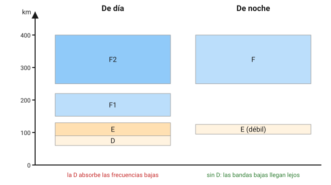
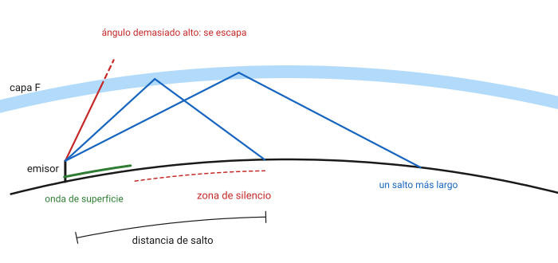
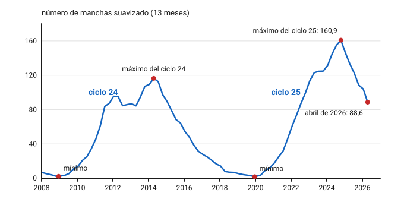
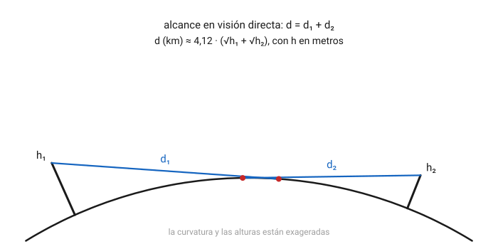
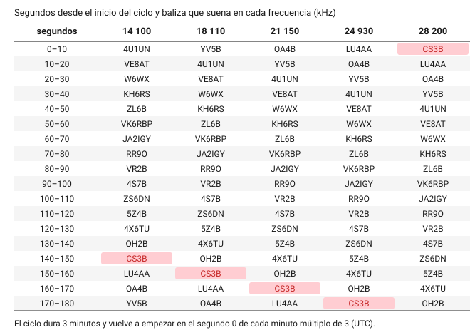

# Propagación y bandas

Una misma emisora de 100 W puede quedarse en el valle de al lado o llegar a Japón según la hora, la estación del año, el estado del Sol y la frecuencia que elijas. En este capítulo aprenderás por qué: cómo se debilita una onda al viajar, qué hace con ella la ionosfera, cómo influye el ciclo solar y qué caminos aprovechan las señales de VHF y frecuencias superiores. Verás también cómo saber, antes de llamar, si una banda está abierta, con las balizas del International Beacon Project y con las herramientas de predicción y seguimiento que hay hoy en Internet. El capítulo acaba con las bandas que puedes usar en España y lo que cabe esperar de cada una.

## Cómo viaja una onda de radio

### Atenuación en el espacio libre

Una antena que radia en todas direcciones reparte su potencia sobre una esfera cada vez mayor. La superficie de esa esfera crece con el cuadrado del radio, así que, a doble distancia, cada metro cuadrado recibe la cuarta parte de la potencia: 6 dB menos. Esta pérdida no la causa ningún obstáculo; es puro reparto geométrico, y se llama **pérdida en el espacio libre**. Entre dos antenas isótropas vale

$$
L_{\text{EL}}\,(\text{dB}) = 32{,}44 + 20 \log d + 20 \log f
$$

donde $d$ es la distancia en kilómetros y $f$ la frecuencia en megahercios. El término de la frecuencia aparece porque una antena de referencia más pequeña, como la de una frecuencia alta, capta menos energía de la misma onda.

**Ejemplo.** En 145 MHz, entre dos estaciones separadas 50 km, $L_{\text{EL}} = 32{,}44 + 20 \log 50 + 20 \log 145 \approx 109{,}6\ \text{dB}$. A 100 km sale 115,7 dB: duplicar la distancia cuesta 6 dB, como cuadruplicar la potencia del transmisor.

En la práctica, la señal sufre además pérdidas por el suelo, la vegetación, los edificios y la propia atmósfera, que dependen mucho de la frecuencia y del terreno. La fórmula da el mejor caso posible.

### Lo que le pasa a una onda por el camino

Al encontrar un medio distinto o un obstáculo, una onda puede sufrir cinco efectos, que explican todos los modos de propagación de este capítulo:

- **Reflexión**: rebota en una superficie conductora y grande comparada con la longitud de onda, como el mar, una ladera o un edificio.
- **Refracción**: se curva al pasar por un medio cuyo índice de refracción cambia poco a poco, como la ionosfera o la atmósfera baja.
- **Difracción**: rodea el borde de un obstáculo y alcanza, debilitada, la zona de sombra que hay detrás. Cuanto más larga es la onda, más se dobla.
- **Dispersión**: un medio irregular, como un rastro de meteoro o una masa de lluvia, la reparte en muchas direcciones, y una pequeña parte llega a donde interesa.
- **Absorción**: el medio se queda con parte de la energía y la convierte en calor.

### Polarización

La **polarización** de una onda es la orientación de su campo eléctrico, que coincide con la de la antena que la emite: un dipolo horizontal da polarización horizontal, y una antena vertical, vertical. En visión directa, si la antena receptora tiene la polarización cruzada respecto a la emisora, se puede perder del orden de 20 dB; es una cifra aproximada, que depende mucho de las antenas y del entorno. Por eso en FM de VHF y UHF, donde casi todo el mundo usa antenas verticales, conviene mantener el portátil derecho, y en BLU y CW de esas bandas se usa la horizontal. En HF la ionosfera gira y mezcla la polarización, así que allí la de cada antena importa mucho menos.

### Tres caminos

Las señales llegan de un punto a otro por tres caminos principales:

- La **onda de superficie**, que sigue el contorno del suelo.
- La **onda directa** o **de visión directa**, en línea recta entre las dos antenas, a veces sumada a una reflexión en el suelo.
- La **onda ionosférica** o **espacial**, que sube a la ionosfera y vuelve a la Tierra lejos del emisor.

Cuál domina depende sobre todo de la frecuencia: la onda de superficie manda en las frecuencias más bajas, la ionosférica en HF y la directa en VHF y por encima.

## Onda de superficie

La **onda de superficie** se propaga pegada a la Tierra, con polarización vertical, y sigue su curvatura. Al rozar el suelo le induce corrientes y pierde energía en ellas. Esas pérdidas aumentan con la frecuencia y disminuyen cuanto mejor conductor es el terreno: el agua del mar es el mejor, la tierra húmeda y fértil es intermedia, y la roca y la arena seca son las peores.

Por eso la onda de superficie es la propia de las ondas largas y medias: las emisoras de radiodifusión en onda media cubren de día cientos de kilómetros con ella. En las bandas de aficionado solo tiene importancia práctica en las más bajas, 2200 m, 630 m y 160 m, y algo en 80 m. En 20 m y por encima se apaga en pocos kilómetros, y lo que llega más lejos es ya onda ionosférica o directa.

## La ionosfera

### Qué es y cómo se forma

Por encima de unos 60 km, la radiación ultravioleta y los rayos X del Sol arrancan electrones a las moléculas del aire, que allí es muy tenue. Esa región con electrones libres es la **ionosfera**. Los electrones libres desvían las ondas de radio, y cuanto más densos son, más alta es la frecuencia que pueden devolver a la Tierra.

La ionización no es uniforme: se concentra en varias **capas** a distintas alturas. Como la crea el Sol, cambia con la hora del día, la estación, la latitud y el nivel de actividad solar.

*Figura 5.1. Capas de la ionosfera de día y de noche. Las alturas son aproximadas y varían con la hora, la estación y la actividad solar.*

Las alturas que siguen son también aproximadas:

- **Capa D**, de unos 60 a 90 km. Aparece con el sol y desaparece casi por completo poco después de anochecer. No devuelve las ondas a la Tierra, pero **absorbe** las de frecuencia baja que la atraviesan: por eso de día 160 m y 80 m solo dan contactos cercanos. La absorción disminuye mucho al subir de frecuencia.
- **Capa E**, de unos 90 a 130 km. Sigue al Sol: es máxima a mediodía y casi desaparece de noche. Permite saltos de hasta unos 2000 km.
- **Capa F1**, de unos 150 a 220 km. Solo existe de día, sobre todo en verano, y tiene poca importancia para el radioaficionado.
- **Capa F2**, de unos 250 a 400 km. Es la más alta y la más ionizada, y la responsable de casi todos los contactos a larga distancia en HF. De noche se une con la F1 en una sola **capa F**, que se mantiene, aunque debilitada, hasta el amanecer.

### Refracción en la ionosfera

Una onda que entra en la ionosfera se va curvando a medida que encuentra más electrones. Si la densidad es suficiente para su frecuencia, el giro acaba devolviéndola hacia abajo; si no, la atraviesa y se pierde en el espacio. Aunque se hable de que la onda «rebota» en una capa, lo que ocurre es una refracción gradual.

Dos factores deciden si la onda vuelve:

- La **frecuencia**: cuanto más alta, menos se desvía.
- El **ángulo** con que llega: una onda que entra muy inclinada, casi rasante, necesita desviarse poco para volver, mientras que una que sube en vertical tiene que darse la vuelta entera.

### Frecuencia crítica y frecuencia máxima utilizable

La **frecuencia crítica** de una capa es la más alta que devuelve a la Tierra una onda enviada en vertical. La de la capa F2 se escribe **foF2**. La miden las **ionosondas**, que emiten pulsos en vertical barriendo frecuencias y registran a qué altura y hasta qué frecuencia vuelven.

Con un ángulo de incidencia menos vertical, la capa devuelve frecuencias más altas. La frecuencia más alta que sirve para un trayecto determinado es la **frecuencia máxima utilizable** (**MUF**, *maximum usable frequency*). Se relaciona con la crítica mediante la **ley de la secante**:

$$
\text{MUF} = \frac{f_c}{\cos \theta}
$$

donde $f_c$ es la frecuencia crítica de la capa y $\theta$ el **ángulo de incidencia**, el que forma la onda con la vertical al llegar a la capa. Con $f_c$ en megahercios, la MUF sale en megahercios. Como $\cos \theta$ es menor que 1, la MUF es siempre mayor que la frecuencia crítica, y lo es más cuanto más largo es el salto.

**Ejemplo.** Una tarde de invierno, la ionosonda más cercana mide una foF2 de 6 MHz. Para un salto de 2000 km reflejado a unos 300 km de altura, la onda sale con unos 12° de elevación y llega a la capa con un ángulo de incidencia de unos 69°. La MUF vale $6 / \cos 69{,}2° \approx 16{,}9\ \text{MHz}$. La banda de 20 m, en 14 MHz, sirve para ese trayecto; la de 15 m, en 21 MHz, no.

En los programas y mapas de propagación verás a menudo la **MUF(3000)F2**, la de un salto de 3000 km por la capa F2, que es una referencia cómoda para comparar.

La MUF no es un límite nítido: varía de minuto en minuto. Por eso se recomienda trabajar algo por debajo, en la **frecuencia óptima de trabajo** (*FOT*), que se suele tomar como el 85 % de la MUF. En el ejemplo anterior, la FOT es $0{,}85 \cdot 16{,}9 \approx 14{,}4\ \text{MHz}$.

También hay un límite inferior. Al bajar de frecuencia, la absorción en la capa D crece hasta que la señal no llega con la intensidad suficiente. La frecuencia más baja con la que se mantiene un enlace útil es la **frecuencia mínima utilizable** (**LUF**, *lowest usable frequency*). Depende de la potencia, de las antenas y del ruido en el receptor, y de día es mucho más alta que de noche. Entre la LUF y la MUF está la **ventana** útil de ese trayecto en ese momento. Si la LUF supera a la MUF, no hay propagación ionosférica posible.

!!! tip "Para el examen"
    La **frecuencia crítica** es la máxima que vuelve con incidencia **vertical**; la **MUF**, la máxima que vuelve para un trayecto concreto, y siempre es mayor. La relación es $\text{MUF} = f_c / \cos \theta$. Por encima de la MUF la señal atraviesa la ionosfera; por debajo de la LUF la absorbe la capa D. Lo ideal es trabajar un poco por debajo de la MUF.

### Salto y zona de silencio

Una antena no lanza un único rayo, sino un haz con muchos ángulos de elevación. A una frecuencia dada, los rayos más empinados atraviesan la ionosfera y los más rasantes vuelven a la Tierra. El primer rayo que vuelve marca la **distancia de salto**: la mínima a la que llega la onda ionosférica.

*Figura 5.2. Distancia de salto y zona de silencio.*

Si la onda de superficie se apaga antes de esa distancia, entre los dos queda una franja que no recibe nada: la **zona de silencio** (*skip zone*). Por eso, en 20 m, puede ocurrir que te oiga perfectamente una estación a 1500 km y no te oiga nadie a 200 km. Cuanto más alta es la frecuencia respecto a la frecuencia crítica, más larga es la distancia de salto.

El alcance de un solo salto tiene un tope, que se alcanza cuando la onda sale rasante. Con la curvatura de la Tierra, por la capa E, a unos 110 km de altura, es de unos 2350 km, y por la capa F2, a unos 300 km, de unos 3800 km. Las distancias mayores se cubren con **saltos múltiples**: la onda vuelve a la Tierra, se refleja en el suelo o en el mar y sube de nuevo. Cada salto añade pérdidas, sobre todo en la capa D si es de día y en la reflexión en el suelo, así que conviene que sean pocos y largos. De ahí la importancia de las antenas que concentran la radiación en **ángulos de elevación bajos**, como las directivas a buena altura.

### Incidencia casi vertical (NVIS)

Si eliges una frecuencia **por debajo de la frecuencia crítica**, incluso el rayo vertical vuelve. Desaparece entonces la zona de silencio y la señal cubre de forma continua un círculo de unos cientos de kilómetros alrededor del emisor. Es la **propagación por incidencia casi vertical** (**NVIS**, *near vertical incidence skywave*). Se consigue con antenas horizontales bajas, a una décima o una quinta parte de la longitud de onda del suelo, que radian sobre todo hacia arriba.

**Ejemplo.** Con una foF2 de 6 MHz, una emisión en 3,6 MHz funciona en NVIS y una en 7,1 MHz no: atraviesa la capa F2 cuando sube en vertical y deja una zona de silencio alrededor de la estación.

Las bandas típicas de NVIS son 80 m y 60 m, y 40 m de día cuando la foF2 es alta. Es el modo natural para enlazar estaciones dentro de una misma región, por ejemplo en comunicaciones de emergencia en terreno montañoso, donde la visión directa no llega.

### Trayecto corto, trayecto largo y línea gris

Entre dos puntos de la Tierra hay dos caminos sobre el círculo máximo que los une. El **trayecto corto** es el habitual; el **trayecto largo** va en sentido contrario y da la vuelta por las antípodas. A veces este último está abierto y el corto no, porque recorre zonas donde la ionosfera, en ese momento, es más favorable. Una señal por trayecto largo llega a menudo con el **eco** de la misma señal por el corto, con un retraso de algo más de una décima de segundo, que es lo que tarda la onda en dar la vuelta completa al planeta: unos 40 000 km a 300 000 km/s, unos 0,13 s.

La franja entre el día y la noche, el **terminador** o **línea gris**, es especialmente favorable en las bandas bajas. En la parte que amanece, la capa D aún no se ha formado; en la que anochece, ya ha desaparecido, y la capa F todavía está ionizada. Dos estaciones situadas en la línea gris pueden comunicarse en 160, 80 o 40 m a distancias que no se alcanzan a otras horas. El efecto dura poco, alrededor de la salida y la puesta del sol en cada extremo.

### Desvanecimiento

La señal ionosférica casi nunca es estable. Sube y baja en pocos segundos, porque llegan varias copias por caminos distintos (por ejemplo, de uno y dos saltos) que se suman y se restan, y porque la ionosfera se mueve y cambia la polarización de la onda. Este **desvanecimiento** (*fading*) es más acusado en los modos de banda ancha. Los receptores lo compensan en parte con el CAG, y algunas estaciones usan dos antenas de polarizaciones distintas y escogen en cada momento la que da más señal.

## El Sol y la propagación

### Manchas solares y flujo solar

La radiación ultravioleta que ioniza la capa F2 procede de las regiones activas del Sol, que se ven desde la Tierra como **manchas solares**. Cuantas más hay, más intensa es la radiación, más densa la ionosfera y más alta la MUF. La actividad se mide con dos índices:

- El **número de manchas solares** (*SSN*, *sunspot number*), que combina el número de grupos y de manchas individuales observados. La serie de referencia internacional la mantiene [SILSO](https://www.sidc.be/SILSO/home), en el Real Observatorio de Bélgica (comprobado en noviembre de 2026). Como el valor diario oscila mucho, para seguir el ciclo se usa el **número suavizado**, una media de 13 meses.
- El **flujo solar**, que es la potencia de la emisión de radio del Sol en 2800 MHz, es decir, en 10,7 cm de longitud de onda. Por eso se escribe **F10.7**. Se mide a diario en Canadá, en el observatorio de Penticton, y se expresa en **unidades de flujo solar**: 1 sfu equivale a $10^{-22}\ \text{W/(m}^2 \cdot \text{Hz)}$, según el [glosario de clima espacial de la NOAA](https://www.spaceweather.gov/content/space-weather-glossary) (comprobado en noviembre de 2026). La NOAA indica que puede ir de menos de 50 sfu a más de 300 sfu ([página sobre el F10.7](https://www.spaceweather.gov/phenomena/f107-cm-radio-emissions), comprobado en noviembre de 2026).

Como orientación, cuanto más alto es el flujo, más arriba llega la MUF: con flujos altos, por encima de unas 150 sfu, las bandas de 15, 12 y 10 m se abren casi a diario, y con flujos bajos, por debajo de unas 80 sfu, solo de forma ocasional. Estos umbrales son aproximados y no marcan un límite exacto.

### El ciclo solar

El número de manchas sube y baja con un periodo medio de unos **11 años**: es el **ciclo solar**. Los ciclos se numeran desde mediados del siglo XVIII, y no todos son iguales: varían en duración y en intensidad.

*Figura 5.3. Ciclos 24 y 25 del número de manchas suavizado, con datos de [SILSO](https://www.sidc.be/SILSO/home) descargados el 9 de noviembre de 2026. Los valores de 2026 son provisionales.*

El ciclo actual es el **25**. Empezó con el mínimo de diciembre de 2019 y, según SILSO, alcanzó su máximo en **octubre de 2024**, con un número suavizado de **160,9**, más alto que el del ciclo 24, que se quedó en 116,4 en abril de 2014 ([anuncio de SILSO sobre el máximo](https://www.sidc.be/article/solar-cycle-25-reached-its-maximum-october-2024), comprobado en noviembre de 2026).

Ahora el ciclo está en su **fase descendente**. El último valor suavizado publicado, el de abril de 2026, es 88,6, un 45 % por debajo del máximo. En octubre de 2026 el número de manchas mensual fue 45,7 y el flujo solar medio, 108,5 sfu, según los [datos del ciclo solar del Centro de Predicción del Clima Espacial de la NOAA](https://www.spaceweather.gov/products/solar-cycle-progression) (SWPC). La predicción del SWPC sitúa el número suavizado en torno a 83 a finales de 2026 y en torno a 60 a finales de 2027. Todo comprobado el 9 de noviembre de 2026; son datos que cambian cada mes, así que consúltalos tú mismo antes de fiarte de ellos.

Qué significa para ti:

- En los próximos años, las bandas de 10 m y 12 m irán abriéndose cada vez menos por la capa F2, y la de 6 m prácticamente dejará de abrirse por esa vía. En cambio, la esporádica E de verano seguirá dando aperturas en 10 y 6 m, porque no depende del ciclo.
- Las bandas de 20, 17 y 15 m seguirán siendo útiles a diario, con menos horas de apertura en invierno.
- Las bandas bajas, 160, 80 y 40 m, mejoran hacia el mínimo: la capa D absorbe menos y hay menos perturbaciones geomagnéticas.

### Variaciones diarias y estacionales

Además del ciclo de 11 años, la MUF sigue el ritmo del Sol en cada lugar:

- **A lo largo del día**: sube a partir del amanecer, alcanza su máximo después del mediodía local y baja de noche, con su mínimo poco antes de amanecer. De día se usan las bandas altas, y de noche, las bajas.
- **A lo largo del año**: en invierno, en latitudes como las de España, la foF2 de mediodía es más alta que en verano, pero las noches largas la hacen caer mucho y abren las bandas bajas durante horas. En verano la ionosfera diurna está más caliente y expandida, la MUF de mediodía es algo más baja y la de noche más alta, y la absorción en la capa D es mayor. Los **equinoccios**, en marzo-abril y septiembre-octubre, suelen ser la mejor época para los trayectos largos en HF, sobre todo los que cruzan el ecuador.

### Perturbaciones solares

El Sol no solo varía lentamente: también tiene erupciones que alteran la propagación en minutos o días. Para clasificarlas se usan las [escalas de clima espacial de la NOAA](https://www.spaceweather.gov/noaa-scales-explanation) (comprobado en noviembre de 2026), de 1 (menor) a 5 (extrema):

| Fenómeno | Cuándo llega | Qué hace en la radio | Escala de la NOAA |
|---|---|---|---|
| **Fulguración**: estallido de rayos X | A los 8 minutos, a la velocidad de la luz | Ioniza de golpe la capa D en el lado diurno y absorbe la HF, empezando por las bandas bajas: es el **apagón de radio** o **perturbación ionosférica súbita** (*SID*, *sudden ionospheric disturbance*). Dura de minutos a un par de horas. | **R** (*radio blackouts*), según la intensidad de los rayos X: de R1, clase M1, a R5, clase X20 |
| **Tormenta de protones**: partículas de alta energía | En minutos u horas | Entran por los polos y absorben la HF en los trayectos que cruzan las regiones polares: es la **absorción del casquete polar** (*PCA*, *polar cap absorption*). Puede durar días. | **S** (*solar radiation storms*) |
| **Eyección de masa coronal** (*CME*): nube de plasma | En uno a cuatro días | Sacude el campo magnético terrestre: es una **tormenta geomagnética**. La capa F2 se desordena y la MUF cae, sobre todo en latitudes altas, durante uno o varios días. Puede provocar auroras. | **G** (*geomagnetic storms*), según el índice Kp: de G1, Kp 5, a G5, Kp 9 |

### Índices geomagnéticos K y A

El estado del campo magnético terrestre se resume con dos índices que verás en todos los boletines de propagación:

- El **índice K** se calcula cada tres horas en un observatorio magnético a partir de la variación del campo respecto a un día tranquilo. Va de 0 (tranquilo) a 9 (tormenta extrema) y su escala es **cuasilogarítmica**: cada punto supone una perturbación bastante mayor que el anterior. El **Kp** (*planetario*) es una media ponderada de los de una red de observatorios.
- El **índice A** es diario y lineal. Para obtenerlo, cada K de tres horas se convierte en un valor equivalente lineal, llamado *ak*, y se hace la media de los ocho del día. El **Ap** es su versión planetaria. Va de 0 a 400.

La tabla de conversión es la del [glosario de la NOAA](https://www.spaceweather.gov/content/space-weather-glossary) (comprobado en noviembre de 2026):

| K | 0 | 1 | 2 | 3 | 4 | 5 | 6 | 7 | 8 | 9 |
|---|---|---|---|---|---|---|---|---|---|---|
| ak | 0 | 3 | 7 | 15 | 27 | 48 | 80 | 140 | 240 | 400 |

**Ejemplo.** Un día con valores de K de 2, 2, 3, 4, 3, 3, 2 y 1 da ak de 7, 7, 15, 27, 15, 15, 7 y 3. Su media es $96 / 8 = 12$, así que el índice A del día es 12: un día algo movido, pero sin tormenta.

Para la HF, cuanto más bajos son K y A, mejor. Un K de 0 a 2 y un A por debajo de 10 indican un campo tranquilo. Con un K de 5 o más hay tormenta geomagnética, con la MUF baja y señales con desvanecimiento, sobre todo en los trayectos que pasan cerca de los polos. Lo ideal para las bandas altas es un flujo solar alto con un campo magnético tranquilo, cosa que no siempre coincide.

!!! tip "Para el examen"
    **Flujo solar alto**: buena noticia para las bandas altas. **K y A altos**: mala noticia para toda la HF. Recuerda qué llega antes: los rayos X de una fulguración, en minutos (apagón en el lado diurno); los protones, en minutos u horas (absorción en los polos); y la eyección de masa coronal, en días (tormenta geomagnética).

## Propagación en VHF, UHF y microondas

Por encima de unos 50 MHz, la ionosfera ya casi nunca devuelve las ondas: la onda directa es la norma. Pero hay excepciones muy aprovechadas por los radioaficionados, que son las que hacen interesantes estas bandas.

### Visión directa y horizonte radioeléctrico

Una antena «ve» hasta el horizonte, y el horizonte está más lejos cuanto más alta es la antena. La atmósfera, además, curva ligeramente las ondas hacia el suelo, porque su índice de refracción disminuye con la altura. El efecto equivale a una Tierra algo mayor, con un radio efectivo de 4/3 del real, unos 8500 km, como indica la [Recomendación UIT-R P.834](https://www.itu.int/rec/R-REC-P.834/es) para la atmósfera de referencia (comprobado en noviembre de 2026). Con ese radio, la distancia al **horizonte radioeléctrico** desde una antena a $h$ metros es

$$
d\,(\text{km}) \approx 4{,}12 \sqrt{h\,(\text{m})}
$$

frente a los $3{,}57 \sqrt{h}$ del horizonte óptico, sin la curvatura de la atmósfera. Dos estaciones se ven si la suma de sus horizontes alcanza la distancia que las separa:

$$
d\,(\text{km}) \approx 4{,}12 \left(\sqrt{h_1} + \sqrt{h_2}\right)
$$

con $h_1$ y $h_2$, las alturas de las dos antenas sobre el terreno que las separa, en metros.

*Figura 5.4. El alcance en visión directa es la suma de los horizontes de las dos antenas.*

**Ejemplo.** Un repetidor instalado en una sierra que domina una llanura a 900 m sobre ella y un portátil en la llanura a 1,5 m del suelo se ven hasta $4{,}12 \cdot (\sqrt{1{,}5} + \sqrt{900}) \approx 129\ \text{km}$. Dos coches con la antena a 1,5 m, en terreno llano, se ven solo hasta unos 10 km. Por eso los repetidores se instalan en lo alto de los montes: la altura de la antena vale más que la potencia.

El cálculo supone un terreno liso. Los montes, los edificios y la vegetación crean sombras, aunque la **difracción** en las crestas permite a veces recibir detrás de un obstáculo, con mucha atenuación. Las reflexiones en edificios y laderas también llevan señal a sitios sin visión directa, y explican el **parpadeo** (*picket fencing*) de la FM en un coche en marcha, cuando las copias reflejadas se suman y se restan.

### Propagación troposférica

La **troposfera** es la capa baja de la atmósfera, donde está el tiempo meteorológico: los primeros 10 km aproximadamente. Normalmente la temperatura y la humedad bajan con la altura de forma suave. Cuando no lo hacen, la refracción aumenta:

- Con **inversiones térmicas**, una capa de aire cálido y seco sobre otra fría y húmeda, las ondas de VHF y UHF se curvan más de lo habitual y llegan más allá del horizonte. Es el **realce troposférico**, frecuente con anticiclones estables, al amanecer y al anochecer, y sobre el mar.
- Si la inversión es fuerte, la onda queda atrapada entre la capa y el suelo o el mar, como en una guía de ondas, y recorre cientos o miles de kilómetros con poca pérdida. Es el **conducto troposférico** (*ducting*). Funciona mejor cuanto más alta es la frecuencia, en 2 m, 70 cm y microondas. Sobre el mar, sobre todo en verano, los conductos pueden llevar las señales de 2 m y 70 cm a más de mil kilómetros.

La **dispersión troposférica** (*troposcatter*) aprovecha que una pequeñísima parte de la señal se dispersa en las irregularidades de la troposfera, por encima del horizonte de ambas estaciones. Necesita potencia, antenas directivas y modos de señal débil, pero funciona a cualquier hora y alcanza unos cientos de kilómetros.

En microondas, a partir de unos 10 GHz, la lluvia ya no es transparente: atenúa la señal y, a la vez, la dispersa. La **dispersión por lluvia** (*rain scatter*) permite enlazar dos estaciones que apuntan sus antenas a la misma tormenta, aunque no se vean entre sí.

### Esporádica E

La **esporádica E** (**Es**) es la formación de nubes muy densas de ionización en la altura de la capa E, de unos cientos de kilómetros de extensión. Aparecen y desaparecen en minutos u horas, y su causa no se conoce del todo: se relacionan con los vientos de la alta atmósfera y con los iones metálicos que dejan los meteoros. Lo que sí se sabe bien es cuándo aparecen. En Europa son sobre todo un fenómeno de **finales de primavera y verano**, de mayo a agosto, con un máximo cerca del solsticio de junio, y un segundo máximo menor alrededor del solsticio de invierno.

Las nubes de Es reflejan frecuencias mucho más altas que la capa E normal. Producen aperturas repentinas en 10 m, 6 m y 4 m, y en las más intensas, también en 2 m. Como están a unos 100 km de altura, cada salto alcanza de unos 500 a unos 2300 km; con dos saltos se llega más lejos. La esporádica E **no depende del ciclo solar**, así que en los años de mínimo es la principal fuente de contactos lejanos en 6 m.

### Dispersión meteórica

Cada día entran en la atmósfera millones de meteoros, casi todos del tamaño de un grano de arena. Al quemarse, entre unos 80 y 120 km de altura, dejan un **rastro ionizado** que refleja durante una fracción de segundo, o unos pocos segundos los más grandes, las ondas de VHF. Es la **dispersión meteórica** (*meteor scatter*, MS), que permite contactos de hasta unos 2000 km en 6 m y 2 m.

Como cada reflexión es muy breve, se usan modos digitales que transmiten los datos en ráfagas cortas y repetidas, como el MSK144 del programa WSJT-X. Según la [guía de usuario de WSJT-X](https://wsjtx.github.io/wsjtx/guide.html), el MSK144 repite el mensaje a gran velocidad durante todo el periodo de transmisión, para el que recomienda 15 s, y así aprovecha hasta los reflejos más breves (comprobado en noviembre de 2026). Las estaciones se turnan en esos periodos fijos y reconstruyen el mensaje a partir de los fragmentos.

Hay meteoros todos los días, más al amanecer que al anochecer, porque a esas horas la cara de la Tierra en la que es de día avanza de frente contra ellos. Pero la actividad aumenta mucho durante las **lluvias de meteoros**, cuando la Tierra cruza el rastro de polvo de un cometa. Estas son algunas de las principales, con la fecha de su máximo y su tasa horaria cenital (THZ, en inglés *ZHR*), que estima cuántos meteoros por hora vería un observador con el radiante en el cénit y un cielo perfecto:

| Lluvia | Máximo | THZ | Próximo máximo |
|---|---|---|---|
| Cuadrántidas | 3 o 4 de enero | 80 | 4 de enero de 2027 |
| Eta Acuáridas | 6 de mayo | 50 | 6 de mayo de 2027 |
| Perseidas | 12 o 13 de agosto | 100 | 13 de agosto de 2027 |
| Oriónidas | 21 o 22 de octubre | 20 | 22 de octubre de 2027 |
| Gemínidas | 14 de diciembre | 150 | 14 de diciembre de 2026 |

*Fuente: calendarios de lluvias de meteoros de la Organización Internacional de Meteoros para [2026](https://www.imo.net/files/meteor-shower/cal2026.pdf) y [2027](https://www.imo.net/files/meteor-shower/cal2027.pdf) (comprobado en noviembre de 2026). Las tasas reales varían de un año a otro.*

### Propagación auroral

Durante las tormentas geomagnéticas fuertes, las partículas que entran por los polos forman la **aurora**, que en Europa se ve sobre todo en Escandinavia y, en tormentas extremas, mucho más al sur. Su ionización refleja las señales de VHF. Para aprovecharla, las estaciones del norte de Europa apuntan sus antenas hacia el norte, hacia la zona auroral, aunque el corresponsal esté al este o al oeste.

Las señales reflejadas en la aurora llegan con un **sonido áspero**, como un susurro o un zumbido, porque la aurora se mueve deprisa y ensancha la señal. Por eso se usa casi solo la CW, y la voz en BLU apenas se entiende. Desde España las aperturas aurorales son muy raras.

### Propagación transecuatorial

Las estaciones situadas a ambos lados del ecuador magnético, a distancias parecidas de él, pueden comunicarse en 6 m, y a veces en 2 m, por la capa F, que alrededor del ecuador forma dos crestas muy ionizadas. Es la **propagación transecuatorial** (*TEP*). Funciona sobre todo por la tarde y la noche, cerca de los equinoccios y en los años de mucha actividad solar. Desde el sur de Europa se aprovecha hacia el sur de África.

### Rebote lunar

En el **rebote lunar** (**EME**, *Earth-Moon-Earth*) se usa la Luna como reflector pasivo. Funciona en VHF, UHF y microondas, entre dos estaciones cualesquiera que vean la Luna a la vez. La Luna está a una media de 384 400 km y refleja muy poco, así que la señal vuelve atenuadísima. Hace falta mucha potencia, conjuntos de antenas directivas, preamplificadores de muy bajo ruido y modos digitales de señal débil.

**Ejemplo.** La señal tarda en ir y volver $2 \cdot 384\,400\ \text{km} / 300\,000\ \text{km/s} \approx 2{,}56\ \text{s}$. Si transmites un punto de CW hacia la Luna, oirás tu propio eco dos segundos y medio después.

El anexo I de la Orden IET/1311/2013, que se cita completa al final del capítulo, permite usar en EME y en dispersión meteórica hasta **1000 W** de potencia de cresta de la envolvente, en las subbandas que recomienda la IARU y siempre fuera de los cascos urbanos (comprobado en noviembre de 2026).

### Efecto Doppler y satélites

Cuando el emisor y el receptor se acercan o se alejan, la frecuencia recibida se desplaza. Es el **efecto Doppler**:

$$
\Delta f = f \cdot \frac{v}{c}
$$

donde $\Delta f$ es el desplazamiento, $f$ la frecuencia emitida, $v$ la velocidad con que se acercan o alejan, en la línea que los une, y $c$ la velocidad de la luz. Si se acercan, la frecuencia recibida sube; si se alejan, baja.

**Ejemplo.** Un satélite de órbita baja puede acercarse a una estación a unos 7 km/s. En 437 MHz, el desplazamiento llega a $437 \cdot 10^{6} \cdot 7000 / (3 \cdot 10^{8}) \approx 10{,}2\ \text{kHz}$; en 145,8 MHz, a solo 3,4 kHz. Por eso, durante el paso del satélite, hay que ir corrigiendo la sintonía, sobre todo en UHF. Lo verás con detalle en el capítulo 13.

El Doppler también explica por qué el eco lunar y las señales de la aurora llegan desplazadas o ensanchadas.

## Balizas y seguimiento de la propagación

### Qué es una radiobaliza

Una **radiobaliza** del servicio de aficionados es, según el anexo I de la Orden IET/1311/2013, una estación automática desatendida destinada a hacer estudios de propagación, que emite de forma automática señales de identificación (comprobado en noviembre de 2026). Emite siempre desde el mismo sitio, con una potencia y una antena conocidas, en una frecuencia fija. Si la oyes, la banda está abierta hacia ese lugar; si no, probablemente no. En España solo las asociaciones de radioaficionados reconocidas pueden tener estaciones automáticas desatendidas, como las radiobalizas y los repetidores, que en HF no pueden superar los 50 W de salida. Las radiobalizas deben transmitir su distintivo al menos cada tres minutos; los repetidores analógicos, al menos cada diez minutos mientras emiten. Todo ello lo fijan los artículos 18, 24 y 25 de la misma orden (comprobado en noviembre de 2026).

El plan de bandas de la IARU Región 1 reserva segmentos para balizas en casi todas las bandas. Los de VHF y UHF están en sus [planes de bandas](https://www.iaru-r1.org/reference/band-plans/) (comprobado en noviembre de 2026):

| Banda | Segmento de balizas en el plan de la IARU Región 1 |
|---|---|
| 10 m | 28 190 – 28 225 kHz, exclusivo para balizas |
| 6 m | 50 000 – 50 100 kHz, proyecto coordinado de balizas, compartido con la CW; 50 400 – 50 500 kHz, exclusivo para balizas |
| 4 m | 70 000 – 70 090 kHz, balizas coordinadas |
| 2 m | 144 400 – 144 490 kHz, exclusivo para balizas |
| 70 cm | 432 400 – 432 490 kHz, exclusivo para balizas |

### El International Beacon Project

El **International Beacon Project** (IBP) es una red mundial de **18 balizas** de HF que mantienen la Northern California DX Foundation (NCDXF) y la IARU. Funciona con su configuración actual desde 1995. Todos los datos de este apartado proceden de la [página del proyecto en la NCDXF](https://www.ncdxf.org/beacon/) y de la [página de balizas de la IARU](https://www.iaru.org/on-the-air/beacons/), comprobados el 9 de noviembre de 2026.

Las balizas comparten **cinco frecuencias**, una en cada banda alta de HF:

| Banda | 20 m | 17 m | 15 m | 12 m | 10 m |
|---|---|---|---|---|---|
| Frecuencia | 14 100 kHz | 18 110 kHz | 21 150 kHz | 24 930 kHz | 28 200 kHz |

El plan de bandas de HF de la IARU Región 1 reserva un margen de ±1 kHz alrededor de cada una para uso exclusivo de las balizas. No transmitas en esas frecuencias.

Cada transmisión dura **10 segundos** y contiene:

1. El **indicativo** de la baliza en CW, a 22 palabras por minuto, con 100 W.
2. **Cuatro rayas** de un segundo, a **100 W, 10 W, 1 W y 0,1 W**.

Cada raya tiene 10 dB menos que la anterior, de modo que de la primera a la última hay $10 \log (100 / 0{,}1) = 30\ \text{dB}$. Contar cuántas rayas oyes te da una medida rápida de lo abierta que está la banda: si oyes las cuatro, el trayecto tiene mucho margen; si solo oyes la de 100 W, apenas hay propagación.

Las balizas se turnan en las cinco frecuencias, de modo que nunca coinciden dos en la misma. Cada baliza transmite en 14 100 kHz, salta a la siguiente frecuencia en el turno siguiente, y así hasta 28 200 kHz; después calla hasta que le vuelve a tocar. El **ciclo completo dura 3 minutos** (18 turnos de 10 s) y se repite las 24 horas. Cada baliza suena, por tanto, una vez cada tres minutos en cada banda.

Las 18 balizas, en el orden en que se turnan, y su estado según el fichero de estado oficial del proyecto, fechado el 5 de noviembre de 2026:

| Turno | Indicativo | Ubicación | Estado |
|---|---|---|---|
| 1 | 4U1UN | Naciones Unidas, Nueva York | En servicio |
| 2 | VE8AT | Inuvik, Canadá | En servicio |
| 3 | W6WX | Monte Umunhum, California (EE. UU.) | En servicio |
| 4 | KH6RS | Maui, Hawái | En servicio |
| 5 | ZL6B | Masterton, Nueva Zelanda | En servicio |
| 6 | VK6RBP | Roleystone, Australia | En servicio |
| 7 | JA2IGY | Monte Asama, Japón | En servicio |
| 8 | RR9O | Novosibirsk, Rusia | En servicio |
| 9 | VR2B | Hong Kong | Fuera de servicio |
| 10 | 4S7B | Colombo, Sri Lanka | En servicio |
| 11 | ZS6DN | Pretoria, Sudáfrica | En servicio |
| 12 | 5Z4B | Kikuyu, Kenia | En servicio |
| 13 | 4X6TU | Tel Aviv, Israel | En servicio |
| 14 | OH2B | Lohja, Finlandia | En servicio |
| 15 | CS3B | São Jorge, Madeira | En servicio |
| 16 | LU4AA | Buenos Aires, Argentina | En servicio |
| 17 | OA4B | Lima, Perú | En servicio |
| 18 | YV5B | Caracas, Venezuela | Fuera de servicio temporalmente |

El ciclo está sincronizado con el **tiempo universal coordinado** (UTC, en inglés *Coordinated Universal Time*), la hora de referencia que se usa en radioafición en lugar de la local. La NCDXF publica en su web un [horario imprimible de las balizas](https://www.ncdxf.org/beacon/ibp.pdf), una tabla en checo preparada en 2005 por OK1SAT, con el minuto y el segundo de cada turno dentro de la hora. Según esa tabla, el ciclo empieza en el segundo 0 de cada minuto múltiplo de 3 (las 10:00:00, 10:03:00, 10:06:00 UTC…), con 4U1UN en 14 100 kHz (comprobado en noviembre de 2026). La tabla es antigua y nombra la baliza de Hawái con su indicativo anterior, KH6WO, pero el orden y los tiempos coinciden con los del reloj en línea de la NCDXF.

*Figura 5.5. Turnos de las balizas del IBP durante un ciclo de tres minutos. CS3B, la más cercana a la Península, está resaltada.*

**Ejemplo.** ¿Cuándo puedes oír CS3B, en Madeira, en 20 m? Es la decimoquinta, así que transmite en 14 100 kHz en el turno 15, de los 140 a los 150 segundos del ciclo. Es decir, en el minuto 2 de cada ciclo, entre los segundos 20 y 30: a las 10:02:20, 10:05:20, 10:08:20 UTC, etc. Diez segundos después estará en 18 110 kHz, y así sucesivamente.

!!! example "En la práctica"
    No tienes que calcular nada: deja el receptor en 14 100 kHz y apunta qué indicativos oyes durante tres minutos, o usa un programa que lo haga por ti. La NCDXF publica un reloj en línea con la baliza que suena en cada frecuencia, y cita programas como FAROS, que vigila las 18 balizas automáticamente, o la extensión para el IBP de los receptores KiwiSDR. También la Reverse Beacon Network, que se describe a continuación, registra las balizas que oyen sus estaciones (comprobado en noviembre de 2026).

### Herramientas de seguimiento en tiempo real

Hoy no hace falta adivinar: miles de receptores automáticos de todo el mundo publican en Internet lo que oyen, minuto a minuto. Todas estas herramientas eran gratuitas y funcionaban al comprobarlas el 9 de noviembre de 2026; son servicios voluntarios que pueden cambiar o desaparecer.

- **[PSK Reporter](https://pskreporter.info/)**. Recoge los informes de recepción de modos digitales, sobre todo FT8 y FT4, que envían automáticamente los programas de las estaciones receptoras. Si transmites unos minutos en FT8, ves en un mapa dónde se te ha oído y con qué relación señal/ruido.
- **[Reverse Beacon Network](https://www.reversebeacon.net/)** (RBN). Una red de receptores, los *skimmers*, que decodifican todo lo que oyen en las bandas de CW y de FT8 y FT4 y publican el indicativo, la frecuencia y la relación señal/ruido. Llama en CW unos segundos y sabrás dónde llegas.
- **WSPR**. Es un modo de señal muy débil pensado para sondear la propagación: las estaciones transmiten su indicativo, su cuadrícula y su potencia en ráfagas de dos minutos con pocos vatios, a menudo menos de uno. Los informes se reúnen en una gran base de datos que se puede consultar en [WSPR Live](https://wspr.live/) o [WSPR Rocks](https://wspr.rocks/).
- **[DXMaps](https://www.dxmaps.com/)**. Muestra en un mapa, casi en tiempo real, los contactos y las escuchas que comunican los radioaficionados, banda por banda, con filtros por modo y por tipo de propagación. Muy útil para detectar aperturas de esporádica E en 6 m y 2 m.
- **[Mapas de KC2G](https://prop.kc2g.com/)**. Dibujan la MUF(3000)F2 y la foF2 sobre el mapa del mundo, casi en tiempo real, a partir de las medidas de las ionosondas que distribuyen las redes GIRO e INGV.
- **Ionosondas**. La red [GIRO](https://giro.uml.edu/) reúne los datos de ionosondas de todo el mundo. En España figuran en su lista la del Observatori de l'Ebre en Roquetes (Tarragona), con el código EB040, y la de El Arenosillo (Huelva), con el código EA036 (comprobado en noviembre de 2026).

### Predicción de la propagación

Para planificar con antelación (a qué hora probar un trayecto, qué banda usar en un concurso o una expedición) se usan modelos de predicción que calculan la MUF, la LUF y la probabilidad de enlace a partir del número de manchas previsto, la hora, la fecha, las antenas y la potencia:

- **VOACAP** es un modelo de predicción de HF de la NTIA/ITS, la agencia de telecomunicaciones del Gobierno de EE. UU., que lo distribuye gratis junto con otros modelos en su [página de software de HF](https://its.ntia.gov/software/high-frequency/) (comprobado en noviembre de 2026). [VOACAP Online](https://www.voacap.com/hf/), mantenido por un radioaficionado finlandés, lo pone al alcance de cualquiera desde el navegador: eliges tu ubicación, la del corresponsal y tu equipo, y te da la probabilidad de enlace por banda y hora (comprobado en noviembre de 2026).
- La **[Recomendación UIT-R P.533](https://www.itu.int/rec/R-REC-P.533/es)** es el método oficial de la UIT para predecir circuitos de HF, y la UIT publica una implementación en software, [ITURHFProp](https://www.itu.int/oth/R0A0400006F) (comprobado en noviembre de 2026).
- El **[Centro de Predicción del Clima Espacial de la NOAA](https://www.spaceweather.gov/)** (SWPC), cuya web estaba antes en swpc.noaa.gov, publica el índice Kp en tiempo real, la previsión geomagnética a tres días, la previsión de auroras y el mapa de absorción en la capa D ([D-RAP](https://www.spaceweather.gov/products/d-region-absorption-predictions-d-rap)), que muestra en qué zonas y hasta qué frecuencia hay un apagón de HF tras una fulguración (comprobado en noviembre de 2026). La Agencia Espacial Europea tiene su propio [servicio de clima espacial](https://swe.ssa.esa.int/), que pide registrarse para algunos productos.

!!! example "En la práctica"
    Una rutina sencilla antes de sentarte a operar: mira el flujo solar y el índice K del día; consulta el mapa de MUF para ver hasta qué banda llega la ionosfera desde tu zona; escucha las balizas del IBP o lanza una llamada corta en CW o FT8 y mira dónde te reciben en la RBN o en PSK Reporter. En cinco minutos sabrás qué bandas merecen la pena.

## Bandas de radioaficionado en España

### Dónde se fijan

Las bandas en que puedes transmitir no dependen de los libros ni del plan de bandas de otro país. En España se fijan en dos normas, complementadas por el Reglamento de Radiocomunicaciones de la UIT, que reparte el espectro entre servicios a escala mundial ([Reglamento de Radiocomunicaciones](https://www.itu.int/pub/R-REG-RR), edición de 2024, comprobado en noviembre de 2026):

- El **[Cuadro Nacional de Atribución de Frecuencias](https://www.boe.es/buscar/act.php?id=BOE-A-2026-15661)** (CNAF) atribuye cada margen del espectro a uno o varios servicios. El vigente es el aprobado por la Orden TDF/732/2026, de 10 de julio, en vigor desde el 18 de julio de 2026, que incorpora los acuerdos de la Conferencia Mundial de Radiocomunicaciones de 2023 (comprobado en noviembre de 2026).
- La **[Orden IET/1311/2013, de 9 de julio](https://www.boe.es/buscar/act.php?id=BOE-A-2013-7624)**, por la que se aprueba el Reglamento de uso del dominio público radioeléctrico por radioaficionados, fija en su anexo I las potencias máximas y las condiciones técnicas de las emisiones (comprobado en noviembre de 2026).

Un servicio puede tener una banda a título **primario** o **secundario**. En el CNAF se distinguen por la tipografía: los primarios van en mayúsculas (AFICIONADOS) y los secundarios en minúsculas (Aficionados). Las estaciones de un servicio secundario no pueden causar interferencias perjudiciales a las de un servicio primario ni reclamar protección frente a ellas, según las definiciones del anexo I de la Orden IET/1311/2013 (comprobado en noviembre de 2026).

### Tabla de bandas

Esta tabla resume las bandas del servicio de aficionados en la columna de atribución nacional del CNAF y las potencias máximas que la tabla del apartado 3.1 del anexo I de la Orden IET/1311/2013 fija expresamente para cada banda (ambos comprobados en noviembre de 2026). Esas potencias son las generales de la banda. En las bandas secundarias manda la regla del 50 %, que se explica justo después: la cifra reducida va entre paréntesis en cada fila secundaria. P. c. e. es la potencia de cresta de la envolvente, y p. i. r. e., la potencia isótropa radiada equivalente, que incluye la ganancia de la antena.

| Banda | Márgenes (CNAF) | Categoría | Potencia máxima en el anexo I |
|---|---|---|---|
| 2200 m | 135,7 – 137,8 kHz | Secundaria | 1 W p. i. r. e. (secundaria: dudoso si se reduce, [ver 3.2](#la-regla-del-50-en-las-bandas-secundarias)) |
| 630 m | 472 – 479 kHz | Secundaria | 1 W p. i. r. e.; hasta 5 W en zonas a más de 800 km de la frontera con países africanos (secundaria: dudoso si se reduce, [ver 3.2](#la-regla-del-50-en-las-bandas-secundarias)) |
| 160 m | 1810 – 1830 kHz | Secundaria | 1000 W p. c. e. (secundaria: 500 W, [ver 3.2](#la-regla-del-50-en-las-bandas-secundarias)) |
| | 1830 – 1850 kHz | Primaria | 1000 W p. c. e. |
| 80 m | 3500 – 3800 kHz | Primaria | 1000 W p. c. e. |
| 60 m | 5351,5 – 5366,5 kHz | Secundaria | No figura en la orden; 15 W p. i. r. e. por la nota 5.133B del RR (véase la nota bajo la tabla) |
| 40 m | 7000 – 7200 kHz | Primaria | 1000 W p. c. e. |
| 30 m | 10 100 – 10 150 kHz | Secundaria | 1000 W p. c. e. (secundaria: 500 W, [ver 3.2](#la-regla-del-50-en-las-bandas-secundarias)) |
| 20 m | 14 000 – 14 350 kHz | Primaria | 1000 W p. c. e. |
| 17 m | 18 068 – 18 168 kHz | Primaria | 1000 W p. c. e. |
| 15 m | 21 000 – 21 450 kHz | Primaria | 1000 W p. c. e. |
| 12 m | 24 890 – 24 990 kHz | Primaria | 1000 W p. c. e. |
| 10 m | 28 000 – 29 700 kHz | Primaria | 1000 W p. c. e. |
| 6 m | 50 – 52 MHz | Secundaria | 600 W p. c. e. (secundaria: 300 W, [ver 3.2](#la-regla-del-50-en-las-bandas-secundarias)) |
| 4 m | 70,150 – 70,250 MHz | Secundaria | 600 W p. c. e. (secundaria: 300 W, [ver 3.2](#la-regla-del-50-en-las-bandas-secundarias)) |
| 2 m | 144 – 146 MHz | Primaria | 600 W p. c. e. |
| 70 cm | 430 – 440 MHz | Primaria | 300 W p. c. e. |
| 23 cm | 1240 – 1300 MHz | Secundaria | 1000 W p. i. r. e. (secundaria: 500 W, [ver 3.2](#la-regla-del-50-en-las-bandas-secundarias)) |
| 13 cm | 2300 – 2450 MHz | Secundaria | 1000 W p. i. r. e. (secundaria: 500 W, [ver 3.2](#la-regla-del-50-en-las-bandas-secundarias)) |
| 6 cm | 5650 – 5850 MHz | Secundaria | 1000 W p. i. r. e. (secundaria: 500 W, [ver 3.2](#la-regla-del-50-en-las-bandas-secundarias)) |
| 3 cm | 10,0 – 10,5 GHz | Secundaria | 1000 W p. i. r. e. (secundaria: 500 W, [ver 3.2](#la-regla-del-50-en-las-bandas-secundarias)) |
| 1,2 cm | 24,00 – 24,05 GHz | Primaria | 1000 W p. i. r. e. |
| | 24,05 – 24,25 GHz | Secundaria | 1000 W p. i. r. e. (secundaria: 500 W, [ver 3.2](#la-regla-del-50-en-las-bandas-secundarias)) |

Hay más bandas de aficionado por encima de 24 GHz (47 GHz, 76 – 81 GHz, 122 GHz, 134 – 141 GHz y otras), recogidas en el mismo CNAF.

La banda de 60 m no aparece en la tabla de potencias de la orden. Su límite, 15 W p. i. r. e., lo fija la nota 5.133B del Reglamento de Radiocomunicaciones, que recoge el CNAF (comprobado en noviembre de 2026).

!!! tip "Para el examen"
    La tabla del apartado 3.1 del anexo I de la Orden IET/1311/2013 llama a la banda de 24 GHz «1,5 cm» (comprobado en noviembre de 2026). Aquí se usa «1,2 cm», que se acerca más a su longitud de onda real, $\lambda = 300 / 24\,000\ \text{m} = 1{,}25\ \text{cm}$. Si en el examen aparece «1,5 cm», se refiere a la misma banda.

### La regla del 50 % en las bandas secundarias

El apartado 3.2 del anexo I de la [Orden IET/1311/2013](https://www.boe.es/buscar/act.php?id=BOE-A-2013-7624) establece que, en las bandas atribuidas al servicio de radioaficionados con carácter secundario, la potencia máxima de las emisiones no puede superar el 50 % de los valores de la tabla del apartado 3.1 (comprobado en noviembre de 2026). La orden no da esa cifra reducida banda por banda: la tienes que calcular tú a partir de la tabla anterior y de la categoría que el CNAF da a cada banda.

**Ejemplo de cálculo.** La banda de 30 m es secundaria en el CNAF y la tabla del anexo I le asigna, como a toda la HF, 1000 W p. c. e. Aplicando el apartado 3.2, en 30 m puedes emitir como máximo $0{,}5 \cdot 1000 = 500\ \text{W}$ p. c. e. Con el mismo cálculo, en 6 m, también secundaria, el límite queda en $0{,}5 \cdot 600 = 300\ \text{W}$ p. c. e.

Las bandas de 2200 m y 630 m tienen en la tabla un límite propio, expresado en p. i. r. e. La orden no aclara si el 50 % se aplica también sobre esas cifras. Ante la duda, consulta a la Jefatura Provincial de Inspección de Telecomunicaciones antes de emitir en ellas con el límite completo.

Algunas precisiones que conviene conocer, todas comprobadas en noviembre de 2026:

- **6 m.** La nota UN-100 del CNAF permite a los radioaficionados usar 50 – 52 MHz como uso especial, sin causar interferencias a la televisión de los países vecinos ni reclamar protección frente a ella.
- **4 m.** La nota UN-132 del CNAF abre a los radioaficionados, a título secundario, el tramo de 70,150 a 70,250 MHz.
- **2200 m.** La nota UN-108 del CNAF limita la potencia radiada a 1 W p. i. r. e. y obliga a no interferir a los servicios móvil marítimo y fijo de la banda.
- **Bandas de microondas con autorización especial.** Para usar 2300 – 2450 MHz, salvo el tramo de 2316 a 2332 MHz; 5650 – 5850 MHz, salvo los tramos de 5700 a 5720 MHz y de 5760 a 5762 MHz; y 24,050 – 24,250 GHz, necesitas una autorización especial de la Administración, según la disposición adicional segunda de la Orden IET/1311/2013, modificada por la Orden IET/614/2015. Para subir al satélite QO-100 en 2400 – 2410 MHz hay, además, una autorización temporal general que cubre a todos los radioaficionados, con sus propias condiciones; la verás en el [capítulo 13](13-satelites.md#la-transmision).
- **Bandas ICM.** En 433,05 – 434,79 MHz, 2400 – 2450 MHz, 5725 – 5800 MHz y 24,00 – 24,25 GHz funcionan aplicaciones industriales, científicas y médicas, como mandos a distancia y hornos de microondas. Según el apartado 3.4 del anexo I, tu estación tiene que aceptar las interferencias que causen.
- **EME y dispersión meteórica.** Con las condiciones vistas antes, se permiten hasta 1000 W p. c. e. (apartado 3.3 del anexo I).

Dentro de cada banda, qué modo va en cada tramo lo recomienda el plan de bandas de la IARU Región 1, que el anexo I toma como referencia para los anchos de banda de las emisiones. Lo verás en el [capítulo 9](09-reglamentacion/index.md#los-planes-de-bandas-de-la-iaru), junto con el resto de la normativa.

!!! tip "Para el examen"
    Aprende los márgenes de las bandas de HF y de 2 m y 70 cm, y cuáles son **secundarias**: 160 m en su tramo bajo, 60 m, 30 m, 6 m, 4 m y las de microondas hasta 10 GHz. En una banda secundaria no puedes interferir al servicio primario y debes aceptar sus interferencias.

### Qué esperar de cada banda

Esta tabla es una guía general, para latitudes como las de España. Las condiciones reales dependen del ciclo solar, de la estación y del día concreto.

| Banda | Propagación típica | Cuándo |
|---|---|---|
| 160 m | Onda de superficie a corta distancia; ionosférica a larga distancia | De noche, sobre todo en invierno y alrededor del mínimo solar. De día, solo contactos locales |
| 80 m | NVIS y contactos regionales; larga distancia de noche | Regional de día; nacional y europea al anochecer; DX de noche en invierno |
| 60 m | NVIS y contactos regionales | De día y al anochecer |
| 40 m | Europa de día; DX de noche | Toda la jornada; la mejor banda «todoterreno» |
| 30 m | Intermedia entre 40 y 20 m; solo CW y modos digitales | De día y de noche |
| 20 m | La banda clásica de DX | De día en todo el ciclo; también de noche en verano y cerca del máximo |
| 17 m | Parecida a 20 m, con menos ocupación | De día; muy buena cerca del máximo |
| 15 m | DX de día cuando el flujo es alto | De día; en el mínimo, solo aperturas ocasionales y esporádica E |
| 12 m | Como 15 y 10 m | De día cerca del máximo; esporádica E en verano |
| 10 m | DX por la capa F2 cerca del máximo; esporádica E | De día cerca del máximo; aperturas de esporádica E de mayo a agosto |
| 6 m | Esporádica E; F2 y transecuatorial cerca del máximo; dispersión meteórica | Esporádica E de mayo a agosto; F2 solo en máximos fuertes |
| 4 m | Esporádica E y dispersión meteórica | Sobre todo en verano |
| 2 m | Visión directa y repetidores; troposférica; esporádica E intensa; meteórica; EME | Siempre en local; aperturas troposféricas con anticiclones; lluvias de meteoros |
| 70 cm | Visión directa y repetidores; conductos troposféricos; satélites; EME | Siempre en local; conductos en verano |
| 23 cm y superiores | Visión directa; troposférica; dispersión por lluvia en 10 GHz; EME | Enlaces locales y concursos; aperturas con buen tiempo estable |

## Resumen

- La señal se reparte sobre una esfera cada vez mayor: en espacio libre pierde 6 dB cada vez que se duplica la distancia, $L_{\text{EL}} = 32{,}44 + 20 \log d + 20 \log f$.
- Hay tres caminos: la onda de superficie (frecuencias bajas, mejor sobre el mar), la ionosférica (HF) y la directa (VHF y superiores).
- La ionosfera tiene de día las capas D (absorbe), E, F1 y F2, y de noche solo la E débil y la F. La F2 da casi todo el DX.
- La frecuencia crítica es la máxima que vuelve en vertical; la MUF, la máxima para un trayecto: $\text{MUF} = f_c / \cos \theta$. Se trabaja algo por debajo, cerca del 85 % de la MUF. Por debajo de la LUF, la capa D se come la señal.
- Entre la onda de superficie y el primer salto queda la zona de silencio. Un salto llega hasta unos 2350 km por la capa E y unos 3800 km por la F2. Con frecuencias por debajo de la foF2 se trabaja en NVIS.
- El ciclo solar dura unos 11 años. El 25 tuvo su máximo en octubre de 2024 (160,9 de número suavizado, según SILSO) y en noviembre de 2026 está en fase descendente (comprobado en noviembre de 2026).
- Flujo solar alto favorece las bandas altas; índices K y A altos perjudican a toda la HF. Fulguración: apagón en minutos. Protones: absorción polar. Eyección de masa coronal: tormenta geomagnética en días.
- En VHF y UHF, el horizonte radioeléctrico es $d \approx 4{,}12 (\sqrt{h_1} + \sqrt{h_2})$ km. Más allá llegan la troposférica, la esporádica E, la dispersión meteórica, la aurora, la transecuatorial y el rebote lunar.
- Las 18 balizas del IBP se turnan cada 10 s en 14 100, 18 110, 21 150, 24 930 y 28 200 kHz, con un ciclo de 3 minutos y rayas de 100, 10, 1 y 0,1 W (comprobado en noviembre de 2026).
- PSK Reporter, la Reverse Beacon Network, WSPR, DXMaps, los mapas de MUF, VOACAP y la NOAA te dicen qué está abierto y qué lo estará.
- En España, las bandas las fija el CNAF (Orden TDF/732/2026) y las potencias, el anexo I de la Orden IET/1311/2013. En las bandas secundarias no se puede interferir al servicio primario y la potencia máxima es la mitad (comprobado en noviembre de 2026).

## Autoevaluación

**1.** La frecuencia crítica de la capa F2 es de 5 MHz. ¿Cuál es la MUF para un trayecto en el que la onda llega a la capa con un ángulo de incidencia de 60° respecto a la vertical?

a) 2,5 MHz  
b) 5,8 MHz  
c) 10 MHz  
d) 20 MHz

??? success "Solución"
    **c)** Por la ley de la secante, $\text{MUF} = 5 / \cos 60° = 5 / 0{,}5 = 10\ \text{MHz}$. La a) multiplica por el coseno en lugar de dividir, y la b) usa el seno. La MUF siempre es mayor que la frecuencia crítica.

**2.** Dos estaciones de VHF tienen sus antenas a 16 m y a 25 m sobre un terreno llano. ¿Hasta qué distancia aproximada se ven por visión directa?

a) 16 km  
b) 32 km  
c) 37 km  
d) 370 km

??? success "Solución"
    **c)** $d \approx 4{,}12 \cdot (\sqrt{16} + \sqrt{25}) = 4{,}12 \cdot 9 \approx 37\ \text{km}$. La b) es el horizonte óptico, con la constante 3,57, que no tiene en cuenta que la atmósfera curva las ondas hacia el suelo.

**3.** ¿Por qué de día no se consiguen contactos lejanos en la banda de 80 m?

a) Porque la capa F2 desaparece de día.  
b) Porque la capa D absorbe las frecuencias bajas que la atraviesan.  
c) Porque la MUF es más baja de día que de noche.  
d) Porque la onda de superficie es más débil de día.

??? success "Solución"
    **b)** La capa D se forma con el sol y absorbe las frecuencias bajas antes de que lleguen a las capas que las devolverían. Al anochecer desaparece y las bandas bajas se abren a larga distancia. La c) es falsa: la MUF es más alta de día.

**4.** ¿Qué es la zona de silencio?

a) La franja de frecuencias entre la LUF y la MUF.  
b) La zona entre el alcance de la onda de superficie y el punto donde vuelve la primera onda ionosférica, en la que no se recibe la señal.  
c) La zona del mundo que está de noche.  
d) El tiempo que tarda una baliza en volver a transmitir en la misma banda.

??? success "Solución"
    **b)** Los rayos más empinados atraviesan la ionosfera, así que la onda ionosférica solo vuelve a partir de la distancia de salto. Si la onda de superficie se agota antes, en medio queda una zona sin señal.

**5.** A las 14:05:25 UTC, ¿qué baliza del IBP está transmitiendo en 14 100 kHz?

a) OH2B  
b) CS3B  
c) LU4AA  
d) 4X6TU

??? success "Solución"
    **b)** El ciclo de tres minutos empezó a las 14:03:00, así que han pasado $2 \cdot 60 + 25 = 145$ segundos: es el turno que va de 140 a 150 s, el decimoquinto, y en 14 100 kHz le corresponde a la decimoquinta baliza, CS3B. OH2B transmite en esa frecuencia diez segundos antes y LU4AA diez segundos después.

**6.** Las balizas del IBP envían cuatro rayas de 100 W, 10 W, 1 W y 0,1 W. ¿Cuántos decibelios hay entre la primera y la última?

a) 3 dB  
b) 10 dB  
c) 30 dB  
d) 1000 dB

??? success "Solución"
    **c)** La relación de potencias es $100 / 0{,}1 = 1000$, y $10 \log 1000 = 30\ \text{dB}$: 10 dB por cada raya. Si solo oyes la primera, el trayecto tiene menos de 10 dB de margen.

**7.** Un día, los ocho índices K de tres horas son 3, 4, 5, 6, 6, 5, 4 y 3. Con la tabla de conversión de K a ak, ¿cuánto vale el índice A?

a) 4,5  
b) 42,5  
c) 48  
d) 340

??? success "Solución"
    **b)** Los ak son 15, 27, 48, 80, 80, 48, 27 y 15, que suman 340; la media es $340 / 8 = 42{,}5$. La a) es la media de los K, que no sirve porque la escala de K no es lineal, y la d) olvida dividir. Es un día de tormenta geomagnética, malo para la HF.

**8.** ¿Cuál de estas bandas está atribuida al servicio de aficionados con carácter **secundario** en España?

a) 7000 – 7200 kHz  
b) 10 100 – 10 150 kHz  
c) 14 000 – 14 350 kHz  
d) 144 – 146 MHz

??? success "Solución"
    **b)** La banda de 30 m es secundaria en el CNAF: no puedes interferir a los servicios primarios, el fijo entre ellos, y tu potencia máxima es la mitad de la general de HF, por el apartado 3.2 del anexo I de la Orden IET/1311/2013. Las otras tres son primarias (comprobado en noviembre de 2026).

**9.** ¿En qué época del año son más frecuentes en Europa las aperturas de esporádica E en la banda de 6 m?

a) De mayo a agosto.  
b) De noviembre a febrero, con las noches largas.  
c) Solo en los años de máximo solar.  
d) En los equinoccios.

??? success "Solución"
    **a)** La esporádica E es sobre todo un fenómeno de finales de primavera y verano, con un máximo cerca del solsticio de junio. No depende del ciclo solar, por eso la c) es falsa: en los años de mínimo es la principal vía de DX en 6 m.

**10.** Un satélite se acerca a tu estación a 6 km/s mientras transmite en 435 MHz. ¿Cuánto se desplaza aproximadamente la frecuencia que recibes, y en qué sentido?

a) 2,9 kHz hacia abajo  
b) 2,9 kHz hacia arriba  
c) 8,7 kHz hacia abajo  
d) 8,7 kHz hacia arriba

??? success "Solución"
    **d)** $\Delta f = 435 \cdot 10^{6} \cdot 6000 / (3 \cdot 10^{8}) = 8700\ \text{Hz}$. Mientras se acerca, la frecuencia recibida es más alta que la emitida; cuando se aleje, será más baja. Los 2,9 kHz corresponderían a 145 MHz, porque el desplazamiento es proporcional a la frecuencia.
