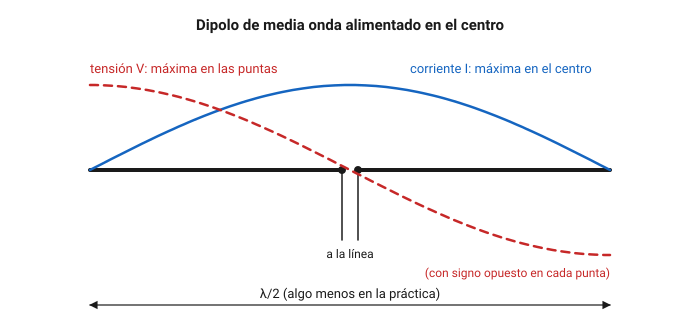
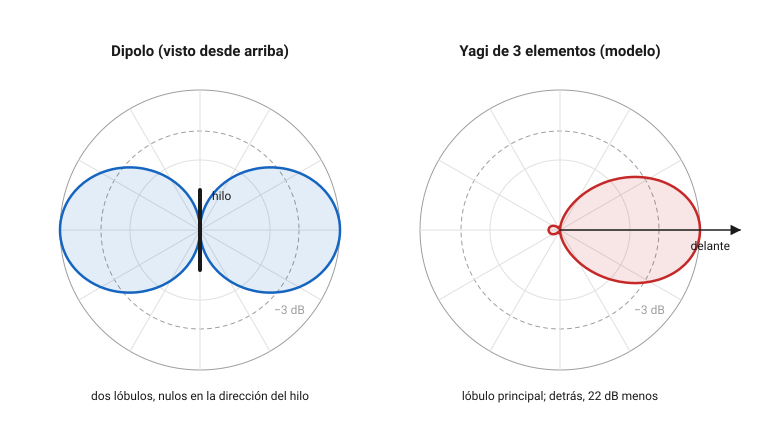
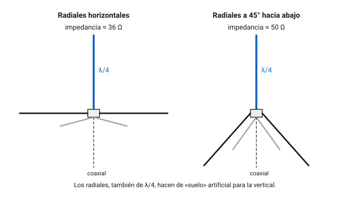
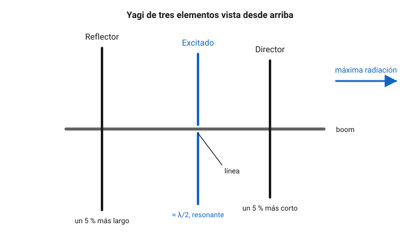
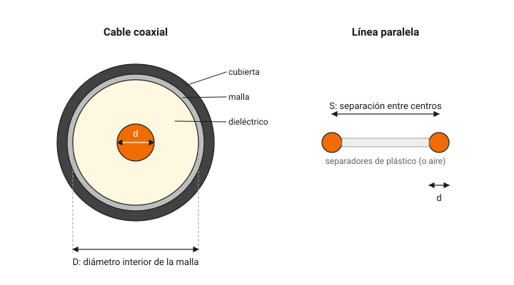
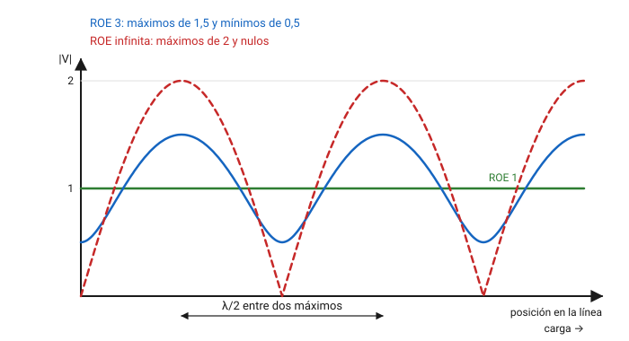
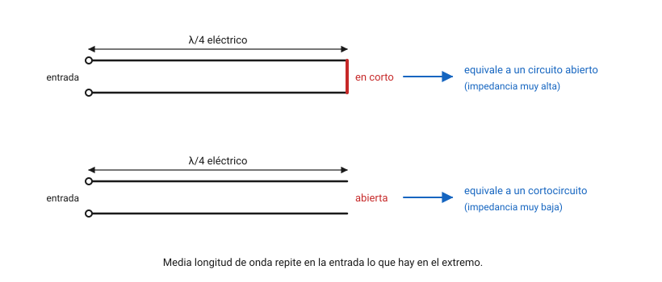
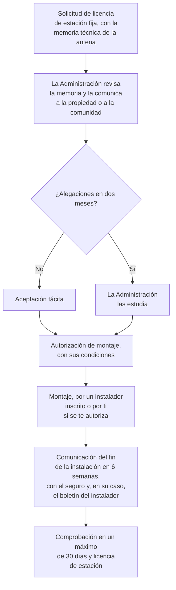

# Antenas y líneas de transmisión

El transmisor más caro no sirve de nada si la energía se queda en el cable o sale disparada hacia donde no hay nadie. La antena y la línea que la alimenta deciden cuánta potencia llega de verdad al aire y hacia dónde va. En este capítulo aprenderás cómo radia una antena y qué significan la impedancia, la ganancia y el diagrama de radiación; cómo se calculan y se ajustan los tipos de antena más habituales; cómo se comportan el cable coaxial y la línea paralela, y cuánto pierden los cables comerciales según sus hojas de datos; qué es la ROE, cómo se mide y cómo se corrige; y qué dice la ley española sobre tu derecho a instalar una antena en el exterior de tu casa.

## Cómo radia una antena

### Resonancia y longitud eléctrica

En el [capítulo 4](04-teoria-radio.md) viste que una corriente alterna de alta frecuencia lanza una onda electromagnética al espacio. Una **antena** es un conductor dimensionado para que esa corriente sea lo más grande posible a la frecuencia de trabajo.

Piensa en un hilo recto de media longitud de onda, cortado en el centro, por donde le llega la señal. La onda de corriente recorre cada mitad, rebota en la punta y vuelve. Si el hilo mide justo media longitud de onda, la onda que vuelve llega en fase con la siguiente y las dos se suman: el hilo **resuena**, como una cuerda de guitarra afinada. Es el **dipolo de media onda**, la antena de referencia de todo el capítulo.

*Figura 6.1. Reparto de la corriente y la tensión a lo largo de un dipolo de media onda.*

Fíjate en la figura 6.1. En las puntas la corriente no tiene adónde ir y vale cero, mientras que la tensión es máxima. En el centro pasa lo contrario: corriente máxima y tensión mínima. Como la impedancia es el cociente entre tensión y corriente, el dipolo tiene una impedancia baja en el centro y muy alta en las puntas. Por eso se alimenta normalmente en el centro.

La onda viaja por el hilo algo más despacio que por el espacio libre, y además las puntas y los aisladores añaden una capacidad que alarga la antena eléctricamente. El resultado es que un dipolo resonante mide alrededor de un 95 % de la media longitud de onda en el espacio libre. Como $\lambda/2 = 150 / f$, la fórmula práctica queda

$$
L\,(\text{m}) \approx \frac{143}{f\,(\text{MHz})}
$$

donde $L$ es la longitud total del dipolo, de punta a punta, en metros, y $f$ la frecuencia en megahercios.

**Ejemplo 1.** Para un dipolo en 7,1 MHz, $L \approx 143 / 7{,}1 \approx 20{,}14\ \text{m}$: dos brazos de unos 10,07 m. La fórmula da un punto de partida. La altura, los objetos cercanos y el grosor del hilo cambian la resonancia, así que corta los brazos algo largos y ajústalos midiendo.

**Ejemplo 2.** Ese dipolo resulta resonar en 7,1 MHz y lo quieres en 7,15 MHz. La longitud es inversamente proporcional a la frecuencia: $20{,}14 \cdot 7{,}1 / 7{,}15 \approx 20{,}0\ \text{m}$. Hay que quitar unos 14 cm en total, 7 cm de cada brazo. Si la antena resuena **por debajo** de donde la quieres, es **demasiado larga** y hay que acortarla; si resuena por encima, es corta.

### Impedancia, resistencia de radiación y eficiencia

La impedancia que presenta una antena en sus bornes de alimentación tiene dos partes:

- Una parte **resistiva**, que a su vez suma dos cosas. La **resistencia de radiación** es una resistencia ficticia que representa la potencia que se va al espacio como onda: no se calienta, radia. La **resistencia de pérdidas** representa la potencia que se convierte en calor en los conductores, en las bobinas, en los aisladores y en el suelo cercano.
- Una parte **reactiva**. En resonancia vale cero. Si la antena es **más larga** que la resonante, se comporta como una bobina en serie (reactancia **inductiva**); si es **más corta**, como un condensador (reactancia **capacitiva**).

Un dipolo de media onda en el espacio libre tiene unos 73 Ω de resistencia de radiación. Más cerca del suelo, el valor cambia con la altura; en las instalaciones reales suele quedar entre 50 y 80 Ω, una buena pareja para un cable de 50 Ω.

La **eficiencia** de una antena es la fracción de la potencia que recibe que acaba radiada:

$$
\eta = \frac{R_r}{R_r + R_p}
$$

donde $R_r$ es la resistencia de radiación y $R_p$ la de pérdidas, ambas en ohmios. Un dipolo de cobre a buena altura tiene una eficiencia cercana al 100 %. Las antenas muy cortas en comparación con la longitud de onda tienen una resistencia de radiación pequeña y, con las mismas pérdidas, la eficiencia cae en picado.

**Ejemplo 3.** Una vertical acortada para 40 m sobre un coche tiene una resistencia de radiación de 12 Ω, y la bobina de carga, la toma de masa y la carrocería suman 18 Ω de pérdidas. La eficiencia es $12 / (12 + 18) = 0{,}4$: de 100 W entregados, solo 40 W salen como onda, una pérdida de 4 dB.

### Polarización

La **polarización** de una antena es la orientación del campo eléctrico que radia, y coincide con la del conductor: un dipolo horizontal radia con polarización horizontal y una vertical, con polarización vertical. Ya viste en el [capítulo 5](05-propagacion-bandas.md) que, en visión directa, las dos estaciones deben usar la misma polarización: con una horizontal y la otra vertical se pierden fácilmente 20 dB o más. En HF, la ionosfera gira la polarización y la diferencia importa mucho menos.

Por costumbre, en VHF y UHF se usa polarización **vertical** para FM y repetidores, que es la de las antenas de los vehículos y de los portátiles, y **horizontal** para BLU, CW y comunicaciones a larga distancia. Para satélites se usa la **polarización circular**, en la que el campo gira mientras avanza; así no importa cómo esté orientado el satélite en cada momento.

### Diagrama de radiación

Ninguna antena real radia igual en todas direcciones. El **diagrama de radiación** representa, en un dibujo polar, cuánto radia la antena en cada dirección. Se dibuja en dos cortes: el **plano horizontal**, visto desde arriba, que te dice hacia qué rumbos radia, y el **plano vertical**, que te dice con qué ángulo de elevación sale la onda.

*Figura 6.2. Diagramas de radiación en el plano horizontal, en escala lineal de campo. El de la Yagi está calculado con un modelo simplificado de tres elementos.*

En el diagrama se distinguen:

- El **lóbulo principal**, la dirección de máxima radiación, y los **lóbulos secundarios** y **trasero**.
- Los **nulos**, direcciones en las que la antena casi no radia ni recibe. Un dipolo tiene nulos en la dirección del propio hilo. Los nulos son útiles: orientando un nulo hacia una fuente de ruido o interferencia, la reduces mucho.
- El **ancho de haz**, el ángulo entre las dos direcciones en las que la potencia cae a la mitad (−3 dB) respecto al máximo. El de un dipolo en su plano es de unos 78°; el de la Yagi del modelo, de unos 65°.
- La **relación delante/detrás** (*F/B*), la diferencia en decibelios entre lo que la antena radia hacia delante y hacia atrás. En la Yagi de la figura vale unos 22 dB.

Una antena radia y recibe igual en cada dirección: es la **reciprocidad**. Todo lo que digas del diagrama de emisión vale para la recepción.

**Ejemplo 4.** Con una Yagi de 2 m recibes una baliza con S9+10 dB apuntando hacia ella y S7 al girar la antena 180°. Si el medidor S de tu equipo da 6 dB por punto, la diferencia es $10 + 2 \cdot 6 = 22\ \text{dB}$: esa es, aproximadamente, la relación delante/detrás de tu antena. Recuerda del capítulo 4 que pocos medidores S están bien calibrados; tómalo como una estimación.

### Ganancia, directividad y potencia radiada

Una antena no amplifica: no puede sacar más potencia de la que recibe. Lo que hace es concentrarla en unas direcciones a costa de otras, como el reflector de una linterna. La **directividad** mide cuánto más intensa es la radiación en la dirección de máximo que si la misma potencia se repartiera por igual en todas direcciones. La **ganancia** es la directividad multiplicada por la eficiencia: incluye las pérdidas.

La ganancia se expresa en decibelios respecto a una antena de referencia:

- **dBi**: respecto a la **antena isótropa**, una antena ideal, sin pérdidas, que radiaría igual en todas direcciones. No existe, pero es la referencia que usan las normas y los cálculos de exposición.
- **dBd**: respecto a un **dipolo de media onda**. Como el dipolo ya tiene una ganancia de 2,15 dBi, se cumple

$$
G\,(\text{dBi}) = G\,(\text{dBd}) + 2{,}15
$$

Una antena anunciada con 7 dBi tiene $7 - 2{,}15 = 4{,}85$ dBd. Desconfía de los catálogos que no dicen cuál de las dos referencias usan: suele ser la que da la cifra más vistosa.

Con la ganancia se calcula la potencia que «parece» radiar la antena en su dirección de máximo. La Orden IET/1311/2013, que verás más adelante, define dos magnitudes en su anexo I (comprobado en noviembre de 2026):

- **Potencia radiada aparente** (p. r. a., *ERP*, de *effective radiated power*): la potencia entregada a la antena multiplicada por su ganancia respecto al dipolo.
- **Potencia isótropa radiada equivalente** (p. i. r. e., *EIRP*): la potencia entregada a la antena multiplicada por su ganancia respecto a la antena isótropa. Es la que se usa en el [capítulo 3](03-seguridad.md) para calcular distancias de seguridad.

**Ejemplo 5.** Entregas 100 W a una Yagi de 6 dBd. 6 dB equivalen a multiplicar por unas 4: la p. r. a. es $100 \cdot 10^{0{,}6} \approx 398\ \text{W}$. En dBi, la antena tiene 8,15 dBi, y la p. i. r. e. es $100 \cdot 10^{0{,}815} \approx 653\ \text{W}$. La p. i. r. e. siempre es 1,64 veces la p. r. a.

### Área de captura

En recepción, una antena se comporta como una superficie que recoge la energía de la onda que le llega. Esa **área de captura** o **apertura efectiva** no coincide con su tamaño físico, y se relaciona con la ganancia:

$$
A_e = \frac{G \, \lambda^2}{4 \pi}
$$

donde $A_e$ es el área en metros cuadrados, $G$ la ganancia como factor (no en decibelios) y $\lambda$ la longitud de onda en metros.

**Ejemplo 6.** En 145 MHz, $\lambda \approx 2{,}07\ \text{m}$. Un dipolo ($G = 1{,}64$) tiene $A_e = 1{,}64 \cdot 2{,}07^2 / (4\pi) \approx 0{,}56\ \text{m}^2$, y una Yagi de 13 dBi ($G \approx 20$), unos 6,8 m². La fórmula explica por qué, con la misma ganancia, una antena para una frecuencia más alta capta menos energía: su área de captura es menor. Es el término de la frecuencia de la pérdida en el espacio libre que viste en el capítulo 5.

### El suelo y la altura

Una antena horizontal cerca del suelo recibe el reflejo de su propia onda en el terreno. Según la altura, la onda directa y la reflejada se suman en unos ángulos de elevación y se restan en otros. Como orientación:

- Un dipolo a menos de un cuarto de onda de altura radia sobre todo hacia arriba. Es malo para el DX, pero ideal para la propagación NVIS a corta distancia del capítulo 5.
- A media onda de altura o más, el lóbulo principal baja hacia el horizonte y la antena sirve para contactos lejanos.

En HF esto tiene consecuencias prácticas: en 80 m, media onda son 40 m de altura, algo inalcanzable para casi todos. Por eso un dipolo de 80 m a 10 m de altura trabaja muy bien a escala regional y bastante peor en DX. Las antenas verticales, en cambio, radian con ángulos bajos aunque estén cerca del suelo, siempre que tengan un buen sistema de radiales.

??? note "Para saber más"
    El suelo real no es un espejo perfecto. Su conductividad y su constante dieléctrica cambian mucho entre un terreno seco y rocoso, un campo húmedo o el agua del mar, y con ellos cambian el ángulo de radiación y las pérdidas, sobre todo en las verticales. Los programas de modelado de antenas basados en el método de los momentos, como los derivados de NEC, calculan el diagrama y la impedancia de una antena teniendo en cuenta el tipo de suelo, la altura y los objetos cercanos. Son la herramienta habitual para diseñar antenas antes de cortar ningún hilo.

## Tipos de antenas

### Dipolo de media onda

El dipolo es sencillo, barato y eficaz. Se cuelga entre dos soportes, horizontal, o desde un único mástil central con los brazos inclinados hacia el suelo: la **V invertida**. La V invertida necesita un solo apoyo alto, tiene un diagrama algo menos directivo y una impedancia más baja, más cercana a 50 Ω. Al inclinar los brazos, la antena resuena algo más abajo, así que hay que acortarla un poco respecto a la fórmula.

Un dipolo funciona también en los múltiplos impares de su frecuencia: uno cortado para 7 MHz resuena cerca de 21 MHz, donde mide tres medias ondas, aunque allí su diagrama cambia y tiene más lóbulos.

### Dipolo plegado

El **dipolo plegado** es un dipolo de media onda formado por un bucle estrecho: dos conductores paralelos, unidos en las puntas, con la alimentación en el centro de uno de ellos. La corriente se reparte entre los dos y la impedancia en el punto de alimentación se multiplica por cuatro: unos $4 \cdot 73 \approx 292\ \Omega$, que en la práctica se redondean a 300 Ω. Tiene un ancho de banda algo mayor que el dipolo simple y se usa mucho como elemento excitado de las Yagi y en las antenas de recepción de FM.

### Media onda alimentada en un extremo

Un hilo de media onda también se puede alimentar en una punta, en lugar de en el centro. Allí la tensión es máxima y la corriente mínima, así que la impedancia es muy alta: valores típicos de 2 000 a 4 000 Ω, según la altura, el grosor del hilo y el entorno. Para conectarle un cable de 50 Ω se usa un transformador con un núcleo de ferrita, con una relación de impedancias de 49:1 o 64:1. Como la relación de impedancias es el cuadrado de la relación de espiras, un transformador 49:1 tiene 7 espiras en un lado por cada una en el otro, y convierte 2 450 Ω en $2\,450 / 49 = 50\ \Omega$.

Esta antena, que en la banda se conoce por sus siglas inglesas, *EFHW* (*end-fed half-wave*), es muy popular para operar en portable: se tiende un solo hilo desde el equipo hasta un árbol, sin tener que subir nada pesado al centro. Funciona en la banda para la que mide media onda y en sus armónicos: un hilo de media onda en 40 m sirve también en 20, 15 y 10 m.

### Antenas multibanda: trampas y abanico

Con un solo dipolo puedes trabajar en varias bandas de dos formas:

- **Dipolo con trampas.** En cada brazo se intercala una **trampa**, un circuito resonante paralelo formado por una bobina y un condensador. En la frecuencia de resonancia de la trampa, su impedancia es altísima y corta eléctricamente el hilo: la antena «termina» allí. A frecuencias más bajas, la trampa deja pasar la corriente y se comporta como una bobina de carga, de modo que el resto del hilo puede ser más corto que un dipolo completo de la banda baja. Las trampas tienen pérdidas y limitan la potencia admisible.
- **Dipolo en abanico.** Varios dipolos de distintas longitudes conectados en paralelo al mismo punto de alimentación. En cada banda, el dipolo resonante presenta una impedancia baja y se lleva casi toda la corriente; los demás, muy desadaptados, apenas influyen. Los hilos hay que separarlos unos de otros, porque interactúan y desplazan las resonancias.

Con un **acoplador de antena** y una línea de bajas pérdidas puedes también alimentar un dipolo no resonante en varias bandas, como verás al hablar de la ROE.

### Vertical de cuarto de onda y plano de tierra

Un conductor vertical de un cuarto de onda sobre un suelo conductor se comporta como la mitad de un dipolo: el suelo hace de espejo y aporta la mitad que falta. Su impedancia típica en la base, sobre un suelo ideal, es de unos 36 Ω, la mitad que la del dipolo, y su diagrama horizontal es **omnidireccional**: radia por igual hacia todos los rumbos. Su longitud práctica es la mitad de la del dipolo:

$$
L\,(\text{m}) \approx \frac{71{,}5}{f\,(\text{MHz})}
$$

**Ejemplo 7.** Una vertical de cuarto de onda para 145 MHz mide $71{,}5 / 145 \approx 0{,}49\ \text{m}$, unos 49 cm.

Como el suelo real conduce mal, se sustituye por un **plano de tierra** artificial: varios conductores de un cuarto de onda, los **radiales**, que salen de la base. En HF, sobre el terreno, se entierran o se tienden muchos radiales, cuantos más mejor; elevados, bastan dos o cuatro resonantes. En VHF, la antena con cuatro radiales es la clásica *ground plane*. Si inclinas los radiales unos 45° hacia abajo, la impedancia sube y queda típicamente cerca de 50 Ω, de modo que puedes conectar el coaxial directamente. Son valores orientativos: la longitud de los radiales, su número y lo que hay alrededor los cambian, y la ROE medida es la que manda.

*Figura 6.3. Vertical de cuarto de onda con plano de tierra. Valores típicos de impedancia: unos 36 Ω con los radiales horizontales y cerca de 50 Ω con los radiales inclinados.*

En un vehículo, la carrocería metálica hace de plano de tierra. Las antenas de móvil de VHF y UHF suelen ser de **5/8 de onda**: más largas que un cuarto de onda, con una bobina en la base que las adapta, y con algo más de ganancia en dirección horizontal.

### Antenas acortadas y antenas de móvil para HF

Una vertical de cuarto de onda para 40 m mide unos 10 m, imposible en un coche. Las antenas de móvil de HF son mucho más cortas y se llevan a resonancia añadiendo inductancia o capacidad:

- Una **bobina de carga**, en la base o hacia la mitad, compensa la reactancia capacitiva de la antena corta. Cuanto más arriba está, más corriente circula por la parte baja del látigo y mejor radia, pero más grande tiene que ser la bobina.
- Un **sombrero capacitivo**, unas varillas o un disco en lo alto, añade capacidad en la punta y reduce la bobina necesaria.

Cuanto más corta es una antena, menor es su resistencia de radiación, más estrecho su ancho de banda y peor su eficiencia, como en el ejemplo 3. Una antena de móvil de HF puede necesitar reajuste solo con moverte 20 o 30 kHz dentro de la banda.

### Antena Yagi

La **Yagi** es la antena directiva más habitual en radioafición. Sobre un soporte llamado **boom** se colocan varios elementos paralelos de alrededor de media onda:

- El **elemento excitado**, el único conectado a la línea, es un dipolo resonante, simple o plegado.
- El **reflector**, detrás, es algo **más largo**. No está conectado a nada: la corriente que la onda induce en él vuelve a radiar con un desfase que refuerza la señal hacia delante y la cancela hacia atrás.
- Los **directores**, delante, son algo **más cortos**. Con el mismo mecanismo, empujan la radiación hacia delante.

*Figura 6.4. Yagi de tres elementos. La antena radia hacia el lado del director.*

Como valores típicos, una Yagi de tres elementos bien diseñada tiene una ganancia de 7 a 8 dBi y una relación delante/detrás de unos 20 dB; las cifras exactas dependen de las longitudes y separaciones de cada diseño. Añadir directores y alargar el boom aumenta la ganancia y estrecha el haz; en VHF y UHF son habituales las Yagi de 10 o más elementos. Los elementos parásitos bajan la impedancia del excitado muy por debajo de los 73 Ω del dipolo, a menudo a 20 o 30 Ω, y hay que adaptarla: con un dipolo plegado, con un transformador de cuarto de onda o con una red de adaptación.

### Cuadros y delta

Un bucle cerrado de una longitud de onda de perímetro también resuena. Con forma de cuadrado es el **cuadro** (*quad*); con forma de triángulo, la **delta**. En la práctica, el perímetro resonante es algo mayor que una longitud de onda:

$$
P\,(\text{m}) \approx \frac{306}{f\,(\text{MHz})}
$$

**Ejemplo 8.** Un cuadro para 14,2 MHz tiene un perímetro de $306 / 14{,}2 \approx 21{,}5\ \text{m}$, unos 5,4 m de lado. Un bucle de onda completa tiene algo más de ganancia que un dipolo, 1 o 2 dB, y suele captar menos ruido local. Con un elemento excitado y un reflector se forma un **cuadro de dos elementos**, que da una ganancia parecida a la de una Yagi de tres elementos en un boom más corto.

### Antenas de apertura: parabólicas y bocinas

En microondas se usan antenas que concentran la energía con superficies, como la luz con un espejo. La **antena parabólica** tiene un reflector con forma de paraboloide que refleja hacia el foco toda la energía que le llega de frente; en el foco se coloca el **alimentador**, un pequeño dipolo o una bocina. La **bocina** es una guía de ondas que se ensancha poco a poco hasta abrirse al aire. Hay también **reflectores** planos o en esquina detrás de un dipolo.

La ganancia de una parabólica depende de su diámetro en longitudes de onda:

$$
G = \eta \left( \frac{\pi D}{\lambda} \right)^2
$$

donde $D$ es el diámetro del plato y $\lambda$ la longitud de onda, en la misma unidad, y $\eta$ el **rendimiento de apertura**, con valores típicos de 0,5 a 0,7 en un plato bien alimentado.

**Ejemplo 9.** El satélite geoestacionario QO-100 transmite en la banda de 10 GHz. En 10 489,5 MHz, $\lambda \approx 2{,}86\ \text{cm}$. Un plato de 80 cm con un rendimiento de 0,6 tiene $G = 0{,}6 \cdot (\pi \cdot 80 / 2{,}86)^2 \approx 4\,640$, es decir, unos 36,7 dBi. Si pasas a un plato de 1,2 m, la ganancia sube $20 \log (1{,}2 / 0{,}8) \approx 3{,}5\ \text{dB}$: duplicar el área duplica la ganancia.

!!! danger "Peligro"
    Delante de una parabólica o de una bocina que transmiten, la densidad de potencia puede ser muy alta incluso con pocos vatios. No te pongas nunca delante ni mires dentro de una guía de ondas con el transmisor conectado: puede lesionar los ojos sin que notes calor, como se explica en el [capítulo 3](03-seguridad.md).

Con tanta ganancia, el haz es muy estrecho, de muy pocos grados, y la antena tiene que estar bien apuntada.

??? note "Para saber más"
    Para satélites de órbita baja se usan antenas de **polarización circular**. La más directa es la **hélice axial**: un conductor enrollado en espiral, de una longitud de onda de circunferencia por vuelta, delante de un plano reflector. Radia hacia delante con polarización circular, y su ganancia crece con el número de vueltas. También se consigue polarización circular con dos Yagi cruzadas, alimentadas con un desfase de 90° mediante una línea de un cuarto de onda. El sentido de giro importa: entre dos antenas circulares de sentido contrario se pierden más de 20 dB. Lo verás con más detalle en el capítulo 13.

### Antenas de hilo no resonantes

Un hilo de longitud arbitraria, el **hilo largo**, conectado al equipo a través de un acoplador, puede servir en muchas bandas. Su impedancia cambia mucho con la frecuencia, casi siempre lejos de 50 Ω, y el acoplador tiene que compensarla. Funciona mejor cuanto más largo y alto es el hilo, y necesita una buena toma de tierra o un contrapeso, porque el otro borne del acoplador forma parte de la antena. Evita las longitudes de media onda, o múltiplos, de las bandas que vayas a usar: en esas frecuencias la impedancia en el extremo es tan alta que el acoplador no la puede adaptar.

!!! tip "Para el examen"
    Apréndete: dipolo $L \approx 143/f$, cuarto de onda $L \approx 71{,}5/f$, dBi = dBd + 2,15, impedancia del dipolo unos 73 Ω, del dipolo plegado unos 300 Ω y de la vertical con radiales horizontales, unos 36 Ω como valor típico. En la Yagi, el reflector es el más largo y los directores los más cortos. Una antena más larga que la resonante es inductiva y resuena más abajo; una más corta es capacitiva y resuena más arriba.

## Líneas de transmisión

### Qué es una línea de transmisión

La **línea de transmisión** (o **línea de alimentación**) lleva la energía del transmisor a la antena, y de la antena al receptor, sin radiarla por el camino. Para ello está formada por dos conductores cuyas corrientes van en sentidos opuestos, de modo que sus campos se cancelan fuera de la línea. Hay tres tipos principales:

- **Cable coaxial**: un conductor central, el **vivo**, rodeado de un **dieléctrico** aislante, una **malla** o pantalla metálica, a veces con una lámina además, y una **cubierta** exterior. Los campos quedan encerrados entre el vivo y la malla. Puedes pegarlo a la pared, enterrarlo o pasarlo junto a un tubo metálico sin que le afecte. Es la línea más común.
- **Línea paralela** o **bifilar**: dos conductores paralelos separados por aire, con separadores de plástico cada cierto trecho (la **línea de escalera**), o embebidos en una cinta de plástico (la **línea de cinta**, de 300 o 450 Ω). Pierde mucho menos que el coaxial, pero hay que mantenerla separada de objetos metálicos y paredes, y no admite curvas cerradas.
- **Guía de ondas**: un tubo metálico hueco, rectangular o circular, por cuyo interior viaja la onda. Solo funciona por encima de una frecuencia de corte que depende de sus dimensiones, por lo que se usa en microondas, donde pierde menos que cualquier coaxial.

*Figura 6.5. Sección de un cable coaxial y de una línea paralela, con las medidas que fijan su impedancia característica.*

### Impedancia característica

Una línea muy larga y sin pérdidas, mirada desde un extremo, se comporta como una resistencia pura, aunque sus conductores no consuman nada: la corriente que entra se reparte entre la inductancia y la capacidad repartidas a lo largo de la línea. Esa resistencia aparente es la **impedancia característica** $Z_0$, y no depende de la longitud, sino de la geometría y del aislante.

Para un cable coaxial,

$$
Z_0 = \frac{138}{\sqrt{\varepsilon_r}} \log \frac{D}{d}
$$

donde $D$ es el diámetro interior de la malla, $d$ el diámetro del vivo, ambos en la misma unidad, y $\varepsilon_r$ la constante dieléctrica relativa del aislante: 1 para el aire, unos 2,25 para el polietileno macizo y bastante menos para el polietileno espumado, que lleva aire en burbujas.

Para una línea paralela en aire, con los conductores separados mucho más que su diámetro,

$$
Z_0 \approx 276 \log \frac{2S}{d}
$$

donde $S$ es la separación entre los centros de los conductores y $d$ su diámetro, en la misma unidad. Si hay un dieléctrico, se divide también por $\sqrt{\varepsilon_r}$.

**Ejemplo 10.** Un coaxial con un vivo de 1,0 mm, una malla de 3,5 mm de diámetro interior y polietileno macizo tiene $Z_0 = (138 / 1{,}5) \log 3{,}5 \approx 50\ \Omega$. Con el mismo $D/d$ y aire como aislante saldrían unos 75 Ω.

**Ejemplo 11.** Una línea de escalera casera con hilo de 2 mm de diámetro y una separación de 30 mm tiene $Z_0 \approx 276 \log (60/2) \approx 408\ \Omega$.

En radioafición se usa casi siempre coaxial de **50 Ω**, que es la impedancia de salida de los transceptores. El de **75 Ω** es el de televisión y satélite; es barato y de bajas pérdidas, pero solo sirve con una adaptación adecuada, o como transformador, como verás después.

### Factor de velocidad

Por dentro de una línea, la onda viaja más despacio que en el aire, porque el aislante la frena. El **factor de velocidad** es la fracción de la velocidad de la luz a la que viaja:

$$
FV = \frac{1}{\sqrt{\varepsilon_r}}
$$

Con polietileno macizo, $FV = 1 / \sqrt{2{,}25} \approx 0{,}66$; con polietileno espumado, entre 0,80 y 0,87; en una línea de escalera, casi toda de aire, por encima de 0,9.

El factor de velocidad importa cuando cortas un tramo de línea con una longitud eléctrica concreta, como un transformador de cuarto de onda o una trampa. La **longitud física** es la longitud en el espacio libre multiplicada por el factor de velocidad.

**Ejemplo 12.** Un cuarto de onda en 145 MHz mide $300 / 145 / 4 \approx 51{,}7\ \text{cm}$ en el aire. Con un coaxial de polietileno macizo, $FV = 0{,}66$, el tramo debe medir $51{,}7 \cdot 0{,}66 \approx 34{,}1\ \text{cm}$; con uno espumado de $FV = 0{,}85$, unos 44 cm. Si te olvidas del factor de velocidad, el tramo queda demasiado largo.

### Pérdidas en la línea

Toda línea real pierde parte de la potencia que transporta. Una parte se calienta en los conductores, por su resistencia, que en RF crece con la frecuencia porque la corriente se concentra en la superficie (el **efecto pelicular**). Otra parte se pierde en el dieléctrico. Por eso las pérdidas:

- crecen con la frecuencia;
- son proporcionales a la longitud: se dan en decibelios por cada 100 m, y 25 m de cable pierden la cuarta parte que 100 m;
- son menores en los cables gruesos y con dieléctrico espumado o de aire;
- aumentan si el cable envejece, se moja o se aplasta.

La línea paralela pierde mucho menos que cualquier coaxial de precio parecido. Entre los coaxiales, las diferencias son enormes, y en VHF y UHF elegir bien el cable vale más que muchos vatios de amplificador.

### Cables coaxiales comerciales

Esta tabla resume los datos de varios cables de 50 Ω muy usados en radioafición, tal como los publica su fabricante en la hoja de datos, consultada el 9 de noviembre de 2026. Belden da la atenuación en dB por cada 100 pies; aquí está convertida a dB/100 m y redondeada a un decimal. SSB-Electronic y Messi & Paoloni la dan a 20 °C; Belden no indica la temperatura.

| Cable (fabricante y referencia) | $Z_0$ | FV | Ø exterior | 10 MHz | 50 MHz | 100 MHz | 144 MHz | 400–432 MHz | 1 000 MHz |
|---|---|---|---|---|---|---|---|---|---|
| RG-58, [Belden 8240](https://catalog.belden.com/techdata/en/8240_techdata.pdf) | 52 Ω | 0,66 | 4,9 mm | 3,6 | 8,2 | 12,5 | — | 27,6 (400) | 47,6 |
| H155, [SSB-Electronic](https://www.ssb.de/media/h155ssb-de.pdf) | 50 Ω | 0,80 | 5,4 mm | 3,2 | 6,9 | 9,1 | 10,6 | 18,7 (432) | 29,6 |
| RG-8X, [Belden 9258](https://catalog.belden.com/techdata/en/9258_techdata.pdf) | 50 Ω | 0,82 | 6,15 mm | 3,0 | 6,9 | 10,2 | — | 21,7 (400) | 36,7 |
| Aircell 7, [SSB-Electronic](https://www.ssb.de/media/6070_de.pdf) | 50 Ω | 0,85 | 7,3 mm | 2,1 | 4,3 | 6,0 | 7,2 | 12,9 (432) | 20,4 |
| RG-213, [Belden 8267](https://catalog.belden.com/techdata/en/8267_techdata.pdf) | 50 Ω | 0,66 | 10,3 mm | 1,8 | 4,3 | 6,2 | — | 13,5 (400) | 26,2 |
| Ecoflex 10, [SSB-Electronic](https://www.ssb.de/media/6080_de.pdf) | 50 Ω | 0,85 | 10,2 mm | 1,1 | 2,7 | 3,8 | 4,7 | 8,5 (432) | 13,5 |
| Hyperflex 10, [Messi & Paoloni](https://messi.it/dati/immagini/HYPERFLEX10-All1_EN.pdf) | 50 Ω | 0,87 | 10,3 mm | 1,3 | 2,7 | 3,9 | 4,7 | 8,6 (430) | 13,4 |
| Ecoflex 15, [SSB-Electronic](https://www.ssb.de/media/6090_de.pdf) | 50 Ω | 0,85 | 14,6 mm | 0,9 | 2,0 | 2,8 | 3,4 | 6,1 (432) | 9,8 |

*Atenuación en dB/100 m. La columna de 400–432 MHz indica entre paréntesis la frecuencia exacta que da cada hoja. Las hojas de Belden no dan valores a 144 MHz. El RG-58 de Belden tiene una impedancia nominal de 52 Ω, con una tolerancia de 51,5 ± 1,5 Ω según su hoja; en la práctica se usa como cable de 50 Ω.*

Un mismo nombre genérico, como RG-58 o RG-213, lo fabrican muchas marcas con calidades distintas. Las cifras de la tabla son las de la referencia concreta enlazada; para otro fabricante, consulta su hoja.

**Ejemplo 13.** Tienes 25 m de cable entre tu equipo de 2 m, que da 50 W, y la antena. Con H155, a 144 MHz, la pérdida es $10{,}55 \cdot 25 / 100 \approx 2{,}6\ \text{dB}$, y a la antena llegan $50 \cdot 10^{-0{,}264} \approx 27\ \text{W}$. Con Ecoflex 10 la pérdida es de $4{,}66 \cdot 0{,}25 \approx 1{,}2\ \text{dB}$, y llegan unos 38 W. En recepción pasa lo mismo: cada decibelio que pierde el cable es un decibelio menos de señal frente al ruido del receptor.

**Ejemplo 14.** En HF las pérdidas pesan mucho menos. 30 m de RG-58 en 10 MHz pierden $3{,}6 \cdot 0{,}30 \approx 1{,}1\ \text{dB}$: de 100 W llegan unos 78 W. Los mismos 30 m en 400 MHz pierden unos 8,3 dB, y de 100 W llegan solo unos 15 W. Un cable fino puede ser aceptable en HF y un desastre en UHF.

!!! example "En la práctica"
    Además de la atenuación, mira la potencia máxima que admite el cable, que la hoja da para cada frecuencia y que baja al subir esta: un RG-58 que aguanta sin problemas 100 W en HF puede calentarse con esa potencia en UHF. Fíjate también en el radio mínimo de curvatura: doblar un coaxial más de la cuenta deforma el dieléctrico, cambia la impedancia en ese punto y aumenta las pérdidas.

### Conectores

Los conectores también tienen impedancia y pérdidas, y además son el punto por donde entra el agua. Los más habituales son:

- **UHF** (macho **PL-259**, hembra **SO-239**): el clásico de los equipos de HF. Robusto y fácil de montar, pero no mantiene una impedancia constante, y eso se nota a partir de las frecuencias de UHF, pese a su nombre. PL-259 y SO-239 son designaciones militares estadounidenses: PL de *plug* (clavija) y SO de *socket* (base).
- **N**, por Paul Neill, uno de sus inventores: roscado, estanco y de impedancia constante. Es el preferido a partir de 430 MHz y en cualquier instalación exterior.
- **BNC** (*Bayonet Neill–Concelman*, la bayoneta de Neill y Concelman): de bayoneta, de enganche rápido. Habitual en instrumentos y en equipos portátiles antiguos.
- **SMA** (*SubMiniature version A*, subminiatura de tipo A): pequeño y roscado, para cables finos. Lo llevan los portátiles actuales, los receptores SDR y muchos módulos de radio. Muchos portátiles chinos llevan la variante **SMA inversa**, con los sexos del vivo cambiados: comprueba cuál lleva el tuyo antes de comprar una antena.

Cada conector debe corresponder al diámetro exacto del cable. Un conector mal montado, con un pelo de la malla tocando el vivo o con el dieléctrico fundido por el soldador, causa más problemas que muchos metros de cable.

!!! example "En la práctica"
    El agua es el gran enemigo del coaxial. Una vez dentro, avanza por la malla, la oxida y dispara las pérdidas. En el exterior, cubre cada conector con cinta autovulcanizante y, encima, cinta aislante de buena calidad resistente a los rayos ultravioleta. Deja el cable con una curva hacia abajo antes de entrar en la antena o en la casa, para que el agua gotee y no corra hacia el conector.

## Adaptación de impedancias y ROE

### Ondas estacionarias

Si la impedancia de la antena es igual que la impedancia característica de la línea, la antena absorbe toda la energía que le llega y la línea está **adaptada**. Si no lo es, una parte de la energía rebota en la antena y vuelve hacia el transmisor. A lo largo de la línea conviven entonces dos ondas, la **incidente** y la **reflejada**, que se suman en unos puntos y se restan en otros. El resultado es un reparto de tensión y corriente con máximos y mínimos fijos: las **ondas estacionarias**.

*Figura 6.6. Tensión a lo largo de una línea con tres cargas distintas. Los máximos se repiten cada media longitud de onda eléctrica.*

La proporción de onda que se refleja la da el **coeficiente de reflexión**:

$$
\Gamma = \frac{Z_L - Z_0}{Z_L + Z_0}
$$

donde $Z_L$ es la impedancia de la carga, la antena, y $Z_0$ la de la línea. Vale 0 si la línea está adaptada y 1, en valor absoluto, si la carga es un cortocircuito o un circuito abierto, que lo reflejan todo. La fracción de potencia reflejada es $|\Gamma|^2$.

La **relación de ondas estacionarias** (**ROE**, en inglés *SWR*, de *standing wave ratio*, o *VSWR*, de *voltage standing wave ratio*) es el cociente entre la tensión máxima y la mínima a lo largo de la línea:

$$
\text{ROE} = \frac{V_{\text{máx}}}{V_{\text{mín}}} = \frac{1 + |\Gamma|}{1 - |\Gamma|}
$$

Vale 1 con la línea adaptada y crece sin límite cuanto peor es la adaptación. Se escribe como «1,5» o «1,5:1». Si la carga es una resistencia pura, se calcula directamente como el cociente entre la mayor y la menor de las dos impedancias:

$$
\text{ROE} = \frac{Z_L}{Z_0} \text{ si } Z_L > Z_0, \qquad \text{ROE} = \frac{Z_0}{Z_L} \text{ si } Z_L < Z_0
$$

**Ejemplo 15.** Conectas una antena de 100 Ω resistivos a un coaxial de 50 Ω. $\Gamma = (100 - 50)/(100 + 50) = 1/3$ y $\text{ROE} = (1 + 1/3)/(1 - 1/3) = 2$, lo mismo que $100 / 50$. Se refleja $|\Gamma|^2 = 1/9$, un 11,1 % de la potencia. Una antena de 25 Ω daría la misma ROE, 2, porque $50 / 25 = 2$: la ROE no te dice si la impedancia está por encima o por debajo de 50 Ω.

| ROE | Potencia reflejada | Pérdida de retorno |
|---|---|---|
| 1 | 0 % | infinita |
| 1,5 | 4,0 % | 14,0 dB |
| 2 | 11,1 % | 9,5 dB |
| 3 | 25,0 % | 6,0 dB |
| 5 | 44,4 % | 3,5 dB |

La **pérdida de retorno** es otra forma de expresar lo mismo, en decibelios: cuánto más débil es la onda reflejada que la incidente, $-20 \log |\Gamma|$. Los analizadores de antena y los NanoVNA la muestran a menudo; cuanto mayor, mejor.

### ¿Es grave una ROE alta?

La potencia reflejada no se pierde por sí misma: vuelve al transmisor, que la vuelve a enviar, y así sucesivamente. Con una línea de pocas pérdidas, casi toda acaba en la antena. Los problemas reales de una ROE alta son otros:

- **El transmisor protege sus transistores.** Los equipos actuales están diseñados para una carga de 50 Ω. Con ROE alta, aparecen tensiones o corrientes excesivas en la etapa final, y el equipo **reduce su potencia** automáticamente; a partir de ROE 2 o 3, según el modelo, la reducción es importante.
- **Las pérdidas de la línea aumentan**, porque las corrientes y tensiones estacionarias son mayores que las de una línea adaptada. En un coaxial largo y en frecuencias altas, el efecto es notable; en una línea paralela, mucho menor.
- **Las tensiones en la línea son mayores**, lo que puede perforar un coaxial fino o un conector con mucha potencia.

Una ROE de 1,5 refleja solo un 4 % de la potencia, una pérdida de apenas 0,18 dB. Por debajo de 2 no merece la pena obsesionarse.

### Medir la ROE

La ROE se mide con un **medidor de ROE** o **reflectómetro**, o con un **vatímetro direccional**, que mide por separado la potencia incidente (**directa**) y la **reflejada**. Ambos se intercalan en la línea, normalmente a la salida del transmisor. A partir de las dos potencias,

$$
|\Gamma| = \sqrt{\frac{P_{\text{ref}}}{P_{\text{dir}}}}
$$

y con ella se calcula la ROE. La potencia que llega a la carga es la diferencia entre la directa y la reflejada.

**Ejemplo 16.** El vatímetro marca 100 W de directa y 4 W de reflejada. $|\Gamma| = \sqrt{4/100} = 0{,}2$ y $\text{ROE} = 1{,}2 / 0{,}8 = 1{,}5$. A la antena le llegan 96 W, menos las pérdidas del cable.

Un **analizador de antenas** o un **NanoVNA** miden la impedancia y la ROE sin transmitir, con una señal propia muy débil, y la barren en toda una banda. Así ves de un vistazo dónde resuena la antena: el mínimo de la curva de ROE. Es la herramienta ideal para ajustar un dipolo. Se usa con la antena en su posición definitiva, porque el entorno cambia la resonancia.

!!! example "En la práctica"
    No te fíes de la etiqueta de una antena barata, sobre todo de las de portátil: mide siempre su ROE en la banda en la que vas a transmitir. Hay antenas «de doble banda» que en una de ellas tienen ROE 3 o peor. Y si vas a medir con el transmisor, hazlo con poca potencia y pulsando poco tiempo, por si la antena está muy desadaptada o hay un fallo en el cable.

### Una línea con pérdidas engaña

Las pérdidas de la línea atenúan la onda reflejada dos veces, a la ida y a la vuelta. Por eso la ROE medida junto al transmisor siempre es **mejor** que la que hay realmente en la antena. El coeficiente de reflexión que ves en el equipo es el de la antena reducido por el doble de las pérdidas:

$$
|\Gamma_{\text{equipo}}| = |\Gamma_{\text{antena}}| \cdot 10^{-2A/20}
$$

donde $A$ es la atenuación de la línea en decibelios, en un sentido.

**Ejemplo 17.** Un cable con 3 dB de pérdidas tiene la antena desconectada en el otro extremo: allí la ROE es infinita, $|\Gamma| = 1$. En el equipo, $|\Gamma| = 10^{-6/20} \approx 0{,}50$, y la ROE medida es de 3,0. Con 1 dB de pérdidas, verías unos 8,7. Y una antena con ROE 3 al final de una línea de 2 dB parece tener ROE 1,9 desde el equipo.

Desconfía de una ROE estupendamente baja en todas las bandas con una antena sencilla: muchas veces es un cable con muchas pérdidas, o una antena que se calienta en vez de radiar. Una carga artificial tiene ROE 1 en todas las frecuencias y no radia nada.

### El acoplador de antena

El **acoplador de antena** o **sintonizador** (*antenna tuner*, o *ATU*, de *antenna tuning unit*) es una red de bobinas y condensadores ajustables que se coloca entre el transmisor y la línea. Transforma la impedancia que presenta la línea en 50 Ω, de modo que el transmisor ve una carga adaptada y entrega toda su potencia. Los hay manuales y automáticos, y muchos transceptores llevan uno incorporado de margen limitado.

Lo que el acoplador **no** hace es arreglar la antena: entre él y la antena la ROE sigue siendo la misma, con sus pérdidas en la línea. Por eso un acoplador en el cuarto de radio funciona muy bien con línea paralela, que pierde poco aunque tenga ROE alta, y bastante peor con un coaxial largo en las bandas altas. La solución más eficiente con coaxial es poner el acoplador automático junto a la antena, en el exterior.

### Balun y corrientes en modo común

Un dipolo es una carga **simétrica**: sus dos brazos son iguales respecto a tierra. El coaxial es **asimétrico**: el vivo está dentro y la malla, fuera, conectada a tierra en el equipo. Si conectas directamente un coaxial a un dipolo, parte de la corriente vuelve por la cara **exterior** de la malla, que se convierte en una parte más de la antena. Son las **corrientes en modo común**: deforman el diagrama, meten RF en el cuarto de radio y en los aparatos de la casa, y hacen que el cable capte ruido.

La solución es un **balun** (de *balanced-unbalanced*, simétrico-asimétrico), un transformador de RF que se coloca en el punto de alimentación:

- El **balun 1:1** o **de corriente** solo bloquea las corrientes en modo común, sin cambiar la impedancia. El más sencillo es un **choque** hecho con varias espiras del propio coaxial, o con varias ferritas adecuadas ensartadas en el cable junto a la antena.
- El **balun 4:1** además divide la impedancia por cuatro; por ejemplo, adapta un dipolo plegado de 200 a 300 Ω a una línea de 50 o 75 Ω.

Un **unun** (de *unbalanced-unbalanced*) es un transformador entre dos impedancias asimétricas, como el 49:1 de la antena alimentada en un extremo o el 9:1 de muchos hilos largos.

### El transformador de cuarto de onda

Un tramo de línea de un cuarto de onda eléctrica transforma una impedancia en otra. Si en su extremo hay una carga $Z_L$, en la entrada se ve

$$
Z_{\text{ent}} = \frac{Z_0^2}{Z_L}
$$

Así que, para adaptar una carga $Z_L$ a una impedancia $Z_{\text{ent}}$, hace falta un tramo de cuarto de onda de impedancia

$$
Z_0 = \sqrt{Z_{\text{ent}} \cdot Z_L}
$$

**Ejemplo 18.** Una antena de 100 Ω y una línea de 50 Ω piden un transformador de $\sqrt{100 \cdot 50} \approx 70{,}7\ \Omega$. Con un cuarto de onda de coaxial de 75 Ω, la impedancia que ves es $75^2 / 100 \approx 56{,}3\ \Omega$, con ROE de 1,13 respecto a 50 Ω: una adaptación excelente con un trozo de cable de televisión. Recuerda cortar el tramo multiplicando por su factor de velocidad.

Un transformador de cuarto de onda solo funciona bien en la banda para la que se corta y en sus múltiplos impares.

### Líneas como circuitos resonantes

Si cambias la carga por un cortocircuito o un circuito abierto, un tramo de línea se comporta como un circuito sintonizado. A estos tramos se les llama **stubs**, o **líneas resonantes**:

*Figura 6.7. Un tramo de cuarto de onda invierte lo que hay en su extremo; uno de media onda lo repite.*

- Un **cuarto de onda en cortocircuito** presenta en su entrada una impedancia altísima, como un circuito resonante **paralelo**. Puedes conectarlo en paralelo con una línea sin que la afecte en su frecuencia de resonancia.
- Un **cuarto de onda abierto** presenta en su entrada un cortocircuito, como un circuito resonante **serie**. Conectado en paralelo con la línea, cortocircuita la frecuencia para la que está cortado.
- Un tramo de **media onda** repite en su entrada la impedancia que tiene en el extremo, sea cual sea, y uno de un cuarto de onda la invierte.

**Ejemplo 19.** Tu equipo de 2 m emite en 145 MHz y quieres reducir su segundo armónico, en 290 MHz. Conecta en T en la línea un tramo de coaxial en cortocircuito de un cuarto de onda en 145 MHz: con $FV = 0{,}66$, los 34,1 cm del ejemplo 12. En 145 MHz presenta una impedancia altísima y la línea no lo nota. En 290 MHz mide media onda, repite en la T el cortocircuito de su extremo y cortocircuita el armónico, igual que todos los armónicos pares. De paso, une el vivo con la malla en continua, lo que descarga la electricidad estática que acumula la antena. Comprueba la ROE después de ponerlo: si el tramo no está bien cortado, desadapta la línea.

!!! tip "Para el examen"
    $\text{ROE} = (1 + |\Gamma|)/(1 - |\Gamma|)$, y con cargas resistivas, el cociente entre la mayor y la menor impedancia. ROE 2 refleja el 11 % y ROE 3, el 25 %. El acoplador no arregla la antena; la línea con pérdidas mejora en apariencia la ROE. Transformador de cuarto de onda: $Z_0 = \sqrt{Z_1 Z_2}$. Cuarto de onda en corto: impedancia altísima; abierto: cortocircuito. El factor de velocidad acorta la longitud física de cualquier tramo de línea.

## Instalar la antena

Lo que tienes que saber sobre seguridad al montar una antena, la puesta a tierra, los rayos y el trabajo en altura está en el [capítulo 3](03-seguridad.md). Aquí van algunos consejos que afectan sobre todo al rendimiento:

- **Altura y despeje.** En VHF y UHF, cada metro de altura cuenta, porque el alcance depende del horizonte radioeléctrico. En HF, aléjate de las paredes, los canalones y los cables eléctricos y telefónicos, que alteran la resonancia y captan ruido.
- **Mástil y rotor.** Una antena directiva necesita un **rotor** para girarla. Calcula el mástil, el rotor y los anclajes para la superficie que la antena expone al viento, que dan los fabricantes, y no solo para su peso.
- **Bajada.** Lleva el coaxial sujeto al mástil a intervalos regulares, con la curva de goteo antes de cada entrada. Si usas línea paralela, sepárala de las superficies con aisladores.
- **Comprueba antes de cerrar.** Mide la ROE en el punto de alimentación y otra vez desde el cuarto de radio; si las dos medidas son muy distintas, el cable o un conector tienen un problema.

## El derecho a instalar antenas en España

Una estación fija necesita, casi siempre, una antena en el tejado, la azotea, la fachada o el jardín. Si eres el único propietario de la casa, el problema es solo técnico. En un edificio de viviendas o de alquiler entran en juego los derechos del propietario y de la comunidad. La ley española resuelve ese conflicto reconociendo a los radioaficionados un derecho específico, con condiciones.

### Las normas que lo regulan

- La **[Ley 19/1983, de 16 de noviembre, sobre regulación del derecho a instalar en el exterior de los inmuebles las antenas de las estaciones radioeléctricas de aficionados](https://www.boe.es/buscar/act.php?id=BOE-A-1983-31093)**. No ha tenido modificaciones desde su publicación (comprobado en noviembre de 2026).
- El **[Real Decreto 2623/1986, de 21 de noviembre, por el que se regulan las instalaciones de antenas de estaciones radioeléctricas de aficionado](https://www.boe.es/buscar/act.php?id=BOE-A-1986-33766)**, que aprueba el reglamento de desarrollo de esa ley. Solo tiene dos correcciones de errores de 1987 (comprobado en noviembre de 2026). Menciona organismos que ya no existen con ese nombre, como la Dirección General de Telecomunicaciones; hoy sus funciones corresponden al ministerio competente en telecomunicaciones y a sus Jefaturas Provinciales de Inspección de Telecomunicaciones. Ese ministerio es hoy el [Ministerio para la Transformación Digital y de la Función Pública](https://digital.gob.es/), a través de su [Secretaría de Estado de Telecomunicaciones e Infraestructuras Digitales](https://digital.gob.es/telecomunicaciones-infraestructuras-digitales) (comprobado en noviembre de 2026).
- La **[Orden IET/1311/2013, de 9 de julio](https://www.boe.es/buscar/act.php?id=BOE-A-2013-7624)**, por la que se aprueba el Reglamento de uso del dominio público radioeléctrico por radioaficionados. Sus artículos 18 a 21 regulan la licencia de las estaciones fijas y remiten expresamente a la Ley 19/1983 y al Real Decreto 2623/1986 (comprobado en noviembre de 2026).
- La **[Ley 11/2022, de 28 de junio, General de Telecomunicaciones](https://www.boe.es/buscar/act.php?id=BOE-A-2022-10757)**, cuya disposición adicional decimonovena trata las licencias municipales, como verás enseguida (comprobado en noviembre de 2026).

### Qué derecho te reconoce la ley

Según el artículo primero de la Ley 19/1983, quien esté **legitimado para usar** todo o parte de un inmueble y tenga la autorización administrativa para montar una estación de aficionado puede instalar, por su cuenta, antenas de emisión y recepción en el exterior del edificio que usa (comprobado en noviembre de 2026). El derecho no es solo del propietario: también lo tiene, por ejemplo, el inquilino.

A cambio, la ley impone obligaciones y límites (artículos segundo a cuarto, comprobados en noviembre de 2026):

- **Los daños son tuyos.** Los daños y perjuicios que cause la instalación, la conservación o el desmontaje de la antena corren a cargo del titular de la licencia, y esa responsabilidad tiene que estar cubierta con un **seguro**.
- **La comunidad puede pedir que la cambies de sitio.** Los derechos que el artículo 545, párrafo segundo, del [Código Civil](https://www.boe.es/buscar/act.php?id=BOE-A-1889-4763) da al dueño de un terreno sobre el que pesa una servidumbre los ejerce la comunidad de propietarios, por **mayoría simple**. Ese precepto permite trasladar la servidumbre, a costa de quien lo pide, cuando resulta muy incómoda o impide obras, siempre que se ofrezca otro lugar igual de cómodo y sin perjuicio para el titular (comprobado en noviembre de 2026).
- **Las obras del edificio tienen prioridad.** La antena no impide hacer obras necesarias en el inmueble. Si hay que desmontarla temporalmente, no tienes derecho a indemnización, pero la instalación debe quedar al final en condiciones similares a las de antes.
- **El derecho se pierde** si se cancela la licencia de estación o la autorización de montaje, o si el seguro deja de estar vigente.

### El procedimiento

El Real Decreto 2623/1986 y los artículos 19 a 21 de la Orden IET/1311/2013 fijan los pasos (comprobados en noviembre de 2026):

*Figura 6.8. Pasos para obtener la licencia de una estación fija con antena exterior.*

- **La memoria.** Si quieres instalar la antena en el exterior, la memoria descriptiva de la estación incluye un plano o esquema del mástil o soporte, con las demás antenas del edificio y del entorno; el cálculo de soportes, vientos y anclajes y de la resistencia frente al viento y la nieve del lugar; y una copia del título que te permite usar el inmueble: la escritura, el contrato de alquiler o el que corresponda. También hay que indicar el nombre y la dirección del propietario o del presidente de la comunidad (artículo 2 del reglamento del Real Decreto 2623/1986).
- **La comunicación a la propiedad.** La Administración comunica la memoria aceptada al propietario o al presidente de la comunidad, que tienen **dos meses** para alegar contra la idoneidad del emplazamiento o por los perjuicios que pueda causar. Si no contestan, se entiende que aceptan (artículo 3). Después se les notifica la aprobación, y pueden recurrirla (artículo 4).
- **Una antena por edificio**, en principio. Solo se permite más de una instalación de aficionado en el mismo inmueble si es material, técnica y radioeléctricamente factible a juicio de la Administración (artículo 5).
- **El montaje.** Como norma general lo hace un instalador de telecomunicaciones inscrito en el registro que crea el [Real Decreto 244/2010, de 5 de marzo](https://www.boe.es/buscar/act.php?id=BOE-A-2010-4851), aunque la Jefatura Provincial puede autorizarte a hacerlo tú mismo si la instalación es sencilla y no presenta riesgos razonables (artículo 19 de la Orden IET/1311/2013; comprobado en noviembre de 2026).
- **La licencia.** Al terminar, comunicas el fin de la instalación a la Jefatura Provincial en un plazo de seis semanas, acreditando el seguro y, si lo hay, con el boletín del instalador. La Jefatura tiene treinta días para comprobarlo y expedir la licencia, que te permite empezar a emitir (artículo 20 de la Orden).
- **Los cambios.** Con la licencia ya expedida, puedes hacer modificaciones experimentales durante un máximo de 60 días si no afectan a la seguridad; si se quedan, tienes que comunicarlas. Cambiar la antena de ubicación exige repetir el procedimiento completo (artículo 20 de la Orden).

### Condiciones técnicas de la instalación

El capítulo IV del reglamento aprobado por el Real Decreto 2623/1986 fija unas prescripciones que tu instalación tiene que cumplir (comprobado en noviembre de 2026):

- La antena no puede producir molestias, peligro ni daños a personas o bienes. En azoteas y lugares transitables hay que **señalizar** los anclajes, los vientos y todo lo que pueda obstaculizar el paso (artículo 12).
- Hay que respetar la separación con las antenas e instalaciones de otros servicios, para no degradarlas, y dejar en todo caso una **altura libre de 3 m** sobre el plano de paso, sobre todo con antenas horizontales (artículo 13).
- Cerca de líneas eléctricas aéreas se aplica el Reglamento Electrotécnico para Baja Tensión, garantizando que es imposible el contacto con ellas (artículo 14).
- Las antenas y sus soportes deben resistir el viento, el hielo y las demás condiciones del lugar, evitar la entrada de agua en los mástiles y estar hechos de materiales resistentes a la corrosión (artículo 16).
- Los soportes **no pueden fijarse a los del pararrayos ni a los de líneas eléctricas aéreas**. Se fijan a la obra en puntos capaces de soportar el esfuerzo, o con elementos que repartan la carga, sin debilitar la estructura ni transmitir vibraciones molestas a las viviendas (artículo 17).
- Las líneas de transmisión deben ir a **10 cm como mínimo** de cualquier otra canalización del edificio, preferentemente por patinillos o patios interiores en lugar de por las fachadas, sujetas a intervalos y nunca colgando libremente en vertical; si van empotradas, en un conducto exclusivo (artículo 18).

Además, tienes que mantener la antena en buen estado y corregir de inmediato cualquier defecto que afecte a la seguridad (artículo 19 del reglamento y artículo 31 de la Orden IET/1311/2013).

### El seguro

El artículo 20 del reglamento detalla el seguro: debe cubrir tu responsabilidad civil por daños materiales y personales, tanto a la propiedad como a terceros, derivada del uso, la instalación, la conservación y el desmontaje de la antena. Se contrata una vez autorizado el montaje y antes de que se expida la licencia; la póliza debe decir expresamente que cumple el artículo segundo de la Ley 19/1983, y hay que entregar una copia al propietario o al presidente de la comunidad, también de cada renovación (comprobado en noviembre de 2026). Si el seguro deja de estar vigente, la licencia de estación se cancela automáticamente y tienes que desmontar la instalación a tu cargo (artículo 21 de la Orden IET/1311/2013).

Algunas asociaciones ofrecen este seguro a sus socios. Por ejemplo, la Unión de Radioaficionados Españoles (URE) incluye entre sus servicios un [seguro de antenas](https://www.ure.es/ser-socio-de-ure-te-interesa-porque/) que cubre los daños materiales y corporales a terceros causados por los sistemas radiantes de sus socios (comprobado en noviembre de 2026).

!!! tip "Para el examen"
    La Ley 19/1983 reconoce el derecho a instalar antenas en el exterior a quien está legitimado para usar el inmueble y tiene la autorización de la estación. Obligaciones: seguro de responsabilidad civil y cargar con los daños. La comunidad puede pedir el traslado por mayoría simple, a su costa (artículo 545 del Código Civil), y la propiedad tiene dos meses para alegar. Las obras necesarias del edificio prevalecen, sin indemnización. Sin seguro vigente se pierde el derecho y se cancela la licencia.

### Ayuntamientos y otras autorizaciones

La disposición adicional decimonovena de la Ley 11/2022 dispone que a la instalación de estaciones de radioaficionado se le aplica el primer párrafo de su artículo 49.9, sin perjuicio de la Ley 19/1983 (comprobado en noviembre de 2026). Ese párrafo prohíbe a las Administraciones exigir licencia o autorización previa de obras, de instalación, de funcionamiento, de actividad o ambiental para instalar estaciones radioeléctricas en dominio privado, **salvo** en tres casos:

- en edificios del patrimonio histórico-artístico declarados **bien de interés cultural**;
- cuando la instalación ocupa más de **300 m²**, contando todo lo que queda dentro de su vallado;
- en instalaciones de nueva construcción que tengan **impacto en espacios naturales protegidos**.

El mismo artículo 49.9 dice, más adelante, que las licencias que no se pueden exigir se sustituyen por **declaraciones responsables**. La ley no aclara del todo si esa sustitución alcanza a los radioaficionados, porque la disposición adicional remite solo al primer párrafo. Si tu ayuntamiento te pide algún trámite, pregúntale en qué norma se basa.

Por último, el artículo 18.3 de la Orden IET/1311/2013 condiciona la licencia a que no perturbes otros servicios y a que cumplas la normativa de seguridad nacional, de servidumbres radioeléctricas y aeronáuticas, de medio ambiente y de ordenación del territorio; los permisos que hagan falta por esas materias corren de tu cuenta (comprobado en noviembre de 2026). Cerca de instalaciones militares rige además el [Reglamento de zonas e instalaciones de interés para la Defensa Nacional](https://www.boe.es/buscar/act.php?id=BOE-A-1978-9612), aprobado por el Real Decreto 689/1978, de 10 de febrero, al que se remite el propio Real Decreto 2623/1986 (comprobado en noviembre de 2026).

!!! example "En la práctica"
    En una comunidad de propietarios, la ley está de tu parte, pero la convivencia también cuenta. Antes de presentar la solicitud, habla con el presidente y explica qué antena quieres poner, dónde y cómo se fijará; enseña el seguro y la memoria. Una antena discreta, bien anclada y señalizada evita casi todos los conflictos. Ten en cuenta que la [Ley 49/1960, de 21 de julio, de Propiedad Horizontal](https://www.boe.es/buscar/act.php?id=BOE-A-1960-10906) no regula las antenas de radioaficionado: su artículo 17.1 trata de las infraestructuras comunes de telecomunicación del edificio, como la antena colectiva de televisión, que es otra cosa (comprobado en noviembre de 2026).

## Resumen

- Un dipolo resonante mide unos $143 / f$ metros, con corriente máxima y unos 73 Ω en el centro. La vertical de cuarto de onda mide la mitad, $71{,}5 / f$, con una impedancia típica de unos 36 Ω, o cerca de 50 Ω con los radiales inclinados.
- Una antena más larga que la resonante es inductiva; una más corta, capacitiva. Eficiencia: $R_r / (R_r + R_p)$; las antenas muy cortas son poco eficientes.
- La ganancia concentra la potencia en unas direcciones, no la crea. dBi = dBd + 2,15. La p. r. a. usa la ganancia en dBd y la p. i. r. e., en dBi. El área de captura es $G\lambda^2 / 4\pi$.
- Dipolo plegado: unos 300 Ω. Media onda en un extremo: miles de ohmios, con un transformador 49:1. Yagi: reflector más largo, directores más cortos. Bucle de onda completa: perímetro de unos $306/f$ m. Parabólica: $G = \eta (\pi D / \lambda)^2$.
- La impedancia característica del coaxial es $(138/\sqrt{\varepsilon_r}) \log(D/d)$, y la de la línea paralela, $276 \log(2S/d)$. El factor de velocidad, $1/\sqrt{\varepsilon_r}$, acorta la longitud física de los tramos de línea.
- Las pérdidas crecen con la frecuencia y la longitud. Según las hojas de los fabricantes, a 144 MHz van de unos 3,4 dB/100 m en un Ecoflex 15 a más de 10 dB/100 m en un H155; un RG-58 Belden 8240 pierde 3,6 dB/100 m a 10 MHz y 27,6 a 400 MHz (consultadas en noviembre de 2026).
- $\Gamma = (Z_L - Z_0)/(Z_L + Z_0)$ y $\text{ROE} = (1 + |\Gamma|)/(1 - |\Gamma|)$. ROE 2: 11 % reflejado; ROE 3: 25 %. La línea con pérdidas hace que la ROE parezca mejor de lo que es.
- El acoplador adapta el transmisor, no la antena. El balun evita las corrientes en modo común. Un cuarto de onda adapta con $Z_0 = \sqrt{Z_1 Z_2}$ e invierte un corto en un abierto, y viceversa.
- La Ley 19/1983 y el Real Decreto 2623/1986 te dan derecho a instalar antenas en el exterior del inmueble que usas, con seguro obligatorio, memoria técnica, dos meses de alegaciones para la propiedad y unas prescripciones técnicas. La Ley 11/2022 impide exigir licencias municipales salvo en bienes de interés cultural, en instalaciones de más de 300 m² y en espacios naturales protegidos (comprobado en noviembre de 2026).

## Autoevaluación

**1.** ¿Qué longitud total aproximada debe tener un dipolo de media onda para 3,65 MHz?

a) 19,6 m  
b) 39,2 m  
c) 41,1 m  
d) 78,4 m

??? success "Solución"
    **b)** $L \approx 143 / 3{,}65 \approx 39{,}2\ \text{m}$. La c) usa 150, la media onda en el espacio libre, sin el acortamiento de un 5 % de un dipolo real. La a) es la longitud de una vertical de cuarto de onda, y la d), el doble de la correcta.

**2.** Un fabricante anuncia una antena colineal de 9 dBi. ¿Cuál es su ganancia respecto a un dipolo de media onda?

a) 11,15 dBd  
b) 9 dBd  
c) 6,85 dBd  
d) 4,5 dBd

??? success "Solución"
    **c)** El dipolo tiene 2,15 dBi, así que $9 - 2{,}15 = 6{,}85$ dBd. La a) suma en lugar de restar. Compara siempre las antenas con la misma referencia.

**3.** Una antena de 150 Ω resistivos se conecta a una línea de 50 Ω. ¿Qué ROE hay en la antena y qué parte de la potencia se refleja?

a) ROE 1,5 y un 4 %  
b) ROE 2 y un 11 %  
c) ROE 3 y un 25 %  
d) ROE 3 y un 50 %

??? success "Solución"
    **c)** Con cargas resistivas, $\text{ROE} = 150 / 50 = 3$. $\Gamma = (150 - 50)/(150 + 50) = 0{,}5$, y la potencia reflejada es $0{,}5^2 = 0{,}25$, un 25 %. La d) confunde el coeficiente de reflexión, que mide tensiones, con la fracción de potencia.

**4.** Quieres cortar un tramo de cuarto de onda eléctrico para 50,1 MHz con un coaxial RG-8X de factor de velocidad 0,82. ¿Cuánto debe medir?

a) 1,23 m  
b) 1,43 m  
c) 1,50 m  
d) 1,83 m

??? success "Solución"
    **a)** En el aire, $\lambda/4 = 300 / 50{,}1 / 4 \approx 1{,}50\ \text{m}$, la c). Dentro del cable la onda va más despacio y el tramo es más corto: $1{,}50 \cdot 0{,}82 \approx 1{,}23\ \text{m}$. La d) divide por el factor de velocidad en lugar de multiplicar.

**5.** Dos antenas de 25 Ω conectadas en paralelo presentan 12,5 Ω. ¿Qué impedancia debe tener un transformador de cuarto de onda para adaptarlas a una línea de 50 Ω?

a) 12,5 Ω  
b) 25 Ω  
c) 31,25 Ω  
d) 62,5 Ω

??? success "Solución"
    **b)** $Z_0 = \sqrt{12{,}5 \cdot 50} = \sqrt{625} = 25\ \Omega$. Se puede hacer con dos tramos de coaxial de 50 Ω en paralelo. La c) es la media aritmética de 12,5 y 50, y la d), su suma: el transformador usa la media geométrica.

**6.** Entre tu equipo de 70 cm, que da 50 W, y la antena hay 40 m de Aircell 7, con una atenuación de 12,92 dB/100 m a 432 MHz según su fabricante. ¿Cuánta potencia llega aproximadamente a la antena?

a) 45 W  
b) 28,5 W  
c) 15 W  
d) 5,2 W

??? success "Solución"
    **c)** La pérdida es $12{,}92 \cdot 0{,}40 \approx 5{,}2\ \text{dB}$, y $50 \cdot 10^{-0{,}52} \approx 15\ \text{W}$: se queda en el cable más del 70 % de la potencia. La d) confunde los decibelios con los vatios. Con Ecoflex 15, de 6,10 dB/100 m, llegarían unos 28,5 W, la b).

**7.** ¿Cuál de los elementos de una Yagi de tres elementos es el más largo?

a) El director  
b) El elemento excitado  
c) El reflector  
d) Los tres miden lo mismo

??? success "Solución"
    **c)** El reflector es algo más largo que la media onda resonante y el director, algo más corto. Esas diferencias de longitud hacen que la corriente inducida en cada uno tenga el desfase justo para reforzar la radiación hacia el lado del director.

**8.** Según la Ley 19/1983, ¿qué ocurre si dejas de tener en vigor el seguro de responsabilidad civil de tu antena?

a) Nada, si la antena está bien instalada.  
b) Pierdes el derecho a tener la antena, y la licencia de la estación se cancela.  
c) Tienes que pagar una multa, pero conservas la licencia.  
d) La comunidad de propietarios pasa a ser responsable de los daños.

??? success "Solución"
    **b)** El artículo cuarto de la Ley 19/1983 dice que la falta de vigencia del seguro implica la pérdida del derecho, y el artículo 21 de la Orden IET/1311/2013 cancela automáticamente la licencia de estación fija en ese caso; después hay que desmontar la instalación a tu cargo (comprobado en noviembre de 2026).

**9.** ¿Qué impedancia presenta en su entrada un tramo de línea sin pérdidas de un cuarto de onda eléctrico con el extremo en cortocircuito?

a) Prácticamente nula, como un cortocircuito.  
b) Igual a la impedancia característica de la línea.  
c) Muy alta, como un circuito resonante paralelo.  
d) Igual a la mitad de la impedancia característica.

??? success "Solución"
    **c)** El cuarto de onda invierte lo que hay en su extremo: un corto se convierte en un abierto. Un tramo abierto haría lo contrario, y uno de media onda repetiría el corto en la entrada.

**10.** El vatímetro direccional a la salida de tu transmisor marca 100 W de potencia directa y 11 W de reflejada. ¿Qué ROE hay en ese punto?

a) 1,1  
b) 1,5  
c) 2  
d) 9

??? success "Solución"
    **c)** $|\Gamma| = \sqrt{11/100} \approx 0{,}33$, y $\text{ROE} = (1 + 0{,}33)/(1 - 0{,}33) \approx 2$. Recuerda que es la ROE en el transmisor: si el cable pierde mucho, en la antena será peor.
