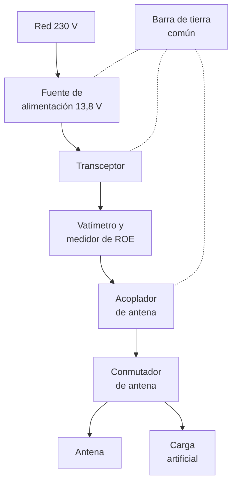
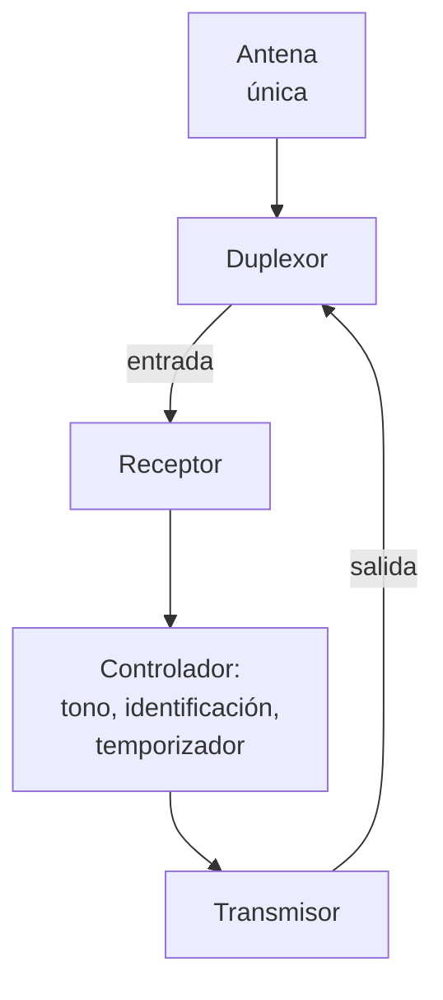

# Equipos

En el capítulo 4 viste cómo funcionan por dentro un receptor y un transmisor. Este capítulo baja a la mesa de la estación. Aprenderás a distinguir los tipos de equipo que hay en el mercado, a leer su hoja de características sin dejarte llevar por la publicidad, qué más necesitas además del transceptor, cómo está hecho un repetidor, qué esperar de un portátil bibanda barato, qué exige la ley a los equipos que compras y qué revisar antes de comprar uno usado. Te servirá para elegir con criterio tu primer equipo y para las preguntas del examen sobre receptores, transmisores y repetidores.

## Tipos de equipo

### Portátil, móvil y de base

Los equipos se agrupan, antes que nada, por dónde se usan:

- Un **portátil** (en la calle, *walkie*) lleva la antena y la batería incorporadas y se usa en la mano. Es la definición que da el anexo I de la [Orden IET/1311/2013](https://www.boe.es/buscar/act.php?id=BOE-A-2013-7624#ani) para la estación portátil: una estación móvil con antena y fuente de energía incorporadas al propio equipo (comprobado en noviembre de 2026). Suele dar unos 5 W en VHF y UHF.
- Un **móvil** se instala en el coche, se alimenta de la batería del vehículo y usa una antena exterior. Da más potencia que un portátil, normalmente entre 20 y 50 W en VHF y UHF, y tiene un disipador grande o un ventilador para evacuar el calor.
- Un **equipo de base** está pensado para la mesa de la estación fija: pantalla grande, muchos mandos y alimentación externa de 13,8 V o de red. En HF, la potencia típica es de 100 W.

La frontera es borrosa. Muchos transceptores de HF de 100 W tienen el tamaño de un móvil y se usan igual en casa que en el coche, y hay equipos de HF de pocos vatios con batería interna, pensados para llevar a la montaña. Las clases de estación desde el punto de vista legal (fija, portable, móvil, portátil) están en el [capítulo 9](09-reglamentacion/espanol.md#clases-de-estaciones).

### Monobanda, bibanda y todo banda

La segunda clasificación es por bandas:

- **Monobanda**: una sola banda, casi siempre 2 m o 70 cm en FM. Son sencillos y baratos, y su receptor suele estar mejor filtrado, porque solo tiene que ser bueno en un tramo estrecho.
- **Bibanda**: 2 m y 70 cm en el mismo equipo, la combinación más habitual en portátiles y móviles de VHF y UHF. Muchos pueden escuchar las dos bandas a la vez.
- **Todo banda** (*all band*): de 1,8 a 50 MHz y, en muchos modelos, también 144 y 430 MHz, en todos los modos (CW, BLU, AM, FM y datos). Es la opción de quien quiere una sola caja para todo, a costa de que en VHF y UHF la potencia y el receptor no suelen estar a la altura de un equipo dedicado.

!!! tip "Para el examen"
    Cuantas más bandas cubre un receptor con la misma entrada, más difícil es filtrar bien cada una. Un equipo que «lo hace todo» sacrifica algo de selectividad de entrada y, con ella, rechazo de imagen y resistencia a la saturación.

### Transceptores y receptores

Un **transceptor** reúne receptor y transmisor en la misma caja, como viste en el [capítulo 4](04-teoria-radio.md#el-transceptor). Es lo que usa casi todo el mundo para transmitir.

Un **receptor** solo escucha. No necesitas autorización para usarlo y es la mejor forma de empezar antes del examen, como se explica en el [capítulo 14](14-escucha-uso-libre.md#la-escucha). Los receptores que más se ven hoy son de dos tipos: los **portátiles de onda corta con BLU** y los **receptores SDR** que se conectan a un ordenador. Los dos se tratan en el apartado siguiente.

## Receptores

### Tipos y etapas

Casi todos los receptores que vas a encontrar responden a una de tres arquitecturas, explicadas con sus diagramas de bloques en el [capítulo 4](04-teoria-radio.md#receptores):

- El **superheterodino**, de simple o doble conversión: amplificador y filtro de RF, mezclador con oscilador local, filtro y amplificador de FI, detector y audio. Es la base de los transceptores clásicos y de muchos receptores portátiles.
- El **receptor de conversión directa**, que pasa la señal a audio en un solo paso. Es frecuente en montajes caseros sencillos.
- El **SDR**, que digitaliza la señal con un convertidor analógico-digital y hace el filtrado y la demodulación por programa ([capítulo 4](04-teoria-radio.md#recepcion-por-sdr)). Muchos transceptores actuales ya lo son por dentro.

Por fuera se parecen mucho. Lo que distingue un receptor bueno de uno mediocre está en unas pocas cifras de su hoja de características, que se explican a continuación.

### Sensibilidad

La **sensibilidad** dice qué señal mínima necesita el receptor para que se entienda. Los fabricantes la dan de dos maneras:

- En BLU y CW, como la tensión en la entrada de antena, en microvoltios, que da una relación entre señal más ruido y ruido de 10 dB: «0,2 µV para 10 dB (S+N)/N».
- En FM, como la tensión que da un **SINAD** de 12 dB. El SINAD (*signal to noise and distortion*) compara la señal completa con lo que sobra de ella: el ruido y la distorsión. Con 12 dB de SINAD una conversación en FM se entiende, aunque con ruido.

Una tensión en microvoltios se pasa a potencia con $P = V^2 / R$, con $R = 50\ \Omega$, la impedancia de la entrada. En dBm (capítulo 2, [dBm y dBW](02-electricidad-electronica.md#valores-absolutos-dbm-y-dbw)) se comparan mejor.

**Ejemplo 1.** Un receptor tiene una sensibilidad de 0,25 µV. La potencia en su entrada es $(0{,}25 \cdot 10^{-6})^2 / 50 = 1{,}25 \cdot 10^{-15}\ \text{W}$, es decir, $10 \log_{10}(1{,}25 \cdot 10^{-12}) \approx -119\ \text{dBm}$.

Otra forma de dar la sensibilidad es el **ruido de fondo** (*noise floor*), el nivel del ruido que genera el propio receptor en el ancho de banda de su filtro. Una señal que no lo supere no se oye. Se calcula así:

$$
N\,(\text{dBm}) = -174 + 10 \log_{10} B + F
$$

donde $-174$ dBm es el ruido térmico en un hercio de ancho de banda a temperatura ambiente, $B$ es el ancho de banda del filtro en hercios y $F$ es la **figura de ruido** del receptor en decibelios, lo que empeora el receptor ese ruido térmico.

**Ejemplo 2.** Un receptor con una figura de ruido de 8 dB y un filtro de BLU de 2,4 kHz tiene un ruido de fondo de $-174 + 10 \log_{10} 2400 + 8 = -174 + 33{,}8 + 8 \approx -132\ \text{dBm}$. Con el filtro de 500 Hz de CW bajaría unos 7 dB, porque entra menos ruido.

Fíjate en que el ancho del filtro forma parte de la cifra. Una sensibilidad o un ruido de fondo no se pueden comparar entre dos equipos si no están medidos con el mismo filtro.

!!! example "En la práctica"
    En HF, la sensibilidad de cualquier equipo moderno sobra: el ruido atmosférico y el de la casa que entran por la antena están muy por encima del ruido del receptor, como viste en el [capítulo 4](04-teoria-radio.md#que-se-le-pide-a-un-receptor). Si al conectar la antena el ruido del medidor S sube, el receptor ya es bastante sensible. En VHF y UHF, y sobre todo en satélites, el ruido de la banda es mucho menor y ahí sí cuenta cada decibelio de figura de ruido.

### Selectividad

La **selectividad** es la capacidad de quedarse con la señal sintonizada y rechazar las de al lado. La dan los filtros de FI o, en un SDR, los filtros digitales. La hoja de características da el ancho de cada filtro a dos niveles: a −6 dB, el ancho que deja pasar, y a −60 dB, el ancho a partir del cual una señal vecina queda prácticamente eliminada.

La relación entre los dos es el **factor de forma**:

$$
\text{FF} = \frac{B_{-60}}{B_{-6}}
$$

donde $B_{-60}$ y $B_{-6}$ son los anchos del filtro a −60 dB y a −6 dB, en las mismas unidades. Un filtro ideal tendría flancos verticales y un factor de forma de 1. Cuanto más se acerque a 1, mejor separa dos estaciones muy próximas.

**Ejemplo 3.** Dos receptores tienen filtros de BLU de 2,4 kHz a −6 dB. El primero mide 4,2 kHz a −60 dB y el segundo, 6,0 kHz. Sus factores de forma son $4{,}2 / 2{,}4 = 1{,}75$ y $6{,}0 / 2{,}4 = 2{,}5$. Con una estación fuerte a 2 kHz de la tuya, el primero la rechaza mucho mejor, aunque los dos anuncien «2,4 kHz».

### Rechazo de imagen y margen dinámico

El **rechazo de imagen** dice cuánto atenúa el receptor una señal que llega en su [frecuencia imagen](04-teoria-radio.md#la-frecuencia-imagen) respecto a una igual en la frecuencia buena. Se da en decibelios: «rechazo de imagen 70 dB» significa que una señal en la imagen tiene que ser 70 dB más fuerte para oírse igual que la deseada. Lo fija el filtro de RF de la entrada, antes del mezclador.

**Ejemplo 4.** Cerca de tu casa hay un emisor que llega a la entrada de tu receptor de VHF con −40 dBm, justo en su frecuencia imagen. Si el rechazo de imagen es de 50 dB, aparece como una señal de $-40 - 50 = -90\ \text{dBm}$. Por encima de 30 MHz, S9 son −93 dBm ([capítulo 4](04-teoria-radio.md#mandos-y-ayudas-del-receptor)), así que la oirás como una estación de S9 + 3 dB que no está donde crees.

El **margen dinámico** (en muchas hojas de características, *rango dinámico*) mide hasta qué punto el receptor soporta señales muy fuertes sin estropear las débiles. Los fabricantes y las revistas que miden equipos dan dos cifras:

- El **margen dinámico de bloqueo**: la diferencia entre el ruido de fondo y la señal fuerte, a pocos kilohercios, que hace perder 1 dB de sensibilidad. Es el [bloqueo](08-interferencias.md#saturacion-y-bloqueo) del capítulo 8 medido en el laboratorio.
- El **margen dinámico de intermodulación**: la diferencia entre el ruido de fondo y el nivel de dos señales fuertes que, al mezclarse en el receptor, crean un producto falso que asoma justo por encima del ruido. Se suele acompañar del **punto de intercepción de tercer orden** (*IP3*, de *third-order intercept point*), en dBm: cuanto más alto, más resiste el receptor a la [intermodulación](08-interferencias.md#intermodulacion).

**Ejemplo 5.** Con el ruido de fondo del ejemplo 2, −132 dBm, un receptor que empieza a bloquearse con una señal de −15 dBm a 5 kHz tiene un margen dinámico de bloqueo de $-15 - (-132) = 117\ \text{dB}$.

En un SDR, el margen dinámico lo limita además el número de bits del convertidor analógico-digital, como se explica en el [capítulo 4](04-teoria-radio.md#bits-y-margen-dinamico).

!!! tip "Para el examen"
    **Sensibilidad**: la señal más débil que se entiende (µV, dBm). **Selectividad**: separar la señal de las vecinas (filtro de FI, factor de forma). **Rechazo de imagen**: lo da el filtro de RF, en dB. **Margen dinámico**: soportar una señal fuerte junto a una débil sin bloquearse ni crear señales falsas, en dB.

### Receptores portátiles de onda corta con BLU

Son receptores del tamaño de un libro de bolsillo, a pilas o con batería, que cubren la onda larga, la onda media, la onda corta y la FM de radiodifusión. Los que interesan al aspirante a radioaficionado son los que, además, tienen **BLU**, porque sin ella no se entienden las estaciones de aficionado en HF, como viste en el [capítulo 14](14-escucha-uso-libre.md#el-receptor).

Lo que suelen ofrecer los de gama media:

- **Cobertura continua** de onda corta, de unos 2 a 30 MHz, con paso de sintonía fino (10 Hz o 100 Hz en BLU) y un mando de **sintonía fina** para centrar la voz.
- **Selección de USB o LSB** y, en los mejores, **filtros de ancho seleccionable**, de unos 6 kHz para la radiodifusión en AM a 2 o 3 kHz para la BLU.
- **Toma de antena exterior** además de la telescópica, y un **atenuador** o selector de ganancia local/distante para cuando la antena exterior satura la entrada.
- Muchos usan por dentro un único circuito integrado que hace casi todo el receptor con técnicas de **procesado digital**: por fuera son un receptor clásico, por dentro se parecen bastante a un SDR.

Sus límites son los de su tamaño: la telescópica capta poco, el altavoz es pequeño y la entrada se satura con una antena de hilo larga cerca de emisoras potentes. Se nota en que aparecen emisoras de radiodifusión donde no deberían estar. El atenuador lo arregla casi siempre.

!!! example "En la práctica"
    Para empezar con uno de estos receptores, sintoniza de día la banda de 20 m (14 100 a 14 350 kHz) en USB, o de noche la de 40 m (7050 a 7200 kHz) en LSB. Mueve la sintonía fina hasta que la voz suene natural: si suena como un pato, estás en la banda lateral equivocada o desplazado. Después prueba con unos metros de hilo en la toma exterior y compara.

### Receptores SDR

El otro gran grupo son los **receptores SDR** que se conectan por USB a un ordenador, a un teléfono o a un miniordenador. El programa hace de receptor completo: elige el modo, el filtro y la sintonía, y dibuja el panorama y la [cascada](04-teoria-radio.md#la-cascada). Hay dos familias:

- Los **de bajo coste**, nacidos de los sintonizadores de televisión digital, con convertidores de 8 bits. Cubren desde unas decenas de megahercios hasta más de 1 GHz y, con un convertidor o un modo especial, también HF. Son ideales para VHF, UHF, satélites y para ver qué pasa en una banda, pero se saturan con facilidad.
- Los **de gama alta para HF**, con convertidores de 12 a 16 bits, filtros de entrada por bandas y mucho más margen dinámico. Algunos se convierten en transceptores añadiendo un módulo de transmisión.

Al leer la hoja de un SDR, fíjate en el número de bits, en el **ancho de banda visible** (que depende de la frecuencia de muestreo, [capítulo 4](04-teoria-radio.md#dos-arquitecturas)) y en si tiene filtros de entrada. Un SDR sin filtros en la entrada, con una antena exterior grande, oirá emisoras de radiodifusión en sitios imposibles.

## Transceptores

### Lo que añade el transmisor

Un transceptor añade al receptor la cadena de transmisión del [capítulo 4](04-teoria-radio.md#transmisores): el modulador, el mezclador que lleva la señal a la frecuencia de trabajo, el amplificador de potencia y el filtro paso bajo de salida. En la hoja de características esa parte se resume en tres cifras: la potencia, las espurias y el consumo.

### Potencia

La potencia se da en vatios sobre una carga de 50 Ω, casi siempre como **máxima**, con un mando o un menú para reducirla. Tres detalles:

- En BLU, la cifra es la **potencia de cresta de la envolvente** (p. c. e.), que solo se alcanza en los picos de la voz. La potencia media es bastante menor. Los límites legales de cada banda también se dan así ([capítulo 5](05-propagacion-bandas.md)).
- En los modos de **portadora continua** (FM, RTTY, FT8 y casi todos los digitales) el amplificador trabaja a plena potencia todo el tiempo que transmites. Muchos equipos de 100 W aguantan esa potencia solo durante un tiempo limitado, o el fabricante aconseja reducirla. Fíjate en lo que dice el manual sobre el **ciclo de trabajo**: es la proporción del tiempo que se transmite, la misma idea que en la exposición a RF del [capítulo 3](03-seguridad.md#potencia-media-y-ciclo-de-trabajo).
- La potencia baja si baja la tensión de alimentación. Un móvil que da 50 W a 13,8 V puede dar bastante menos con la batería del coche medio descargada.

### Emisiones espurias

La pureza de la emisión se da en **dBc**, decibelios por debajo de la portadora: «espurias y armónicos: mejor que −60 dBc». Para saber si eso cumple, se pasa a potencia y se compara con los límites del apartado 4.1 del anexo I de la orden, que tienes en la tabla del [capítulo 8](08-interferencias.md#limites-legales-de-las-espurias).

**Ejemplo 6.** Un móvil de 25 W en 70 cm anuncia espurias a −60 dBc. Cada una tendría $25 \cdot 10^{-6}\ \text{W} = 25\ \mu\text{W}$. Para 25 W o menos entre 235 y 960 MHz, el límite es de 40 dB por debajo sin superar 25 µW: el segundo valor manda y el equipo cumple justo. Con −55 dBc, el mismo equipo tendría espurias de unos 79 µW y no cumpliría.

Una cifra en dBc solo dice algo si sabes a qué potencia y en qué banda se midió. Desconfía de las hojas que no la dan, y recuerda que un armónico que cumple con la antena bien adaptada puede empeorar mucho con una ROE alta o con un amplificador saturado.

### Consumo

El consumo se da en amperios, a 13,8 V, en tres situaciones: transmitiendo a plena potencia, recibiendo con el audio alto y en espera con el silenciador cerrado. La primera sirve para elegir la [fuente de alimentación](02-electricidad-electronica.md#fuentes-de-alimentacion) y la sección del cable; las otras dos, para calcular cuánto dura una batería.

El **rendimiento** del transmisor es la potencia de RF que entrega dividida entre la potencia que consume:

$$
\eta = \frac{P_{\text{RF}}}{V \cdot I} \cdot 100
$$

donde $\eta$ es el rendimiento en tanto por ciento, $P_{\text{RF}}$ la potencia de salida en vatios, $V$ la tensión de alimentación en voltios e $I$ la corriente en amperios.

**Ejemplo 7.** Un transceptor de HF da 100 W y consume 21 A a 13,8 V. Toma $13{,}8 \cdot 21 = 289{,}8\ \text{W}$ de la fuente, así que su rendimiento es $100 / 289{,}8 \cdot 100 \approx 34{,}5\ \%$. Los otros 189,8 W se convierten en calor, y por eso el disipador y el ventilador importan tanto.

En un portátil, la autonomía depende sobre todo de cuánto tiempo pasa en espera. Una forma habitual de estimarla es suponer que, de cada cien minutos, transmites 5, recibes 5 y pasas 90 en espera.

**Ejemplo 8.** Un portátil consume 1,6 A al transmitir, 0,4 A al recibir y 0,08 A en espera. La corriente media es $0{,}05 \cdot 1{,}6 + 0{,}05 \cdot 0{,}4 + 0{,}90 \cdot 0{,}08 = 0{,}172\ \text{A}$. Con una batería de 2 Ah dura unas $2 / 0{,}172 \approx 11{,}6$ horas. Si te pasas la tarde hablando por un repetidor, mucho menos.

## La estación básica

### Qué la forma

Un transceptor solo no es una estación. Entre el enchufe y la antena hacen falta algunas piezas más, y la propia orden exige varias en los apartados 4.3, 4.5 y 4.6 de su anexo I: una carga artificial para los ensayos que no necesiten radiar, elementos para comprobar que emites dentro de las bandas autorizadas y para medir de forma indicativa tu potencia, y las redes de adaptación y los filtros paso bajo que hagan falta (comprobado en noviembre de 2026).

*Figura 7.1. Una estación básica de HF. La línea discontinua es la conexión equipotencial de los chasis.*

### Transceptor y fuente de alimentación

La fuente tiene que dar la corriente máxima de transmisión del equipo con margen, como se explica en el [capítulo 2](02-electricidad-electronica.md#fuentes-de-alimentacion). Una fuente lineal no mete ruido en el receptor; una conmutada pesa mucho menos, pero si es de mala calidad la oirás en HF ([capítulo 8](08-interferencias.md#fuentes-de-alimentacion-conmutadas)). Usa cable de sección suficiente, corto y con fusible en el positivo.

### Vatímetro y medidor de ROE

Se intercala a la salida del transceptor y te dice la potencia directa, la reflejada y la ROE ([capítulo 6](06-antenas-lineas.md#medir-la-roe)). Con él cumples la obligación de poder medir tu potencia de forma indicativa. Elige uno que cubra tus bandas y tu potencia: un medidor de HF no sirve en 70 cm. Muchos transceptores lo llevan incorporado.

### Acoplador de antena

Hace que el transmisor vea 50 Ω aunque la antena no los presente ([capítulo 6](06-antenas-lineas.md#el-acoplador-de-antena)). No mejora la antena: solo protege el amplificador y le deja entregar su potencia. Si el medidor va antes del acoplador, como en la figura, te dice qué ve el transmisor, que es lo que interesa al ajustar.

### Carga artificial

Una **carga artificial** (*dummy load*) es una resistencia de 50 Ω, sin inductancia apreciable, capaz de disipar la potencia del transmisor sin radiarla. Sirve para ajustar el equipo, probar un equipo usado o comprobar si una interferencia sale por la antena ([capítulo 8](08-interferencias.md#si-la-interferencia-la-causas-tu)). Al elegirla, mira dos cifras: la **potencia que admite y durante cuánto tiempo** (muchas aguantan su potencia nominal solo unos segundos) y la **frecuencia máxima** a la que su ROE sigue siendo baja.

### Tierra

La estación necesita dos cosas distintas: la **tierra de protección** de la instalación eléctrica y de la antena, que protege a las personas y se trata en el [capítulo 3](03-seguridad.md#puesta-a-tierra-de-la-instalacion-de-antena), y la **conexión equipotencial** de todos los chasis a un punto común, que evita RF en la mesa y se trata en el [capítulo 8](08-interferencias.md#toma-de-tierra-y-conexion-equipotencial). Las dos van unidas.

!!! danger "Peligro"
    Una carga artificial convierte toda la potencia en calor. Con 100 W durante un minuto se calienta mucho: no la toques, déjala en un sitio ventilado y no superes el tiempo que indica el fabricante. Las de aceite pueden derramarse o reventar si se sobrecalientan.

## Repetidores por dentro

En el [capítulo 10](10-operacion.md#los-repetidores) aprendiste a usar un repetidor. Aquí verás cómo está hecho.

### Las piezas

Un repetidor de FM tiene cuatro bloques:

*Figura 7.2. Diagrama de bloques de un repetidor de FM con una sola antena.*

1. Un **receptor** sintonizado en la entrada.
2. Un **controlador** que decide cuándo transmitir: abre el paso solo si llega el tono de acceso correcto, añade la identificación automática, corta las transmisiones demasiado largas con un temporizador y, en muchos casos, emite un pitido de fin de turno.
3. Un **transmisor** sintonizado en la salida, que trabaja durante horas con un ciclo de trabajo muy alto. Por eso suele funcionar por debajo de su potencia máxima y con buena ventilación.
4. Un **duplexor**, que permite usar una sola antena para las dos cosas a la vez.

Las condiciones legales de los repetidores (quién puede tenerlos, potencia, identificación) están en el [capítulo 9](09-reglamentacion/espanol.md#estaciones-automaticas-desatendidas).

### Dúplex y semidúplex

Un repetidor recibe y transmite **a la vez**, en frecuencias distintas: funciona en **dúplex**. Tu portátil, en cambio, recibe en la salida y, mientras pulsas el PTT, transmite en la entrada: usa dos frecuencias, pero nunca las dos a la vez. Esa forma de trabajar se llama **semidúplex**. En **símplex** transmites y recibes en la misma frecuencia, por turnos.

### El duplexor

El problema del repetidor es que su transmisor y su receptor están en la misma antena, y en 2 m solo 600 kHz los separan. El receptor tiene que oír señales de −120 dBm mientras, a su lado, el transmisor entrega decenas de vatios. Sin protección, el receptor se bloquea y, además, el ruido que el transmisor emite alrededor de su frecuencia cae justo en la entrada y la tapa.

El **duplexor** resuelve las dos cosas. Tiene dos ramas: la del transmisor deja pasar la salida y rechaza la frecuencia de entrada, y la del receptor hace lo contrario. Como hay que separar frecuencias muy próximas, no basta con bobinas y condensadores: se usan **cavidades resonantes**, cilindros metálicos con un conductor central ajustable que se comportan como circuitos resonantes de un factor de calidad (Q) altísimo. Cada cavidad atenúa mucho una frecuencia y casi nada la de al lado, y se ponen varias en cada rama.

La cifra que importa es el **aislamiento**: cuántos decibelios por debajo llega al receptor la señal del transmisor.

**Ejemplo 9.** Un repetidor transmite con 25 W, que son unos +44 dBm. Para que su receptor no pierda sensibilidad, la portadora no debe llegarle con más de −40 dBm. El duplexor tiene que aislar al menos $44 - (-40) = 84\ \text{dB}$. Si cada cavidad atenúa unos 30 dB la frecuencia que debe rechazar, hacen falta como mínimo tres en esa rama.

Por eso los repetidores de 2 m usan duplexores grandes, y por eso no se puede montar un repetidor con un portátil y un trozo de cable. La alternativa es usar dos antenas separadas en vertical varios metros, que dan parte del aislamiento por su separación.

### Desplazamiento y subtonos

El **desplazamiento** entre entrada y salida (−600 kHz en 2 m; −1,6 o −7,6 MHz en 70 cm) es lo que permite al duplexor separar las dos frecuencias, como viste en el [capítulo 10](10-operacion.md#desplazamiento-y-canales). Cuanto mayor es, más fácil es el duplexor.

Los **subtonos** (CTCSS o, en algunos equipos, DCS) los decodifica el controlador: si tu señal no lleva el tono del repetidor, no la retransmite ([capítulo 10](10-operacion.md#tonos-de-acceso-ctcss-y-1750-hz)). Así el repetidor no se abre con ruido, con interferencias ni con otro repetidor lejano que comparte canal.

Los repetidores digitales (DMR, D-STAR, System Fusion) tienen la misma estructura de radio, con un controlador que además entiende el protocolo digital y, a menudo, conecta con una red por Internet ([capítulo 12](12-modos-digitales.md#voz-digital)).

### Banda cruzada

Un repetidor de **banda cruzada** recibe en una banda y retransmite en otra; por ejemplo, entra en 70 cm y sale en 2 m. Como las dos frecuencias están muy separadas, basta un **diplexor**, un filtro sencillo que separa las dos bandas, en vez de un duplexor de cavidades.

Muchos móviles bibanda tienen una función de banda cruzada: lo que reciben en una banda lo retransmiten en la otra. Se usa, por ejemplo, para enlazar un portátil de poca potencia con un repetidor lejano a través del móvil del coche, aparcado en un sitio alto. Ojo con dejarlo funcionando solo: un equipo que retransmite automáticamente lo que recibe para ampliar el alcance es lo que el anexo I de la Orden IET/1311/2013 llama **estación repetidora**, que es un tipo de estación automática desatendida, y el mismo anexo define estas como estaciones **colectivas**, de una asociación (comprobado en noviembre de 2026). Úsalo solo mientras lo controlas tú, y comprueba antes las condiciones del [capítulo 9](09-reglamentacion/espanol.md#estaciones-automaticas-desatendidas).

### Repetidores símplex

Un **repetidor símplex** (en la calle, *repetidor loro*) usa una sola frecuencia: graba lo que recibe y, cuando acaba la transmisión, la vuelve a emitir en la misma frecuencia. No necesita duplexor, así que se puede montar con un equipo corriente y un pequeño grabador digital. A cambio, cada mensaje ocupa la frecuencia el doble de tiempo, y no puedes interrumpir a nadie mientras habla, porque nadie te oye hasta que acaba.

El mismo principio, almacenar y reenviar en la misma frecuencia, es el de los [digipeaters de APRS](12-modos-digitales.md#digipeaters-e-igates) del capítulo 12.

!!! tip "Para el examen"
    Repetidor: **dúplex** (recibe y transmite a la vez) gracias al **duplexor**, que en VHF usa **cavidades resonantes** de Q muy alto. Tu equipo trabaja en **semidúplex**. **Banda cruzada**: entra en una banda y sale en otra, con un filtro sencillo. **Símplex**: graba y repite en la misma frecuencia.

## Portátiles bibanda de iniciación

### Qué son

Desde hace años se venden portátiles bibanda de VHF y UHF a un precio muy bajo, y son el primer transceptor de mucha gente. La familia más conocida es la UV-5R de la marca Baofeng, con sus muchas variantes, pero hay decenas de marcas con equipos parecidos. Suelen tener 5 W o algo más, dos frecuencias en pantalla, unas cien memorias, CTCSS y DCS, linterna y radio FM, y reciben un margen de frecuencias mucho más ancho que las bandas de aficionado.

Son un buen equipo para aprender a programar memorias, escuchar repetidores y hacer los primeros contactos en FM. Pero conviene conocer sus limitaciones, que son las de un diseño barato.

### Sus limitaciones

- **Espurias.** El filtro paso bajo de salida de un equipo bibanda es un compromiso, y la calidad cambia de un lote a otro. Que un modelo cumpla no garantiza que tu unidad cumpla. Si vas a transmitir con frecuencia, y sobre todo si añades un amplificador, vale la pena medir sus armónicos con un analizador de espectro, que muchos radioclubes tienen. Los límites son los del [capítulo 8](08-interferencias.md#limites-legales-de-las-espurias).
- **Saturación.** Muchos de estos equipos hacen casi todo el receptor con un solo circuito integrado y tienen poco filtrado en la entrada. Cerca de un emisor de radiodifusión de FM, de una estación base de un servicio profesional o en lo alto de un monte con muchas antenas, se llenan de señales falsas por intermodulación o se quedan sordos por bloqueo ([capítulo 8](08-interferencias.md#saturacion-y-bloqueo)). Con una antena exterior grande, el efecto empeora.
- **La antena de serie.** La antena flexible que trae de fábrica es corta, y en 2 m rinde bastante menos que una de media onda o más larga. Cambiarla por una mejor es la mejora más barata que puedes hacer, pero comprueba su ROE en las dos bandas antes de fiarte de la etiqueta, como se explica en el [capítulo 6](06-antenas-lineas.md#medir-la-roe). Fíjate en el conector: la mayoría usa una variante [SMA](06-antenas-lineas.md#conectores), y hay macho y hembra según la marca.
- **Transmite fuera de las bandas de aficionado.** Muchos equipos permiten transmitir en todo el margen que reciben. Que el equipo lo permita no significa que puedas: tu autorización solo te habilita para emitir en las bandas atribuidas al servicio de aficionados (artículo 5.3 de la Orden IET/1311/2013; comprobado en noviembre de 2026), y transmitir fuera de ellas es usar el espectro sin título.
- **Manual y menús.** Los menús numerados son poco intuitivos y los manuales, escuetos. Por eso casi todo el mundo los programa con el ordenador.

### Programarlo con CHIRP

**CHIRP** es un programa libre para programar las memorias de cientos de modelos de portátiles y móviles desde el ordenador. Según su [página de descarga](https://chirpmyradio.com/projects/chirp/wiki/Download), funciona en Windows 10 o posterior, en macOS Big Sur o posterior y en Linux, y se distribuye como compilaciones automáticas que se nombran por su fecha. La única versión que se mantiene es la que se descarga como «latest CHIRP build»; la antigua **CHIRP-legacy** ya no recibe actualizaciones de ningún tipo y no se recomienda. En el momento de comprobarlo, la compilación más reciente era la **next-20261106**, del 6 de noviembre de 2026 (comprobado el 10 de noviembre de 2026). Su código se publica con licencia GPL-3.0 en su [repositorio](https://github.com/kk7ds/chirp), y la familia UV-5R figura en su [lista de equipos compatibles](https://chirpmyradio.com/projects/chirp/wiki/Supported_Radios) (comprobado en noviembre de 2026).

El procedimiento, según su [guía para principiantes](https://chirpmyradio.com/projects/chirp/wiki/Beginners_Guide) (comprobado en noviembre de 2026), tiene tres pasos:

1. **Descarga** el contenido del equipo con *Radio → Download From Radio*, eligiendo el puerto del cable, la marca y el modelo. Guarda enseguida una copia del archivo: si algo sale mal, podrás devolver el equipo a su estado inicial.
2. **Edita** las memorias en la tabla.
3. **Súbelas** al equipo con *Radio → Upload To Radio*.

Necesitas un cable de programación USB con el conector del equipo, normalmente uno doble de tipo jack, y el controlador del convertidor USB-serie que lleve el cable. Si el ordenador no reconoce el cable, casi siempre es el controlador.

Las columnas más importantes de la tabla son la frecuencia (la de recepción), *Duplex* y *Offset*, que fijan el desplazamiento, y las del tono. Según la [explicación de las columnas](https://chirpmyradio.com/projects/chirp/wiki/MemoryEditorColumns) del propio programa, *Duplex* vacío significa símplex; «+» o «−», que transmites por encima o por debajo de la frecuencia de recepción en lo que diga *Offset*; y **off**, que la transmisión queda desactivada en ese canal, si el equipo lo admite (comprobado en noviembre de 2026). Esa última opción es muy útil para las memorias de **solo escucha**: frecuencias que quieres oír pero en las que no debes transmitir nunca.

**Ejemplo 10.** Para el repetidor ficticio RV58, cuya salida está en $145{,}000 + 58 \cdot 0{,}0125 = 145{,}725\ \text{MHz}$, con −600 kHz y un CTCSS de 77,0 Hz, escribes en esa memoria: frecuencia, 145,725 MHz; *Duplex*, «−»; *Offset*, 0,6 MHz; *Tone Mode*, «Tone», y *Tone*, 77,0 Hz. Al pulsar el PTT el equipo transmitirá en 145,125 MHz con el tono.

### No es un PMR446

Muchos de estos portátiles reciben los canales de **PMR446**, y algunos los traen incluso programados de fábrica. **Transmitir con ellos en PMR446 es ilegal**, tengas o no autorización de radioaficionado. La banda de 446,0 a 446,2 MHz no es de aficionados, así que tu autorización no la cubre; y el uso libre de esa banda solo vale para equipos que cumplen las condiciones de la nota UN-110 del CNAF: equipos portátiles con antena incorporada, 500 mW p. r. a. como máximo y la norma ETSI EN 303 405 ([capítulo 14](14-escucha-uso-libre.md#potencia-y-antena)). Un bibanda de aficionado no cumple ninguna de las tres. Además, el artículo 7.3 del Real Decreto 188/2016 prohíbe usar en España un equipo con una interfaz radioeléctrica distinta de la que el fabricante indica en su declaración UE de conformidad (comprobado en noviembre de 2026).

Si alguien te ha dado un equipo con canales de PMR446, márcalos como solo escucha con la opción *Duplex* «off» de CHIRP o bórralos.

## Normativa de los equipos

### La Directiva de equipos radioeléctricos

En la Unión Europea, los equipos de radio que se venden se rigen por la [Directiva 2014/53/UE del Parlamento Europeo y del Consejo, de 16 de abril de 2014, relativa a la armonización de las legislaciones de los Estados miembros sobre la comercialización de equipos radioeléctricos](https://eur-lex.europa.eu/legal-content/ES/TXT/?uri=CELEX:02014L0053-20260530), conocida como **RED** (*Radio Equipment Directive*). Sustituyó a la Directiva 1999/5/CE desde el 13 de junio de 2016 (artículos 49 y 50) y su versión consolidada más reciente es del 30 de mayo de 2026 (comprobado en noviembre de 2026).

Lo esencial para ti está en tres puntos de la directiva (comprobados en noviembre de 2026):

- **Qué es un equipo radioeléctrico.** El artículo 2.1 incluye cualquier producto que **emita o reciba** intencionadamente ondas de radio. Los receptores también están dentro.
- **Qué tiene que cumplir.** El artículo 3 fija los **requisitos esenciales**: proteger la salud y la seguridad de las personas, de los animales domésticos y de los bienes; tener una compatibilidad electromagnética adecuada; y hacer un uso eficiente del espectro para no causar interferencias perjudiciales.
- **Qué queda fuera.** El punto 1 del anexo I excluye los equipos de radio que usan los radioaficionados, **salvo que estén disponibles en el mercado**. Y aclara que no se consideran comercializados los kits de montaje para radioaficionados, los equipos modificados por radioaficionados para su propio uso y los construidos por radioaficionados con fines experimentales y científicos relacionados con la radioafición.

Dicho de otro modo: un transceptor de aficionado que compras en una tienda está sujeto a la directiva igual que un teléfono móvil. Lo que construyes o modificas tú para tu uso, no.

Un detalle práctico: el cargador común USB-C solo se exige a las categorías que enumera el anexo I bis de la Directiva 2014/53/UE, añadido por la Directiva (UE) 2022/2380, como teléfonos, tabletas, cámaras o altavoces portátiles; los transceptores de radioaficionado no figuran en esa lista (comprobado en noviembre de 2026).

### El Real Decreto 188/2016

En España, la directiva se aplica mediante el [Real Decreto 188/2016, de 6 de mayo, por el que se aprueba el Reglamento por el que se establecen los requisitos para la comercialización, puesta en servicio y uso de equipos radioeléctricos, y se regula el procedimiento para la evaluación de la conformidad, la vigilancia del mercado y el régimen sancionador de los equipos de telecomunicación](https://www.boe.es/buscar/act.php?id=BOE-A-2016-4444), en vigor desde el 13 de junio de 2016. Su texto consolidado se actualizó por última vez el 13 de marzo de 2026 (comprobado en noviembre de 2026). Ya lo viste en el [capítulo 8](08-interferencias.md#las-condiciones-de-tu-estacion) a propósito de la compatibilidad electromagnética. Estas son las reglas que afectan a los radioaficionados (todas comprobadas en noviembre de 2026):

- **La exclusión de los equipos de aficionado** está en su artículo 1.2 y en el punto 1 de su anexo I, con el mismo contenido que la directiva. El anexo añade una frase que despeja dudas: los equipos destinados a radioaficionados **que se comercialicen** se consideran incluidos en el reglamento.
- **El fabricante** coloca el **marcado CE** y redacta la **declaración UE de conformidad** después de evaluar el equipo (artículo 9.3). Cada equipo viene con esa declaración o con una **simplificada**, que tiene que dar la dirección de Internet exacta donde está el texto completo (artículo 9.9).
- **Las instrucciones** tienen que estar al menos en castellano si el equipo se vende en España y, en los equipos que transmiten, indicar las **bandas** en las que opera y la **potencia máxima** de RF (artículo 9.8). Si hay restricciones de uso en algún país, el embalaje y las instrucciones tienen que decirlo (artículo 9.10).
- **La puesta en servicio y el uso** se permiten si el equipo cumple el reglamento, está bien instalado y mantenido y se usa para lo que está previsto (artículo 6.1). Los equipos que necesitan una habilitación para usar el espectro solo se pueden usar con ella (artículo 6.4): en tu caso, la autorización de radioaficionado. Y si se vende en España un equipo que no se ajusta al uso del espectro del CNAF, su embalaje tiene que decir que no puede usarse en territorio español (artículos 6.3 y 6.5).

### Qué significa para ti

Desde el lado del usuario, todo se resume en tres ideas:

1. **Equipo comprado**: tiene que llevar el marcado CE y su declaración de conformidad, y cumplir la normativa que le era aplicable cuando se comercializó por primera vez (artículo 5.5 de la Orden IET/1311/2013; comprobado en noviembre de 2026). Si lo compras fuera de la Unión, sin esa documentación, nadie ha comprobado que cumpla.
2. **Equipo de construcción propia, kit o equipo modificado por ti**: no necesita marcado CE ni autorización previa, pero tiene que cumplir las características técnicas del anexo I de la orden, y si interfiere por funcionar mal respondes tú (artículo 5.6 de la Orden IET/1311/2013; comprobado en noviembre de 2026). Lo viste en el [capítulo 9](09-reglamentacion/espanol.md#tus-equipos).
3. **Uso**: el marcado CE dice que el equipo se puede vender, no que puedas usarlo en cualquier frecuencia. Dónde y con cuánta potencia transmites lo deciden tu autorización y el CNAF.

## Comprar de segunda mano

Un equipo usado bien cuidado puede ser mejor compra que uno nuevo de gama baja. Pero los transceptores tienen fallos que no se ven en una foto, así que, siempre que puedas, pruébalo antes de pagar o cómpralo a alguien que te deje devolverlo.

### Antes de verlo

- Busca el **manual** del modelo y lee sus especificaciones: potencia, consumo, bandas. Así sabrás qué tienes que comprobar.
- Busca si el modelo tiene **fallos conocidos**: pantallas que se apagan, relés de antena que fallan, mandos de sintonía que patinan. Los foros y los radioclubes los conocen bien.
- Pregunta si está **modificado**, por ejemplo para transmitir fuera de las bandas de aficionado, y si tiene el **número de serie** intacto.

### La prueba

Lleva una carga artificial, un vatímetro y, si puedes, una antena o un receptor para comprobar la frecuencia.

1. **Mira y huele.** Golpes, tornillos con marcas de herramienta, conectores flojos o restos de soldadura indican que se ha abierto. Un olor a quemado es mala señal.
2. **Recepción.** Escucha en todas las bandas y modos con una antena. Gira todos los mandos: si al moverlos hay ruidos o cortes, los potenciómetros están sucios o gastados. El medidor S debe moverse con las señales y el ruido de fondo debe subir al conectar la antena.
3. **Transmisión sobre la carga artificial**, nunca sobre una antena de la que no conozcas la ROE. Mide la potencia en cada banda a la máxima y a la mínima. Una banda que da mucha menos potencia que las demás puede indicar un filtro o un amplificador averiado.
4. **Frecuencia.** Comprueba con otro receptor o con un SDR que el equipo emite donde dice la pantalla.
5. **Consumo y temperatura.** Si puedes, mide la corriente en espera y en transmisión y compárala con el manual. Escucha si el ventilador funciona.
6. **En un portátil, la batería.** Una batería de litio **hinchada** o deformada no se usa ni se carga: es un riesgo de incendio, como se explica en el [capítulo 3](03-seguridad.md#baterias). Comprueba también que el equipo carga y que la batería dura.

### Equipos antiguos

Para un equipo de segunda mano comercializado antes del Real Decreto 1890/2000, el artículo 5.5 de la Orden IET/1311/2013 exige que tenga el **certificado de aceptación radioeléctrica** que se pedía entonces o, si no lo tiene, que un laboratorio acreditado certifique que cumple las características técnicas del anexo I de la orden (comprobado en noviembre de 2026). Pide ese certificado al vendedor junto con el equipo.

!!! example "En la práctica"
    Pregunta en tu radioclub antes de comprar. Casi siempre hay alguien que conoce el modelo, que tiene un vatímetro o un analizador para probarlo contigo y que sabe si el precio es razonable.

## Resumen

- Por uso, los equipos son **portátiles** (antena y batería incorporadas), **móviles** (coche) y **de base** (estación fija). Por bandas, **monobanda**, **bibanda** o **todo banda**. Cuantas más bandas, más difícil es filtrar bien cada una.
- La **sensibilidad** es la señal mínima que se entiende (µV para 10 dB (S+N)/N, o 12 dB de **SINAD** en FM). El **ruido de fondo** es $-174 + 10 \log_{10} B + F$ dBm. La **selectividad** la dan los filtros de FI; el **factor de forma** compara su ancho a −60 y a −6 dB. El **rechazo de imagen** lo da el filtro de RF. El **margen dinámico** mide la resistencia al bloqueo y a la intermodulación.
- Del transmisor importan la **potencia** (en BLU, p. c. e.; en modos continuos, cuidado con el ciclo de trabajo), las **espurias** en dBc, que hay que comparar con los límites de la orden, y el **consumo**, que da el rendimiento y la autonomía.
- La **estación básica** suma al transceptor una fuente, un vatímetro y medidor de ROE, un acoplador, una carga artificial y la tierra. La orden exige carga artificial para los ensayos, medios para medir potencia y comprobar las bandas, y los filtros y redes de adaptación necesarios.
- Un **repetidor** tiene receptor, controlador, transmisor y **duplexor** de **cavidades resonantes**, que le deja trabajar en **dúplex** con una sola antena. Tu equipo trabaja en **semidúplex**. Hay repetidores de **banda cruzada** y **símplex**.
- Los **portátiles bibanda de iniciación** tienen espurias variables, se saturan con facilidad y traen una antena mediocre. Se programan con **CHIRP**. **Transmitir con ellos en PMR446 es ilegal.**
- La **Directiva 2014/53/UE** y el **Real Decreto 188/2016** exigen marcado CE, declaración UE de conformidad e instrucciones a los equipos que se venden, también a los de aficionado. Los kits, los equipos modificados por radioaficionados para su uso y los de construcción propia quedan fuera, pero tienen que cumplir el anexo I de la Orden IET/1311/2013 (comprobado en noviembre de 2026).
- Un equipo de **segunda mano** se prueba sobre carga artificial, en todas las bandas, y con la batería revisada.

## Autoevaluación

**1.** Un receptor anuncia una sensibilidad de 0,5 µV. ¿Qué potencia es eso en la entrada de 50 Ω?

a) −107 dBm  
b) −113 dBm  
c) −119 dBm  
d) −83 dBm

??? success "Solución"
    **b)** $P = V^2/R = (0{,}5 \cdot 10^{-6})^2 / 50 = 5 \cdot 10^{-15}\ \text{W}$, y $10 \log_{10}(5 \cdot 10^{-12}) \approx -113\ \text{dBm}$. La c) es la de 0,25 µV: al dividir la tensión entre dos, la potencia se divide entre cuatro, 6 dB menos.

**2.** Un receptor tiene una figura de ruido de 10 dB y lo usas con el filtro de CW de 500 Hz. ¿Cuál es su ruido de fondo?

a) −164 dBm  
b) −147 dBm  
c) −137 dBm  
d) −127 dBm

??? success "Solución"
    **c)** $-174 + 10 \log_{10} 500 + 10 = -174 + 27 + 10 = -137\ \text{dBm}$. La a) olvida el ancho de banda, la b) olvida la figura de ruido y la d) suma el ancho de banda como si fueran 5000 Hz.

**3.** Un filtro de CW mide 0,5 kHz a −6 dB y 1,5 kHz a −60 dB. Otro mide 0,5 kHz y 1,0 kHz. ¿Cuál separa mejor una estación que está a 600 Hz de la tuya?

a) El primero, porque su factor de forma es 3  
b) El segundo, porque su factor de forma es 2  
c) Los dos igual, porque los dos miden 0,5 kHz a −6 dB  
d) El primero, porque deja pasar más señal

??? success "Solución"
    **b)** El factor de forma es $B_{-60}/B_{-6}$: 3 en el primero y 2 en el segundo. Cuanto más cerca de 1, más empinados son los flancos y antes se elimina la señal vecina. El ancho a −6 dB por sí solo no lo dice todo.

**4.** Vives cerca de un emisor potente de radiodifusión de FM y tu receptor se llena de señales falsas que aparecen y desaparecen con la programación de la emisora. ¿Qué característica del receptor es insuficiente?

a) La sensibilidad  
b) El margen dinámico frente a la intermodulación  
c) La estabilidad del oscilador  
d) La selectividad del filtro de FI

??? success "Solución"
    **b)** Las señales fuertes se mezclan en las primeras etapas del receptor y crean productos falsos. Resistir eso es el margen dinámico de intermodulación, que acompaña al IP3. Más sensibilidad empeoraría las cosas, y el filtro de FI llega tarde: el producto ya está creado dentro.

**5.** Un portátil de 5 W en 70 cm anuncia espurias a −50 dBc. ¿Cumple el límite de la Orden IET/1311/2013?

a) Sí, porque −50 dBc es mejor que los 40 dB que exige  
b) Sí, porque cada espuria tiene 5 µW  
c) No, porque cada espuria tiene 50 µW y el límite es 25 µW  
d) No, porque en UHF hacen falta siempre 60 dB

??? success "Solución"
    **c)** $5 \cdot 10^{-5} = 50\ \mu\text{W}$. Entre 235 y 960 MHz, con 25 W o menos, el límite es de 40 dB por debajo **sin superar 25 µW**, y manda el valor más bajo. La a) olvida el tope absoluto; los 60 dB de la d) son para más de 25 W.

**6.** Vas a ajustar el acoplador de antena de tu estación de HF. ¿Dónde pones el medidor de ROE para saber si el transmisor ve 50 Ω?

a) Entre el transceptor y el acoplador  
b) Entre el acoplador y la antena  
c) En lo alto del mástil, junto a la antena  
d) Entre la fuente de alimentación y el transceptor

??? success "Solución"
    **a)** Lo que te interesa es la carga que ve el transmisor, y esa está a la entrada del acoplador. Entre el acoplador y la antena la ROE sigue siendo la de la antena, aunque el acoplador esté bien ajustado. La d) es un circuito de continua, sin RF.

**7.** Dejas tu móvil bibanda en el coche, en banda cruzada, retransmitiendo a 2 m todo lo que recibe en 70 cm, y te vas a pasear varias horas. ¿Qué dice el anexo I de la Orden IET/1311/2013?

a) Nada: es tu estación móvil y puedes usarla como quieras  
b) Funciona como una estación repetidora, que es automática desatendida, y la orden define estas como colectivas  
c) Está permitido si no superas 5 W  
d) Solo está prohibido dentro de los cascos urbanos

??? success "Solución"
    **b)** Un equipo que retransmite automáticamente lo que recibe para ampliar el alcance es una estación repetidora, y el anexo I la define como estación automática desatendida, que a su vez define como colectiva, de una asociación. La banda cruzada se usa mientras la controlas tú.

**8.** Quieres programar en tu portátil con CHIRP unas frecuencias para escucharlas, sin riesgo de transmitir en ellas por error. ¿Qué haces?

a) Pones el CTCSS a 0  
b) Pones *Duplex* en «off» en esas memorias  
c) Pones la potencia en baja  
d) Pones un *Offset* de 0

??? success "Solución"
    **b)** Según la documentación de CHIRP, *Duplex* «off» desactiva la transmisión en ese canal si el equipo lo admite. Un *Offset* de 0 o *Duplex* vacío es símplex, y la potencia baja sigue transmitiendo.

**9.** Montas un transceptor QRP a partir de un kit. ¿Qué dice la normativa?

a) Necesita marcado CE antes de usarlo  
b) Necesitas una autorización previa de la Jefatura para usarlo  
c) No necesita marcado CE, porque un kit para radioaficionados no se considera comercializado, pero tiene que cumplir el anexo I de la orden  
d) No tiene que cumplir ningún requisito técnico, porque es de construcción propia

??? success "Solución"
    **c)** El anexo I del Real Decreto 188/2016 y de la Directiva 2014/53/UE no consideran comercializados los kits de montaje para radioaficionados. El artículo 5.6 de la Orden IET/1311/2013 permite usar equipos de construcción propia sin autorización previa, pero cumpliendo las características técnicas de su anexo I.

**10.** Compras un transceptor usado de los años noventa, anterior al Real Decreto 1890/2000. ¿Qué exige el artículo 5.5 de la Orden IET/1311/2013?

a) Nada, porque los equipos de segunda mano están exentos  
b) Que lleve el marcado CE actual  
c) El certificado de aceptación radioeléctrica de su época o, si no lo tiene, un certificado de un laboratorio acreditado de que cumple el anexo I  
d) Que lo revise un radioclub

??? success "Solución"
    **c)** Es lo que dispone el artículo 5.5 para los equipos de segunda mano comercializados antes de ese real decreto. El marcado CE no se puede exigir a un equipo anterior a él.
