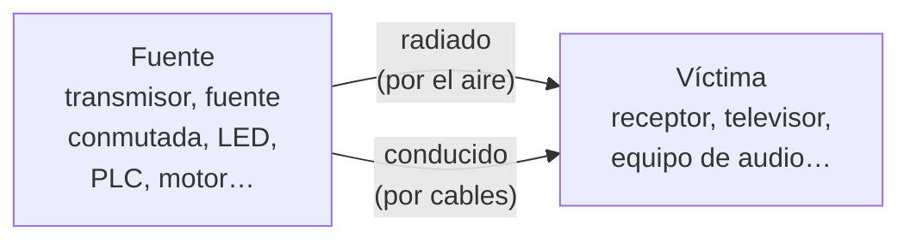
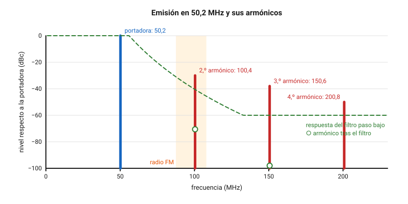
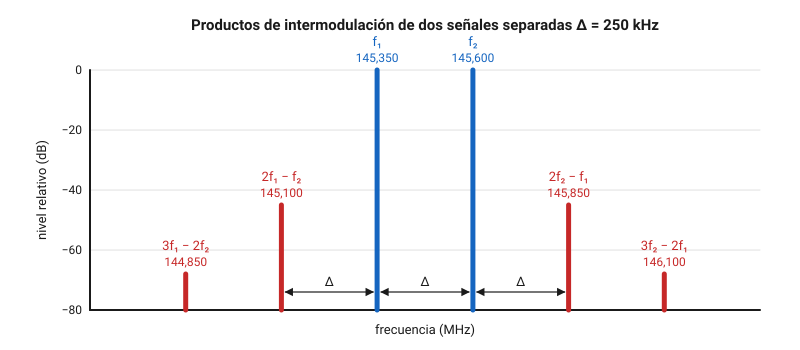
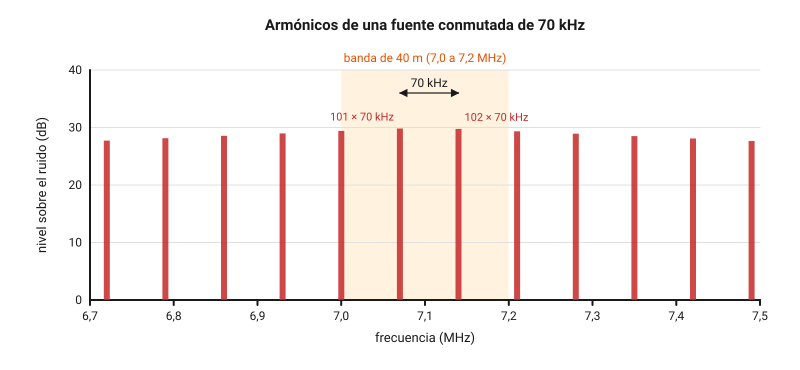
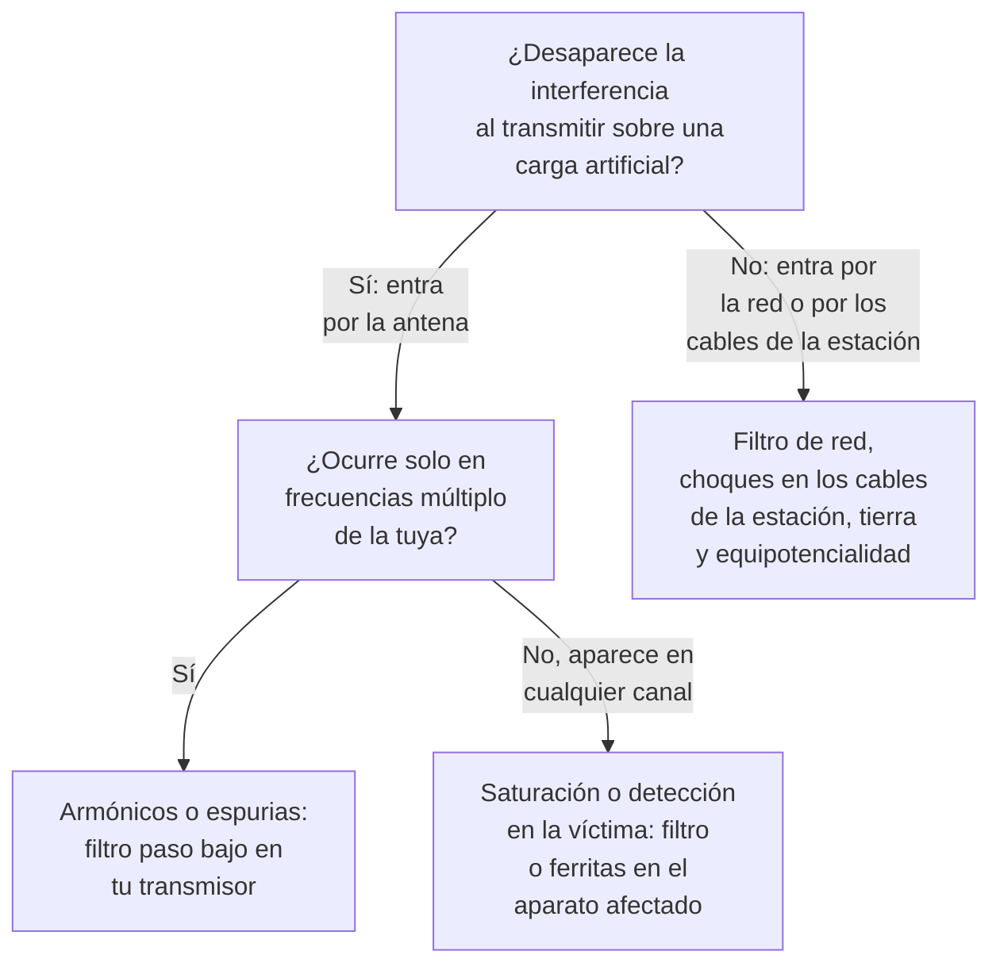
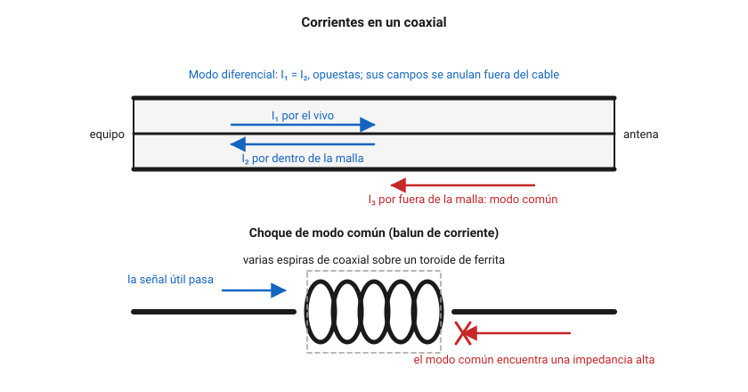

# Interferencias

Tarde o temprano te pasará una de estas dos cosas: un vecino llama a tu puerta porque, cuando transmites, se oye tu voz en su equipo de música, o eres tú quien no puede escuchar nada en 40 m porque un zumbido tapa la banda. En los dos casos, saber qué está pasando ahorra discusiones y dinero. En este capítulo aprenderás de dónde salen las interferencias, tanto las que causa un transmisor como las que nacen en el receptor que las sufre o en los aparatos eléctricos de la casa; cómo averiguar paso a paso cuál es la causa; cómo se resuelven con filtros, ferritas, choques de modo común y una buena toma de tierra; y qué dice la normativa española cuando la interferencia la causas tú o la sufres tú, incluida la reclamación ante el ministerio.

## Qué es una interferencia

### Fuente, camino y víctima

Toda interferencia tiene tres piezas: una **fuente** que produce energía de radiofrecuencia, un **camino** por el que esa energía llega a otro aparato y una **víctima** que funciona mal por culpa de ella. Para resolver el problema basta con actuar sobre una de las tres, y casi siempre hay una que es más fácil de tocar que las otras.

*Figura 8.1. Las tres piezas de cualquier interferencia y los dos caminos posibles.*

El camino puede ser:

- **Radiado**: la energía viaja por el aire desde una antena, o desde un cable que se comporta como antena sin quererlo.
- **Conducido**: la energía viaja por un cable, sobre todo por la red eléctrica, el cable de antena de la televisión o los cables de altavoces, de red o de USB.

En la práctica los dos se mezclan. Un cable de alimentación largo recoge la RF del aire y la lleva por conducción hasta el interior de un aparato.

### Las definiciones oficiales

La [Orden IET/1311/2013, de 9 de julio, por la que se aprueba el Reglamento de uso del dominio público radioeléctrico por radioaficionados](https://www.boe.es/buscar/act.php?id=BOE-A-2013-7624), recoge en el apartado 1 de su anexo I dos definiciones que conviene distinguir (comprobado en noviembre de 2026):

- **Interferencia** es el efecto de una energía no deseada sobre la recepción de un sistema de radiocomunicación, que se nota como una pérdida de calidad, una información falseada o una información perdida.
- **Interferencia perjudicial** es la que compromete un servicio de radionavegación u otro servicio de seguridad, o la que degrada gravemente, interrumpe una y otra vez o impide el funcionamiento de un servicio de radiocomunicación que funciona conforme al Reglamento de Radiocomunicaciones.

La diferencia importa. Un ruido leve que apenas se nota es una interferencia; solo cuando el daño es grave, repetido o afecta a la seguridad pasa a ser perjudicial, y es entonces cuando la Administración actúa, como verás al final del capítulo.

### Compatibilidad electromagnética

La **compatibilidad electromagnética** (*EMC*) es la capacidad de un aparato para funcionar bien en su entorno sin estropear el funcionamiento de los demás. Tiene dos caras:

- La **emisión**: lo que el aparato suelta al exterior, por el aire o por sus cables.
- La **inmunidad**: lo que el aparato aguanta sin fallar cuando le llegan perturbaciones de fuera.

El anexo I del [Real Decreto 186/2016, de 6 de mayo, por el que se regula la compatibilidad electromagnética de los equipos eléctricos y electrónicos](https://www.boe.es/buscar/act.php?id=BOE-A-2016-4442), exige las dos cosas a los aparatos que se venden en España: que sus perturbaciones se limiten a un nivel que deje funcionar a los equipos de radio y de telecomunicaciones, y que el aparato tenga una protección frente a las perturbaciones previsibles que le permita funcionar sin una degradación inaceptable (comprobado en noviembre de 2026). Ninguna de las dos es absoluta: un aparato puede cumplir la norma y aun así fallar a pocos metros de una antena que emite cien vatios.

## Causas en el transmisor

Una emisión limpia ocupa solo el ancho de banda que necesita. Todo lo que sale fuera de ese ancho son **emisiones no deseadas**, que la Orden IET/1311/2013 divide en dos grupos en el apartado 1 de su anexo I (comprobado en noviembre de 2026):

- Las **emisiones fuera de banda**, inmediatamente pegadas a la emisión y producidas por la propia modulación: una BLU sobreexcitada que salpica a los lados, un CW con clics de manipulación.
- Las **emisiones no esenciales** o **espurias**, que se pueden reducir sin afectar a la información transmitida. La orden incluye entre ellas los armónicos, las oscilaciones parásitas, los productos de intermodulación y los de conversión de frecuencia.

En el [capítulo 4](04-teoria-radio.md) viste de dónde salen. Aquí interesa cómo afectan a los demás.

### Armónicos

Un **armónico** es una emisión en un múltiplo entero de la frecuencia de trabajo: el doble (segundo armónico), el triple (tercero), etcétera. Cualquier amplificador que no sea perfectamente lineal los produce, y los amplificadores de potencia de un transmisor nunca lo son del todo.

$$
f_n = n \cdot f_0
$$

donde $f_0$ es la frecuencia de la emisión, $n$ el orden del armónico (2, 3, 4…) y $f_n$ la frecuencia del armónico, en las mismas unidades que $f_0$.

**Ejemplo 1.** Emites en la banda de 6 m, en 50,2 MHz. El segundo armónico cae en $2 \cdot 50{,}2 = 100{,}4\ \text{MHz}$, en plena banda de radio FM; el tercero, en 150,6 MHz, y el cuarto, en 200,8 MHz. Si tu equipo no filtra bien, el vecino que escucha la emisora de 100,4 MHz te oirá a ti. La banda de radiodifusión sonora en FM va de 87,5 a 108 MHz según el [Cuadro Nacional de Atribución de Frecuencias](https://www.boe.es/buscar/act.php?id=BOE-A-2026-15661) (CNAF), aprobado por la Orden TDF/732/2026, de 10 de julio, que la reserva a ese servicio en su nota UN-17 (comprobado en noviembre de 2026).

*Figura 8.2. Armónicos de una emisión en 50,2 MHz antes y después de un filtro paso bajo. Los niveles son ilustrativos.*

**Ejemplo 2.** Un portátil de 2 m transmite en 145,2 MHz. El segundo armónico cae en 290,4 MHz y el tercero en $3 \cdot 145{,}2 = 435{,}6\ \text{MHz}$, dentro de la banda de 70 cm. Si tienes un receptor de 70 cm cerca, puede oír tu emisión de 2 m a través de ese armónico, y un compañero que escuche en 435,6 MHz te oirá donde no estás transmitiendo.

El nivel de un armónico se da en **dBc**, decibelios respecto a la portadora. Un armónico a −50 dBc tiene una potencia cien mil veces menor que la de la emisión.

**Ejemplo 3.** Mides el segundo armónico de un transmisor de 100 W y está a −55 dBc. Su potencia es $100 \cdot 10^{-5{,}5} \approx 316\ \mu\text{W}$. Parece poco, pero es una señal fortísima para un receptor de radio FM que está en la casa de al lado.

### Límites legales de las espurias

El apartado 4.1 del anexo I de la Orden IET/1311/2013 fija cuánta potencia puede tener, como máximo, **cada componente** de una emisión no esencial, medida en la línea que va a la antena (comprobado en noviembre de 2026):

| Frecuencia de la espuria | Potencia media de la emisión | Límite de cada componente |
|---|---|---|
| Por debajo de 30 MHz | cualquiera | 40 dB por debajo, sin superar 50 mW |
| De 30 a 235 MHz | más de 25 W | 60 dB por debajo, sin superar 1 mW |
| De 30 a 235 MHz | 25 W o menos | 40 dB por debajo, sin superar 25 µW |
| De 235 a 960 MHz | más de 25 W | 60 dB por debajo, sin superar 20 mW |
| De 235 a 960 MHz | 25 W o menos | 40 dB por debajo, sin superar 25 µW |
| De 960 MHz a 17,7 GHz | más de 10 W | 50 dB por debajo, sin superar 100 mW |
| De 960 MHz a 17,7 GHz | 10 W o menos | 50 dB por debajo, sin superar 100 µW |

El mismo apartado permite a la Administración exigir límites más estrictos para proteger la radioastronomía, los servicios espaciales u otras instalaciones concretas. Cada fila tiene dos condiciones, una relativa y otra absoluta, y se cumplen las dos a la vez: manda la que dé el valor más bajo.

**Ejemplo 4.** En HF, con 400 W de potencia media, 40 dB por debajo son $400 \cdot 10^{-4} = 0{,}04\ \text{W} = 40\ \text{mW}$, que no llega a los 50 mW: el límite es 40 mW. Con 1 000 W, 40 dB por debajo serían 100 mW, por encima del tope; el límite es 50 mW, que equivale a 43 dB por debajo de la potencia media.

**Ejemplo 5.** Un portátil de 5 W en 2 m. Por ser de 25 W o menos, la primera condición da $5 \cdot 10^{-4} = 500\ \mu\text{W}$; la segunda, 25 µW. Manda la segunda: cada espuria debe quedar 53 dB por debajo de la emisión, más de lo que parecería a primera vista. Con una emisora de 50 W en la misma banda, el límite es 60 dB por debajo, es decir, 50 µW.

**Ejemplo 6.** Vuelve al ejemplo 3. Los 100,4 MHz del armónico están entre 30 y 235 MHz, y la emisión tiene más de 25 W, así que el armónico debe quedar 60 dB por debajo: $100 \cdot 10^{-6} = 100\ \mu\text{W}$. Los 316 µW medidos lo triplican. Ese transmisor necesita un filtro.

### Otras emisiones no deseadas

- **Oscilaciones parásitas**: una etapa que oscila por su cuenta en una frecuencia que no tiene nada que ver con la de trabajo. Suelen aparecer al cambiar la carga, por ejemplo con una ROE alta, y desaparecen al ajustar o reparar el amplificador.
- **Salpicaduras** (*splatter*): una BLU con el micrófono demasiado alto, o un procesador de voz mal ajustado, ensancha la emisión y molesta a los corresponsales de las frecuencias vecinas. El remedio es bajar la ganancia del micrófono y vigilar el ALC.
- **Clics de manipulación**: en CW, una envolvente con flancos demasiado bruscos produce chasquidos a varios kilohercios a cada lado. Los equipos actuales permiten suavizarlos ajustando el tiempo de subida.
- **Ruido de fase** del oscilador: un oscilador poco limpio emite un «colchón» de ruido alrededor de la portadora que se oye a decenas de kilohercios, sobre todo con potencias altas.

### Intermodulación

Cuando dos o más señales pasan a la vez por un elemento no lineal, aparecen nuevas frecuencias que son combinaciones de las originales. Es la **intermodulación**. Con dos señales $f_1$ y $f_2$:

- Los productos de **segundo orden** son $f_1 + f_2$ y $f_2 - f_1$. Suelen caer lejos de las señales originales y un filtro los elimina con facilidad.
- Los de **tercer orden** son $2f_1 - f_2$ y $2f_2 - f_1$. Son los peligrosos, porque caen muy cerca de las señales originales, a la misma separación por fuera de cada una, donde ningún filtro los puede separar.
- Los de **quinto orden**, $3f_1 - 2f_2$ y $3f_2 - 2f_1$, caen un paso más allá y son más débiles.

*Figura 8.3. Productos de intermodulación de tercer y quinto orden. Los niveles son ilustrativos.*

**Ejemplo 7.** En el mismo mástil hay dos emisoras de 2 m que transmiten a la vez en 145,350 y 145,600 MHz, separadas 250 kHz. Los productos de tercer orden caen en $2 \cdot 145{,}350 - 145{,}600 = 145{,}100\ \text{MHz}$ y en $2 \cdot 145{,}600 - 145{,}350 = 145{,}850\ \text{MHz}$, otros 250 kHz por fuera de cada señal. Los de quinto orden, en 144,850 y 146,100 MHz. Los de segundo orden, $f_1 + f_2 = 290{,}95\ \text{MHz}$ y $f_2 - f_1 = 0{,}25\ \text{MHz}$, quedan tan lejos que no molestan.

La intermodulación puede nacer en tres sitios:

- **En el transmisor**, cuando la señal de otro emisor cercano entra por la antena hasta la etapa de salida y se mezcla con la propia. Es típico de los emplazamientos con muchas antenas.
- **En el receptor**, cuando dos señales fuertes llegan a la vez a su entrada. Lo verás en la sección siguiente.
- **Fuera de cualquier equipo**: una unión oxidada entre dos metales, un tornillo flojo de un canalón o una abrazadera corroída de una antena se comportan como un diodo rudimentario. Los radioaficionados lo llaman el efecto del **tornillo oxidado**. Cuesta mucho de encontrar, porque la fuente no es ningún aparato.

## Causas en el receptor afectado

Muchas veces el transmisor está perfecto y la culpa es del aparato que sufre la interferencia. Estos casos se reconocen porque el problema aparece **en la frecuencia en la que transmites**, no en un armónico, y porque un filtro en tu transmisor no lo arregla.

### Saturación y bloqueo

La entrada de un receptor está pensada para señales débiles. Si le llega una señal muy fuerte, aunque esté fuera de la frecuencia que escucha, sus primeras etapas se **saturan**: dejan de comportarse de forma lineal. Las consecuencias son dos:

- **Bloqueo**: el receptor pierde sensibilidad y las señales que escuchabas bajan o desaparecen mientras dura la señal fuerte.
- **Intermodulación en el receptor**: la señal fuerte se mezcla con otras y aparecen señales fantasma que en realidad no existen en el aire.

Un televisor con amplificador de antena, un receptor de FM barato o el escáner de un vecino a pocos metros de tu antena son víctimas típicas. La señal que los satura es la tuya, en tu frecuencia y limpia de espurias. La solución está en la víctima: un filtro que deje pasar lo que ella quiere recibir y rechace tu frecuencia.

**Ejemplo 8.** Un vecino escucha onda corta con un receptor de bolsillo y oye, en 15,57 MHz y en 3,67 MHz, una mezcla de dos emisoras de radiodifusión muy fuertes que en realidad están en 5,95 y 9,62 MHz. Son los productos de segundo orden: $5{,}95 + 9{,}62 = 15{,}57$ y $9{,}62 - 5{,}95 = 3{,}67\ \text{MHz}$. Su receptor se satura con la antena telescópica extendida del todo; si la recoge un poco, los fantasmas desaparecen y las emisoras de verdad siguen oyéndose.

!!! tip "Para el examen"
    Si el problema desaparece al poner un filtro **paso bajo en tu transmisor**, la culpa era de tus armónicos. Si solo se arregla con un filtro **en el aparato afectado**, el problema era su saturación. Y un atenuador que hace desaparecer una señal mucho más deprisa de lo que debería indica que esa señal es un producto de intermodulación del propio receptor: un producto de tercer orden baja 3 dB por cada dB que bajan las señales que lo forman.

### Detección en equipos de audio y teléfonos

Los aparatos que no son receptores de radio también sufren interferencias. En un amplificador de audio, un altavoz activo de ordenador, un interfono o un teléfono fijo, la RF entra por los cables, que hacen de antena, y la primera unión de semiconductor que encuentra la **rectifica**, igual que el detector de un receptor de AM. Lo que queda es la envolvente de tu señal:

- En **AM** y **BLU** se oye tu voz, más o menos distorsionada. En BLU sube y baja con tu voz y desaparece en los silencios.
- En **CW** se oyen golpes o chasquidos al ritmo de la manipulación.
- En **FM**, como la amplitud es constante, normalmente solo se oye un cambio de ruido de fondo o un zumbido mientras transmites.

La solución suele estar en los cables del aparato afectado: ferritas en los cables de altavoces y de alimentación, o condensadores de desacoplo en la entrada, montados por un técnico.

### Respuesta imagen y otras debilidades

Un receptor superheterodino también responde a su **frecuencia imagen**, a dos frecuencias intermedias de la que escucha, como viste en el [capítulo 4](04-teoria-radio.md). Si tu emisión cae justo en la imagen de un receptor cercano, este te oirá aunque esté sintonizado en otra parte. De nuevo, el problema es del receptor y se resuelve con un filtro de entrada mejor.

## Ruido eléctrico en casa

Hoy, la mayor parte de los problemas que sufre un radioaficionado no los causa ningún otro transmisor, sino los aparatos eléctricos que hay alrededor. Casi todos tienen dentro circuitos que conmutan corrientes a gran velocidad, y cualquier conmutación rápida genera un espectro amplísimo de armónicos.

### Fuentes de alimentación conmutadas

Una **fuente conmutada** convierte la tensión de red en continua abriendo y cerrando un transistor decenas o cientos de miles de veces por segundo. La tienen los cargadores de móvil, los alimentadores de portátiles y de routers, los televisores modernos y las propias fuentes de muchos transceptores. Funcionan con un rendimiento excelente, pero si están mal filtradas, o son de mala calidad, emiten por el cable de red y por el de salida todos los armónicos de su frecuencia de conmutación.

Se reconocen bien: aparecen como un **peine** de portadoras separadas siempre la misma distancia, que es la frecuencia de conmutación. Las portadoras no son limpias: se ensanchan y se desplazan cuando cambia la carga de la fuente, por ejemplo cuando el móvil termina de cargar.

**Ejemplo 9.** Una fuente conmuta a 70 kHz. Sus armónicos 100, 101 y 102 caen en 7 000, 7 070 y 7 140 kHz, dentro de la banda de 40 m. En la banda de 20 m, de 14 000 a 14 350 kHz, caben seis: los armónicos del 200 al 205. Si escuchas un peine de portadoras separadas 70 kHz, ya sabes qué tipo de aparato buscas.

*Figura 8.4. El peine de armónicos de una fuente conmutada de 70 kHz. Los niveles son ilustrativos.*

### Iluminación LED

Una bombilla LED no se alimenta directamente de la red: lleva dentro un pequeño **driver**, normalmente otra fuente conmutada. En las lámparas baratas ese circuito apenas tiene filtro. Una sola bombilla molesta poco, pero una casa entera con LED, más las tiras de LED con su alimentador, pueden subir varios puntos S el ruido de fondo en HF. El ruido suele ser de banda ancha, como un soplido, o un peine poco definido, y aparece y desaparece al encender y apagar la luz. Los reguladores de intensidad empeoran el problema.

### Comunicaciones por la red eléctrica (PLC)

Los **adaptadores PLC** (*power line communication*), que se venden para llevar la conexión de internet de una habitación a otra usando los enchufes, inyectan en la instalación eléctrica señales de banda ancha, normalmente en buena parte de la HF. La instalación eléctrica no está pensada para llevar RF: es una red de cables sin apantallar que radia esa señal a todo el edificio.

En el receptor se oye como un ruido continuo, a veces con un ritmo de ráfagas, que cubre megahercios enteros. Muchos modelos recientes llevan **muescas** (*notches*) que dejan de emitir en las bandas de aficionado, y en ellos el ruido baja justo en la banda y sube a los lados. Si los adaptadores son del vecino, tu equipo de radio no puede hacer nada contra ese ruido: la conversación con él, y en su caso la reclamación, son el único camino.

### Otras fuentes habituales

- **Inversores de placas solares** y **cargadores de coche eléctrico**: conmutan potencias grandes y, si no están bien instalados, radian por los cables largos de los paneles.
- **Motores con escobillas**: taladros, batidoras, secadores. Producen un ruido crepitante mientras funcionan.
- **Termostatos, timbres y relés**: un chasquido cada vez que conmutan.
- **Líneas eléctricas**: un aislador sucio o roto, o un herraje flojo, produce pequeñas descargas en cada pico de la tensión. Como la tensión pasa por un pico positivo y otro negativo en cada ciclo, el ruido tiene un zumbido característico de $2 \cdot 50 = 100\ \text{Hz}$. Suele empeorar o mejorar con la humedad y el viento.
- **Vehículos**: el encendido de los motores de gasolina produce impulsos al ritmo del motor, y los vehículos modernos añaden sus propias fuentes conmutadas.

!!! example "En la práctica"
    Antes de culpar a nadie, apunta en una libreta o en una hoja de cálculo cuándo aparece el ruido, en qué bandas y con qué nivel en el medidor S. Un ruido que empieza todos los días a la misma hora y se va al amanecer suele ser una iluminación con temporizador. Uno que solo aparece los días soleados apunta a un inversor de placas. Esas notas serán además muy útiles si al final tienes que reclamar.

## Cómo diagnosticar

### Si el ruido lo sufres tú

1. **Escucha qué tipo de ruido es.** Un peine de portadoras, un soplido de banda ancha, un zumbido de 100 Hz o chasquidos aislados apuntan a familias de fuentes distintas, como acabas de ver.
2. **Descarta tu propia casa.** Alimenta el receptor con una batería y corta la corriente de toda la vivienda con el interruptor general del cuadro. Si el ruido desaparece, la fuente está en casa: vuelve a conectar los circuitos uno a uno y después desenchufa aparatos hasta encontrarla. Es la comprobación más rentable de todas, porque en la mayoría de los casos el culpable resulta estar dentro.
3. **Si sigue, búscalo fuera.** Un receptor portátil de onda media o de onda corta en AM, con la antena de ferrita interna, sirve de buscador: la antena de ferrita tiene nulos muy marcados, y al girar el receptor el ruido baja cuando la ferrita apunta hacia la fuente. Ve acercándote: el ruido sube a medida que te aproximas. En VHF y UHF, una pequeña antena directiva hace la misma función.
4. **Mide antes y después.** El medidor S de tu equipo, aunque no esté bien calibrado, sirve para comparar. Recuerda que cada unidad S son 6 dB.

**Ejemplo 10.** Con el interruptor general cortado, el ruido baja de S8 a S3. Son $5 \cdot 6 = 30\ \text{dB}$: el ruido que generaba tu propia casa tenía una potencia mil veces mayor que el que queda.

!!! danger "Peligro"
    No abras el cuadro eléctrico ni manipules la instalación fija; usa solo los interruptores y las protecciones accesibles, como se explica en el [capítulo 3](03-seguridad.md). Al cortar la corriente se apagan también el frigorífico, las alarmas y los equipos médicos que pueda haber en casa: avisa antes. Y no busques fuentes de ruido en postes, transformadores o líneas eléctricas acercándote a ellos: avisa a la compañía distribuidora.

### Si la interferencia la causas tú

Cuando alguien te dice que le interfieres, el primer paso es comprobarlo con calma, en su casa si te deja, y averiguar el camino:

*Figura 8.5. Un camino de diagnóstico para la interferencia que causa tu estación.*

- **La carga artificial** es la prueba clave. Transmite con la misma potencia sobre una carga artificial en lugar de la antena. Si la interferencia desaparece, la energía viaja por la antena. Si sigue, sale de la estación por otro camino: el cable de red, el cable de la fuente o los cables de los accesorios. El apartado 4.3 del anexo I de la Orden IET/1311/2013 obliga además a usar una carga artificial no radiante en todos los ensayos que no necesiten radiar por la antena (comprobado en noviembre de 2026).
- **Mira en qué frecuencia molesta.** Si el aparato afectado solo te oye cuando está sintonizado en un múltiplo de tu frecuencia, son tus armónicos. Si te oye en cualquier canal, o es un aparato que no recibe radio, como un equipo de música, es saturación o detección en la víctima.
- **Prueba con otro receptor.** Si un receptor de buena calidad, en el mismo sitio, no nota nada, el problema está en el aparato afectado.
- **Prueba otras bandas y modos.** Una interferencia que solo aparece en una banda suele apuntar a un cable que resuena en esa banda.
- **Baja la potencia.** Si con la mitad de potencia la interferencia baja mucho más que 3 dB, hay saturación o intermodulación por medio.

### La intensidad de campo en casa del vecino

Para hacerte una idea de lo que recibe el aparato afectado, calcula el campo que produce tu antena a la distancia a la que está, con la fórmula del [capítulo 3](03-seguridad.md):

$$
E = \frac{\sqrt{30 \cdot \text{PIRE}}}{d}
$$

con $E$ en voltios por metro, la PIRE en vatios y $d$ en metros.

**Ejemplo 11.** Emites 100 W con un dipolo de media onda, que tiene 2,15 dBi, un factor de 1,64. La PIRE es de $100 \cdot 1{,}64 = 164\ \text{W}$. El televisor del vecino está a 12 m de la antena, en la dirección de máxima radiación:

$$
E = \frac{\sqrt{30 \cdot 164}}{12} = \frac{\sqrt{4\,920}}{12} \approx 5{,}8\ \text{V/m}
$$

Si alejas la antena hasta 24 m, el campo baja a la mitad, 2,9 V/m, es decir, 6 dB menos. Bajar la potencia de 100 a 25 W da el mismo resultado. Un portátil de 5 W a 1 m de un aparato produce, en cambio, unos $\sqrt{30 \cdot 5} \approx 12{,}2\ \text{V/m}$: mucho más que una estación de casa bien instalada. Son campos que los aparatos domésticos no siempre toleran, aunque cumplan la normativa.

## Cómo resolverlo

### Filtros

Un **filtro** deja pasar unas frecuencias y atenúa otras. Ya conoces los tipos del [capítulo 4](04-teoria-radio.md). Para las interferencias, cada uno tiene su sitio:

| Filtro | Dónde se pone | Para qué |
|---|---|---|
| **Paso bajo** | A la salida del transmisor o del amplificador, antes del acoplador | Quita los armónicos de una emisión de HF o de 6 m |
| **Paso banda** | A la salida del transmisor o a la entrada de un receptor | Deja pasar solo una banda; útil en concursos con varias estaciones juntas |
| **Paso alto** | En la entrada de antena del televisor o del receptor afectado | Rechaza tu emisión de HF, que está por debajo de lo que la víctima quiere recibir |
| **Banda eliminada** (*notch*) | En la entrada del aparato afectado | Rechaza una frecuencia concreta, por ejemplo tu banda de 2 m o 70 cm |
| **Filtro de red** | En el cable de alimentación, lo más cerca posible del aparato | Impide que la RF entre o salga por la red eléctrica |

El apartado 4.6 del anexo I de la Orden IET/1311/2013 exige que la estación disponga de los filtros supresores de armónicos, de tipo paso bajo, y de las redes de adaptación de impedancias que sean precisos (comprobado en noviembre de 2026).

Algunos consejos para que funcionen:

- El filtro paso bajo del transmisor está diseñado para trabajar sobre 50 Ω. Ponlo **entre el transmisor y el acoplador**, donde la impedancia es la correcta, y no entre el acoplador y una antena desadaptada.
- Un filtro en el transmisor no arregla nunca una saturación de la víctima. Y un filtro en la víctima no arregla nunca tus armónicos, porque caen justo donde ella escucha.
- Los filtros de la víctima van en **su** equipo y se deben instalar con su permiso. Si es una instalación comunitaria de antena, su mantenimiento lo hace un instalador de telecomunicaciones.

### Ferritas y choques de modo común

En un coaxial bien usado, la corriente que va por el vivo vuelve por la cara interior de la malla con el mismo valor y sentido contrario. Sus campos se anulan fuera del cable: es el **modo diferencial**, y el cable ni radia ni capta. Cuando una parte de la corriente circula por la **cara exterior** de la malla, o cuando varios conductores de un mismo cable llevan corriente en el mismo sentido, aparece el **modo común**. Esa corriente sí radia y sí capta: convierte el cable en una antena. Ya lo viste en el [capítulo 6](06-antenas-lineas.md) al hablar del balun.

*Figura 8.6. Modo diferencial, modo común y choque de modo común.*

La mayoría de las interferencias en casa viajan en modo común: por la malla del coaxial, por el cable de red, por los cables de altavoces o de red de datos. Para frenarlas se usa un **choque de modo común**: se enrolla el cable sobre un núcleo de **ferrita** o se le ponen ferritas partidas que se cierran a presión alrededor. La ferrita presenta una impedancia alta a la corriente en modo común y deja pasar sin tocarla la señal útil, que viaja en modo diferencial y no crea campo neto en el núcleo.

Lo que importa de un choque es su impedancia a la frecuencia del problema, comparada con la del camino por el que circula la corriente. Si tratas los dos como resistencias, la corriente en modo común se reduce en el factor

$$
\frac{I_\text{con}}{I_\text{sin}} = \frac{Z_\text{camino}}{Z_\text{camino} + Z_\text{choque}}
$$

donde $Z_\text{camino}$ es la impedancia del circuito por el que circula la corriente en modo común y $Z_\text{choque}$ la que añade el choque, las dos en ohmios.

**Ejemplo 12.** La malla de un coaxial forma con el resto de la instalación un camino de unos 150 Ω en modo común. Le añades un choque de 1 500 Ω a esa frecuencia. La corriente queda en $150 / (150 + 1\,500) \approx 0{,}091$ veces la inicial: unos 21 dB menos.

Dos ideas prácticas:

- **Las espiras cuentan.** La impedancia de un choque crece aproximadamente con el cuadrado del número de veces que el cable pasa por el núcleo, hasta que la capacidad entre espiras lo limita. Una ferrita partida que da 80 Ω con el cable pasado una vez puede llegar a unos 2 000 Ω con cinco vueltas: $80 \cdot 5^2 = 2\,000\ \Omega$. Una sola ferrita sin vueltas suele servir de poco en HF.
- **El material importa.** Cada ferrita está pensada para un margen de frecuencias. Las de los cables de ordenador suelen trabajar bien en VHF y poco en HF. Elige la ferrita por la hoja de datos del fabricante, que da su impedancia en función de la frecuencia.

Los sitios donde ponerlas, por orden de eficacia: en el coaxial junto a la antena (es el balun de corriente del capítulo 6), en el coaxial a la entrada de la casa, en los cables de la estación (red, micrófono, manipulador, USB del ordenador) y, por último, en los cables del aparato afectado, empezando por los más largos.

### Toma de tierra y conexión equipotencial

Una toma de tierra cumple dos funciones distintas que no conviene mezclar:

- La **tierra de seguridad**, la de la instalación eléctrica y la de protección contra rayos, protege a las personas. Es obligatoria y se trata en el [capítulo 3](03-seguridad.md).
- La **tierra de RF** busca que la estación no tenga RF en los chasis, en el micrófono o en el manipulador, y que no circulen corrientes de RF por los cables de la casa.

En un piso alto, la «tierra de RF» que se busca muchas veces con un cable hasta el suelo no funciona. Un cable de tierra es también un conductor de una longitud determinada, y se comporta como una línea: si mide un cuarto de onda, el cortocircuito que hay en su extremo se convierte en una impedancia altísima en el otro, el de la estación, como viste con las líneas resonantes en el [capítulo 6](06-antenas-lineas.md).

**Ejemplo 13.** Un cable de tierra de 10,6 m desde la estación hasta la toma del edificio. Como $\lambda/4 \approx 75/f$, a 7,1 MHz mide un cuarto de onda: en la estación presenta una impedancia altísima y no sirve de nada como tierra de RF; incluso puede radiar. A 14,2 MHz mide media onda y repite el cortocircuito: ahí sí funciona. Un cable de tierra largo es una tierra de RF solo en algunas bandas.

Lo que sí funciona siempre es la **conexión equipotencial**: unir todos los chasis de la estación (transceptor, fuente, acoplador, amplificador, ordenador) con conexiones cortas y anchas, por ejemplo con una pletina o una malla, a un punto común. Así no hay diferencias de tensión de RF entre ellos, y la corriente de RF no busca caminos por los cables de audio o de datos. Ese punto común debe estar unido a la tierra de protección del edificio, como se explica en el capítulo 3; no crees nunca una tierra aislada de la de la instalación.

### Medidas en la estación

- **Aleja la antena de la casa** y, sobre todo, de los cables de la casa. Cada metro cuenta: el campo baja en proporción a la distancia.
- **Usa antenas simétricas con balun** y coaxial, mejor que hilos alimentados en un extremo que bajan hasta el cuarto de radio y meten la RF dentro de casa.
- **Usa solo la potencia necesaria.** El apartado 4.2 del anexo I de la Orden IET/1311/2013 exige limitar la potencia y la duración de las emisiones a lo estrictamente necesario (comprobado en noviembre de 2026).
- **Revisa las conexiones de la antena**: un conector mal crimpado o una unión oxidada producen intermodulación y ruido.
- **Ajusta bien la modulación**: micrófono y procesador sin excesos, ALC en su zona y clics de manipulación suaves.
- **Vigila tus propias fuentes conmutadas**: la fuente del transceptor, el cargador del portátil o el router pueden ser tu peor fuente de ruido.

!!! example "En la práctica"
    Si un vecino se queja, ve con buena disposición y propón hacer pruebas juntos a una hora acordada. Llévate ferritas partidas y un filtro de red: muchas veces el problema se resuelve en una tarde. Nunca abras ni modifiques un aparato que no es tuyo. Si el aparato necesita un filtro interno, que lo ponga su servicio técnico. Y si la causa resulta estar en tu estación, corrígela aunque nadie te lo exija.

## La interferencia en la normativa española

### Las condiciones de tu estación

La Orden IET/1311/2013 fija varias obligaciones técnicas que, en la práctica, sirven para prevenir interferencias (todas comprobadas en noviembre de 2026):

- Los límites de las emisiones no esenciales del apartado 4.1 de su anexo I, que viste más arriba.
- La potencia y la duración de las emisiones limitadas a lo estrictamente necesario (apartado 4.2 del anexo I).
- El uso de carga artificial en los ensayos que no necesiten radiar (apartado 4.3).
- El cumplimiento de la legislación vigente sobre perturbaciones radioeléctricas e interferencias (apartado 4.4).
- Los elementos para comprobar que emites dentro de las bandas autorizadas y para medir, de forma indicativa, tu potencia (apartado 4.5).
- Los filtros supresores de armónicos y las redes de adaptación que sean precisos (apartado 4.6).

Además, su artículo 18.3 condiciona la licencia de funcionamiento de las estaciones fijas, en todo caso, a que no perturben otros servicios radioeléctricos autorizados (comprobado en noviembre de 2026).

En cuanto a tus equipos, el artículo 2.2.c) del RD 186/2016 deja fuera de la normativa de compatibilidad electromagnética los equipos de radio que usan los radioaficionados, **salvo que sean comercializados**; y aclara que no se consideran comercializados los kits de componentes para que los monten los radioaficionados ni los equipos comerciales modificados por y para radioaficionados (comprobado en noviembre de 2026). Los transceptores que se venden ya montados son equipos radioeléctricos y se rigen por el [Real Decreto 188/2016, de 6 de mayo](https://www.boe.es/buscar/act.php?id=BOE-A-2016-4444), que regula los requisitos para comercializar, poner en servicio y usar equipos radioeléctricos (comprobado en noviembre de 2026). Dicho de otro modo: si construyes o modificas tu equipo, nadie lo ha ensayado por ti, y te corresponde a ti que cumpla los límites del anexo I de la orden.

### Si tu estación interfiere

El artículo 32 de la Orden IET/1311/2013 fija el procedimiento cuando una estación de aficionado causa interferencias perjudiciales a otros servicios autorizados (comprobado en noviembre de 2026). La orden se refiere a la Administración como «la SETSI», el nombre que tenía entonces la Secretaría de Estado de Telecomunicaciones; hoy es la Secretaría de Estado de Telecomunicaciones e Infraestructuras Digitales, del Ministerio para la Transformación Digital y de la Función Pública:

1. Si, **tras comprobarlo su personal**, la Administración determina que tu estación causa interferencia perjudicial a otro servicio de telecomunicación autorizado o a la recepción de la radio o la televisión, tienes que **dejar de emitir** y, en su caso, siguiendo sus instrucciones y **a tu costa**, adoptar medidas técnicas razonables en tu estación para eliminarla.
2. Una vez aplicadas las medidas, lo **comunicas de forma fehaciente** a la Administración, y desde ese momento puedes volver a emitir sin más trámite.
3. Si la interferencia persiste, la Administración puede, de forma excepcional, imponerte **restricciones de bandas, de potencia o de horario**.

Fíjate en dos detalles. El procedimiento empieza con una comprobación de la Inspección, no con la queja de un vecino. Y las medidas que te pueden exigir son técnicas y razonables y se aplican en **tu** estación; si el problema es la falta de inmunidad del aparato afectado, no está en tu mano resolverlo y no es tu estación la que lo causa.

Las estaciones y los equipos de aficionado están sometidos a la inspección del ministerio, y su titular está obligado a facilitar el acceso a la instalación y la documentación a los inspectores, que tienen la consideración de autoridad pública (artículo 33 de la Orden IET/1311/2013; comprobado en noviembre de 2026).

La [Ley 11/2022, de 28 de junio, General de Telecomunicaciones](https://www.boe.es/buscar/act.php?id=BOE-A-2022-10757), clasifica las infracciones relacionadas (comprobado en noviembre de 2026):

- Es **muy grave** producir **deliberadamente** interferencias a redes o servicios autorizados (artículo 106.7) y **no atender el requerimiento de cesación** que la Administración formula en los casos de interferencias (artículo 106.8).
- Es **grave** la **mera producción** de interferencias a redes o servicios autorizados, sin que sea deliberada (artículo 107.6), y negarse a ser inspeccionado u obstruir la inspección (artículo 107.36).
- Las multas llegan hasta 20 millones de euros por las muy graves y hasta 2 millones por las graves (artículo 109.1). Cuando se emite sin título habilitante o con características técnicas distintas de las autorizadas, la sanción puede llevar además el cese o el ajuste de las emisiones, el precintado o la incautación de los equipos o la clausura de la instalación (artículo 109.2).

Son cifras máximas pensadas sobre todo para operadores, pero dejan claro que ignorar un requerimiento de cesación es mucho más grave que haber causado la interferencia.

!!! tip "Para el examen"
    Ante una interferencia perjudicial comprobada por la Administración: **cesar** las emisiones, aplicar **a tu costa** las medidas técnicas razonables que te indiquen, **comunicarlo** de forma fehaciente y volver a emitir. Si persiste, la Administración puede limitar bandas, potencia u horario (artículo 32 de la Orden IET/1311/2013). La interferencia deliberada y no atender el requerimiento de cesación son infracciones **muy graves** de la Ley 11/2022; la no deliberada, **grave** (comprobado en noviembre de 2026).

### Si eres tú quien sufre la interferencia

Antes de reclamar, recuerda en qué situación está tu servicio:

- En muchas bandas el servicio de aficionados es **secundario**, como viste en el [capítulo 5](05-propagacion-bandas.md). Según las definiciones del apartado 1 del anexo I de la Orden IET/1311/2013, un servicio secundario no puede causar interferencias perjudiciales a los servicios primarios ni reclamar protección frente a ellos, aunque sí frente a estaciones del mismo servicio o de otros servicios secundarios a los que se asignen frecuencias más tarde (comprobado en noviembre de 2026).
- En las bandas destinadas a aplicaciones **industriales, científicas y médicas** (ICM) que comparte el servicio de aficionados, sus estaciones tienen que **aceptar** la interferencia perjudicial que produzcan esas aplicaciones. El apartado 3.4 del anexo I de la orden enumera cuatro: 433,050 a 434,790 MHz, 2 400 a 2 450 MHz, 5 725 a 5 800 MHz y 24,00 a 24,25 GHz (comprobado en noviembre de 2026). Por eso no tiene sentido reclamar por los mandos de garaje o las estaciones meteorológicas que oyes en 433 MHz.

Si la interferencia viene de un **aparato eléctrico** (una fuente conmutada, una iluminación, un adaptador PLC, un inversor), el aparato debe cumplir los requisitos esenciales del RD 186/2016 que viste al principio. Para las **instalaciones fijas**, como la de un edificio o la de unas placas solares, el artículo 19 del mismo real decreto dispone que, cuando haya indicios de que no cumplen, en especial si hay quejas por las perturbaciones que generan, las autoridades pueden pedir pruebas de su conformidad e imponer medidas para que la cumplan; y que la conformidad de una instalación fija es responsabilidad de su propietario o, en su caso, de su titular (comprobado en noviembre de 2026). La vigilancia del mercado de los aparatos que regula ese real decreto corresponde a los órganos competentes de las comunidades autónomas (artículo 30.2; comprobado en noviembre de 2026).

En la práctica, el orden razonable es este:

1. **Asegúrate de que la fuente no está en tu casa**, con la prueba del interruptor general.
2. **Localízala** y, si es de un vecino, **habla con él**. Explícale el problema con datos y ofrécete a probar una solución, como cambiar unas bombillas o poner un filtro. Muchas veces el vecino ni sabe que su aparato molesta, y casi siempre es el camino más rápido.
3. **Si no se resuelve, reclama** ante la Inspección de Telecomunicaciones.

### La reclamación ante el ministerio

La página del Ministerio para la Transformación Digital y de la Función Pública sobre [interferencias perjudiciales](https://digital.gob.es/telecomunicaciones-infraestructuras-digitales/areas-interes/inspeccion-telecomunicaciones/interferencias-perjudiciales) indica que las reclamaciones las atiende la **Jefatura Provincial de Inspección de Telecomunicaciones** de la provincia en la que se produce la interferencia, y ofrece un modelo de solicitud para presentarlas (comprobado en noviembre de 2026). Los datos de contacto de cada Jefatura están en la [página de contacto de las Jefaturas Provinciales](https://digital.gob.es/telecomunicaciones-infraestructuras-digitales/jefaturas-provinciales/contacto) (comprobado en noviembre de 2026). La misma página precisa que tienen derecho a protección los titulares habilitados para usar el dominio público radioeléctrico que lo usen en las condiciones de su título o, en su caso, del Cuadro Nacional de Atribución de Frecuencias: como radioaficionado, lo estás mientras emitas en las bandas, con las potencias y en las condiciones de tu autorización. Las interferencias denunciadas las analizan los servicios técnicos de las Jefaturas con la Red de Comprobación Técnica de Emisiones Radioeléctricas (red CTER) del ministerio (comprobado en noviembre de 2026).

La sede electrónica del ministerio tiene un trámite específico, el [Servicio Interferencias](https://digital.gob.es/ministerio/servicios-a-la-ciudadania/procedimientos-y-servicios/telecomunicaciones-e-infraestructuras-digitales/espectro-radioelectrico/servicio_interferencias) (código SIA 216083), habilitado «para la comunicación y solicitud de intervención técnica por un posible uso indebido del dominio público radioeléctrico». Lo gestiona la Subdirección General de Inspección de las Telecomunicaciones e Infraestructuras Digitales. Se accede con certificado digital o con Cl@ve, y en una solicitud nueva hay que adjuntar firmado el formulario «Datos identificativos de la interferencia», que se descarga en la misma página (comprobado en noviembre de 2026). El formulario pide:

- El servicio interferido, marcado en una lista que incluye «Radioaficionado», y la frecuencia o el canal afectados.
- La identificación de la estación interferida: la referencia de su expediente administrativo, su dirección y sus coordenadas.
- Las características de la interferencia: dónde se detecta, si es permanente o temporal, con fechas y horas, y cómo se manifiesta (ruido, una emisión identificable, pérdida de calidad…).
- Las medidas que hayas hecho de la señal interferente: frecuencia, clase de emisión, ancho de banda, intensidad de campo, polarización, dirección de llegada (la marcación o QTE) y, si se identifica, el nombre o el indicativo de la estación.

Como radioaficionado, la estación interferida es la tuya, y su referencia administrativa es la de tu autorización y, si la tienes, la de tu licencia de estación fija. Tus notas del diario de ruido y tus medidas con el medidor S y el receptor portátil encajan exactamente en lo que pide el formulario. Ni la página del trámite ni la de interferencias perjudiciales mencionan ninguna tasa.

Para quien no use la vía electrónica, la página de interferencias perjudiciales ofrece un [modelo de solicitud de intervención ante interferencias](https://digital.gob.es/content/dam/portal-mtdfp/avance-digital/telecomunicacion-e-infraestructuras-digitales/areas_interes/inspeccion-telecomunicaciones/documents/mod-solicitud-interferencias-perjudiciales.docx). Pide los mismos datos técnicos y, además, la Jefatura a la que se dirige, la acción que solicitas y tus datos de contacto (comprobado en noviembre de 2026).

Elegir la vía es un derecho: según el [artículo 14.1 de la Ley 39/2015, de 1 de octubre, del Procedimiento Administrativo Común de las Administraciones Públicas](https://www.boe.es/buscar/act.php?id=BOE-A-2015-10565), como persona física puedes decidir si te comunicas con la Administración por medios electrónicos o no, salvo que estés obligado a hacerlo electrónicamente; las asociaciones, como personas jurídicas, sí están obligadas (artículo 14.2.a) (comprobado en noviembre de 2026). Ninguna de las dos páginas del ministerio dice dónde se entrega el modelo en papel, así que, si eliges esa vía, pregunta antes a tu Jefatura. La vía electrónica deja constancia inmediata de la fecha de presentación.

!!! tip "Para el examen"
    Las reclamaciones por interferencias perjudiciales las atiende la **Jefatura Provincial de Inspección de Telecomunicaciones** de la provincia donde se producen. Se presentan por el trámite «Servicio Interferencias» de la sede electrónica del ministerio o con su modelo de solicitud. En las bandas ICM, el radioaficionado **acepta** las interferencias de esas aplicaciones, y en las bandas en las que es **secundario** no puede reclamar protección frente a los servicios primarios (comprobado en noviembre de 2026).

## Resumen

- Toda interferencia tiene una **fuente**, un **camino** (radiado o conducido) y una **víctima**. Basta con actuar sobre una de las tres.
- La Orden IET/1311/2013 define la **interferencia perjudicial** como la que compromete servicios de seguridad o degrada gravemente, interrumpe repetidamente o impide un servicio de radiocomunicación (comprobado en noviembre de 2026).
- Del transmisor salen **armónicos** ($f_n = n \cdot f_0$), oscilaciones parásitas, salpicaduras, clics y productos de **intermodulación**. Los de tercer orden, $2f_1 - f_2$ y $2f_2 - f_1$, caen junto a las señales originales.
- El anexo I de la Orden IET/1311/2013 limita cada espuria. Por debajo de 30 MHz, 40 dB bajo la potencia media y sin superar 50 mW. Entre 30 y 960 MHz, si emites más de 25 W, 60 dB por debajo sin superar 1 mW (de 30 a 235 MHz) o 20 mW (de 235 a 960 MHz); si emites 25 W o menos, 40 dB por debajo sin superar 25 µW. En cada caso manda el valor más bajo (comprobado en noviembre de 2026).
- La **saturación**, el **bloqueo** y la **detección** en equipos de audio son problemas de la víctima: aparecen en tu frecuencia y se resuelven con filtros o ferritas en el aparato afectado, no en el tuyo.
- **Fuentes conmutadas**, **LED**, **PLC**, inversores y líneas eléctricas son hoy las fuentes de ruido más comunes. Un peine de portadoras con separación fija delata una fuente conmutada; un zumbido de 100 Hz, una descarga en una línea.
- Para diagnosticar: el **interruptor general** con el receptor a baterías, un **receptor portátil** para localizar la fuente y la **carga artificial** para saber si tu interferencia sale por la antena.
- Filtro **paso bajo** en el transmisor contra los armónicos; **paso alto**, **banda eliminada** o **filtro de red** en la víctima; **choques de modo común** con varias espiras sobre ferrita en los cables; conexión **equipotencial** de todos los equipos.
- Si la Administración comprueba que tu estación causa interferencia perjudicial, tienes que **cesar**, corregir a tu costa, **comunicarlo** y después puedes volver a emitir (artículo 32 de la orden). La interferencia deliberada y desatender el requerimiento de cesación son infracciones **muy graves** de la Ley 11/2022 (comprobado en noviembre de 2026).
- Si la sufres tú, habla primero con el vecino y, si no se resuelve, reclama ante la **Jefatura Provincial de Inspección de Telecomunicaciones** por el trámite «Servicio Interferencias» de la sede electrónica o con el modelo del ministerio (comprobado en noviembre de 2026).

## Autoevaluación

**1.** Transmites en 145,8 MHz. ¿En qué frecuencia cae el tercer armónico?

a) 291,6 MHz  
b) 437,4 MHz  
c) 148,8 MHz  
d) 48,6 MHz

??? success "Solución"
    **b)** $3 \cdot 145{,}8 = 437{,}4\ \text{MHz}$, dentro de la banda de 70 cm. La a) es el segundo armónico. La c) suma 3 MHz en lugar de multiplicar por tres, y la d) divide: los armónicos siempre están por encima de la frecuencia de trabajo.

**2.** Un transmisor de HF entrega 10 W de potencia media. Según el anexo I de la Orden IET/1311/2013, ¿qué potencia máxima puede tener cada componente de una emisión no esencial por debajo de 30 MHz?

a) 50 mW  
b) 10 mW  
c) 1 mW  
d) 10 µW

??? success "Solución"
    **c)** Por debajo de 30 MHz, cada espuria debe quedar 40 dB por debajo de la potencia media, sin superar 50 mW. 40 dB son un factor de 10 000: $10 / 10\,000 = 1\ \text{mW}$, que está por debajo del tope de 50 mW, así que manda la condición relativa. La a) es el tope absoluto, que aquí no llega a aplicarse. La b) usa 30 dB y la d) 60 dB.

**3.** Dos emisoras muy fuertes en 432,8 y 433,4 MHz llegan a la vez a la entrada de un receptor. ¿En qué frecuencias aparecerán los productos de intermodulación de tercer orden?

a) 432,2 y 434,0 MHz  
b) 0,6 y 866,2 MHz  
c) 432,5 y 433,7 MHz  
d) 865,6 y 866,8 MHz

??? success "Solución"
    **a)** $2 \cdot 432{,}8 - 433{,}4 = 432{,}2$ y $2 \cdot 433{,}4 - 432{,}8 = 434{,}0\ \text{MHz}$: a la misma separación, 0,6 MHz, por fuera de cada señal. La b) son los productos de segundo orden, la diferencia y la suma. La d) son los segundos armónicos de cada señal.

**4.** Cuando transmites en BLU en 3,7 MHz, el vecino oye tu voz en su equipo de música, en cualquier emisora que sintonice y también cuando escucha un disco. ¿Cuál es la causa más probable y dónde está la solución?

a) Armónicos de tu transmisor; filtro paso bajo en tu equipo.  
b) Detección de tu señal en los circuitos de audio del equipo; ferritas en sus cables y, si hace falta, filtrado interno por su servicio técnico.  
c) Intermodulación en un tornillo oxidado; revisar el tejado.  
d) Frecuencia imagen; cambiar de banda.

??? success "Solución"
    **b)** Si te oye también con un disco, la señal no entra por el sintonizador: los cables del equipo captan tu RF y un semiconductor la rectifica. Por eso se oye tu voz en BLU. Los armónicos de 3,7 MHz caen en múltiplos concretos, no en todo el dial ni en la reproducción de un disco, y un filtro en tu transmisor no cambiaría nada.

**5.** Escuchas en 40 m un peine de portadoras ensanchadas, una cada 45 kHz, por ejemplo en 7 090 y 7 135 kHz. ¿Qué es lo más probable?

a) Un adaptador PLC con muescas en las bandas de aficionado.  
b) Una fuente conmutada que trabaja a 45 kHz.  
c) Una línea eléctrica con un aislador sucio.  
d) Un transmisor de aficionado con clics de manipulación.

??? success "Solución"
    **b)** La separación fija entre las portadoras es la frecuencia de conmutación: $7\,135 - 7\,090 = 45\ \text{kHz}$. Que estén ensanchadas encaja con una fuente cuya frecuencia varía con la carga. El PLC da un ruido de banda ancha, y la línea eléctrica, un ruido con zumbido de 100 Hz.

**6.** Una corriente en modo común recorre un cable por un camino de unos 200 Ω. Le pones un choque que presenta 600 Ω a esa frecuencia. Tratando las dos impedancias como resistencias, ¿cuánto se reduce la corriente?

a) Unos 3 dB  
b) Unos 6 dB  
c) Unos 12 dB  
d) Unos 20 dB

??? success "Solución"
    **c)** La corriente queda en $200 / (200 + 600) = 0{,}25$ veces la inicial, y $20 \log_{10} 0{,}25 \approx -12\ \text{dB}$. Se usa $20 \log$ porque es una relación de corrientes. Con más espiras sobre la ferrita la impedancia del choque crece aproximadamente con el cuadrado del número de vueltas, y la reducción sería mucho mayor.

**7.** Transmites sobre una carga artificial con la misma potencia de siempre y el vecino **sigue** teniendo la interferencia. ¿Qué puedes concluir?

a) Que la culpa es de tus armónicos, que salen por la antena.  
b) Que la energía no sale por la antena, sino por la red eléctrica o por los cables de la estación.  
c) Que el problema es la saturación del receptor del vecino por tu señal radiada.  
d) Que la interferencia no la causas tú.

??? success "Solución"
    **b)** Con la carga artificial la antena no radia, así que la energía llega al vecino por otro camino: la red eléctrica, el cable de la fuente o los cables de los accesorios. Toca un filtro de red, choques en los cables y revisar la conexión equipotencial. La d) no se sigue: si la interferencia aparece solo cuando transmites, la causas tú, aunque no sea por la antena.

**8.** Según el artículo 32 de la Orden IET/1311/2013, ¿qué debes hacer si la Administración comprueba que tu estación causa una interferencia perjudicial a la recepción de televisión?

a) Seguir emitiendo con menos potencia hasta que la Administración resuelva.  
b) Cesar las emisiones, adoptar a tu costa las medidas técnicas razonables que te indiquen y comunicarlo de forma fehaciente; después puedes volver a emitir.  
c) Esperar a que el vecino instale un filtro en su televisor.  
d) Pedir una nueva licencia de estación con otra potencia.

??? success "Solución"
    **b)** Es el procedimiento del artículo 32 (comprobado en noviembre de 2026). Tras comunicar las medidas puedes reiniciar las emisiones sin más trámite; si la interferencia persiste, la Administración puede limitar de forma excepcional tus bandas, tu potencia o tu horario. No atender el requerimiento de cesación es una infracción muy grave del artículo 106.8 de la Ley 11/2022.

**9.** En 433,9 MHz oyes las ráfagas digitales de un sensor meteorológico inalámbrico de un vecino. ¿Puedes reclamar a la Jefatura Provincial para que se retire?

a) Sí, porque el servicio de aficionados es primario en toda la banda de 70 cm.  
b) Sí, porque cualquier interferencia en una banda de aficionado es perjudicial.  
c) No, porque esa frecuencia está en una banda ICM y el apartado 3.4 del anexo I de la Orden IET/1311/2013 obliga a las estaciones de aficionado a aceptar la interferencia de esas aplicaciones.  
d) No, porque las Jefaturas Provinciales solo atienden reclamaciones de operadores de telefonía.

??? success "Solución"
    **c)** 433,9 MHz está dentro del margen ICM de 433,050 a 434,790 MHz, en el que las estaciones de aficionado deben aceptar la interferencia perjudicial de esas aplicaciones (comprobado en noviembre de 2026). La d) es falsa: las Jefaturas atienden también las reclamaciones de los ciudadanos.

**10.** El cable de tierra de una estación en un tercer piso mide 5 m hasta la toma del edificio. ¿En qué frecuencia aproximada se comporta peor como tierra de RF?

a) 7,5 MHz  
b) 15 MHz  
c) 30 MHz  
d) 60 MHz

??? success "Solución"
    **b)** Se comporta peor cuando mide un cuarto de onda, porque entonces el cortocircuito de su extremo aparece como una impedancia altísima en la estación: $\lambda/4 \approx 75/f$, así que $f \approx 75/5 = 15\ \text{MHz}$. A 30 MHz mide media onda y repite el cortocircuito, de modo que ahí funciona. Por eso la conexión equipotencial con uniones cortas es más fiable que un cable largo de tierra.
