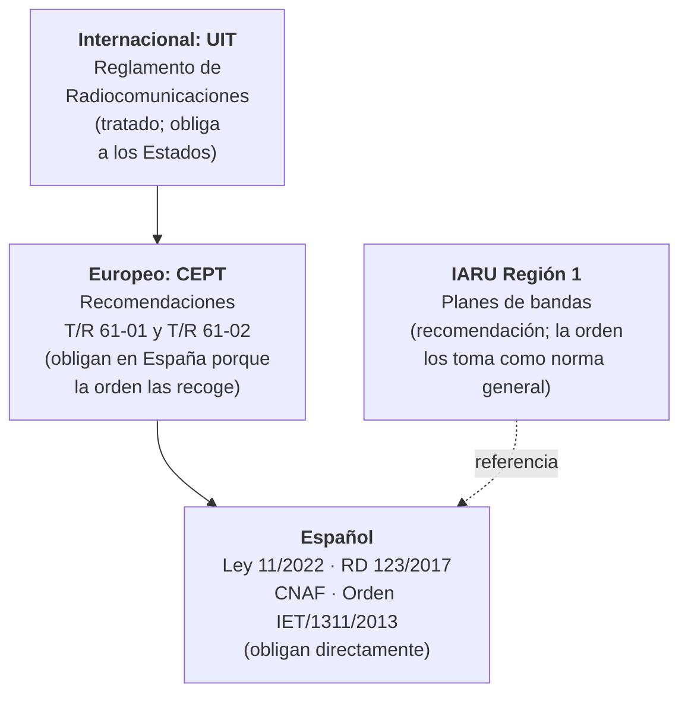

# Reglamentación

Cuando enciendes el transceptor no solo te rigen las leyes de la física. Te rige también una cadena de normas que empieza en un tratado internacional y termina en una orden ministerial española, y junto a ellas conviven recomendaciones que no son ley pero que todo el mundo respeta. En este capítulo aprenderás qué dice cada nivel, de dónde sale cada regla y, sobre todo, a distinguir lo que **estás obligado** a cumplir de lo que **se te recomienda**. Es una de las dos partes del examen y, además, lo que te evita un disgusto con la Inspección.

El capítulo trata las reglas que se aplican **una vez que tienes la autorización**. Cómo se obtiene (el examen, la solicitud, las tasas y la asignación del indicativo) está en el [capítulo 1](../01-autorizacion.md).

## Tres niveles de normas

Las normas que afectan al radioaficionado español se ordenan en tres niveles, de lo más general a lo más concreto:

*Figura 9.1. Los tres niveles de normas y el lugar de los planes de bandas de la IARU, que no forman parte de la cadena legal.*

- **[Internacional](internacional.md).** La Unión Internacional de Telecomunicaciones (UIT) define el servicio de aficionados, divide el mundo en tres regiones, reparte las series de distintivos entre países y fija en su artículo 25 las reglas básicas del servicio.
- **[Europeo](europeo.md).** La Conferencia Europea de Administraciones de Correos y Telecomunicaciones (CEPT) armoniza dos cosas: la licencia que te deja operar de visita en otros países (T/R 61-01) y el certificado de examen que todos reconocen (HAREC, T/R 61-02).
- **[Español](espanol.md).** La Ley 11/2022, General de Telecomunicaciones, el Cuadro Nacional de Atribución de Frecuencias (CNAF) y, sobre todo, la Orden IET/1311/2013 fijan cómo usas tu autorización: tipos de estación, identificación, normas de uso, inspección y sanciones.

Varios temas normativos ya están en otros capítulos y aquí solo se enlazan:

| Tema | Dónde está |
|---|---|
| Bandas, márgenes del CNAF, potencias máximas y regla del 50 % en bandas secundarias | [Capítulo 5](../05-propagacion-bandas.md#bandas-de-radioaficionado-en-espana) |
| Licencia de estación fija, derecho a instalar antenas y seguro | [Capítulo 6](../06-antenas-lineas.md#el-derecho-a-instalar-antenas-en-espana) |
| Emisiones no esenciales, procedimiento si interfieres y reclamaciones | [Capítulo 8](../08-interferencias.md#la-interferencia-en-la-normativa-espanola) |
| Límites de exposición a radiofrecuencias | [Capítulo 3](../03-seguridad.md#los-limites-en-espana) |
| Identificación de repetidores en Morse y plan de bandas de la telegrafía | Capítulo 11: [identificación de repetidores](../11-telegrafia.md#la-velocidad-en-la-normativa-espanola) y [plan de bandas](../11-telegrafia.md#la-telegrafia-en-el-plan-de-bandas) |
| Examen, solicitud de la autorización, tasas y asignación del indicativo | [Capítulo 1](../01-autorizacion.md) |

## Obligación legal y recomendación

No todo lo que leerás en este capítulo obliga del mismo modo. La diferencia está en **quién dicta la norma** y **cómo llega a ti**:

| Texto | Quién lo dicta | ¿Te obliga? |
|---|---|---|
| Reglamento de Radiocomunicaciones de la UIT | Las conferencias mundiales de radiocomunicaciones de la UIT, formadas por los Estados | Es un tratado: obliga a España como Estado. A ti te llega a través de las normas españolas, que mandan explotar las bandas de aficionado conforme a él (artículo 2.2 del reglamento aprobado por la Orden IET/1311/2013). |
| Recomendaciones T/R 61-01 y T/R 61-02 de la CEPT | La CEPT, que agrupa a las administraciones europeas | Por sí solas no. Obligan en España porque la Orden IET/1311/2013 las incorpora en sus artículos 5, 10 y 11 a 14. |
| Ley 11/2022, Real Decreto 123/2017, CNAF y Orden IET/1311/2013 | Las Cortes, el Gobierno y el ministerio, y se publican en el BOE | Sí, directamente. Su incumplimiento se sanciona conforme al título VIII de la Ley 11/2022. |
| Planes de bandas de la IARU Región 1 | La Unión Internacional de Radioaficionados, una federación privada de asociaciones | No son una norma jurídica. Pero la orden te pide seguirlos «como norma general» para repartir los modos y los anchos de banda. |

Las normas españolas citadas en la tabla son la [Ley 11/2022, de 28 de junio, General de Telecomunicaciones](https://www.boe.es/buscar/act.php?id=BOE-A-2022-10757); el [Real Decreto 123/2017, de 24 de febrero, por el que se aprueba el Reglamento sobre el uso del dominio público radioeléctrico](https://www.boe.es/buscar/act.php?id=BOE-A-2017-2460); la [Orden TDF/732/2026, de 10 de julio, por la que se aprueba el Cuadro Nacional de Atribución de Frecuencias](https://www.boe.es/buscar/act.php?id=BOE-A-2026-15661), y la [Orden IET/1311/2013, de 9 de julio, por la que se aprueba el Reglamento de uso del dominio público radioeléctrico por radioaficionados](https://www.boe.es/buscar/act.php?id=BOE-A-2013-7624). Todas se comprobaron en el BOE en noviembre de 2026.

El caso de la IARU merece una explicación. El artículo 2.2 del reglamento aprobado por la Orden IET/1311/2013 dice que, para facilitar las transmisiones y evitar interferencias entre modulaciones distintas, se usarán **como norma general** los planes de banda de la IARU para la Región 1. El apartado 3.1 de su anexo I repite la idea para los anchos de banda de las emisiones (ambos comprobados en noviembre de 2026). Así que no puedes ignorarlos sin más. Pero el plan lo redacta y lo cambia una asociación privada, sin pasar por el BOE, y ninguna norma española copia sus segmentos ni los convierte en límites con sanción propia. Lo que sí es límite legal estricto es lo que fijan el CNAF y el anexo I de la orden: los bordes de cada banda y la potencia máxima.

Un ejemplo con la banda de 160 m. El plan de HF de la IARU Región 1 llega hasta 2000 kHz, porque la nota 5.96 del Reglamento de Radiocomunicaciones permite a una lista de países de la Región 1, en la que no está España, abrir a los aficionados parte de los kilohercios entre 1850 y 2000 kHz. En España, el cuadro del CNAF solo atribuye al servicio de aficionados el tramo de 1810 a 1850 kHz: de 1810 a 1830 kHz a título secundario y de 1830 a 1850 kHz a título primario (Orden TDF/732/2026, BOE, p. 101094; [capítulo 5](../05-propagacion-bandas.md#tabla-de-bandas)). Si el plan dice que puedes hablar en 1900 kHz y el CNAF dice que esa frecuencia no es de aficionados, manda el CNAF.

La única excepción es la que el propio Ministerio autorice expresamente. Lo viene haciendo con resoluciones que valen para un año natural y permiten usar el tramo de 1850 a 2000 kHz solo durante los concursos, sin protección frente a las interferencias de otros servicios y con las mismas condiciones técnicas que el anexo I de la orden fija para 160 m. Antes de transmitir por encima de 1850 kHz, comprueba que hay una resolución en vigor para ese año en la página de [autorizaciones de uso temporal y experimental](https://digital.gob.es/telecomunicaciones-infraestructuras-digitales/areas-interes/espectro-radioelectrico/radioaficionados-cb27/autorizaciones/autorizacion-uso-temporal) del Ministerio para la Transformación Digital y de la Función Pública. Sin ella, por encima de 1850 kHz no puedes transmitir (comprobado en noviembre de 2026).

!!! tip "Para el examen"
    **Obligan:** el Reglamento de Radiocomunicaciones de la UIT (a través del Estado), la Ley 11/2022, el Real Decreto 123/2017, el CNAF y la Orden IET/1311/2013, que además da fuerza en España a las recomendaciones T/R 61-01 y T/R 61-02 de la CEPT. **Recomiendan:** los planes de bandas de la IARU Región 1, que la orden manda seguir «como norma general» para repartir modos y anchos de banda, pero que no fijan los bordes de las bandas ni las potencias. Si un plan de la IARU y el CNAF no coinciden, **manda el CNAF**, salvo que el Ministerio autorice expresamente otra cosa (comprobado en noviembre de 2026).

## Los planes de bandas de la IARU

### Para qué sirven

La **Unión Internacional de Radioaficionados** (IARU) federa a las asociaciones nacionales de radioaficionados y se organiza en tres regiones. La de España es la **Región 1**. Sus conferencias generales aprueban los **planes de bandas**, que reparten cada banda en tramos según el modo y el ancho de banda para que las señales de distinto tipo no se pisen: la telegrafía y los modos digitales estrechos no compiten con la voz, y las señales débiles no quedan tapadas por las fuertes. La propia IARU Región 1 presenta sus planes como una **guía** para aprovechar mejor el espectro ([página de los planes de bandas](https://www.iaru-r1.org/on-the-air/band-plans/); comprobado en noviembre de 2026).

Los planes vigentes son (comprobados en noviembre de 2026):

- El de **HF**, en vigor desde el **16 de octubre de 2020**, aprobado en la conferencia virtual de Novi Sad ([PDF del plan de HF](https://www.iaru-r1.org/wp-content/uploads/2021/06/hf_r1_bandplan.pdf)).
- El de **VHF** para 144 MHz, en vigor desde **diciembre de 2020** ([plan de VHF](https://www.iaru-r1.org/wp-content/uploads/2020/12/VHF-Bandplan.pdf)). Lo que de él se cita aquí coincide con el *VHF Handbook* que se menciona a continuación.
- Para **430 – 440 MHz**, el ***VHF Handbook*** de la IARU Región 1, versión 10.03, de febrero de 2026, apartado 7.5 ([PDF del *VHF Handbook*](https://www.iaru-r1.org/wp-content/uploads/2026/02/VHF_Handbook_V10_03_final.pdf)). El [plan de UHF de diciembre de 2020](https://www.iaru-r1.org/wp-content/uploads/2021/03/UHF-Bandplan.pdf) queda solo como referencia histórica: la propia IARU advierte, en su [página de planificación de VHF y bandas superiores](https://www.iaru-r1.org/about-us/committees-and-working-groups/vhf-uhf-shf-committee-c5/vhf-up-bandplanning/), que su parte de 432 MHz sigue basada en la versión 9.01 del *Handbook*, ya desfasada.

### El plan de HF

El plan de HF ordena cada banda por **ancho de banda máximo**, de abajo arriba (comprobado en noviembre de 2026):

| Ancho máximo | Qué cabe | Dónde |
|---|---|---|
| 200 Hz | Telegrafía | En el extremo inferior de cada banda; los tramos están en el [capítulo 11](../11-telegrafia.md#la-telegrafia-en-el-plan-de-bandas) |
| 500 Hz | **Modos de banda estrecha**: todos los de hasta 500 Hz, como la telegrafía, el RTTY o el PSK | A continuación de la telegrafía |
| 2700 Hz | **Todos los modos**: telegrafía, fonía y los modos señalados como centros de actividad; también AM, con consideración a los canales vecinos | En el resto de la banda |

Otras reglas generales del plan:

- La **telegrafía** se acepta en toda la banda, salvo en los segmentos de balizas.
- En fonía de **banda lateral única** se usa la **inferior** (LSB) por debajo de 10 MHz y la **superior** (USB) por encima. La excepción es la banda de 60 m, donde se recomienda la superior.
- No se hacen **concursos** en las bandas de 60, 30, 17 y 12 m.
- Los segmentos de las balizas del **International Beacon Project** son exclusivos para ellas ([capítulo 5](../05-propagacion-bandas.md#el-international-beacon-project)).
- Hay **centros de actividad de emergencia**: 3760 kHz y 7110 kHz para la Región 1; 14 300 kHz y 21 360 kHz como centros mundiales, y 18 160 kHz. Si no participas en una emergencia, deja libres esas frecuencias.

Las frecuencias del plan son frecuencias **transmitidas**, no la de la portadora suprimida que marca el dial. Por eso el plan da la frecuencia mínima de dial para la fonía en LSB: 1843, 3603 y 7053 kHz (comprobado en noviembre de 2026).

**Ejemplo.** En 40 m, el tramo de todos los modos empieza en 7050 kHz. Una señal de voz en LSB de unos 3 kHz de ancho ocupa los 3 kHz que quedan **por debajo** de la frecuencia del dial. Si pones el dial en 7053 kHz, tu señal va de unos 7050 a 7053 kHz y queda justo dentro del tramo. Si lo pusieras en 7051 kHz, ocuparías de 7048 a 7051 kHz, dentro del tramo de 500 Hz reservado a los modos estrechos. Con la USB pasa lo contrario: la señal queda por encima del dial, y por eso el plan pide no subir el dial a menos de 3 kHz del borde superior en las bandas de 20 a 10 m.

### Los planes de 2 m y 70 cm

Estos son los tramos y frecuencias que más usarás en VHF y UHF (comprobados en noviembre de 2026):

| Banda | Tramo o frecuencia | Uso |
|---|---|---|
| 2 m | 144,025 – 144,100 MHz | Solo telegrafía |
| 2 m | 144,300 MHz | Centro de actividad de BLU |
| 2 m | 144,400 – 144,490 MHz | Balizas, en exclusiva |
| 2 m | 144,800 MHz | APRS |
| 2 m | 144,975 – 145,194 MHz | Entradas de repetidores, en exclusiva |
| 2 m | 145,500 MHz | Llamada en FM |
| 2 m | 145,575 – 145,7935 MHz | Salidas de repetidores, en exclusiva |
| 2 m | 145,806 – 146,000 MHz | Satélites, en exclusiva |
| 70 cm | 432,050 MHz y 432,200 MHz | Centros de actividad de telegrafía y de BLU |
| 70 cm | 433,500 MHz | Llamada en FM |
| 70 cm | 435 – 438 MHz | Satélites; de 436 a 438 MHz, también televisión digital y datos |

En 2 m los repetidores trabajan con una **separación de 600 kHz** entre la salida y la entrada, con la entrada por debajo: un repetidor que sale en 145,600 MHz escucha en $145{,}600 - 0{,}600 = 145{,}000\ \text{MHz}$. En 70 cm el plan prevé dos separaciones, de **1,6 MHz** y de **7,6 MHz**: un repetidor con salida en 438,650 MHz y desplazamiento de 7,6 MHz escucha en $438{,}650 - 7{,}6 = 431{,}050\ \text{MHz}$ (comprobado en noviembre de 2026). Cuál usa cada repetidor lo indican los listados de repetidores.

Recuerda que todo esto son recomendaciones, y que la banda de 2 m es en España de 144 a 146 MHz y la de 70 cm de 430 a 440 MHz ([capítulo 5](../05-propagacion-bandas.md#tabla-de-bandas)), así que estos planes caben enteros en lo autorizado.

## Por qué la orden habla de organismos que ya no existen

La Orden IET/1311/2013 es de 2013 y su texto consolidado no ha cambiado en lo esencial desde entonces: solo se modificó su disposición adicional segunda, por la Orden IET/614/2015 (comprobado en el BOE en noviembre de 2026). Por eso al leerla encontrarás nombres antiguos:

- **«La SETSI»**, la Secretaría de Estado de Telecomunicaciones y para la Sociedad de la Información. Hoy es la **Secretaría de Estado de Telecomunicaciones e Infraestructuras Digitales**, del Ministerio para la Transformación Digital y de la Función Pública. Es la que firma, por ejemplo, la [Resolución de 29 de julio de 2026 sobre los distintivos con sufijo de una letra](https://www.boe.es/buscar/doc.php?id=BOE-A-2026-17504) (comprobado en noviembre de 2026).
- **La Ley 32/2003, General de Telecomunicaciones**, ya derogada. Hoy rige la Ley 11/2022.
- **El Real Decreto 863/2008**, que desarrollaba la ley en materia de espectro. Lo derogó el Real Decreto 123/2017 (letra a) de su disposición derogatoria única; comprobado en noviembre de 2026).
- **«La Dirección General de Protección Civil y Emergencias»**, que cita el artículo 30 de la orden para la colaboración en catástrofes y las comunicaciones de socorro. Sigue existiendo, pero el [Real Decreto 328/2026, de 22 de abril](https://www.boe.es/buscar/doc.php?id=BOE-A-2026-9079), creó en el Ministerio del Interior la **Secretaría General de Protección Civil y Emergencias**, que asume sus funciones y de la que pasa a depender (comprobado en noviembre de 2026). Lo verás en el [capítulo 15](../15-emergencias/index.md#lo-que-dice-la-orden).

La orden sigue vigente con esas referencias. Cuando leas «SETSI» en un artículo, entiende la Secretaría de Estado actual, y cuando leas la Dirección General de Protección Civil y Emergencias, ten en cuenta que hoy depende de la Secretaría General. Tu interlocutor más cercano sigue siendo la Jefatura Provincial de Inspección de Telecomunicaciones de tu provincia.

## Cómo está organizado el capítulo

Cada subpágina termina con su resumen y sus preguntas de autoevaluación:

1. [Nivel internacional: la UIT](internacional.md).
2. [Nivel europeo: la CEPT](europeo.md).
3. [Nivel español](espanol.md).

## Resumen

- Las normas del radioaficionado se ordenan en tres niveles: **UIT** (Reglamento de Radiocomunicaciones), **CEPT** (T/R 61-01 y T/R 61-02) y **España** (Ley 11/2022, Real Decreto 123/2017, CNAF y Orden IET/1311/2013).
- El Reglamento de Radiocomunicaciones obliga a España como Estado; las recomendaciones de la CEPT obligan aquí porque la Orden IET/1311/2013 las incorpora; las normas españolas obligan directamente y su incumplimiento se sanciona con la Ley 11/2022.
- Los **planes de bandas de la IARU** son una recomendación de una federación privada. La orden manda seguirlos «como norma general» para los modos y los anchos de banda, pero los bordes de las bandas y las potencias los fijan el CNAF y el anexo I de la orden. Si no coinciden, manda el CNAF (comprobado en noviembre de 2026).
- El plan de HF de la IARU Región 1 (en vigor desde el 16 de octubre de 2020) ordena las bandas por ancho: **200 Hz** para la telegrafía, **500 Hz** para los modos estrechos y **2700 Hz** para todos los modos. LSB por debajo de 10 MHz y USB por encima; sin concursos en 60, 30, 17 y 12 m. En 2 m: llamada en FM en **145,500 MHz**, APRS en **144,800 MHz**, repetidores con **600 kHz** de separación y satélites de 145,806 a 146,000 MHz. En 70 cm: llamada en FM en **433,500 MHz** y satélites de 435 a 438 MHz (comprobado en noviembre de 2026).
- La orden todavía habla de la «SETSI», de la Ley 32/2003 y del Real Decreto 863/2008. Hoy son la Secretaría de Estado de Telecomunicaciones e Infraestructuras Digitales, la Ley 11/2022 y el Real Decreto 123/2017.
