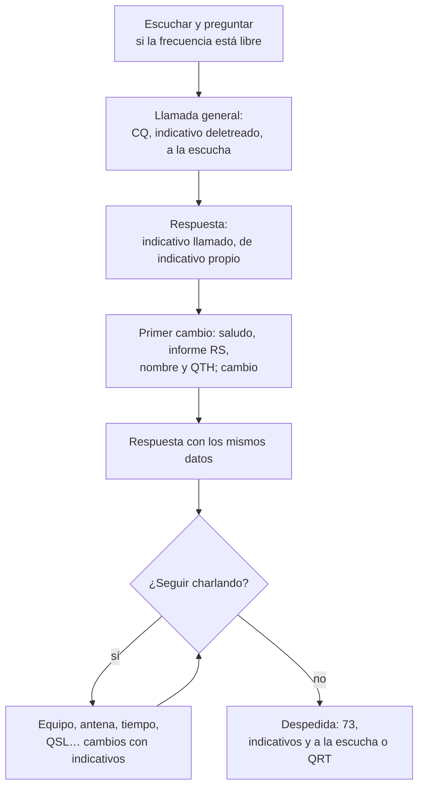
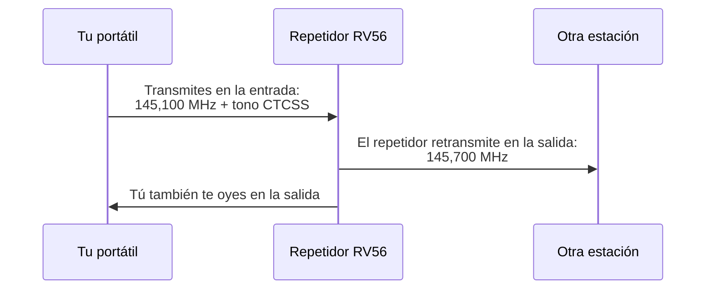
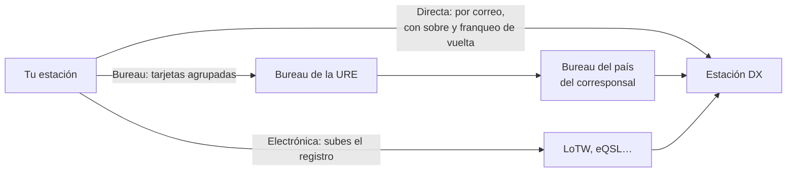

# Operación

Saber cómo funciona un transceptor no basta para salir al aire: hay que saber **cómo se habla por radio**. En este capítulo aprenderás el alfabeto de deletreo de la UIT, el código Q y las abreviaturas que se oyen en fonía, cómo se da un informe de señal, cómo se ordena un contacto en fonía y en los modos digitales, cómo se usa un repetidor, qué cambia cuando operas desde el coche o desde el monte, cómo se confirman los contactos con tarjetas QSL y sistemas electrónicos, qué conviene anotar en el libro de guardia y cómo se participa en concursos, diplomas y pile-ups. Al final verás las normas de convivencia que hacen que miles de estaciones compartan las mismas bandas sin pisarse. El examen pregunta por el código Q, las abreviaturas, el alfabeto y los procedimientos, y en la banda los vas a usar desde el primer día.

Lo normativo ya lo viste en el [nivel español del capítulo 9](09-reglamentacion/espanol.md#como-identificas-tus-emisiones): la identificación al principio y al final de cada emisión y al menos cada diez minutos, los añadidos optativos «portable» y «móvil» (/P y /M en telegrafía) y los distintivos especiales y temporales. Aquí no se repite.

Todos los indicativos de este capítulo son **ficticios**. Siguen la convención del [capítulo 11](11-telegrafia.md#un-ejemplo-completo): llevan la cifra de distrito 0, que en España solo se usa para distintivos temporales en circunstancias especiales, así que no pueden coincidir con el de ninguna estación permanente.

## El alfabeto de deletreo

### Por qué hace falta

En fonía, con ruido o con una señal débil, muchas letras suenan casi igual: B, D, E, P, T y V acaban todas en «-e» en español y en «-i» en inglés. Si das tu indicativo letra a letra, tu corresponsal puede anotar EB0QQQ donde dijiste ED0QQQ, y el contacto no constará en ninguno de los dos registros. La solución es sustituir cada letra por una **palabra de código** que empieza por ella y que no se confunde con ninguna otra.

### El cuadro de la UIT

El alfabeto que se usa en todo el mundo es el del **[Apéndice 14 del Reglamento de Radiocomunicaciones](https://www.itu.int/pub/R-REG-RR)** de la UIT, «Cuadro para el deletreo de letras y cifras», en su revisión de la CMR-23 (edición de 2024 del Reglamento; comprobado en noviembre de 2026). Según su punto 1, se usa cuando hay que deletrear distintivos de llamada, abreviaturas reglamentarias o ciertas palabras.

| Letra | Palabra | Letra | Palabra | Letra | Palabra |
|:-:|---|:-:|---|:-:|---|
| A | Alfa | J | Juliett | S | Sierra |
| B | Bravo | K | Kilo | T | Tango |
| C | Charlie | L | Lima | U | Uniform |
| D | Delta | M | Mike | V | Victor |
| E | Echo | N | November | W | Whiskey |
| F | Foxtrot | O | Oscar | X | X-ray |
| G | Golf | P | Papa | Y | Yankee |
| H | Hotel | Q | Quebec | Z | Zulu |
| I | India | R | Romeo | | |

Fíjate en la ortografía, que es la oficial: **Alfa** con *f* y **Juliett** con dos *t*, para que quien no habla inglés no las pronuncie mal. El cuadro da también la pronunciación recomendada, sílaba a sílaba: Charlie se dice «char-li»; Juliett, «yu-li-et»; Whiskey, «uis-ki», y X-ray, «ex-rey».

El mismo apéndice trae un segundo cuadro para las **cifras** (Nadazero, Unaone, Bissotwo…), pensado para los servicios marítimo y aeronáutico. Entre radioaficionados casi no se usa: las cifras se dicen en el idioma del contacto, en español o en inglés, y con eso basta.

**Ejemplo.** El indicativo ficticio ED0QXV se deletrea «Echo Delta Cero Quebec X-ray Victor». En un contacto en inglés dirías «Echo Delta Zero Quebec X-ray Victor».

!!! example "En la práctica"
    En los contactos entre estaciones españolas oirás a veces nombres de ciudades o de personas («Ene de Navarra», «Zeta de Zaragoza»). El punto 3 del Apéndice 14 permite que las estaciones de un mismo país usen otro cuadro preparado por su administración (comprobado en noviembre de 2026). En DX, en los concursos y en cualquier contacto con el extranjero, usa siempre el cuadro de la UIT: es el único que entiende todo el mundo. Y no te inventes palabras «graciosas»: si tu corresponsal no las conoce, el deletreo no sirve.

## El código Q y las abreviaturas

### Qué es el código Q

El **código Q** es un conjunto de grupos de tres letras que empiezan por Q. Cada grupo tiene un significado fijo, que vale como pregunta si va seguido de una interrogación y como respuesta o afirmación si no la lleva. Nació para la telegrafía marítima, donde ahorraba tiempo y salvaba la barrera del idioma, y los radioaficionados lo adoptaron muy pronto.

El texto oficial está en la **[Recomendación UIT-R M.1172](https://www.itu.int/rec/R-REC-M.1172/es)**, de 1995, que sigue en vigor y que el Reglamento de Radiocomunicaciones incorpora por referencia. Su sección I recoge las series de QOA a QUZ; las de QOA a QQZ se reservan para el servicio móvil marítimo (comprobado en noviembre de 2026). La recomendación es para el servicio marítimo, y algunos grupos han cogido entre aficionados un sentido algo distinto del oficial. La tabla da los dos.

### Los grupos que más vas a oír

| Grupo | Uso entre radioaficionados | Sentido en la Rec. UIT-R M.1172 |
|:-:|---|---|
| QRG | Frecuencia | ¿Quiere indicarme mi frecuencia exacta? |
| QRK | Inteligibilidad de la señal | ¿Cuál es la inteligibilidad de mi transmisión? (escala de 1 a 5) |
| QRL | Frecuencia ocupada; en CW, `QRL?` es «¿está ocupada?» | ¿Está usted ocupado? |
| QRM | Interferencia de otras estaciones | ¿Está interferida mi transmisión? (escala de 1 a 5) |
| QRN | Ruido atmosférico o eléctrico | ¿Le perturban los atmosféricos? (escala de 1 a 5) |
| QRO | Potencia alta, o subir potencia | ¿Debo aumentar la potencia? |
| QRP | Potencia baja; operar con muy poca potencia (por convenio, 5 W o menos en CW) | ¿Debo disminuir la potencia? |
| QRQ / QRS | Transmitir más deprisa / más despacio | ¿Debo transmitir más de prisa / más despacio? |
| QRT | Dejo de transmitir, cierro la estación | ¿Debo cesar de transmitir? |
| QRV | Estoy preparado, estoy activo en la banda | ¿Está usted preparado? |
| QRX | Espera un momento | ¿Cuándo volverá a llamarme? |
| QRZ | ¿Quién me llama? | ¿Quién me llama? |
| QSB | Desvanecimiento: la señal sube y baja | ¿Varía la intensidad de mis señales? |
| QSL | Recibido; también, la tarjeta que confirma un contacto | ¿Puede acusarme recibo? |
| QSO | Contacto entre dos estaciones | ¿Puede comunicar directamente con…? |
| QSP | Retransmitir un mensaje para otra estación | ¿Quiere retransmitir gratuitamente a…? |
| QSY | Cambiar de frecuencia | ¿Tengo que pasar a transmitir en otra frecuencia? |
| QTH | Lugar donde está la estación | ¿Cuál es su situación en latitud y longitud? |
| QTR | Hora exacta | ¿Qué hora es, exactamente? |

La tabla resume los significados de la recomendación (comprobados en noviembre de 2026). Fíjate en tres desviaciones del uso aficionado: **QSO** es oficialmente una pregunta sobre si puedes comunicar con alguien, y en la banda es el contacto mismo; **QSL** es un acuse de recibo, y entre aficionados es además la tarjeta que lo confirma; **QRX** pregunta cuándo te volverán a llamar, y en la banda se usa como «espera».

!!! tip "Para el examen"
    Apréndete los grupos de la tabla y su sentido en la banda. Las confusiones típicas: **QRM** es interferencia de otras estaciones y **QRN**, ruido natural o eléctrico; **QRO** es subir potencia y **QRP**, bajarla; **QRS** es más despacio y **QRQ**, más deprisa; **QRT** es cerrar y **QRX**, esperar. El signo de interrogación convierte cualquier grupo en pregunta: `QRZ?` es «¿quién me llama?».

### En fonía

El código Q nació para la telegrafía, pero en fonía se usa casi tanto. Los grupos se pronuncian letra a letra, a la española («cu, erre, zeta») o a la inglesa («kiu, ar, zed»). En los contactos en español oirás además:

- **QAP**, «a la escucha». Es costumbre en España y en Hispanoamérica, pero no forma parte de la Rec. UIT-R M.1172, cuyas series empiezan en QOA. Fuera del ámbito hispano no lo entenderán.
- **Cambio**, para ceder el turno. En inglés, *over*.
- **Copiado** o **recibido**, para confirmar que te ha llegado el mensaje.
- **Afirmativo** y **negativo** en lugar de «sí» y «no», que con ruido se pierden fácilmente.
- **73**, saludos cordiales, y **88**, un saludo afectuoso, más personal. Se dicen «setenta y tres» y «ochenta y ocho», sin la ese del plural: «73» ya significa «saludos».
- **OM** (colega), **YL** (colega mujer) y **XYL** (esposa), heredadas de la telegrafía.
- **DX**, una estación o un contacto lejano, y **QRP**, como adjetivo: «una estación QRP».

Las abreviaturas de la telegrafía (`K`, `<KN>`, `<SK>`, `TU`, `FB`…) se dicen en voz alta pocas veces. Las tienes en el [capítulo 11](11-telegrafia.md#abreviaturas-y-senales-de-procedimiento).

## El informe de señal: RS y RST

### Las tres cifras

Al empezar un contacto, cada estación le dice a la otra cómo la recibe con un **informe de señal** de dos o tres cifras:

- **R, legibilidad** (*readability*), de 1 a 5. Mide cuánto se entiende el mensaje, no lo fuerte que llega.
- **S, intensidad** (*strength*), de 1 a 9. Es la fuerza de la señal, la que marcaría un medidor S bien calibrado.
- **T, tono**, de 1 a 9. Solo existe en telegrafía y en otros modos de tono: lo verás en el [capítulo 11](11-telegrafia.md#el-informe-rst-en-telegrafia).

En fonía se dan solo las dos primeras: es el **informe RS**. El sistema RST es una costumbre del servicio de aficionados, no una norma de la UIT. La IARU Región 1 recomendó no cambiarlo en su conferencia de 1987, según su [HF Manager's Handbook](https://www.iaru-r1.org/reference/handbooks/) (versión 9, apartado 2.1.2; comprobado en noviembre de 2026).

| R | Legibilidad | S | Intensidad |
|:-:|---|:-:|---|
| 1 | Ilegible | 1 | Apenas perceptible |
| 2 | Se entienden palabras sueltas | 3 | Débil |
| 3 | Se entiende con dificultad | 5 | Regular |
| 4 | Se entiende casi todo, sin dificultad seria | 7 | Bastante buena |
| 5 | Perfectamente legible | 9 | Muy fuerte |

Las intensidades pares (2, 4, 6 y 8) quedan entre las impares de la tabla. Por encima de S9 se habla de decibelios: «59 más 20» es una señal 20 dB por encima de S9. Cada unidad S equivale a 6 dB, como viste en el [capítulo 4](04-teoria-radio.md#mandos-y-ayudas-del-receptor).

### Cómo se da un buen informe

La legibilidad y la intensidad son independientes. Una señal puede marcar S9 y ser ilegible porque la tapa un QRM más fuerte, y una señal S3 puede ser perfectamente legible en una banda silenciosa. Por eso un informe honrado separa las dos cosas.

**Ejemplo.** Oyes a una estación de Canarias que marca S6 en tu medidor, sube y baja por el QSB y algunas palabras se te escapan. Un buen informe es «4 y 6, con QSB». Un «5 y 9» sería falso y no le serviría de nada a tu corresponsal, que quizá esté probando una antena nueva.

!!! example "En la práctica"
    En los concursos todo el mundo da «59» (o `5NN` en CW) a todas las estaciones: allí el informe es un trámite que exigen las bases, no una medida. Fuera de los concursos, da informes reales. Y recuerda que los medidores S de muchos equipos marcan de más: si dudas, guíate por cómo se entiende la señal.

## Un contacto en fonía

### Antes de llamar

1. **Elige banda y tramo** según el plan de la IARU Región 1: en HF, la BLU va en banda lateral inferior por debajo de 10 MHz y en la superior por encima, como viste en el [capítulo 9](09-reglamentacion/index.md#el-plan-de-hf).
2. **Escucha** un buen rato. Puede que la frecuencia esté ocupada por una estación a la que tú no oyes, pero tu corresponsal sí.
3. **Pregunta si está libre**: «¿Está ocupada la frecuencia? Aquí EA0ZZZ». Si nadie contesta tras una segunda pregunta, puedes llamar.
4. **Ajusta la potencia** a la necesaria. Si haces sintonía con el acoplador, hazla con poca potencia y, si puedes, sobre una carga artificial.

### La llamada general

Una **llamada general** (CQ) invita a cualquier estación a contestarte. Es corta, se repite unas pocas veces y termina diciendo que quedas a la escucha:

> CQ CQ CQ, aquí Echo Alfa Cero Zulu Zulu Zulu, EA0ZZZ, llamando general y a la escucha.

Repite la llamada dos o tres veces, con pausas para escuchar entre una y otra. Una CQ de un minuto seguido no consigue más respuestas: espanta a quien está buscando. Si quieres que contesten solo estaciones lejanas, dilo («CQ DX») y no hagas contacto con las cercanas que respondan; si quieres un continente o un país concreto, también («CQ Sudamérica»).

### La llamada a una estación

Si oyes a una estación que llama CQ, o quieres llamar a una concreta, dices **su indicativo y luego el tuyo**, una o dos veces cada uno:

> EA0ZZZ, de Echo Bravo Cero Quebec Quebec Quebec, EB0QQQ.

Lo mismo vale para responder a una CQ. No hace falta repetir el indicativo del otro diez veces: él ya sabe cómo se llama.

### La estructura



*Figura 10.1. Estructura de un contacto en fonía.*

### Un ejemplo completo

Contacto en 40 m entre dos estaciones con indicativos ficticios:

```text
EA0ZZZ:  CQ CQ CQ, aquí Echo Alfa Cero Zulu Zulu Zulu, EA0ZZZ, llamando general y a la escucha.
EB0QQQ:  EA0ZZZ, de Echo Bravo Cero Quebec Quebec Quebec, EB0QQQ.
EA0ZZZ:  EB0QQQ, aquí EA0ZZZ. Buenas tardes y gracias por la llamada. Te recibo 5 y 8.
         Mi nombre es Marta, Mike Alfa Romeo Tango Alfa, y estoy en Soria.
         ¿Cómo me copias? EB0QQQ, de EA0ZZZ, cambio.
EB0QQQ:  EA0ZZZ, de EB0QQQ. Copiado todo, Marta. Te paso un 5 y 9 con algo de QSB.
         Aquí Jorge, desde Cáceres, con 100 W y un dipolo. EA0ZZZ, de EB0QQQ, cambio.
EA0ZZZ:  Recibido, Jorge. Aquí 50 W y una vertical. Mando QSL por el bureau.
         Muchas gracias por el contacto, 73. EB0QQQ, de EA0ZZZ.
EB0QQQ:  Igualmente, Marta. QSL por el bureau también. 73. EA0ZZZ, de EB0QQQ, QRT.
```

Fíjate en cuatro costumbres:

- **Cada cambio empieza y acaba con los indicativos.** Así cumples la obligación de identificarte al principio y al final de cada emisión que fija el artículo 29.1 de la [Orden IET/1311/2013](https://www.boe.es/buscar/act.php?id=BOE-A-2013-7624#a29) (comprobado en noviembre de 2026).
- **Lo difícil se deletrea; lo fácil, no.** El indicativo y los nombres poco corrientes se deletrean la primera vez. Soria o Cáceres no hace falta.
- **Primero lo esencial.** Informe, nombre y QTH van en el primer cambio, por si la propagación se cae a mitad del contacto. Si se cae después, el contacto ya es válido.
- **Turnos cortos.** Un cambio de cinco minutos aburre a tu corresponsal y le impide decirte que ya no te oye.

!!! tip "Para el examen"
    Orden de los indicativos: **primero el de la estación a la que te diriges y después el tuyo** («EB0QQQ de EA0ZZZ»). Es la misma regla que en telegrafía. En la llamada general solo das el tuyo, detrás de «CQ».

### Si la frecuencia es de todos

Algunas frecuencias tienen un uso especial que conviene respetar aunque estén libres:

- Las **frecuencias de llamada** de VHF y UHF (145,500 MHz y 433,500 MHz en FM) sirven para establecer el contacto. En cuanto contesten, pasáis a otra frecuencia simplex libre («QSY a 145,450»).
- Los **centros de actividad de emergencia** que recomienda la IARU: 3 760 y 7 110 kHz en la Región 1, y 14 300, 18 160 y 21 360 kHz en todo el mundo, según el apartado 2.1.5 del [HF Manager's Handbook](https://www.iaru-r1.org/reference/handbooks/) (comprobado en noviembre de 2026). No son frecuencias reservadas, pero no llames CQ en ellas y déjalas libres si hay tráfico de emergencia. Lo verás en el [capítulo 15](15-emergencias/index.md).

## Un contacto en los modos digitales

### Teclado y mensajes fijos

Los modos digitales de **teclado**, como RTTY o PSK31, siguen la misma lógica que la telegrafía: indicativos al principio y al final de cada cambio, `DE` entre ellos, `K` o `KN` para ceder el turno y la información importante repetida. Si sabes hacer un contacto en CW ([capítulo 11](11-telegrafia.md#un-contacto-en-telegrafia)), sabes hacerlo en RTTY.

Los modos más usados hoy, como **FT8**, funcionan de otra forma: el programa envía **mensajes estructurados** de pocos caracteres en ciclos fijos de tiempo, y el operador solo elige a quién contestar. El contacto es siempre el mismo:

```text
EA0ZZZ   →  CQ EA0ZZZ IN80              (llamada general con el cuadrado del localizador)
EB0QQQ   →  EA0ZZZ EB0QQQ IN71          (contesta con su cuadrado)
EA0ZZZ   →  EB0QQQ EA0ZZZ -12           (informe: relación señal/ruido en dB)
EB0QQQ   →  EA0ZZZ EB0QQQ R-08          (R: recibido tu informe; este es el mío)
EA0ZZZ   →  EB0QQQ EA0ZZZ RR73          (recibido todo, saludos)
EB0QQQ   →  EA0ZZZ EB0QQQ 73            (cortesía final)
```

Los indicativos y los cuadrados de localizador del ejemplo son ficticios. Fíjate en que el informe ya no es RST sino la **relación señal/ruido en decibelios** que mide el programa, normalmente negativa: −12 dB significa que la señal está 12 dB por debajo del ruido en un ancho de 2 500 Hz, y aun así se descodifica. El contacto termina cuando las dos estaciones tienen los dos indicativos, los dos informes y la confirmación de que el otro los recibió; los mensajes de cortesía no añaden nada.

Cómo funciona el FT8 y cómo se configura lo verás en el [capítulo 12](12-modos-digitales.md).

??? note "Para saber más"
    Para los modos digitales por debajo de 30 MHz, la IARU Región 1 recomendó en 2005 un informe **RSQ**, en el que la Q mide la calidad de la señal (por ejemplo, si se ven productos de intermodulación en la cascada). Está en el apartado 2.1.2 del [HF Manager's Handbook](https://www.iaru-r1.org/reference/handbooks/) (comprobado en noviembre de 2026), pero en la banda casi no se usa.

## Los repetidores

### Qué hacen

Un **repetidor** es una estación automática instalada en un punto alto que recibe en una frecuencia, la **entrada**, y retransmite al mismo tiempo lo que oye en otra, la **salida**. Con un portátil de pocos vatios en un valle, a través de un repetidor en una sierra cubres decenas de kilómetros que en simplex no alcanzarías, como viste en el [capítulo 5](05-propagacion-bandas.md#vision-directa-y-horizonte-radioelectrico).



*Figura 10.2. Un repetidor de 2 m con desplazamiento de −600 kHz.*

### Desplazamiento y canales

Tu equipo escucha en la salida y, al pulsar el PTT, salta solo a la entrada. La diferencia entre las dos es el **desplazamiento** (*shift*), que se programa una vez en el canal de memoria. El plan de la IARU Región 1 fija **−600 kHz** en 2 m y **−1,6 MHz** o **−7,6 MHz** en 70 cm, según el repetidor: lo tienes con sus tramos en el [capítulo 9](09-reglamentacion/index.md#los-planes-de-2-m-y-70-cm).

Los canales tienen además un **nombre** normalizado. Según el apartado «Channel designation system» del [VHF Handbook](https://www.iaru-r1.org/reference/handbooks/) de la IARU Región 1 (versión 10.03, página 65; comprobado en noviembre de 2026), cada canal FM se nombra con una letra de banda (V para 145 MHz, U para 435 MHz) y un número que avanza cada 12,5 kHz desde 145,000 MHz o 430,000 MHz; la R delante indica que es la salida de un repetidor.

**Ejemplo.** El canal **RV56** es un repetidor cuya salida está en $145{,}000 + 56 \cdot 0{,}0125 = 145{,}700\ \text{MHz}$. Con −600 kHz, su entrada está en $145{,}700 - 0{,}600 = 145{,}100\ \text{MHz}$. El **RU690** sale en $430{,}000 + 690 \cdot 0{,}0125 = 438{,}625\ \text{MHz}$ y, si usa −7,6 MHz, escucha en $438{,}625 - 7{,}6 = 431{,}025\ \text{MHz}$.

### Tonos de acceso: CTCSS y 1 750 Hz

Para que el repetidor no se active con cualquier ruido o con la señal de otra estación lejana que usa el mismo canal, la entrada solo se abre si tu señal lleva un **tono de acceso**:

- El **CTCSS** (*Continuous Tone-Coded Squelch System*) es un tono subaudible, entre 67,0 y 250,3 Hz, que tu equipo suma a la voz durante toda la transmisión. El receptor del repetidor lo filtra y solo se abre si reconoce el suyo. Cada repetidor tiene asignado uno.
- El **tono de 1 750 Hz** (*tone burst*) es un pitido audible y corto, de menos de un segundo, que se envía al empezar para «despertar» el repetidor. Es el sistema antiguo.

La Recomendación técnica FM.24 de la IARU Región 1, recogida en el [VHF Handbook](https://www.iaru-r1.org/reference/handbooks/) (versión 10.03, páginas 119 y 120; comprobado en noviembre de 2026), admite los dos sistemas, prefiere el CTCSS para los repetidores nuevos, pide que desde 2015 los repetidores FM nuevos lo usen tanto en recepción como en transmisión y fija la lista de 38 frecuencias normalizadas, de 67,0 a 250,3 Hz. Si el repetidor también **emite** su tono, puedes activar el CTCSS en tu receptor y solo lo oirás a él, no a otras estaciones del mismo canal.

En España, el artículo 25.c) de la [Orden IET/1311/2013](https://www.boe.es/buscar/act.php?id=BOE-A-2013-7624#a25) obliga a que el acceso a los repetidores analógicos y digitales finales sea libre y a que, si el repetidor tiene un código de acceso, sea públicamente conocido (comprobado en noviembre de 2026). Por eso el tono de cada repetidor aparece en los listados que publican las asociaciones.

!!! example "En la práctica"
    Si oyes perfectamente un repetidor pero no consigues abrirlo, casi siempre es una de tres cosas: el desplazamiento está mal programado (o en el sentido contrario), te falta el tono CTCSS o el que pusiste no es el suyo. Comprueba el canal con el listado antes de pensar que el repetidor está averiado. Con la función inversa (*reverse*) del equipo escuchas su entrada: si oyes directamente a tu corresponsal, pasaos a simplex y dejad el repetidor libre.

### Buenas prácticas

- **Identifícate al entrar.** Basta con tu indicativo: «EA0ZZZ a la escucha» o «EA0ZZZ, ¿alguien en frecuencia?». No se llama CQ en un repetidor, ni se pulsa el PTT sin decir nada para «ver si abre».
- **Deja una pausa entre cambios.** Espera a que caiga la portadora del repetidor, o al pitido de fin de turno si lo tiene, antes de contestar. Esa pausa permite entrar a quien tiene algo urgente y deja que se reinicie el temporizador, que corta las transmisiones demasiado largas.
- **Para entrar en una conversación**, di tu indicativo en una de esas pausas y espera a que te den paso. Si es una urgencia, dilo claramente al principio.
- **Pasa a simplex** si podéis oíros directamente. El repetidor sirve a toda una comarca; no lo ocupes para una charla que podrías tener sin él.
- **Usa la potencia mínima** que te dé una comunicación limpia, como recomienda la misma FM.24 (comprobado en noviembre de 2026).
- **No contestes a quien interfiere.** Las portadoras sin modular, los pitidos o las provocaciones buscan que alguien responda. Ignóralos; si persisten, avisa al responsable del repetidor.

## Operación portable y móvil

### Lo que cambia

Operar fuera de casa es una de las partes más atractivas de la afición: desde el coche, desde la cima de un monte, desde una playa o desde un camping. A efectos legales, recuerda que una **estación portable** es la fija instalada temporalmente en otro lugar, con su propio aviso previo a la Jefatura en algunos casos, y que la identificación «portable» o «móvil» es optativa: está todo en el [capítulo 9](09-reglamentacion/espanol.md#estacion-portable). En la práctica cambian tres cosas:

- **La alimentación.** Una batería tiene una capacidad limitada y su tensión baja al descargarse. Un equipo de 100 W necesita más de 20 A en transmisión; con 10 W, la misma batería dura muchas horas. Lo viste en el [capítulo 3](03-seguridad.md) con sus riesgos.
- **La antena.** Las que se montan y desmontan rápido (dipolos de hilo con un mástil telescópico, verticales con radiales en el suelo) rinden menos que las de casa. Lo compensa la ubicación: un monte despejado vale más que cualquier antena en un patio de luces.
- **El ruido.** Lejos de las ciudades, sin fuentes conmutadas ni LED a tu alrededor, el ruido de fondo baja mucho y oyes señales que en casa no existen.

### En el coche

La seguridad vial va primero. El artículo 13.3 del [Real Decreto Legislativo 6/2015, de 30 de octubre, por el que se aprueba el texto refundido de la Ley sobre Tráfico, Circulación de Vehículos a Motor y Seguridad Vial](https://www.boe.es/buscar/act.php?id=BOE-A-2015-11722), y el artículo 18.2 del [Reglamento General de Circulación](https://www.boe.es/buscar/act.php?id=BOE-A-2003-23514), aprobado por el Real Decreto 1428/2003, de 21 de noviembre, prohíben usar mientras conduces cualquier medio o sistema de comunicación, salvo que la comunicación se haga sin emplear las manos y sin cascos ni auriculares (comprobado en noviembre de 2026). El micrófono de mano queda descartado mientras conduces: usa un sistema de manos libres con altavoz o para el coche en un lugar seguro. Y monta el equipo de forma que no salga despedido en una frenada ni estorbe a los airbags.

!!! danger "Peligro"
    No extiendas antenas de hilo cerca de líneas eléctricas, ni en el monte ni en el camping, y no operes desde una cima si hay tormenta en las proximidades. Una antena desplegada en un lugar alto y expuesto es exactamente lo que busca un rayo. Las precauciones están en el [capítulo 3](03-seguridad.md).

### Programas de actividad

Hay programas internacionales que premian a quien opera desde lugares concretos y a quien contacta con ellos: **SOTA** (*Summits on the Air*), desde cumbres, y **POTA** (*Parks on the Air*), desde espacios naturales protegidos, entre otros. Son una buena forma de empezar con poca potencia, porque las estaciones que «cazan» esas actividades están pendientes de las señales débiles. Las reglas de cada programa están en su web.

## La QSL y la confirmación de contactos

### La tarjeta QSL

La **tarjeta QSL** es una postal que confirma por escrito que un contacto tuvo lugar. Es una tradición casi tan antigua como la afición y sigue siendo la prueba que exigen muchos diplomas. Una QSL tiene que llevar, como mínimo:

- Tu indicativo y el del corresponsal, bien legibles.
- La **fecha** y la **hora en UTC** del contacto. Nunca la hora local: si tu corresponsal es de otro continente, la fecha puede incluso no coincidir.
- La **banda** o la frecuencia, el **modo** y el **informe** que le diste.
- Si confirmas el contacto («QSL») o solo lo pides («PSE QSL»).

Todos esos datos tienen que coincidir con el registro del corresponsal; si no, no te confirmará. Una diferencia de pocos minutos en la hora suele aceptarse; un día distinto o una banda equivocada, no.

### Las tres vías



*Figura 10.3. Las tres vías para confirmar un contacto.*

- **Directa.** Envías la tarjeta por correo postal a la dirección del corresponsal, con un sobre con tu dirección y el franqueo para la respuesta. Es la vía más rápida y la más cara. Muchas expediciones usan un **gestor de QSL** (*QSL manager*): otra estación que atiende sus tarjetas.
- **Bureau.** Casi todas las asociaciones nacionales miembros de la IARU tienen un **servicio de QSL** (*bureau*) que agrupa las tarjetas de todos sus usuarios y las intercambia por lotes con los de otros países. Es lenta, puede tardar más de un año, pero cuesta muy poco. La IARU publica la [lista de bureaus por país](https://www.iaru.org/on-the-air/qsl-bureau-2/), y en ella el de España es la **Unión de Radioaficionados Españoles** (URE), sección española de la IARU (comprobado en noviembre de 2026).
- **Electrónica.** Subes tu registro a un sistema en línea, y el contacto queda confirmado cuando tu corresponsal sube el suyo y los datos coinciden.

### El bureau de la URE

Según su página de [tráfico de QSL](https://www.ure.es/trafico-de-qsl/), las tarjetas para el bureau se entregan en una sección local de la URE o se envían a la sede central, ordenadas: las españolas por orden alfabético y las extranjeras por países. Los socios reciben las tarjetas que les llegan a través de su sección. Las que llegan para **no socios** se guardan y se les entregan si las piden, con un coste por tarjeta más el envío, según la página de [QSL para no socios](https://www.ure.es/qsl-no-socios-ure/) (comprobado en noviembre de 2026). Antes de enviar, consulta las condiciones vigentes en su web.

### Los sistemas electrónicos

- **[Logbook of The World](https://lotw.arrl.org)** (LoTW), de la ARRL estadounidense, es una base de datos en la que subes tu registro **firmado digitalmente** con un certificado de indicativo. El certificado y el programa que firma el registro (TQSL) son gratuitos, y subir contactos también; solo se paga al pedir un diploma. Para obtener el certificado, un radioaficionado de fuera de EE. UU. envía una copia de su autorización y de otro documento oficial con su nombre y dirección. No hace falta ser socio de la ARRL (comprobado en noviembre de 2026).
- **[eQSL](https://www.eqsl.cc)** es un servicio en el que cada estación sube su registro y el sistema genera una tarjeta QSL en imagen para cada contacto coincidente. Es muy popular y fácil de usar.

La diferencia importa si persigues diplomas. Las [reglas del DXCC](https://www.arrl.org/dxcc-rules) de la ARRL solo aceptan, como confirmación electrónica, las de LoTW; las eQSL quedan excluidas de forma expresa (comprobado en noviembre de 2026). Otros diplomas, en cambio, sí aceptan eQSL: lo dicen sus bases.

!!! example "En la práctica"
    Muchas estaciones usan las tres vías a la vez. Una costumbre sensata: sube tu registro a LoTW y a eQSL al terminar cada sesión, contesta por bureau a todas las tarjetas que recibas y reserva la vía directa para los contactos raros que necesites confirmar pronto. Si un corresponsal te dice «QSL solo por LoTW», no le mandes una tarjeta en papel.

## El libro de guardia

### Qué exige la normativa española

Nada. La Orden IET/1311/2013 no te obliga a llevar libro de guardia, como viste en el [capítulo 9](09-reglamentacion/espanol.md#lo-que-no-te-exige-la-ley), aunque el temario armonizado del HAREC, en el [anexo 6 de la Recomendación T/R 61-02 de la CEPT](https://docdb.cept.org/document/926), incluye saber llevarlo (comprobado en noviembre de 2026).

### Qué es buena práctica

Llévalo siempre. Sin registro no hay QSL que contestar, ni diplomas, ni concursos, y es tu mejor prueba si alguien te atribuye una interferencia. Anota en cada contacto:

| Dato | Por qué |
|---|---|
| Fecha y hora **UTC** de inicio | Es lo que se cruza en las QSL y en LoTW |
| Banda o frecuencia | La pide cualquier confirmación |
| Modo (BLU, FM, CW, FT8…) | Ídem; los diplomas se dan también por modo |
| Indicativo del corresponsal | Tal como lo dio, incluido /P o /M si lo usó |
| Informe enviado y recibido | Va en la QSL |
| Potencia y antena | Te sirve para comparar y si te preguntan por una interferencia |
| Nombre, QTH y observaciones | QSL pedida o enviada, por qué vía, propagación… |

Hoy casi todo el mundo usa un programa de registro en el ordenador, que se conecta al equipo para leer la frecuencia y el modo y exporta el registro en **ADIF**, el formato de intercambio que aceptan LoTW, eQSL y los organizadores de concursos. Haz copias de seguridad: un registro de veinte años perdido por un disco duro averiado no se recupera.

**Ejemplo.** Haces un contacto a las 23:40 hora peninsular del 31 de marzo. Ese día ya rige el horario de verano (UTC + 2), así que en UTC son las 21:40 del **31 de marzo**. Si fuera el 31 de diciembre a las 00:30 de la madrugada, en invierno (UTC + 1), en UTC serían las 23:30 del **30 de diciembre**: otra fecha. Por eso se anota directamente en UTC.

## Concursos y diplomas

### Los concursos

Un **concurso** (*contest*) es una competición en la que se trata de hacer el mayor número de contactos válidos en un tiempo fijado, normalmente entre 12 y 48 horas, intercambiando los datos que piden las bases: un informe y un número de serie, una zona, una provincia… Cada contacto da puntos, y los **multiplicadores** (países, zonas o provincias distintas trabajados) los multiplican. Hay concursos para cada gusto: de HF y de VHF, de CW, fonía o digital, nacionales e internacionales, de 24 horas o de una tarde.

No hace falta una gran estación para participar. Hay categorías de baja potencia y de QRP, y un concurso es la mejor forma de llenar el registro de países y de aprender a operar rápido y con precisión. Las reglas básicas:

- **Lee las bases** antes: qué se intercambia, en qué bandas y modos, y cómo se envía el registro (casi siempre en formato Cabrillo o ADIF, por la web del organizador).
- **Sé breve.** En un concurso nadie quiere saber tu nombre ni tu equipo. Indicativo, intercambio, «gracias», y al siguiente. El ejemplo en CW está en el [capítulo 11](11-telegrafia.md#en-un-concurso).
- **Respeta los tramos sin concursos.** El plan de HF de la IARU Región 1 los excluye de algunas bandas, como viste en el [capítulo 9](09-reglamentacion/index.md#el-plan-de-hf), y su HF Manager's Handbook recomienda a quien no participa usar 30, 17 y 12 m durante los grandes concursos internacionales (comprobado en noviembre de 2026).
- **Envía el registro** aunque hayas hecho pocos contactos. Sirve para comprobar los de los demás.

### Los diplomas

Un **diploma** (*award*) certifica que has contactado y confirmado un conjunto de estaciones: un número de países, todos los continentes, todas las provincias, cierto número de cumbres o de islas… Los convocan las asociaciones, los clubes y las revistas, y cada uno tiene sus bases y dice qué confirmaciones acepta.

El más conocido es el **DXCC** (*DX Century Club*) de la ARRL: se consigue con 100 **entidades** confirmadas de su lista, que no coincide del todo con la de países del mundo, porque cuenta por separado algunas islas y territorios. No exige ser socio de la ARRL a los aficionados de fuera de EE. UU. Tiene variantes por modo y por banda (comprobado en noviembre de 2026). En España, la URE y otras asociaciones convocan diplomas propios: consulta sus bases en sus webs.

## DX y pile-ups

### El DX

Hacer **DX** es buscar contactos lejanos o difíciles: otros continentes en HF, cientos de kilómetros en VHF o un país raro en cualquier banda. Las **expediciones** (*DXpeditions*) llevan equipos a islas o territorios sin radioaficionados para dar contacto a miles de estaciones en pocos días. Para enterarte de qué está activo se usan los **clústeres de DX**, redes en línea donde los propios aficionados anuncian las estaciones que oyen.

### El pile-up

Cuando una estación rara llama, cientos de estaciones contestan a la vez: es un **pile-up**. Para que el DX entienda algo en ese barullo, la IARU Región 1 recomienda estas pautas en el apartado 2.1.3 de su [HF Manager's Handbook](https://www.iaru-r1.org/reference/handbooks/) (comprobado en noviembre de 2026), que aquí se resumen:

1. **No ajustes el equipo** en la frecuencia del DX.
2. **Escucha antes de llamar**: el indicativo del DX, dónde escucha y cómo opera. Ten paciencia; no transmitas «¿cuál es tu indicativo?».
3. **Da tu indicativo pocas veces** y después escucha. Llamar sin parar solo alarga los huecos entre contactos.
4. Si el DX llama a una zona o un país concretos, **contesta solo si estás en ellos**.
5. **Usa el alfabeto de la UIT** en fonía; en CW, no transmitas más deprisa que el DX.
6. Si el DX trabaja en *split*, **llama en la frecuencia que indica**.
7. Una vez en contacto, **da solo la información que te den** y no pidas favores mientras otros esperan.

### El *split*

En un pile-up grande, el DX no escucha en su propia frecuencia: transmite en una y escucha en otra, o en una ventana de frecuencias, para que su señal quede limpia. Es la operación **en *split***. El DX lo anuncia («escucho 5 arriba», o `UP 5` en CW), y tú configuras el equipo para recibir en la frecuencia del DX y transmitir en la de escucha, normalmente con el segundo VFO. La misma IARU recomienda a quien trabaja en *split* que su ventana sea tan estrecha como pueda y que la anuncie junto con su indicativo (comprobado en noviembre de 2026).

**Ejemplo.** Una expedición transmite en 14 195 kHz en BLU y dice «escuchando de 5 a 10 arriba». Tu VFO A queda en 14 195 kHz para oírla; el VFO B, en una frecuencia entre 14 200 y 14 205 kHz, por ejemplo 14 202 kHz, para llamar. Si llamas sin activar el *split*, transmitirás encima del DX y taparás a todo el mundo. Es el error más típico, y le pasa a todo el mundo alguna vez.

!!! example "En la práctica"
    Antes de llamar, escucha a quién contesta el DX: si los contactos van subiendo de frecuencia en la ventana, llama un poco por encima del último contacto. Y no confundas el *split* con hablar en la frecuencia del DX para decir «arriba, arriba»: así solo añades QRM.

## La ética del radioaficionado

### Por qué importa

Las bandas de aficionado son un espacio compartido, sin canales asignados ni un árbitro que reparta turnos. Funcionan porque casi todos siguen unas normas que no están escritas en ninguna ley, pero que la afición ha consolidado durante un siglo. La IARU Región 1 las recoge en el documento **[*Ethics and Operating Procedures for the Radio Amateur*](https://www.iaru-r1.org/on-the-air/eop/)**, cuya cuarta edición, de 2026, se publica con licencia CC BY-SA 4.0 y trata de todo lo de este capítulo con más detalle. La URE tradujo al español la tercera edición, de 2010 (comprobado en noviembre de 2026).

### Las normas de convivencia

- **Escucha más de lo que hablas.** Antes de transmitir, durante el contacto y antes de llamar a un DX.
- **Nadie es dueño de una frecuencia.** Quien estaba antes tiene preferencia, pero ni una rueda diaria ni una asociación pueden reservarse una frecuencia frente a los demás.
- **Usa la potencia mínima** necesaria para la comunicación.
- **Respeta los planes de banda.** No pongas FT8 en el tramo de CW ni una charla en BLU en la frecuencia de una baliza.
- **Ayuda a quien empieza.** Contesta a la CQ lenta, repite el informe sin impaciencia y corrige, si hace falta, en privado y con amabilidad.
- **Cuida el contenido.** Nada de política, religión, publicidad ni lenguaje ofensivo: la banda la escucha cualquiera.
- **No respondas a las interferencias deliberadas.** Quien interfiere busca público; el silencio lo deja sin él. Si persiste, guarda una grabación y los datos, y comunícalo a la Jefatura Provincial de Inspección de Telecomunicaciones.
- **Mantén tu estación limpia**: sin armónicos, sin sobremodulación, sin interferencias a los vecinos ([capítulo 8](08-interferencias.md)).
- **Está disponible en una emergencia.** Si oyes tráfico de socorro, deja la frecuencia libre o colabora si te lo piden. Lo que te obliga la ley en ese caso está en el [capítulo 9](09-reglamentacion/espanol.md#lo-que-dice-el-articulo-30).

!!! tip "Para el examen"
    La parte segunda del anexo II de la [Orden IET/1311/2013](https://www.boe.es/buscar/act.php?id=BOE-A-2013-7624#anii) incluye en el temario el alfabeto de deletreo, el código Q, las abreviaturas, la responsabilidad social del radioaficionado y los procedimientos operativos (comprobado en noviembre de 2026). Ten claras las ideas centrales: escuchar antes de transmitir, potencia mínima, respetar los planes de banda, identificarse siempre, no contestar a las interferencias deliberadas y dar prioridad absoluta al tráfico de emergencia.

## Resumen

- **Alfabeto de deletreo**: el del Apéndice 14 del Reglamento de Radiocomunicaciones (Alfa, Bravo, Charlie… Juliett… X-ray, Yankee, Zulu). Úsalo siempre fuera de los contactos nacionales (comprobado en noviembre de 2026).
- **Código Q**: Rec. UIT-R M.1172, series de QOA a QUZ. Los imprescindibles: QRM (interferencia), QRN (ruido), QRO/QRP (más/menos potencia), QRS/QRQ (más despacio/más deprisa), QRT (cierro), QRX (espera), QRZ (¿quién me llama?), QSB (desvanecimiento), QSL (recibido; tarjeta), QSO (contacto), QSY (cambio de frecuencia), QTH (lugar). QAP es un uso hispano, no de la UIT.
- **Informe RS(T)**: R de 1 a 5 (legibilidad), S de 1 a 9 (intensidad) y, en CW, T de 1 a 9 (tono). En fonía, RS: «5 y 9». En FT8, relación señal/ruido en dB.
- **Contacto en fonía**: escuchar, preguntar si está libre, CQ con el indicativo deletreado; al llamar a alguien, **su indicativo primero y el tuyo después**; informe, nombre y QTH en el primer cambio; identificación al principio y al final de cada cambio.
- **Repetidores**: desplazamiento de −600 kHz en 2 m y −1,6 o −7,6 MHz en 70 cm; acceso con **CTCSS** (preferido, de 67,0 a 250,3 Hz) o 1 750 Hz; pausas entre cambios, identificación al entrar, simplex si os oís directamente y potencia mínima.
- **QSL**: fecha y hora UTC, banda, modo e informe. Vías directa, bureau (en España, la URE) y electrónica. Para el DXCC solo vale LoTW, no eQSL.
- **Libro de guardia**: la normativa española no lo exige, pero es imprescindible para QSL, diplomas, concursos y para defenderte ante una acusación de interferencia. Siempre en UTC.
- **Pile-ups**: escuchar, llamar poco, respetar el *split* y no ajustar el equipo en la frecuencia del DX.
- **Ética**: escucha, potencia mínima, planes de banda, cortesía, silencio ante las interferencias deliberadas y prioridad a las emergencias.

## Autoevaluación

**1.** Tienes que deletrear el indicativo ficticio EC0JWY en un contacto con el extranjero. ¿Cuál es la forma correcta?

a) Echo Charlie Zero Juliet Whisky Yankee  
b) Echo Charlie Zero Juliett Whiskey Yankee  
c) Edward Charlie Zero Juliett Washington Yellow  
d) Echo Coca Zero Jota Whiskey Yankee

??? success "Solución"
    **b)** El Apéndice 14 del Reglamento de Radiocomunicaciones escribe **Juliett**, con dos *t*, y **Whiskey**, con *e*. La a) es la grafía que se ve a menudo, pero no la oficial. La c) mezcla palabras de alfabetos antiguos o inventados, y la d), palabras españolas que fuera de España no se entienden.

**2.** En un contacto en 20 m tu corresponsal te dice: «Hay mucho QRN esta tarde, te copio con dificultad». ¿Qué está pasando?

a) Otra estación transmite cerca de vuestra frecuencia  
b) Hay ruido atmosférico o eléctrico en su recepción  
c) Tu señal sube y baja por la propagación  
d) Te pide que bajes la potencia

??? success "Solución"
    **b)** QRN es el ruido de origen natural o eléctrico (atmosféricos, tormentas lejanas, ruido industrial). La a) sería **QRM**, interferencia de otras estaciones; la c), **QSB**, desvanecimiento, y la d), **QRP**.

**3.** Recibes una señal que tu medidor marca como S9 + 10 dB, pero una estación muy fuerte en la frecuencia de al lado te tapa la mitad de las palabras. ¿Qué informe RS es el más honrado?

a) 59 + 10  
b) 39 + 10, con QRM  
c) 55  
d) 19

??? success "Solución"
    **b)** La intensidad es real (S9 + 10 dB), pero la legibilidad no es buena: entiendes con dificultad, que es un **3**. La legibilidad y la intensidad son independientes; dar 59 + 10 diría que entiendes todo perfectamente. Añadir «con QRM» le explica a tu corresponsal por qué.

**4.** Llamas a la estación ficticia EB0QQQ desde tu estación ficticia EA0ZZZ. ¿Cómo lo haces?

a) «EA0ZZZ llamando a EB0QQQ, EA0ZZZ llamando a EB0QQQ, EA0ZZZ…»  
b) «EB0QQQ, EB0QQQ, de EA0ZZZ, EA0ZZZ»  
c) «CQ EB0QQQ, CQ EB0QQQ»  
d) «EB0QQQ», sin tu indicativo, porque él ya sabe quién eres

??? success "Solución"
    **b)** Primero el indicativo de la estación a la que llamas y después el tuyo, una o dos veces cada uno. La a) invierte el orden y alarga la llamada; la c) usa CQ, que es una llamada general, no dirigida, y la d) no te identifica, cosa que exige el artículo 29.1 de la Orden IET/1311/2013 al principio y al final de cada emisión (comprobado en noviembre de 2026).

**5.** Quieres usar el repetidor del canal ficticio RV52, que trabaja con el desplazamiento normalizado de 2 m. ¿En qué frecuencia transmites?

a) 145,050 MHz  
b) 145,650 MHz  
c) 146,250 MHz  
d) 144,450 MHz

??? success "Solución"
    **a)** La salida del RV52 está en $145{,}000 + 52 \cdot 0{,}0125 = 145{,}650\ \text{MHz}$, que es donde escuchas, la b). En 2 m el desplazamiento es de −600 kHz, así que transmites en $145{,}650 - 0{,}600 = 145{,}050\ \text{MHz}$. La c) aplica el desplazamiento al revés y queda fuera de la banda de 2 m, y la d) resta 1,2 MHz.

**6.** Oyes con fuerza un repetidor, pero al transmitir no se abre. Has comprobado que el desplazamiento es correcto. ¿Qué es lo más probable?

a) Tu equipo no tiene programado el tono CTCSS del repetidor, o tiene otro  
b) El repetidor solo deja entrar a los socios de la asociación que lo mantiene  
c) Hace falta más potencia, porque los repetidores necesitan al menos 50 W  
d) Tienes que llamar CQ para que el repetidor te detecte

??? success "Solución"
    **a)** Muchos repetidores solo abren su entrada si la señal lleva su tono CTCSS, y la IARU Región 1 lo recomienda para todos los nuevos. La b) es falsa: el artículo 25.c) de la Orden IET/1311/2013 exige acceso libre y que el código de acceso, si existe, sea público (comprobado en noviembre de 2026). La c) no tiene fundamento: un portátil de pocos vatios basta si el repetidor está a la vista. Y en un repetidor no se llama CQ.

**7.** Hiciste un contacto a las 00:20 hora peninsular del 15 de enero. ¿Qué fecha y hora pones en la QSL?

a) 15 de enero, 00:20 UTC  
b) 15 de enero, 01:20 UTC  
c) 14 de enero, 23:20 UTC  
d) 14 de enero, 22:20 UTC

??? success "Solución"
    **c)** En invierno la hora peninsular es UTC + 1, así que restas una hora: 23:20 UTC, y el día anterior. La d) restaría dos horas, que es la diferencia en verano. Si pones la hora local, la QSL no coincidirá con el registro de tu corresponsal y no te confirmará el contacto.

**8.** Una expedición DX transmite en 21 290 kHz y dice «escuchando 5 a 10 arriba». ¿Qué haces?

a) Llamas en 21 290 kHz, que es donde la oyes  
b) Recibes en 21 290 kHz y transmites entre 21 295 y 21 300 kHz  
c) Transmites en 21 290 kHz para avisar a los demás de que llamen arriba  
d) Recibes y transmites entre 21 295 y 21 300 kHz

??? success "Solución"
    **b)** Es una operación en *split*: escuchas al DX en su frecuencia y llamas en su ventana de escucha, por ejemplo con el segundo VFO. La a) y la c) transmiten encima del DX, que es justo lo que el *split* pretende evitar. Con la d) llamarías bien, pero no oirías al DX, que transmite en 21 290 kHz.

**9.** ¿Qué dice la normativa española sobre el libro de guardia?

a) Es obligatorio y hay que conservarlo cinco años  
b) Es obligatorio solo para las estaciones portables  
c) La Orden IET/1311/2013 no obliga a llevarlo, aunque es muy recomendable  
d) Está prohibido guardar datos de otros radioaficionados

??? success "Solución"
    **c)** La Orden IET/1311/2013 no exige libro de guardia (comprobado en noviembre de 2026). Llevarlo es buena práctica: sin él no puedes confirmar contactos, pedir diplomas ni demostrar qué hacías si te atribuyen una interferencia. Las demás opciones no tienen apoyo en la norma.

**10.** Quieres conseguir el diploma DXCC. ¿Qué confirmaciones te sirven?

a) Tarjetas QSL en papel y confirmaciones de LoTW  
b) Cualquier confirmación electrónica, incluidas las de eQSL  
c) Solo confirmaciones de LoTW  
d) Solo tarjetas en papel recibidas por vía directa

??? success "Solución"
    **a)** Las reglas del DXCC aceptan tarjetas en papel, por cualquier vía, y como única confirmación electrónica las de LoTW. Las eQSL están excluidas de forma expresa, así que la b) es falsa, y la c) y la d) se quedan cortas.
