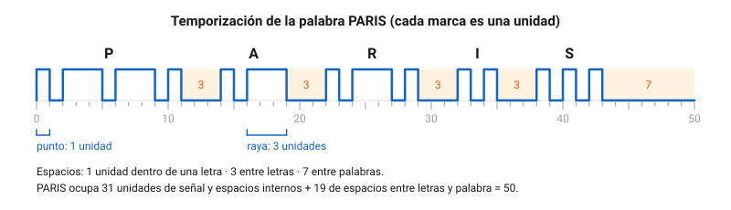
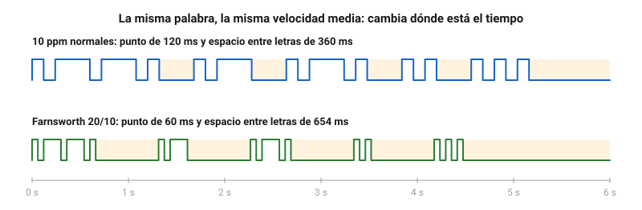
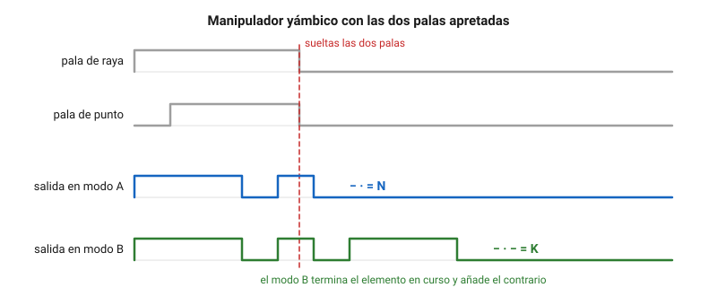
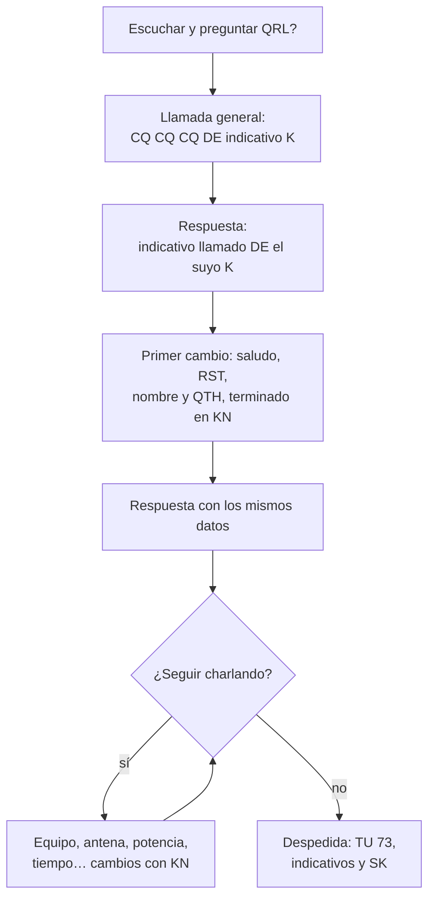

# Telegrafía

La telegrafía es el modo más antiguo de la radio y, aun así, sigue muy vivo en las bandas: con unos pocos vatios y una antena modesta llega donde la voz no se entiende, ocupa muy poco espectro y el equipo para emitirla es el más sencillo que existe. En este capítulo aprenderás el código Morse internacional tal como lo fija la UIT, cómo se mide su velocidad con la palabra PARIS, los métodos que funcionan para aprenderlo y las herramientas con que practicar hoy, los manipuladores, las abreviaturas y señales de un contacto en telegrafía, dónde se transmite según el plan de bandas de la IARU Región 1 y por qué una manipulación demasiado brusca ensucia las frecuencias vecinas. También verás qué exige hoy el examen español sobre la telegrafía.

## Qué es la telegrafía

En radio, **telegrafía** es transmitir texto encendiendo y apagando una portadora al ritmo de un código. Por eso se la llama también **CW** (*continuous wave*, onda continua), aunque la onda no sea continua: el nombre viene de los primeros transmisores de chispa, que emitían trenes de ondas amortiguadas, frente a los de onda continua que los sustituyeron. Su designación de emisión es **A1A**: modulación de amplitud (A), una sola señal digital sin subportadora (1) y telegrafía para recepción auditiva (A). Ya la viste en el [capítulo 4](04-teoria-radio.md).

El receptor no oye directamente la portadora, que no tiene audio. Un **oscilador de batido** (*BFO*) o un detector de producto la mezclan con una señal local desplazada unos cientos de hercios, y de la mezcla sale un tono audible mientras la portadora está encendida. La mayoría de los equipos usan un desplazamiento de entre 500 y 800 Hz, y casi todos permiten elegirlo.

Sus ventajas siguen siendo las mismas que hace un siglo:

- **Ocupa muy poco espectro.** Una señal bien conformada a velocidades normales ocupa del orden de un centenar de hercios, frente a los 2,7 kHz de una BLU.
- **Se oye en condiciones muy malas.** Como toda la energía se concentra en una banda estrecha, el receptor puede usar un filtro de 500 Hz o menos y dejar fuera casi todo el ruido. El oído humano, además, distingue un tono débil entre el ruido mucho mejor que una voz.
- **El equipo es sencillo.** Un transmisor de CW es un oscilador, un amplificador y un manipulador. Por eso es el modo preferido de quienes construyen sus propios equipos y de quienes trabajan con muy poca potencia (**QRP**, 5 W o menos).
- **No hay barrera de idioma.** Las abreviaturas y el código Q son internacionales, y un contacto básico se entiende igual entre dos operadores que no comparten lengua.

## El código Morse internacional

### La norma de referencia

El código que se usa hoy en radio lo fija la [Recomendación UIT-R M.1677-1, *International Morse code*](https://www.itu.int/rec/R-REC-M.1677-1-200910-I/es), aprobada en octubre de 2009 y vigente (comprobado en noviembre de 2026). Define los caracteres, sus duraciones y unas reglas generales de transmisión. Es la versión internacional del código; el de los telégrafos de cable estadounidenses del siglo XIX era distinto y ya no se usa.

En las tablas siguientes, `·` es un punto y `−` una raya.

### Letras

| Letra | Código | Letra | Código | Letra | Código |
|:-:|:--|:-:|:--|:-:|:--|
| A | `·−` | J | `·−−−` | S | `···` |
| B | `−···` | K | `−·−` | T | `−` |
| C | `−·−·` | L | `·−··` | U | `··−` |
| D | `−··` | M | `−−` | V | `···−` |
| E | `·` | N | `−·` | W | `·−−` |
| F | `··−·` | O | `−−−` | X | `−··−` |
| G | `−−·` | P | `·−−·` | Y | `−·−−` |
| H | `····` | Q | `−−·−` | Z | `−−··` |
| I | `··` | R | `·−·` | É | `··−··` |

La recomendación incluye la **É** acentuada, herencia del francés, pero no la **Ñ**. En español se usa tradicionalmente `−−·−−` para la Ñ, que no es parte de la norma internacional: en un contacto con otro país, escribe N.

Fíjate en que las letras más frecuentes en inglés son las más cortas: E y T tienen un solo elemento; A, I, M y N, dos. El código se diseñó para ahorrar tiempo de línea.

### Cifras

| Cifra | Código | Cifra | Código |
|:-:|:--|:-:|:--|
| 1 | `·−−−−` | 6 | `−····` |
| 2 | `··−−−` | 7 | `−−···` |
| 3 | `···−−` | 8 | `−−−··` |
| 4 | `····−` | 9 | `−−−−·` |
| 5 | `·····` | 0 | `−−−−−` |

Las cifras siguen una regla: todas tienen cinco elementos. Del 1 al 5 empiezan con tantos puntos como indica la cifra y se completan con rayas; del 6 al 0, con rayas y se completan con puntos.

### Signos de puntuación y otros

| Signo | Código | Signo | Código |
|:-:|:--|:-:|:--|
| Punto `.` | `·−·−·−` | Barra de fracción `/` | `−··−·` |
| Coma `,` | `−−··−−` | Paréntesis de apertura `(` | `−·−−·` |
| Dos puntos `:` | `−−−···` | Paréntesis de cierre `)` | `−·−−·−` |
| Interrogación `?` | `··−−··` | Comillas `"` | `·−··−·` |
| Apóstrofo `'` | `·−−−−·` | Doble guion `=` | `−···−` |
| Guion `-` | `−····−` | Cruz o suma `+` | `·−·−·` |
| Arroba `@` | `·−−·−·` | Multiplicación `×` | se transmite la X |

### Señales de servicio

La recomendación define además unas señales que no corresponden a ningún carácter escrito y que regulan la comunicación:

| Significado | Código | Cómo se suele escribir |
|---|:--|:-:|
| Comprendido | `···−·` | SN |
| Error | `········` (ocho puntos) | HH |
| Invitación a transmitir | `−·−` | K |
| Espera | `·−···` | AS |
| Fin de trabajo | `···−·−` | SK |
| Señal de comienzo | `−·−·−` | KA |

Algunas de estas señales y de los signos anteriores se transmiten como un solo carácter, sin el espacio entre letras. Por eso se les llama **prosignos** (señales de procedimiento) y se escriben con las dos letras que los forman, con una raya encima o entre ángulos: `<SK>`, `<AR>`. La cruz `·−·−·` es el prosigno `<AR>`; el doble guion `−···−`, el `<BT>`; y el paréntesis de apertura `−·−−·`, el `<KN>`. Los verás en uso más adelante.

??? note "Para saber más: signos que el código no tiene"
    La recomendación explica cómo transmitir lo que no tiene código propio. El tanto por ciento se envía como un 0, la barra y otro 0 (`0/0`), unido a la cifra con un guion: el 2 % se transmite `2-0/0`. Una cifra con fracción se une también con un guion, `1-3/4`, para que no se confunda con 13/4. Los minutos y segundos de ángulo se envían con uno o dos apóstrofos. Son reglas pensadas para los telegramas; en radioafición apenas se usan.

## Temporización

### Las cinco reglas

Todo el código se mide en una sola unidad: la duración del **punto**. Según la Recomendación UIT-R M.1677-1 (comprobado en noviembre de 2026):

1. Una **raya** dura **tres** puntos.
2. Entre los elementos de una misma letra hay un silencio de **un** punto.
3. Entre dos letras, el silencio es de **tres** puntos.
4. Entre dos palabras, de **siete** puntos.

A esas cuatro se suma una quinta implícita: el punto es la única duración libre. Si cambias la velocidad, todo se estira o se encoge en la misma proporción.

### La palabra PARIS

Para dar la velocidad en **palabras por minuto** (**ppm**, en inglés *wpm*) hace falta acordar qué es una palabra, porque no todas duran lo mismo. La convención es la palabra **PARIS** seguida de su espacio de palabra, que mide exactamente **50 unidades**:



*Figura 11.1. La palabra PARIS: 31 unidades de caracteres (con sus silencios internos) y 19 de espacios, 50 en total.*

| Letra | Código | Unidades dentro de la letra |
|:-:|:-:|:-:|
| P | `·−−·` | 1 + 1 + 3 + 1 + 3 + 1 + 1 = 11 |
| A | `·−` | 1 + 1 + 3 = 5 |
| R | `·−·` | 1 + 1 + 3 + 1 + 1 = 7 |
| I | `··` | 1 + 1 + 1 = 3 |
| S | `···` | 1 + 1 + 1 + 1 + 1 = 5 |
| Espacios | 4 entre letras y 1 de palabra | 4 · 3 + 7 = 19 |

Si transmites a $v$ palabras por minuto, en un minuto caben $50\,v$ unidades. La duración del punto es entonces:

$$
t_p\,(\text{ms}) = \frac{60\,000}{50 \cdot v} = \frac{1200}{v\,(\text{ppm})}
$$

donde $t_p$ es la duración del punto en milisegundos y $v$ la velocidad en palabras por minuto.

**Ejemplo.** A 20 ppm, el punto dura $1200 / 20 = 60\ \text{ms}$; la raya, 180 ms; el silencio entre letras, 180 ms, y el que separa dos palabras, $7 \cdot 60 = 420\ \text{ms}$. Una PARIS completa dura $50 \cdot 60\ \text{ms} = 3\ \text{s}$, y en un minuto caben exactamente 20.

<audio controls preload="none" src="assets/audio/11-paris-20.mp3"></audio>

*Audio 11.1. PARIS PARIS a 20 ppm, con un tono de 600 Hz.*

**Ejemplo.** Una llamada general como `CQ CQ CQ DE EA0ZZZ EA0ZZZ K` (indicativo ficticio) mide 289 unidades sin contar el espacio final. A 18 ppm, el punto dura $1200 / 18 \approx 66{,}7\ \text{ms}$ y la llamada entera, $289 \cdot 66{,}7\ \text{ms} \approx 19{,}3\ \text{s}$.

<audio controls preload="none" src="assets/audio/11-cq.mp3"></audio>

*Audio 11.2. Llamada general con un indicativo ficticio, a 18 ppm.*

Las velocidades habituales van de 5 a 12 ppm para quien empieza, de 15 a 25 ppm en un contacto normal y de 30 ppm en adelante en los concursos. Es habitual que algunos programas de concursos usen la palabra **CODEX**, de 60 unidades, que se parece más a un texto con indicativos y cifras; una velocidad en «ppm CODEX» es por eso algo menor que la misma en «ppm PARIS». Salvo que se diga otra cosa, en radioafición la referencia es PARIS.

!!! tip "Para el examen"
    Punto = 1, raya = 3, silencio dentro de la letra = 1, entre letras = 3, entre palabras = 7. PARIS mide 50 unidades, y el punto dura $t_p = 1200 / v$ milisegundos. Una confusión frecuente es dividir 60 000 entre la velocidad sin tener en cuenta las 50 unidades de la palabra.

### La velocidad en la normativa española

La [Orden IET/1311/2013, de 9 de julio, por la que se aprueba el Reglamento de uso del dominio público radioeléctrico por radioaficionados](https://www.boe.es/buscar/act.php?id=BOE-A-2013-7624), recoge el Morse en dos sitios (comprobado en noviembre de 2026):

- Su [artículo 25](https://www.boe.es/buscar/act.php?id=BOE-A-2013-7624#a25), letra d), obliga a los **repetidores analógicos** a emitir su distintivo de forma automática mientras dure la emisión, por voz o en Morse «a una velocidad no superior a diez palabras por minuto», a intervalos de diez minutos como máximo y modulando la portadora con un tono de audio.
- Su [artículo 29](https://www.boe.es/buscar/act.php?id=BOE-A-2013-7624#a29), apartado 2, permite añadir al indicativo, en telegrafía, las expresiones /M, /MM, /MA o /P para las estaciones móviles, móviles marítimas, móviles aeronáuticas o portables.

**Ejemplo.** A 10 ppm, el punto de la identificación de un repetidor dura como mínimo $1200 / 10 = 120\ \text{ms}$. Un repetidor con el indicativo ficticio ED0ZZZ tarda 75 unidades, es decir, $75 \cdot 0{,}12 = 9{,}0\ \text{s}$, en identificarse.

??? note "Para saber más: velocidad en baudios"
    Cada unidad es un símbolo de la señal (portadora encendida o apagada), así que la velocidad de modulación en **baudios** es el número de unidades por segundo: $1 / t_p$. A 20 ppm, $1 / 0{,}06\ \text{s} \approx 16{,}7$ baudios. Con esa cifra se calcula el ancho de banda necesario de una emisión A1A, que crece en proporción a la velocidad: una señal de CW rápida ocupa más espectro que una lenta, aunque en cualquier caso mucho menos que una de voz.

## Cómo aprender

### Por el sonido, no por la vista

El error más común es aprenderse la tabla como una lista de puntos y rayas y, al escuchar, ir contando: «punto, raya, raya, punto… es una P». Funciona a 5 ppm y se convierte en un muro a partir de 10 o 12, porque ya no da tiempo a contar. Quien llega lejos en telegrafía reconoce cada letra como un **sonido completo**, igual que reconoces una palabra hablada sin deletrearla: «didahdahdit» es la P, sin pasar por la imagen.

De ahí salen tres consejos que comparten todos los métodos:

- **No estudies la tabla con los ojos.** Úsala solo para consultar. Aprende cada carácter escuchándolo.
- **Pronuncia el código, no lo dibujes.** Si necesitas decirlo en voz alta, di «di» para el punto y «dah» para la raya: la A es «didah».
- **Practica poco y a diario.** Quince o veinte minutos cada día rinden mucho más que dos horas el fin de semana. El reconocimiento de sonidos es una destreza, como tocar un instrumento, y se consolida con la repetición espaciada.

### El método Koch

Se atribuye habitualmente al psicólogo alemán Ludwig Koch. La idea es que los caracteres se oigan **desde el primer día a la velocidad final**, para que el oído no aprenda un sonido lento que luego tendrá que olvidar:

1. Empiezas con **dos** caracteres, a 18 o 20 ppm de velocidad de carácter.
2. Copias grupos aleatorios de esos dos caracteres durante unos minutos.
3. Cuando aciertas el **90 %**, añades un carácter más.
4. Repites hasta tener todo el alfabeto, las cifras y los signos habituales.

Al principio parece imposible: la letra pasa antes de que te des cuenta. Es justo lo que se busca. A los pocos días el oído la identifica sin pensar, y cada carácter nuevo se aprende contra todos los anteriores.

### El método Farnsworth

Si los caracteres van a 20 ppm, las primeras semanas no da tiempo a escribir lo que se oye. El método **Farnsworth**, que según se cuenta habitualmente lleva el nombre del radioaficionado estadounidense que lo popularizó, mantiene los caracteres rápidos y **alarga los silencios** entre letras y palabras. Se describe con dos cifras: la velocidad de carácter $c$ y la velocidad media o efectiva $s$. «Farnsworth 20/10» significa caracteres a 20 ppm y 10 palabras PARIS por minuto.



*Figura 11.2. Las dos versiones de PARIS duran 6 s, pero en la de Farnsworth cada letra suena como a 20 ppm.*

Como en PARIS hay 31 unidades de caracteres y 19 de espacios, el tiempo que no ocupan los caracteres se reparte entre esas 19 unidades de espacio. Cada unidad de espacio dura:

$$
t_e\,(\text{s}) = \frac{1}{19}\left(\frac{60}{s} - \frac{31 \cdot 1{,}2}{c}\right)
$$

donde $s$ es la velocidad efectiva y $c$ la de carácter, las dos en palabras por minuto. El primer término es lo que dura una PARIS a la velocidad efectiva; el segundo, lo que ocupan sus caracteres a la velocidad de carácter. Los silencios entre letras valen $3\,t_e$ y entre palabras $7\,t_e$.

**Ejemplo.** Con Farnsworth 20/10, los caracteres de PARIS ocupan $31 \cdot 1{,}2 / 20 = 1{,}86\ \text{s}$ de los 6 s de la palabra. La unidad de espacio es $(6 - 1{,}86) / 19 \approx 0{,}218\ \text{s}$; el silencio entre letras, unos 654 ms, y entre palabras, unos 1,53 s. A 10 ppm normales serían 360 ms y 840 ms: Farnsworth casi duplica el tiempo para pensar sin que cambie el sonido de las letras.

<audio controls preload="none" src="assets/audio/11-paris-farnsworth.mp3"></audio>

*Audio 11.3. PARIS PARIS con Farnsworth 20/10. Compáralo con el audio 11.1: las letras suenan igual, pero hay más silencio entre ellas.*

Lo más eficaz es **combinar los dos métodos**: aprendes los caracteres por Koch a velocidad de carácter alta, con silencios de Farnsworth, y vas acortando los silencios a medida que copias con soltura hasta que la velocidad efectiva alcanza a la de carácter.

### Transmitir y copiar de oído

Transmitir bien es tan importante como recibir. Practica con el manipulador conectado al equipo en **modo de práctica**: casi todos los transceptores permiten desactivar la emisión (*break-in* apagado) y oír solo el tono local. Graba lo que transmites y compruébalo con un decodificador o, mejor, escúchalo un día después: así oirás si tus espacios entre letras son demasiado cortos, el defecto más habitual.

Cuando ya copias letra a letra, el siguiente paso es **copiar de oído** (sin escribir) palabras completas y abreviaturas frecuentes, que es como se mantiene una conversación a 20 ppm o más.

### Herramientas para practicar

Todas estas herramientas se comprobaron en sus páginas oficiales el 9 de noviembre de 2026. Son gratuitas salvo lo que se indica.

| Herramienta | Qué es | Plataforma |
|---|---|---|
| [LCWO](https://lcwo.net/) (*Learn CW Online*) | Curso completo por el método Koch, con Farnsworth, práctica de grupos, palabras e indicativos y estadísticas de progreso. Interfaz en español. Requiere una cuenta gratuita. | Navegador |
| [Koch CW Trainer](https://www.g4fon.net/CW%20Trainer2.php) | Programa clásico de Koch con velocidad efectiva ajustable y práctica de transmisión. Última versión, 10.8.1, de marzo de 2021; interfaz en inglés. | Windows |
| [Morse Code Ninja](https://morsecode.ninja/) | Miles de audios de práctica por niveles para el reconocimiento instantáneo de letras y palabras, en descarga y en vídeo. En inglés. | Navegador, audios descargables |
| [Morse Runner Community Edition](https://github.com/w7sst/MorseRunner) | Simulador de concursos: llaman estaciones virtuales con ruido, desvanecimientos y apilamientos, y tú las anotas. Código abierto. | Windows |
| [RufzXP](https://www.rufzxp.net/) | Entrenamiento de copia de indicativos: la velocidad sube cuando aciertas y baja cuando fallas. | Windows |
| [VBand](https://hamradio.solutions/vband/) | Canales para manipular por internet con otros aficionados, con el teclado o con un manipulador conectado al ordenador. El adaptador USB de VBand es de pago. | Navegador |
| [CW Academy](https://cwops.org/cw-academy/) | Cursos en grupo por videoconferencia con un asesor, en convocatorias de enero-febrero, mayo-junio y septiembre-octubre. No hace falta ser socio. En inglés. | Videoconferencia |
| [Long Island CW Club](https://longislandcwclub.org/cw-spanish-classes/) | Club con clases en directo por videoconferencia, también **en español**. Requiere hacerse socio. | Videoconferencia |
| [URE, descargas](https://www.ure.es/descargas/?categoria=lecciones-de-cw&su=1) | La Unión de Radioaficionados Españoles ofrece lecciones de telegrafía en español, en audio y PDF, de descarga libre. | Audios y PDF |

!!! example "En la práctica"
    Un plan realista: Koch en LCWO con caracteres a 20 ppm y Farnsworth hasta copiar todo el alfabeto, las cifras y `? / . , =` (dos o tres meses a veinte minutos diarios). Después, audios de palabras y QSO de práctica, y escucha de contactos reales en los centros de actividad **QRS** del plan de bandas (3 555, 14 055, 21 055 y 28 055 kHz), donde se transmite despacio para quien empieza.

## Manipuladores

El **manipulador** es el interruptor con el que se enciende y apaga la emisión. Hay tres familias.

### Manipulador vertical

El **manipulador vertical** (*straight key*) es una palanca con un contacto: mientras la aprietas hacia abajo hay portadora; al soltarla, un muelle la levanta. Tú decides la duración de cada punto, cada raya y cada silencio, así que la calidad de la transmisión depende por completo de tu mano. Es el mejor para aprender el ritmo y el más sencillo, pero cansa a partir de 15 o 20 ppm.

Se ajustan dos cosas: la **separación de los contactos** (cuanto menor, más rápida la manipulación) y la **tensión del muelle**. Debe estar bien sujeto a la mesa o tener una base pesada, y el brazo apoyado: se manipula con la muñeca y los dedos, no con el hombro.

### Manipuladores de palas y manipulador electrónico

Un **manipulador de palas** (*paddle*) tiene una o dos palas que se mueven a los lados. No forma los puntos y las rayas por sí mismo: los genera un **manipulador electrónico** (*keyer*), que hoy viene integrado en casi todos los transceptores. Mientras empujas la pala de puntos, el *keyer* emite puntos perfectos a la velocidad elegida; mientras empujas la de rayas, rayas. Lo habitual es puntos con el pulgar y rayas con el índice.

- Con **una sola pala** (*single lever*), solo puedes pulsar un lado a la vez.
- Con **dos palas** independientes (*dual lever*) puedes apretar las dos a la vez, y entonces el *keyer* alterna puntos y rayas. Es la manipulación **yámbica**.

El conector más habitual es un jack estéreo de 3,5 mm o de 6,3 mm. Lo habitual es que la punta vaya a los puntos, el anillo a las rayas y el cuerpo a masa, pero compruébalo en el manual: algunos permiten invertirlo en un menú, útil si eres zurdo.

### Manipulación yámbica: modos A y B

Con las dos palas apretadas, el *keyer* alterna: raya, punto, raya, punto… La C (`−·−·`) se forma apretando las dos palas, empezando por la de rayas, y soltándolas a tiempo: cuatro elementos con un solo gesto. Lo que hace el *keyer* al soltar las palas define el **modo**:

- En **modo A**, termina el elemento que está sonando y se para.
- En **modo B**, termina el elemento en curso y **añade uno más del tipo contrario**, si las dos palas estaban apretadas durante ese elemento.



*Figura 11.3. El mismo gesto produce una N en modo A y una K en modo B.*

Ninguno es mejor: son costumbres distintas. Quien aprende con un modo y cambia al otro mete un elemento de más o de menos durante un tiempo. Elige uno al empezar y no lo cambies.

??? note "Para saber más: el manipulador semiautomático y el lateral"
    El **manipulador semiautomático** (*bug*) es mecánico: al empujar la palanca a un lado, un péndulo con un contrapeso genera una serie de puntos; las rayas se hacen a mano empujando al otro lado. Fue el manipulador rápido antes de los electrónicos y tiene un sonido característico. El **manipulador lateral** (*sideswiper* o *cootie*) es una palanca que cierra el contacto hacia los dos lados, sin *keyer*: todos los elementos se hacen a mano, alternando el lado.

### Otras formas de transmitir

Muchos equipos tienen **memorias** de mensajes (la llamada CQ, el intercambio de un concurso) y aceptan un teclado o un ordenador que envía el texto escrito con una temporización perfecta. Son útiles en concursos y para emitir una baliza, pero no sustituyen a saber manipular: el corresponsal te contestará a la velocidad a la que llames, y tendrás que entenderle.

## Abreviaturas y señales de procedimiento

En CW nadie escribe frases completas. Se usan abreviaturas internacionales, casi todas derivadas del inglés, el [código Q](10-operacion.md) y unos pocos prosignos. Esta es una selección de las más frecuentes:

### Prosignos y señales de procedimiento

| Señal | Uso en un contacto |
|:-:|---|
| `K` | Adelante: invitación a transmitir a cualquiera. |
| `<KN>` | Adelante, **solo** la estación con la que hablo; las demás, que no entren. |
| `<AR>` | Fin del mensaje (el signo `+`). Se usa al final de una llamada o de un cambio antes de K. |
| `<SK>` | Fin del contacto (el «fin de trabajo» de la recomendación). |
| `<BT>` | Separador entre partes del mensaje (el doble guion `=`), como un punto y aparte. |
| `<AS>` | Espera un momento. |
| `<HH>` | Error: ocho puntos seguidos. En la práctica también se oye `EEEEEE`. Después se repite la última palabra bien. |
| `BK` | Cambio rápido, para intercambiar una frase corta sin repetir indicativos. |
| `CL` | Cierro la estación y dejo de escuchar. |
| `?` | Repite, o señal de pregunta. |

### Abreviaturas habituales

| Abreviatura | Significado | Abreviatura | Significado |
|:-:|---|:-:|---|
| CQ | Llamada general | DE | De (separa indicativos: «a ti DE mí») |
| R | Recibido | RR | Recibido todo |
| TU, TNX | Gracias | FER | Por (*for*) |
| UR | Tu, tus | MY | Mi, mis |
| RST | Informe de señal | 5NN | 599 abreviado |
| NAME, OP | Nombre, operador | QTH | Lugar de la estación |
| RIG | Equipo | ANT | Antena |
| PWR | Potencia | WX | Tiempo meteorológico |
| HR | Aquí | ES | Y |
| FB | Muy bien | OM, YL | Colega, colega mujer |
| GM, GA, GE | Buenos días, buenas tardes, buenas noches | PSE | Por favor |
| AGN | Otra vez | HW? | ¿Qué tal me copias? |
| CUL | Hasta luego | 73 | Saludos cordiales |
| GL | Buena suerte | DX | Contacto o estación lejana |

Tres grupos del código Q aparecen en casi todos los contactos de CW: **QRS** (transmite más despacio), **QRQ** (transmite más deprisa) y **QRL?** (¿está ocupada la frecuencia?). El código Q completo y el alfabeto de deletreo están en el [capítulo 10](10-operacion.md).

### El informe RST en telegrafía

En telegrafía el informe tiene tres cifras: **R** de legibilidad (1 a 5), **S** de intensidad (1 a 9) y **T** de **tono** (1 a 9). La T solo existe en CW y en otros modos de tono: 9 es un tono puro y limpio; las cifras bajas indican un tono con zumbido de alterna o muy distorsionado. Tradicionalmente se añadía una C si la señal tenía *chirp* (la frecuencia «resbala» al manipular) o una K si tenía clics. Con los equipos actuales casi todas las señales son T9, y en los concursos se envía `5NN` a todo el mundo, donde la N es un 9 abreviado.

!!! tip "Para el examen"
    El programa del examen incluye el código Q y las abreviaturas más usadas en radioafición. Aprende a distinguir `K` (cualquiera puede contestar) de `<KN>` (solo la estación con la que hablas) y `<AR>` (fin de mensaje) de `<SK>` (fin de contacto). En CW, la tercera cifra del RST es el tono.

## Un contacto en telegrafía

### Antes de llamar

1. **Escucha** un buen rato en la frecuencia. Una estación débil puede estar usándola aunque tú no la oigas bien.
2. Pregunta si está libre: `QRL?`. Si alguien contesta `QRL`, `YES` o simplemente `C`, busca otra.
3. **Ajusta el equipo**: filtro estrecho (500 Hz o menos), velocidad del *keyer* a la que copias con comodidad y potencia la necesaria.

### La estructura

La Recomendación UIT-R M.1677-1 fija en su parte II las reglas generales que siguen usándose hoy: quien llama transmite el indicativo de la estación llamada (no más de dos veces), la palabra DE, su propio indicativo y la invitación a transmitir K; la estación llamada contesta del mismo modo; el fin de la transmisión se indica con `<AR>` seguido de K, y el fin del trabajo con `<SK>` (comprobado en noviembre de 2026). El contacto típico entre aficionados se ordena así:



*Figura 11.4. Estructura de un contacto de CW típico.*

### Un ejemplo completo

Este es un contacto corto entre dos estaciones con **indicativos ficticios**, EA0ZZZ y EB0QQQ. Cada línea es un cambio:

```text
EA0ZZZ:  CQ CQ CQ DE EA0ZZZ EA0ZZZ K
EB0QQQ:  EA0ZZZ DE EB0QQQ EB0QQQ K
EA0ZZZ:  EB0QQQ DE EA0ZZZ GM TNX FER CALL = UR RST 579 579 = NAME ANA ANA = QTH TERUEL TERUEL = HW? EB0QQQ DE EA0ZZZ KN
EB0QQQ:  EA0ZZZ DE EB0QQQ R GM ANA TNX FER RPRT = UR RST 599 599 = NAME LUIS LUIS = QTH LUGO = RIG 5W ES DIPOLE = HW? EA0ZZZ DE EB0QQQ KN
EA0ZZZ:  EB0QQQ DE EA0ZZZ R FB LUIS = 5W FB SIG = RIG HR 100W ES VERT = TU QSO 73 GL <SK> EB0QQQ DE EA0ZZZ
EB0QQQ:  EA0ZZZ DE EB0QQQ R TU ANA 73 CUL <SK> EA0ZZZ DE EB0QQQ TU EE
```

Leído en castellano: Ana llama general. Luis contesta. Ana le saluda («buenos días»), le agradece la llamada, le da un 579, su nombre y su localidad dos veces cada uno, por si hay ruido, y le cede el turno solo a él. Luis confirma que lo ha recibido todo, le devuelve un 599, su nombre y su localidad, y le cuenta que usa 5 W y un dipolo. Ana le felicita por la señal que hace con tan poca potencia, le dice su equipo y se despide. Luis se despide también. El `TU EE` final es un «gracias, adiós» informal muy extendido.

Fíjate en tres costumbres:

- Lo importante (RST, nombre, QTH) **se repite** dos veces; el resto, no.
- Cada cambio empieza y termina con los indicativos: así cumples la obligación de identificarte al principio y al final de cada emisión que fija el artículo 29.1 de la Orden IET/1311/2013 (comprobado en noviembre de 2026).
- Se **contesta a la velocidad del otro**, o algo más despacio. Si te llaman más rápido de lo que copias, `QRS PSE` es perfectamente educado.

### En un concurso

En los concursos solo se intercambia lo que piden las bases, y a toda velocidad. Por ejemplo, si piden RST y zona CQ:

```text
CQ TEST EA0ZZZ
EB0QQQ
EB0QQQ 5NN 14
TU 5NN 14
TU EA0ZZZ
```

La estación que llama solo da su indicativo una vez; la que contesta, también. El `TU EA0ZZZ` final confirma el contacto y sirve de nueva llamada. En el intercambio se usan **números cortados**: N por 9 y T por 0, para ahorrar rayas.

## La telegrafía en el plan de bandas

### Para qué sirve el plan

Las bandas de aficionado se reparten entre modos según el **plan de bandas de la IARU Región 1**. No es una norma legal por sí mismo, pero la Orden IET/1311/2013 lo toma como referencia: el apartado 3.1 de su anexo I dice que los anchos de banda de las emisiones se ajustarán, como norma general, al plan de bandas de la IARU para la Región 1 (comprobado en noviembre de 2026). Los márgenes de cada banda en España, que son los que mandan, están en el [capítulo 5](05-propagacion-bandas.md).

Los datos de HF son los del **plan de 2020**, en vigor desde el **16 de octubre de 2020** ([PDF del plan de HF](https://www.iaru-r1.org/wp-content/uploads/2021/06/hf_r1_bandplan.pdf), enlazado desde la [página de planes de bandas de la IARU Región 1](https://www.iaru-r1.org/reference/band-plans/); comprobado en noviembre de 2026). Es el último plan de HF que publica la IARU Región 1 en su web. La última versión de su [*HF Manager's Handbook*](https://www.iaru-r1.org/reference/handbooks/), la 9, es de junio de 2018 y es anterior a ese plan, así que no sirve para confirmar si ha habido cambios posteriores. El plan de 2020 reserva en cada banda un tramo de **ancho de banda máximo de 200 Hz**, dedicado a la telegrafía:

| Banda | Tramo de CW, plan de 2020 (200 Hz máx.) | Centros de actividad y notas |
|---|---|---|
| 160 m | 1 810 – 1 838 kHz | QRP: 1 836 kHz |
| 80 m | 3 500 – 3 570 kHz | 3 500 – 3 510: prioridad para contactos intercontinentales. QRS: 3 555 kHz; QRP: 3 560 kHz |
| 60 m | 5 351,5 – 5 354,0 kHz | CW y modos de banda estrecha; uso propuesto |
| 40 m | 7 000 – 7 040 kHz | QRP: 7 030 kHz |
| 30 m | 10 100 – 10 130 kHz | QRP: 10 116 kHz |
| 20 m | 14 000 – 14 070 kHz | QRS: 14 055 kHz; QRP: 14 060 kHz |
| 17 m | 18 068 – 18 095 kHz | QRP: 18 086 kHz |
| 15 m | 21 000 – 21 070 kHz | QRS: 21 055 kHz; QRP: 21 060 kHz |
| 12 m | 24 890 – 24 915 kHz | QRP: 24 906 kHz |
| 10 m | 28 000 – 28 070 kHz | QRS: 28 055 kHz; QRP: 28 060 kHz |

Tres notas del plan de 2020 importan a quien opera en CW:

- **La telegrafía se acepta en toda la banda**, no solo en su tramo, salvo en los segmentos reservados a las balizas (como 14 099 – 14 101 kHz).
- **No se hacen concursos en 60, 30, 17 y 12 m.** Son las bandas a las que conviene ir durante los grandes concursos si no participas.
- En España, la banda de 160 m solo va de 1 810 a 1 850 kHz (CNAF, ver capítulo 5), así que el tramo de CW completo cae dentro de lo autorizado.

En VHF y UHF, según los planes de la IARU Región 1 en vigor desde diciembre de 2020 ([VHF](https://www.iaru-r1.org/wp-content/uploads/2020/12/VHF-Bandplan.pdf) y [UHF](https://www.iaru-r1.org/wp-content/uploads/2021/03/UHF-Bandplan.pdf); comprobado en noviembre de 2026):

| Banda | Tramo | Uso |
|---|---|---|
| 6 m | 50,000 – 50,100 MHz | Telegrafía (500 Hz máx.). Centro de actividad en 50,050 MHz y de actividad intercontinental en 50,090 MHz |
| 4 m | 70,100 – 70,250 MHz | BLU, telegrafía y modos digitales. Llamada de CW y BLU en 70,200 MHz. En España la banda empieza en 70,150 MHz |
| 2 m | 144,025 – 144,100 MHz | Solo telegrafía (500 Hz máx.). Llamada de CW en 144,050 MHz |
| 70 cm | 432,000 – 432,100 MHz | Telegrafía y modos digitales de banda estrecha. Centro de actividad de CW en 432,050 MHz |

En VHF y UHF la CW se usa sobre todo para trabajar señales débiles: contactos a larga distancia por propagación troposférica, dispersión meteórica y rebote lunar.

!!! tip "Para el examen"
    El programa incluye los planes de bandas de la IARU y sus objetivos. Recuerda que en HF la telegrafía va en el **extremo inferior** de cada banda, con 200 Hz de ancho máximo; en 40 m, de 7 000 a 7 040 kHz, y en 20 m, de 14 000 a 14 070 kHz. En 2 m, el tramo solo de telegrafía es 144,025 – 144,100 MHz.

## Los clics de manipulación

### De dónde salen

En el [capítulo 8](08-interferencias.md#otras-emisiones-no-deseadas) viste que una manipulación con flancos demasiado bruscos produce **clics de manipulación**: chasquidos que se oyen a varios kilohercios a cada lado de la señal y molestan a quien está en las frecuencias vecinas. Ahora puedes ver por qué.

Encender y apagar la portadora es modular su amplitud con una señal rectangular. Como en cualquier modulación de amplitud, la forma de la envolvente decide el espectro: una envolvente con escalones instantáneos contiene componentes de frecuencia muy altas, que aparecen como bandas laterales lejos de la portadora. Si los flancos se suavizan, esas componentes desaparecen y la señal se queda estrecha. Por eso los transmisores de CW **conforman** la envolvente para que suba y baje en unos milisegundos.


*Figura 11.5. Un punto a 20 ppm con flancos instantáneos y con flancos de 5 ms, y la envolvente de su espectro según un modelo simplificado.*

**Ejemplo.** Con el modelo de la figura, el espectro de un punto de 60 ms con flancos instantáneos está unos 45 dB por debajo del máximo a 1 kHz de la portadora y unos 55 dB a 3 kHz, y no baja de −60 dB hasta más allá de 5,3 kHz. Con flancos de 5 ms, a 1 kHz ya está unos 85 dB por debajo: casi 40 dB menos de energía donde escucha tu vecino de frecuencia.

??? note "Para saber más: el modelo de la figura"
    Un elemento rectangular de duración $T$ tiene un espectro cuya envolvente decrece como $1 / (\pi f T)$: 20 dB por década. Si cada flanco tiene la forma de medio ciclo de coseno de duración $t_s$, a partir de unos $1/t_s$ hercios la envolvente cae además como $1 / (2 f t_s)^2$, es decir, 40 dB por década más. Los cálculos están en `herramientas/calculos11.py`. Es un modelo de un solo elemento aislado; una señal real, con muchos elementos seguidos, tiene un espectro de líneas, pero con la misma envolvente.

### Cómo se evitan

- **Ajusta el tiempo de subida** (*rise time*, *CW wave shape*) en el menú del transceptor. Valores de unos 4 a 8 ms son habituales; los más cortos solo tienen sentido a velocidades muy altas.
- **Vigila el amplificador lineal.** Un amplificador con conmutación lenta o el ALC mal ajustado pueden recortar o deformar el primer elemento de cada transmisión y crear clics aunque el excitador esté bien.
- **Escúchate.** Pide a otra estación cercana que escuche a 1 o 2 kHz de tu frecuencia mientras transmites, o usa un receptor SDR con una antena pequeña y mira el espectro.

<audio controls preload="none" src="assets/audio/11-clics.mp3"></audio>

*Audio 11.4. VVV con flancos instantáneos y después con flancos de 5 ms. El chasquido de los primeros es audible incluso en el tono de audio.*

Dos defectos parecidos: el ***chirp*** es un cambio de frecuencia al manipular, por un oscilador que se ve afectado por la carga o la alimentación, y suena como un «piu» al principio de cada elemento; la ***backwave*** es una portadora residual que se oye débil durante los silencios porque el transmisor no se apaga del todo.

## ¿Exige el examen saber telegrafía?

**No.** Históricamente, en muchos países, saber Morse fue requisito para transmitir en onda corta. Hoy, en España, la prueba para obtener la autorización no incluye recepción ni transmisión de Morse. Según el [artículo 10 de la Orden IET/1311/2013](https://www.boe.es/buscar/act.php?id=BOE-A-2013-7624#a10), la prueba tiene dos partes independientes: conocimientos de electricidad y radioelectricidad y dominio de la normativa reglamentaria. Su programa, en el anexo II de la misma orden, es acorde al anexo 6 de la Recomendación T/R 61-02 de la CEPT, y quien lo supera recibe el certificado armonizado HAREC (texto consolidado comprobado contra el BOE el 9 de noviembre de 2026; última actualización del texto en el BOE, 10 de agosto de 2026).

Las condiciones concretas del examen las fija la [Resolución de 3 de junio de 2014, de la Secretaría de Estado de Telecomunicaciones y para la Sociedad de la Información, por la que se establece el procedimiento para la realización del examen de capacitación para operar estaciones de radioaficionado](https://www.boe.es/buscar/doc.php?id=BOE-A-2014-6461). Es la última resolución sobre el examen que aparece en el BOE y no consta que se haya derogado. Fija 60 preguntas tipo test con cuatro respuestas, 30 de cada parte. Para aprobar cada parte bastan 15 aciertos, y cada parte dura como máximo 45 minutos. No dice nada de telegrafía ni de Morse (comprobado en noviembre de 2026).

Eso no significa que la telegrafía no entre en el examen. El anexo II de la orden pide (comprobado en noviembre de 2026):

- En la parte técnica: la modulación por onda continua, las formas de onda y el espectro de la CW, los diagramas de bloques de receptores y transmisores de CW (A1A) y los detectores de CW y BLU.
- En la parte de normativa: el código Q, las abreviaturas más usuales, los procedimientos operativos y los planes de bandas de la IARU.

Es decir, no te van a pedir que copies Morse, pero sí que sepas cómo funciona, cómo se opera y dónde va en cada banda. La CW es una puerta abierta, no una obligación.

## Resumen

- La **telegrafía** (CW, A1A) enciende y apaga una portadora; ocupa del orden de un centenar de hercios, se recibe con filtros estrechos y funciona con poca potencia.
- El código lo fija la **Recomendación UIT-R M.1677-1** (vigente, comprobada en noviembre de 2026): letras, cifras de cinco elementos, signos y señales de servicio. La Ñ (`−−·−−`) es un uso tradicional en español, no internacional.
- **Temporización**: punto 1, raya 3, silencio dentro de la letra 1, entre letras 3, entre palabras 7. **PARIS** mide 50 unidades y $t_p\,(\text{ms}) = 1200 / v\,(\text{ppm})$: a 20 ppm, 60 ms.
- Se aprende **por el sonido**: método **Koch** (caracteres a velocidad final desde el principio, añadiendo uno al llegar al 90 %) y **Farnsworth** (caracteres rápidos, silencios largos), en sesiones cortas y diarias.
- **Manipuladores**: vertical, de palas con *keyer* electrónico y yámbico, con los **modos A y B**, que difieren en el elemento que se añade al soltar.
- Prosignos clave: `K` (adelante), `<KN>` (solo tú), `<AR>` (fin de mensaje), `<SK>` (fin de contacto), `<BT>` (separador). En CW el RST lleva **tono** (T).
- Un contacto: escuchar, `QRL?`, CQ, intercambio de RST, nombre y QTH repetidos, cambios con `KN` y despedida con `73` y `<SK>`, identificándote al principio y al final.
- Plan de la **IARU Región 1** (HF: plan de 2020): CW en el extremo inferior de cada banda con 200 Hz como máximo; en 40 m, 7 000 – 7 040 kHz. En 2 m, 144,025 – 144,100 MHz solo telegrafía.
- Los **clics de manipulación** salen de flancos demasiado bruscos; se evitan con un tiempo de subida de unos milisegundos.
- El examen español **no exige Morse**: son 60 preguntas tipo test sobre técnica y normativa. Sí entran la técnica de la CW, el código Q, las abreviaturas y los planes de bandas (Orden IET/1311/2013, artículo 10 y anexo II, y Resolución de 3 de junio de 2014; comprobado en noviembre de 2026).

## Autoevaluación

**1.** ¿Cuánto dura un punto transmitido a 25 palabras por minuto?

a) 20 ms  
b) 48 ms  
c) 60 ms  
d) 144 ms

??? success "Solución"
    **b)** $t_p = 1200 / 25 = 48\ \text{ms}$. La c) es el punto a 20 ppm, y la d), la raya a 25 ppm (tres puntos). La a) sale de dividir 500 entre 25, sin relación con las 50 unidades de PARIS.

**2.** Una baliza transmite la palabra PARIS seguida de su espacio de palabra, y el conjunto dura 2,4 s. ¿A qué velocidad transmite?

a) 20,8 ppm  
b) 24 ppm  
c) 25 ppm  
d) 50 ppm

??? success "Solución"
    **c)** Una PARIS con su espacio es exactamente una palabra. Si dura 2,4 s, en un minuto caben $60 / 2{,}4 = 25$ palabras. La a) divide las 50 unidades entre 2,4 s, que da unidades por segundo (baudios), no palabras por minuto.

**3.** Oyes el carácter `−·−·`. ¿Qué letra es?

a) K  
b) C  
c) Y  
d) Q

??? success "Solución"
    **b)** La C es raya, punto, raya, punto. La K es `−·−` (tres elementos), la Y `−·−−` y la Q `−−·−`. Si dudas entre ellas al oírlas, es señal de que aún cuentas elementos en lugar de reconocer el sonido completo.

**4.** Al final de un contacto en CW, ¿qué señal indica que la comunicación ha terminado?

a) `<AR>`  
b) `<KN>`  
c) `<SK>`  
d) `<BT>`

??? success "Solución"
    **c)** `<SK>` (`···−·−`) es el «fin de trabajo» de la Recomendación UIT-R M.1677-1. `<AR>` marca el fin de un mensaje y suele ir antes de una invitación a transmitir; `<KN>` cede el turno solo a la estación con la que hablas; `<BT>` separa partes de un mismo mensaje.

**5.** Practicas con Farnsworth 15/6: caracteres a 15 ppm y velocidad efectiva de 6 ppm. ¿Cuánto dura aproximadamente el silencio entre dos letras?

a) 0,24 s  
b) 0,60 s  
c) 1,19 s  
d) 2,77 s

??? success "Solución"
    **c)** La unidad de espacio es $t_e = (60/6 - 31 \cdot 1{,}2/15) / 19 = (10 - 2{,}48) / 19 \approx 0{,}396\ \text{s}$, y el silencio entre letras vale $3\,t_e \approx 1{,}19\ \text{s}$. La a) es el silencio entre letras a 15 ppm normales y la b), a 6 ppm normales. La d) es el silencio entre palabras ($7\,t_e$).

**6.** Según el plan de bandas de HF de la IARU Región 1, ¿qué tramo de la banda de 40 m se reserva a la telegrafía, con un ancho de banda máximo de 200 Hz?

a) 7 000 – 7 025 kHz  
b) 7 000 – 7 040 kHz  
c) 7 040 – 7 050 kHz  
d) 7 000 – 7 100 kHz

??? success "Solución"
    **b)** De 7 000 a 7 040 kHz, con el centro de actividad QRP en 7 030 kHz. El tramo de 7 000 a 7 025 kHz fue durante unos años el preferido para concursos de CW, pero se retiró del plan. De 7 040 a 7 050 kHz va a modos de banda estrecha de hasta 500 Hz.

**7.** Un corresponsal te dice que tu señal de CW produce chasquidos a 2 kHz de tu frecuencia. ¿Qué es lo primero que debes revisar?

a) El filtro paso bajo de la salida del transmisor  
b) El tiempo de subida de la envolvente de CW  
c) La ROE de la antena  
d) La velocidad del *keyer*, que debe ser menor de 10 ppm

??? success "Solución"
    **b)** Son clics de manipulación, producidos por flancos demasiado bruscos. Se corrigen alargando el tiempo de subida y bajada (unos milisegundos). El filtro paso bajo elimina armónicos lejanos, no componentes a 2 kHz de la portadora; la ROE no influye, y bajar la velocidad estrecha un poco la señal, pero no quita los clics.

**8.** ¿Qué exige hoy la normativa española sobre telegrafía para obtener la autorización de radioaficionado?

a) Recibir y transmitir Morse a 5 ppm  
b) Recibir Morse a 12 ppm, solo para operar en HF  
c) No hay prueba de Morse, pero el programa incluye la técnica de la CW, el código Q y las abreviaturas  
d) La telegrafía no aparece en ninguna parte del programa

??? success "Solución"
    **c)** La prueba de la Orden IET/1311/2013 tiene dos partes escritas, técnica y normativa, sin recepción ni transmisión de Morse (artículo 10). La Resolución de 3 de junio de 2014, que fija las condiciones del examen, tampoco menciona la telegrafía. Su anexo II sí incluye la modulación por onda continua, los receptores y transmisores de CW (A1A), el código Q, las abreviaturas y los planes de bandas, así que la d) también es falsa (comprobado en noviembre de 2026).

**9.** Con un manipulador yámbico, aprietas primero la pala de puntos y en seguida la de rayas, y sueltas las dos mientras suena la raya. ¿Qué letra sale en modo A y cuál en modo B?

a) A en los dos modos  
b) A en modo A y R en modo B  
c) R en modo A y A en modo B  
d) N en modo A y K en modo B

??? success "Solución"
    **b)** El *keyer* empieza por el punto y sigue con la raya: `·−`, una A. En modo A se para al terminar la raya. En modo B añade un elemento del tipo contrario, un punto: `·−·`, una R. La d) es el caso de la figura 11.3, que empieza por la raya.

**10.** Recibes `QRS PSE`. ¿Qué te están pidiendo?

a) Que transmitas más deprisa  
b) Que transmitas más despacio  
c) Que cambies de frecuencia  
d) Que repitas tu indicativo

??? success "Solución"
    **b)** QRS significa «transmita más despacio» y PSE, «por favor». Lo contrario es QRQ. Contestar a la velocidad que te piden es una de las cortesías básicas de la CW.
