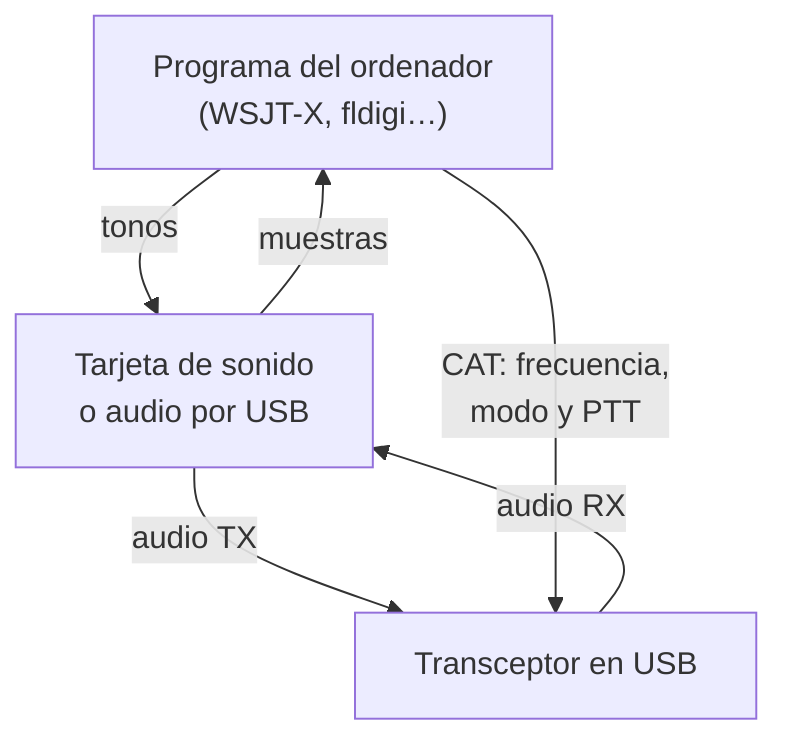
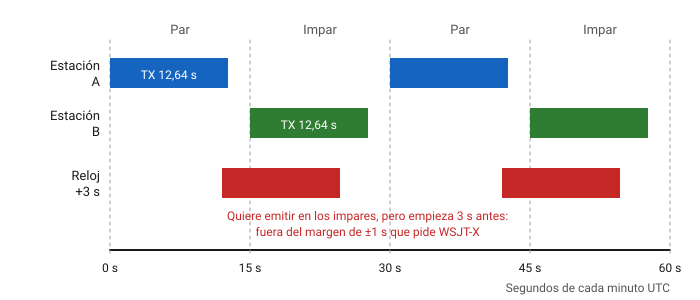
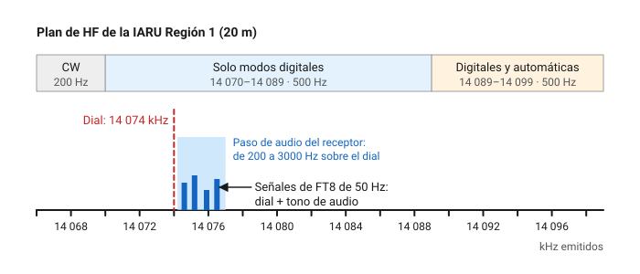
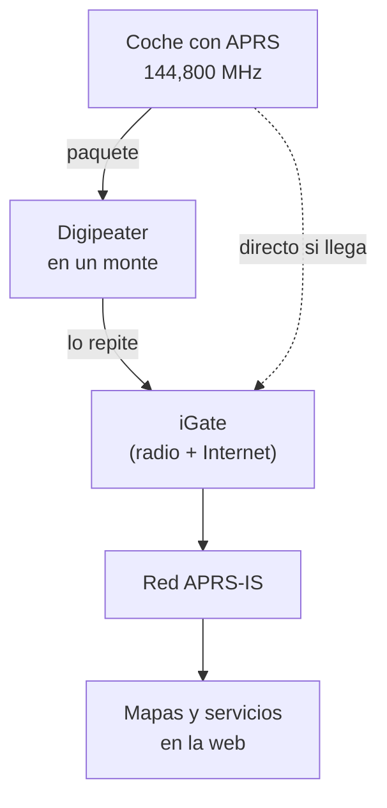
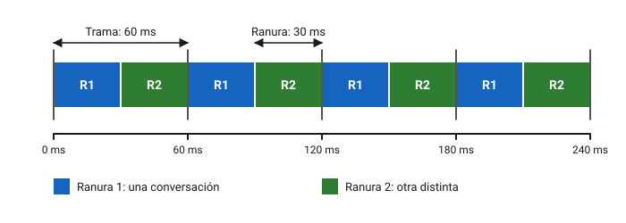
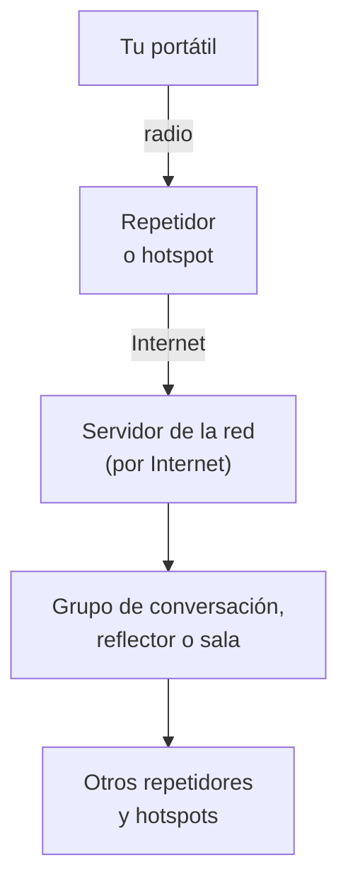

# Modos digitales

Hoy una gran parte de la actividad en las bandas de aficionado no se oye con el altavoz: la escribe y la lee un ordenador. En este capítulo aprenderás cómo se conecta la radio al ordenador y cómo se ajustan los niveles para no ensuciar la banda, qué modos de datos se usan en HF y dónde va cada uno en el plan de bandas, cómo funciona el APRS en Europa, en qué se parecen y en qué se diferencian las tres familias de voz digital (DMR, D-STAR y System Fusion) y qué son los hotspots y los enlaces por Internet. Al final verás lo que dice la normativa española sobre las conexiones con Internet. En el examen entran los conceptos (modulación, ancho de banda, velocidad, para qué sirve cada modo); en la banda, casi todo lo demás.

Lo normativo general ya lo viste en el [capítulo 9](09-reglamentacion/espanol.md): los repetidores digitales finales son de acceso libre y solo los analógicos tienen que emitir su distintivo de forma automática ([estaciones automáticas desatendidas](09-reglamentacion/espanol.md#estaciones-automaticas-desatendidas)), y ningún modo puede cifrarse para ocultar el significado de lo que transmites ([artículo 30](09-reglamentacion/espanol.md#lo-que-dice-el-articulo-30)). Aquí no se repite.

Los indicativos de los ejemplos son **ficticios** y siguen la convención del [capítulo 10](10-operacion.md): llevan la cifra 0, que no puede coincidir con la de ninguna estación permanente. Las versiones de los programas que se citan se comprobaron en sus webs oficiales en noviembre de 2026; cambian a menudo, así que mira siempre la última antes de instalar.

## Fundamentos

### La radio y el ordenador

En casi todos los modos de este capítulo, el **programa** del ordenador hace de módem: convierte el texto en tonos de audio y los tonos recibidos otra vez en texto. La radio solo tiene que transmitir y recibir esos tonos como si fueran voz, normalmente en **banda lateral superior** (*USB*). Ya lo anticipaba el [capítulo 4](04-teoria-radio.md#modulaciones-digitales): el tono actúa como una subportadora, y por eso estas emisiones llevan la designación J2.

Entre los dos aparatos hacen falta tres conexiones:

- **Audio** en los dos sentidos: de la salida de la radio a la entrada del ordenador y de la salida del ordenador a la entrada de modulación de la radio. Puede ir por una **tarjeta de sonido** externa o, en muchos transceptores actuales, por el propio cable USB, que lleva dentro un códec de audio. La guía de WSJT-X pide audio a 48 000 Hz y 16 bits ([guía de WSJT-X](https://wsjtx.github.io/wsjtx/guide-full.html), apartado de requisitos; comprobado en noviembre de 2026).
- **Control del equipo**, o **CAT** (*computer aided transceiver*): un enlace de datos, por USB o por un puerto serie, por el que el programa lee y cambia la frecuencia y el modo.
- **Conmutación de emisión y recepción** (*PTT*). WSJT-X admite cuatro métodos: por CAT, por las líneas DTR o RTS de un puerto serie o por **VOX** (*voice-operated exchange*), que pone la radio en transmisión cuando le llega audio.

*Figura 12.1. Las tres conexiones entre el ordenador y la radio: audio de ida y vuelta, control CAT y PTT.*

!!! example "En la práctica"
    Si usas VOX, cualquier sonido del sistema (un aviso del correo, un vídeo) sale por la tarjeta de sonido y te pone en el aire. Desactiva los sonidos del sistema, o usa una tarjeta dedicada a la radio, y prefiere el PTT por CAT cuando el equipo lo permita. Si oyes zumbidos en la recepción o la emisión sale con ruido de red, suele ser un **bucle de masa** entre el ordenador y la radio; se resuelve con transformadores de aislamiento de audio o con las ferritas del [capítulo 8](08-interferencias.md#ferritas-y-choques-de-modo-comun).

### Ajuste de niveles

**En recepción**, el programa necesita ver el ruido de la banda, no una señal saturada. La guía de WSJT-X recomienda dejar el nivel de ruido de fondo alrededor de **30 dB** en su escala cuando no hay señales y apagar el control automático de ganancia (*AGC*) o bajar la ganancia de RF para que actúe lo menos posible (comprobado en noviembre de 2026). Si el filtro de la radio lo permite, ábrelo al máximo: cuanto más ancho el paso de audio, más señales ves a la vez.

**En emisión**, el ajuste es el contrario de lo que pide el instinto. La misma guía propone un procedimiento sencillo: pulsa *Tune* para emitir un tono continuo y baja el mando de potencia de audio del programa desde el máximo **hasta que la potencia de salida de la radio caiga ligeramente** (comprobado en noviembre de 2026). En ese punto la cadena de audio y el amplificador trabajan en su zona lineal y el control automático de nivel (*ALC*, que viste en el [capítulo 4](04-teoria-radio.md#transmisor-de-blu)) apenas actúa. Si quieres menos potencia, bájala con el mando de potencia de la radio, no subiendo y bajando el audio.

### Por qué saturar el audio produce espurias

Con demasiado audio pasan dos cosas, las dos malas para tus vecinos de frecuencia:

- **El amplificador deja de ser lineal.** Un modo como el PSK31 tiene una envolvente que sube y baja (su especificación lo describe como BPSK con modulación de amplitud en coseno alzado), así que necesita un amplificador lineal. Si lo saturas, la señal se ensancha y salpica a ambos lados, igual que una BLU sobreexcitada. Son las **salpicaduras** del [capítulo 8](08-interferencias.md#otras-emisiones-no-deseadas).
- **El audio se distorsiona antes de llegar a la radio.** Si saturas la tarjeta de sonido o la entrada de modulación, el tono sale recortado y aparecen sus **armónicos de audio**, que la radio transmite como si fueran señales legítimas. El FT8 tiene envolvente constante, y el artículo que lo describe destaca que por eso la amplificación no lineal no le produce intermodulación ([«The FT4 and FT8 Communication Protocols», QEX, julio/agosto de 2020](https://wsjt.sourceforge.io/FT4_FT8_QEX.pdf), enlazado desde la guía de WSJT-X; comprobado en noviembre de 2026); pero un tono ya distorsionado en el ordenador sale con sus armónicos igualmente.

**Ejemplo.** Tienes el dial en 14 074 kHz y el programa emite un tono de 700 Hz. Tu señal sale en $14\,074 + 0{,}7 = 14\,074{,}7\ \text{kHz}$. Si el audio va saturado, el segundo armónico del tono (1 400 Hz) sale en 14 075,4 kHz y el tercero (2 100 Hz) en 14 076,1 kHz. Los dos caben en el filtro de BLU, de unos 3 kHz, y aparecen como dos señales fantasma encima de las de otras estaciones. Con un tono de 1 600 Hz, el segundo armónico estaría en 3 200 Hz y el filtro de la radio lo eliminaría. Por eso la guía de WSJT-X recomienda emitir con tonos entre **1 500 y 2 000 Hz** y mover el dial si hace falta (modo *Split*), para que los armónicos de audio no pasen el filtro (comprobado en noviembre de 2026).

Estas emisiones caen muy cerca de la tuya, dentro o al lado del canal, y son emisiones no deseadas en el sentido del anexo I de la Orden IET/1311/2013, cuyos límites viste en el [capítulo 8](08-interferencias.md#limites-legales-de-las-espurias).

!!! tip "Para el examen"
    Dial más tono de audio da la frecuencia emitida en USB. Un audio excesivo produce salpicaduras (no linealidad) y armónicos de audio dentro del filtro. El nivel correcto es el que deja el ALC casi sin actuar.

### La hora exacta

Los modos de la familia del FT8 transmiten en **periodos fijos** sincronizados con el reloj: todas las estaciones empiezan a la vez y escuchan a la vez. Si tu reloj se desvía, empiezas a destiempo y los demás no te descodifican, o te descodifican peor. La guía de WSJT-X pide un reloj sincronizado con el UTC con un error de **±1 s** como máximo. Además, el reloj tiene que avanzar de forma continua, sin saltos hacia atrás: las correcciones se aplican acelerando o frenando poco a poco el reloj, como hace el protocolo **NTP**, y no a saltos. Para Windows recomienda el programa Meinberg NTP Client, aunque admite el servicio de hora de las versiones recientes si se configura bien, y desaconseja las herramientas que corrigen la hora a saltos ([guía de WSJT-X](https://wsjtx.github.io/wsjtx/guide-full.html), apartados de requisitos e instalación; comprobado en noviembre de 2026).

**Ejemplo.** El oscilador de cuarzo de un ordenador puede tener un error de 20 partes por millón. En un día de 86 400 s eso son $20 \cdot 10^{-6} \cdot 86\,400 \approx 1{,}7\ \text{s}$. Sin sincronización, en menos de 14 horas ($1 / (20 \cdot 10^{-6}) = 50\,000\ \text{s}$) ya te has salido del margen de ±1 s. En el campo, sin Internet, sirve un receptor GPS conectado al ordenador como fuente de hora.

## Modos de HF

### FT8 y FT4

El **FT8** apareció en julio de 2017 con la versión 1.8 de **WSJT-X**, y el **FT4**, pensado para concursos, dos años después con la 2.1 (artículo de QEX citado; comprobado en noviembre de 2026). Los dos envían mensajes cortos y estructurados (indicativos, cuadrado del localizador, informe y confirmaciones) con una corrección de errores muy potente. Por eso se descodifican señales que no se oyen. Cómo es un contacto en FT8 lo viste en el [capítulo 10](10-operacion.md#un-contacto-en-los-modos-digitales).

Los datos técnicos de la guía de WSJT-X (comprobados en noviembre de 2026):

| | FT8 | FT4 |
|---|---|---|
| Periodo de emisión y recepción | 15 s | 7,5 s |
| Modulación | 8-GFSK (8 tonos) | 4-GFSK (4 tonos) |
| Velocidad | 6,25 baudios | 20,83 baudios |
| Duración de cada emisión | 12,6 s | 5,04 s |
| Ancho ocupado | 50 Hz | 83,3 Hz |
| Información por mensaje | 77 bits | 77 bits |
| Umbral de descodificación (relación señal/ruido en 2 500 Hz) | −21 dB | −17,5 dB |

Comprueba los números. En FT8 cada símbolo dura $1/6{,}25 = 0{,}16\ \text{s}$ y un mensaje son 79 símbolos (58 de datos y 21 de sincronismo), así que la emisión dura $79 \cdot 0{,}16 = 12{,}64\ \text{s}$; los 2,36 s que sobran del periodo de 15 s dan tiempo a la propagación y a que el programa descodifique. Con 8 tonos separados 6,25 Hz, la señal ocupa $8 \cdot 6{,}25 = 50\ \text{Hz}$, y cada símbolo lleva $\log_2 8 = 3$ bits.

*Figura 12.2. Los periodos de FT8. Una estación emite en los pares y la otra contesta en los impares.*

**Ejemplo: señales «por debajo del ruido».** El umbral de −21 dB se refiere al ruido que cabe en 2 500 Hz, el ancho de un canal de BLU. Pero la señal de FT8 solo ocupa 50 Hz, y en 50 Hz entra 50 veces menos ruido: $10 \log_{10}(2\,500/50) \approx 17\ \text{dB}$ menos. Medida en su propio ancho, la señal más débil que se descodifica está a unos $-21 + 17 = -4\ \text{dB}$. No hay magia: es la ventaja de estrechar mucho el ancho de banda y transmitir despacio, más la corrección de errores.

**WSJT-X** es software libre bajo la licencia GNU GPL, con versiones para Windows 10 y posteriores (64 bits), macOS y Linux. La última versión estable es la **3.0.2, de junio de 2026**; hay una versión candidata, la 3.2.0-rc1, que la propia web reserva para quien quiera probarla ([web de WSJT-X](https://wsjtx.github.io/wsjtx/index.html); comprobado en noviembre de 2026). Además de FT8 y FT4 trae otros modos de señal débil, como JT65, JT9, Q65, MSK144 (dispersión meteórica), FST4 y WSPR (balizas de propagación).

!!! danger "Peligro"
    Una emisión de FT8 tiene envolvente constante: durante 12,6 s de cada 15 el equipo da toda la potencia que hayas ajustado, como con una portadora continua, y en una sesión larga eso se repite cientos de veces. La potencia media es mucho mayor que en fonía con la misma potencia de pico. Mira en el manual de tu equipo qué potencia admite en modos digitales, baja la potencia si el disipador se calienta y recuerda que la potencia media es la que cuenta para la exposición a RF ([capítulo 3](03-seguridad.md)).

### Dónde va cada uno en la banda

Los programas no eligen la frecuencia solos: traen una lista de **frecuencias de dial** por defecto. Las de FT8 y FT4 en el código fuente oficial de WSJT-X son estas (comprobado en noviembre de 2026):

| Banda | FT8 (kHz) | FT4 (kHz) |
|---|---|---|
| 160 m | 1 840 | — |
| 80 m | 3 573 | 3 575 |
| 60 m | 5 357 | 5 357 |
| 40 m | 7 074 | 7 047,5 |
| 30 m | 10 136 | 10 140 |
| 20 m | 14 074 | 14 080 |
| 17 m | 18 100 | 18 104 |
| 15 m | 21 074 | 21 140 |
| 12 m | 24 915 | 24 919 |
| 10 m | 28 074 | 28 180 |
| 6 m | 50 313 | 50 318 |

Recuerda que el dial **no** es la frecuencia emitida: en USB tu señal sale en el dial más el tono de audio, que el programa sitúa entre unos 200 y 3 000 Hz.

*Figura 12.3. En 20 m, las señales de FT8 ocupan de 14 074,2 a 14 077 kHz, dentro del tramo de modos digitales.*

**Ejemplo.** Con el dial en 14 074 kHz, un tono de 1 200 Hz sale en $14\,074 + 1{,}2 = 14\,075{,}2\ \text{kHz}$, y todo el paso de audio va de 14 074,2 a 14 077 kHz. Ese margen está dentro del tramo de **14 070 a 14 089 kHz** que el plan de HF de la IARU Región 1 reserva a modos digitales de hasta 500 Hz. En 40 m pasa algo distinto: de 7 074,2 a 7 077 kHz caes en el tramo de **todos los modos** (7 060 – 7 100 kHz), no en el de banda estrecha (7 040 – 7 050 kHz). Cada señal de FT8 sigue ocupando 50 Hz, pero ahí convives con la fonía.

Los modos digitales tienen su sitio en cada banda del [plan de HF de la IARU Región 1](https://www.iaru-r1.org/wp-content/uploads/2021/06/hf_r1_bandplan.pdf), en vigor desde el 16 de octubre de 2020, que ya viste en el [capítulo 9](09-reglamentacion/index.md#el-plan-de-hf). Lo que interesa aquí (comprobado en noviembre de 2026):

- El plan llama ***digimodes*** a cualquier modo digital dentro del ancho permitido, como el RTTY, el PSK o el MFSK, y **modos de banda estrecha** a los de hasta 500 Hz.
- Cada banda tiene, a continuación de la telegrafía, un tramo de banda estrecha para modos digitales: 3 570 – 3 600, 7 040 – 7 050, 10 130 – 10 150, 14 070 – 14 099, 18 095 – 18 109, 21 070 – 21 110, 24 915 – 24 929 y 28 070 – 28 150 kHz. El ancho máximo es de 500 Hz, salvo en 3 570 – 3 580 kHz, donde el plan da 200 Hz.
- La parte alta de esos tramos, y algún margen de 2 700 Hz justo encima, admite también **estaciones de datos de control automático** (*automatically controlled data stations*), las que trabajan sin operador, como los buzones de almacenamiento y reenvío.
- Hay **centros de actividad de imagen** (SSTV y fax) en 3 735, 7 165, 14 230, 21 340 y 28 680 kHz, dentro de los tramos de todos los modos.
- Recuerda que las bandas en sí, y sus potencias, las fija el CNAF y la Orden IET/1311/2013 ([capítulo 5](05-propagacion-bandas.md#tabla-de-bandas)); el plan solo reparte los usos dentro de ellas.

En VHF, WSJT-X propone 144,174 MHz para FT8 y 144,170 MHz para FT4 (comprobado en noviembre de 2026). El [*VHF Handbook*](https://www.iaru-r1.org/wp-content/uploads/2026/02/VHF_Handbook_V10_03_final.pdf) de la IARU Región 1 (versión 10.03, página 38) sitúa en 2 m un centro de actividad de datos en 144,600 MHz y uno de imagen en 144,500 MHz, y llama **MGM** (*machine generated modes*, modos generados por máquina) a esta familia de modos (comprobado en noviembre de 2026).

### JS8

El **JS8** usa el motor del FT8 para algo distinto: mensajería por teclado, con texto libre, en tiempo real. Su programa, **JS8Call**, va por la versión **3.0.3, de 12 de julio de 2026**, para Windows, macOS y Linux, y su web afirma que descodifica hasta −24 dB de relación señal/ruido ([web de JS8Call](https://js8call.com/); comprobado en noviembre de 2026). Como en FT8, necesita el reloj en hora.

### PSK31

El **PSK31** es el modo de teclado clásico de los años 2000: escribes y el corresponsal lee en tiempo real. Según su especificación, transmite a **31,25 baudios** (unas 50 palabras por minuto), ocupa unos **60 Hz** a −26 dB y usa BPSK sin corrección de errores o QPSK con ella; su designación UIT es 60H0J2B ([especificación del PSK31 en la ARRL](https://www.arrl.org/psk31-spec); comprobado en noviembre de 2026). Cada símbolo dura $1/31{,}25 = 32\ \text{ms}$. Codifica las letras con un código de longitud variable, el **Varicode**, en el que las letras más frecuentes son las más cortas. Va en los tramos de 500 Hz.

### RTTY

El **radioteletipo** (*RTTY*) es el modo digital más antiguo que sigue en uso, sobre todo en concursos. Es una FSK de dos tonos, con un desplazamiento habitual de **170 Hz**, que transmite el código **Baudot** de 5 bits a **45,45 baudios** ([páginas de RTTY de fldigi](https://www.w1hkj.org/modes/rtty.htm) y su [manual](https://www.w1hkj.org/FldigiHelp/rtty_page.html); comprobado en noviembre de 2026). Cada bit dura $1/45{,}45 \approx 22\ \text{ms}$, y el manual de fldigi le asigna un ancho de 270 Hz. No tiene corrección de errores: un desvanecimiento se traduce en letras equivocadas. Se puede generar como tonos de audio en USB (AFSK) o con la manipulación FSK directa de algunos equipos; en los dos casos se emite en el tramo de 500 Hz.

**fldigi** es el programa más completo para estos modos de teclado (PSK, RTTY, MFSK, Olivia, Hellschreiber y otros): es software libre (GPL v3) para Windows, macOS, Linux y BSD, y su versión en SourceForge es la **4.2.13** ([fldigi en SourceForge](https://sourceforge.net/projects/fldigi/); comprobado en noviembre de 2026).

### SSTV

La **televisión de barrido lento** (*SSTV*) transmite imágenes fijas en color como una sucesión de tonos de audio cuya frecuencia representa el brillo de cada punto. Hay varios modos, que se diferencian en la resolución y en el tiempo que tarda cada imagen. Se usa en los centros de actividad de imagen del plan de HF, en 144,500 MHz y, en FM, en 433,400 MHz (*VHF Handbook*, páginas 38 y 42; comprobado en noviembre de 2026). Programas habituales: **MMSSTV**, para Windows, gratuito para uso de radioaficionado y sin cambios desde su versión 1.13A de 2010 ([web de MMSSTV](https://hamsoft.ca/pages/mmsstv.php)), y **QSSTV** para Linux, en su versión 9.5.8 ([web de QSSTV](https://www.qsl.net/on4qz/qsstv/index.html)), ambos comprobados en noviembre de 2026. Las imágenes que envía de vez en cuando la Estación Espacial Internacional las verás en el [capítulo 13](13-satelites.md).

### Winlink y VARA

**Winlink** es un sistema de **correo electrónico por radio**. Tu programa conecta por radio con una **pasarela** (*RMS*, una estación de aficionado conectada a Internet) y esta entrega y recoge tu correo en los servidores centrales del sistema. Es muy útil en emergencias y en navegación, porque funciona donde no hay ninguna otra red.

El enlace de radio necesita un módem que convierta los datos en audio. El más extendido hoy es **VARA**, un programa propietario: su web publica las versiones VARA HF 4.9.1 y VARA FM 4.4.1 y ofrece la compra de una licencia ([web de VARA](https://rosmodem.wordpress.com/); comprobado en noviembre de 2026). Como cliente de correo puedes usar el oficial de Winlink, para Windows, o **Pat**, libre y para Linux, macOS y Windows, que admite VARA y va por la versión 1.0.1 ([web de Pat](https://getpat.io/) y [sus versiones](https://github.com/la5nta/pat/releases); comprobado en noviembre de 2026).

Dos reglas del capítulo 9 pesan aquí más que en ningún otro modo: el contenido no puede ir **cifrado** (artículo 30.2 de la Orden IET/1311/2013) y solo puedes transmitir comunicaciones **en nombre de terceros** en casos de emergencia o desastre (artículo 30.3), así que no sirve para pasar el correo de otras personas fuera de esos casos (comprobado en noviembre de 2026).

## APRS

### Qué es

El **APRS** (*Automatic Packet Reporting System*) es una red de datos en la que las estaciones envían paquetes cortos con su **posición**, el estado de una estación meteorológica, un mensaje breve o un aviso. Usa el protocolo **AX.25** a **1 200 bit/s** con modulación AFSK, la forma más común en VHF y UHF según la documentación del módem Dire Wolf ([README de Dire Wolf](https://github.com/wb2osz/direwolf); comprobado en noviembre de 2026). Un portátil con APRS, un GPS y una antena en el coche dibujan tu recorrido en un mapa de Internet al cabo de unos segundos.

En Europa todo el APRS de 2 m va en una sola frecuencia, **144,800 MHz**. En 70 cm el *VHF Handbook* recoge **432,500 MHz** como «nueva frecuencia de APRS» (versión 10.03, páginas 38 y 41; comprobado en noviembre de 2026). Al ser una frecuencia compartida por todos, cada paquete tiene que ser corto y no repetirse más de lo necesario.

### Digipeaters e iGates

*Figura 12.4. Un paquete de APRS sube a la red por radio, a través de un digipeater si hace falta, y entra en Internet por un iGate.*

- Un **digipeater** (repetidor digital) recibe un paquete, lo guarda y lo vuelve a transmitir en la misma frecuencia, una vez. No es un repetidor de voz: no tiene frecuencia de entrada y de salida, sino que retransmite después.
- Un **iGate** (pasarela a Internet) recibe los paquetes de radio y los pasa a la red **APRS-IS**, que interconecta por Internet las redes de radio de APRS de todo el mundo ([APRS-IS](http://www.aprs-is.net/); comprobado en noviembre de 2026). De ahí salen los mapas que ves en la web.
- El paquete lleva una **ruta** que le dice a los digipeaters cuántas veces puede repetirse. La IARU Región 1 adoptó en 2008 el sistema llamado *New-N Paradigm*: la red solo acepta rutas del tipo **WIDEn-N** y cada usuario limita el número de saltos al mínimo que necesita en su zona (*VHF Handbook*, página 98; comprobado en noviembre de 2026).

**Ejemplo: por qué importa la ruta.** Un paquete de 75 bytes son 600 bits, que a 1 200 bit/s ocupan el canal $600/1\,200 = 0{,}5\ \text{s}$. Si en tu zona hay 40 estaciones y cada una envía un paquete por minuto, ocupan $40 \cdot 0{,}5 = 20\ \text{s}$ de cada minuto, un 33 %. Si cada paquete pide además un salto de digipeater, suena dos veces y la ocupación sube a 40 s, un 67 %. Con dos o tres saltos, el canal se colapsa y empiezan las colisiones. Por eso se pide el mínimo de saltos y no transmitir la posición más a menudo de lo necesario (por ejemplo, con el coche parado).

!!! example "En la práctica"
    Para empezar basta un móvil con Android y la aplicación APRSdroid, cuya web ofrece como última versión la 1.6.3d, de abril de 2024 ([web de APRSdroid](https://aprsdroid.org/)), conectada a la radio con un cable o una interfaz de audio. En un ordenador, **Dire Wolf** hace de módem por software con la tarjeta de sonido y puede funcionar como digipeater o iGate; va por la versión 1.8.1, de noviembre de 2025, bajo licencia GPL v2 ([versiones de Dire Wolf](https://github.com/wb2osz/direwolf/releases)). Ambos comprobados en noviembre de 2026. Sobre las estaciones que funcionan solas, sin operador, mira lo que dice la normativa al final del capítulo.

## Voz digital

### Lo que tienen en común

Los tres sistemas de voz digital extendidos en VHF y UHF hacen lo mismo con distintos detalles: un **códec** (*vocoder*) comprime la voz en unos pocos kilobits por segundo, se añade corrección de errores y datos (tu indicativo, a quién llamas, a veces tu posición) y todo se transmite con una modulación digital en un canal estrecho. Ventajas: audio limpio hasta que la señal cae por debajo del umbral, datos junto a la voz y varias conversaciones en un canal. Inconvenientes: por debajo del umbral se corta de golpe, sin el «ruido creciente» de la FM, y los tres sistemas no son compatibles entre sí ni con la FM sin una pasarela.

El *VHF Handbook* reparte la voz digital con la FM: los canales de repetidores de 2 m y 70 cm pueden usar FM o voz digital, hay frecuencias de **llamada en voz digital** en 145,375 MHz y 433,450 MHz, y los tramos de 2 m junto a los de satélites son solo para símplex, sin pasarelas de voz digital (versión 10.03, páginas 38, 39, 42 y 44; comprobado en noviembre de 2026).

### DMR

El **DMR** (*Digital Mobile Radio*) es una norma del ETSI pensada para las radios profesionales, que los radioaficionados aprovechan porque los equipos son baratos y abundantes. Según la norma ETSI TS 102 361-1, versión 2.6.1 de mayo de 2023 ([norma en el ETSI](https://www.etsi.org/deliver/etsi_ts/102300_102399/10236101/02.06.01_60/ts_10236101v020601p.pdf); comprobado en noviembre de 2026):

- Usa **acceso múltiple por división en el tiempo** (*TDMA*) con **dos ranuras** en un canal de **12,5 kHz**: una trama de 60 ms se divide en dos ranuras de 30 ms.
- Modula en **4FSK** a 4 800 símbolos por segundo, con 2 bits por símbolo: $4\,800 \cdot 2 = 9\,600\ \text{bit/s}$ brutos.
- Cada repetidor lleva un **código de color** (*colour code*, de 0 a 15) que distingue repetidores que comparten frecuencia; no sirve para direccionar llamadas.

*Figura 12.5. Dos conversaciones comparten un canal DMR alternándose cada 30 ms.*

**Ejemplo.** Un repetidor DMR lleva **dos conversaciones a la vez** en un canal de 12,5 kHz, es decir, $12{,}5/2 = 6{,}25\ \text{kHz}$ por conversación. Y un portátil que habla en una ranura solo transmite 30 ms de cada 60, la mitad del tiempo, lo que alarga la batería.

Lo que lo hace distinto en la práctica es la forma de dirigir las llamadas:

- Un **grupo de conversación** (*talkgroup*) es un número que agrupa a quienes quieren hablar entre sí, estén en el repetidor que estén. Al pulsar el PTT con un grupo seleccionado, tu voz sale por todos los repetidores y hotspots conectados a ese grupo en la red.
- La **red** que une los repetidores por Internet decide qué grupo sale por qué repetidor y en qué ranura. La más extendida entre radioaficionados es **BrandMeister**. Según su documentación, el grupo **91** es el mundial, y la red lo envía por la ranura 1 de los repetidores; el **214** es el grupo nacional de España; y, para probar tu señal, una **llamada privada** al **9990** te devuelve tu propia voz (*parrot*) (wiki de BrandMeister: páginas del [grupo 91](https://wiki.brandmeister.network/index.php/TalkGroup/91) y de [España](https://wiki.brandmeister.network/index.php/Spain); comprobado en noviembre de 2026). Los grupos regionales y los de cada repetidor los publican la red y los responsables de cada repetidor.
- Cada canal de tu equipo combina frecuencia, ranura, código de color y grupo. El conjunto de canales, contactos y zonas se prepara en el ordenador y se carga en la radio: es el **codeplug**.
- Para operar necesitas un **identificador DMR**, un número que te identifica en la red y que se pide una sola vez en [RadioID](https://radioid.net/) (comprobado en noviembre de 2026).

### D-STAR

El **D-STAR** es la norma de voz digital de la Liga Japonesa de Radioaficionados (JARL), la primera pensada desde el principio para radioaficionados y la que adoptó Icom. Su norma ([D-STAR, versión 6.0a de enero de 2019, en la web de la JARL](https://www.jarl.org/English/7_dstar/STD6_0_E.pdf); comprobado en noviembre de 2026) fija:

- Una velocidad de transmisión de **4,8 kbit/s** como máximo, normalmente con modulación **GMSK**.
- La voz codificada con **AMBE** a 2,4 kbit/s, que con la corrección de errores son 3,6 kbit/s.
- Un ancho ocupado de **6 kHz** como máximo.

De los 4,8 kbit/s, $4{,}8 - 3{,}6 = 1{,}2\ \text{kbit/s}$ quedan para sincronismo y para datos lentos que viajan junto a la voz: un mensaje corto o tu posición GPS.

En D-STAR las llamadas se dirigen **por indicativo**: en la radio escribes a quién llamas y por qué repetidor quieres salir. Los repetidores con pasarela a Internet pueden enlazarse a **reflectores**, servidores que reúnen a todos los repetidores y hotspots conectados a uno de sus **módulos** (identificados por letras) en una misma conversación.

### System Fusion (C4FM)

**System Fusion** es la versión de Yaesu, presentada en 2013. Usa **C4FM**, una FSK de 4 niveles, en un canal de 12,5 kHz. Tiene cuatro modos: **V/D** o **DN**, voz y datos a la vez; **Voice FR** o **VW**, que usa todo el ancho de banda para una voz de mayor calidad; datos a alta velocidad, hasta 9 600 bit/s, para imágenes y mensajes; y **FM analógica**. La función **AMS** (*Automatic Mode Select*) reconoce si la señal que llega es C4FM o FM y cambia de modo sola, de modo que en un repetidor Fusion conviven usuarios digitales y analógicos ([qué es System Fusion, web de Yaesu](https://systemfusion.yaesu.com/what-is-system-fusion/); comprobado en noviembre de 2026).

La red de Yaesu por Internet es **WIRES-X**: un **nodo** es una radio conectada a un ordenador con Internet que hace de punto de acceso, y una **sala** (*room*) es un punto de reunión al que se conectan varios nodos a la vez, igual que un reflector de D-STAR.

### Redes, grupos y reflectores

*Figura 12.6. Estructura común de las redes de voz digital. Cambia el nombre del punto de reunión: grupo en DMR, reflector en D-STAR, sala en WIRES-X.*

| | DMR | D-STAR | System Fusion |
|---|---|---|---|
| Origen | Norma ETSI profesional | Norma de la JARL | Yaesu |
| Modulación | 4FSK, TDMA de 2 ranuras | GMSK | C4FM (4FSK) |
| Canal | 12,5 kHz, 2 conversaciones | 6 kHz como máximo | 12,5 kHz |
| Cómo se dirige la llamada | Grupo de conversación | Indicativo y reflector | Sala de WIRES-X |
| Convive con FM | No | No | Sí, con AMS |

Hay un cuarto sistema, el **M17**, un proyecto comunitario que usa el códec Codec2 en lugar del AMBE ([proyecto M17](https://m17project.org/); comprobado en noviembre de 2026).

### Los hotspots

Un **hotspot** es un pequeño transceptor de pocos milivatios, unido a un ordenador de placa (como una Raspberry Pi) con Internet, que hace de repetidor personal: tu portátil le habla en una frecuencia de UHF a pocos metros y él te conecta a la red. Sirve cuando no tienes un repetidor digital al alcance.

La mayoría usan la placa y el programa **MMDVM**, de código abierto, cuyo firmware admite D-STAR, DMR, System Fusion, P25, NXDN, POCSAG y FM ([MMDVM](https://github.com/g4klx/MMDVM)). Encima se instala una distribución que lo configura desde el navegador: **Pi-Star**, cuya última imagen es la 4.3.7, de mayo de 2026 ([descargas de Pi-Star](https://www.pistar.uk/downloads/)), o **WPSD**, que se actualiza de forma continua y se distribuye bajo GPL v2 ([WPSD](https://w0chp.radio/wpsd/)). Todos comprobados en noviembre de 2026.

!!! example "En la práctica"
    Antes de encender un hotspot, ponlo en una frecuencia **símplex** fuera de los tramos de satélites, de las balizas y de los canales de repetidores. El *VHF Handbook* prohíbe expresamente nodos, pasarelas y hotspots de voz digital en 436 – 438 MHz, la parte de satélites de 70 cm (página 44; comprobado en noviembre de 2026). Muchas imágenes traen por defecto frecuencias pensadas para otros países.

## Enlaces por Internet

### EchoLink y similares

**EchoLink** permite hablar entre radioaficionados a través de Internet, con un ordenador o un móvil, o desde una radio a través de una estación de enlace conectada a la red. Es gratuito para radioaficionados, y cada usuario nuevo tiene que **validar** su autorización antes de entrar. Para Windows va por la versión 2.4.142, de 17 de mayo de 2025, y tiene aplicaciones para Android e iOS ([web de EchoLink](https://www.echolink.org/) y su [página de novedades](https://www.echolink.org/news.htm); comprobado en noviembre de 2026). Si tu router lo bloquea, necesita abrir los puertos UDP 5198 y 5199.

**AllStarLink** une repetidores, estaciones remotas y hotspots por voz sobre IP, basado en la centralita de software libre Asterisk; su versión actual es la 3, y desde enero de 2026 pide una copia oficial de la licencia para registrarse ([web de AllStarLink](https://www.allstarlink.org/); comprobado en noviembre de 2026).

En 2 m y 70 cm, el *VHF Handbook* propone frecuencias para las **pasarelas de voz por Internet** en símplex: 145,2375, 145,2875 y 145,3375 MHz en FM; 144,8125 a 144,8625 MHz para las de voz digital; y una lista en 433,950 – 434,050 MHz (páginas 38, 39 y 44; comprobado en noviembre de 2026). En España, recuerda que 433,05 – 434,79 MHz es banda ICM, en la que tienes que aceptar las interferencias de esos aparatos ([capítulo 5](05-propagacion-bandas.md#la-regla-del-50-en-las-bandas-secundarias)).

### Qué dice la normativa española

La [Orden IET/1311/2013, de 9 de julio, por la que se aprueba el Reglamento de uso del dominio público radioeléctrico por radioaficionados](https://www.boe.es/buscar/act.php?id=BOE-A-2013-7624), no usa las palabras «pasarela», «hotspot» ni «Internet». Lo que sí regula es la conexión con otras redes (comprobado en noviembre de 2026):

- El **artículo 23** permite interconectar las estaciones de radioaficionado a través de otras instalaciones de telecomunicación autorizadas, **siempre que sea con fines de radioafición**. Los aparatos que se conecten a las redes públicas no pueden dañarlas ni interferirlas. Y cuando el acceso es **a través de una red pública**, los repetidores analógico-digitales solo son accesibles con un **código personal e intransferible**, distinto para cada usuario, y el **distintivo** del operador; el responsable del repetidor tiene que dar la clave a todo radioaficionado que la pida. Lo mismo vale para los enlaces entre repetidores.
- El **artículo 24** cuenta entre las estaciones automáticas desatendidas los repetidores analógicos y digitales, los **repetidores de portadora o nodo**, los repetidores finales y las radiobalizas. El [anexo I](https://www.boe.es/buscar/act.php?id=BOE-A-2013-7624#ani) define la **estación automática desatendida** como una estación **colectiva** que para su funcionamiento habitual no requiere la intervención directa del operador, y la estación colectiva como la de una asociación reconocida. El mismo anexo llama repetidor de portadora o nodo al que solo enlaza con otros repetidores digitales, y repetidor final al que reparte el tráfico de esos repetidores a las estaciones de cada radioaficionado.
- El **artículo 25** fija las condiciones de esas estaciones, que viste en el capítulo 9.

El sistema de validación de EchoLink, con indicativo y prueba de licencia, encaja con lo que pide el artículo 23 para el acceso desde la red pública.

La orden **no menciona los hotspots**. Si tienes dudas sobre cómo encaja el tuyo, consulta a la Jefatura Provincial de Inspección de Telecomunicaciones.

En HF, el plan de la IARU Región 1 recomienda que las estaciones sin operador en HF solo se activen bajo control del operador, salvo las balizas coordinadas, y que quien se conecta a una estación automática responda de no interferir. Y el artículo de QEX que define el FT8 pide a quien programe esos modos que **prohíba expresamente los contactos robóticos o desatendidos** (los dos, comprobados en noviembre de 2026). Por eso no dejes el FT8 contestando solo mientras no estás delante.

## Resumen

- El ordenador hace de módem: tonos de audio en USB, más control **CAT** y **PTT** (por CAT, DTR, RTS o VOX). La frecuencia emitida es el **dial más el tono**.
- Recepción con el ruido de fondo moderado y el AGC apagado; emisión con el audio justo por debajo del punto en que la potencia deja de subir y el **ALC** casi sin actuar. El audio saturado produce **salpicaduras** y **armónicos de audio** ([capítulo 8](08-interferencias.md#otras-emisiones-no-deseadas)).
- FT8 y FT4 exigen el reloj del ordenador a **±1 s** del UTC, sincronizado de forma continua (NTP).
- **FT8**: periodos de 15 s, 8-GFSK, 50 Hz, umbral −21 dB en 2 500 Hz; **FT4**: 7,5 s, 83,3 Hz, −17,5 dB. WSJT-X 3.0.2, de junio de 2026. En 20 m, dial en 14 074 kHz; en 40 m, 7 074 kHz.
- **PSK31**: 31,25 baudios y unos 60 Hz. **RTTY**: Baudot de 5 bits, 45,45 baudios, desplazamiento de 170 Hz. **SSTV**: imágenes, en 14 230 kHz y otros centros de imagen. **Winlink**: correo por radio, a menudo con el módem VARA.
- En el plan de HF de la IARU Región 1 los modos digitales van en los tramos de **500 Hz** junto a la telegrafía, y las estaciones automáticas en su parte alta.
- **APRS**: AX.25 a 1 200 bit/s en **144,800 MHz**; los **digipeaters** repiten en la misma frecuencia y los **iGates** pasan los paquetes a **APRS-IS**. Rutas **WIDEn-N** con el mínimo de saltos.
- **DMR**: norma ETSI, TDMA de **dos ranuras** de 30 ms en 12,5 kHz, 4FSK a 9 600 bit/s, código de color y **grupos de conversación**. **D-STAR**: JARL, GMSK a 4,8 kbit/s, AMBE, llamadas por indicativo y **reflectores**. **System Fusion**: C4FM, modos DN y VW, **AMS** para convivir con la FM, salas de **WIRES-X**.
- Un **hotspot** es un repetidor personal de pocos milivatios con MMDVM; ponlo en símplex y nunca en 436 – 438 MHz.
- La Orden IET/1311/2013 permite interconectar estaciones por otras redes **con fines de radioafición**; el acceso a un repetidor analógico-digital desde una red pública exige **código personal e indicativo** (artículo 23). Las estaciones **automáticas desatendidas** son siempre colectivas (anexo I) (comprobado en noviembre de 2026).

## Autoevaluación

**1.** Trabajas FT8 en 20 m con el dial en 14 074 kHz en USB y el programa emite un tono de 2 000 Hz. ¿En qué frecuencia sale tu señal?

a) 14 074 kHz  
b) 14 072 kHz  
c) 14 076 kHz  
d) 14 094 kHz

??? success "Solución"
    **c)** En USB la señal emitida está por encima del dial, a la distancia del tono: $14\,074 + 2{,}0 = 14\,076\ \text{kHz}$. Cae dentro del tramo de modos digitales de 14 070 a 14 089 kHz del plan de la IARU Región 1. La b) sería en LSB, y la d) confunde hercios con kilohercios.

**2.** Tu programa de FT8 ve las señales en la cascada pero no descodifica ninguna, y nadie contesta tus llamadas. Las demás estaciones de tu radio club sí trabajan con normalidad. ¿Qué es lo primero que compruebas?

a) La ROE de la antena  
b) La hora del ordenador  
c) La potencia de salida  
d) El código de color

??? success "Solución"
    **b)** Si ves las señales, la antena y el receptor funcionan. El FT8 trabaja en periodos de 15 s sincronizados con el UTC, y la guía de WSJT-X pide el reloj a ±1 s. Con el reloj desviado, tus periodos de recepción no coinciden con las emisiones de los demás y los tuyos de emisión tampoco. El código de color es de DMR.

**3.** Ajustas el nivel de emisión de un modo digital. ¿Cuál es el procedimiento correcto?

a) Subir el audio hasta que el ALC marque el máximo, para sacar toda la potencia.  
b) Subir el audio al máximo y limitar la potencia con el mando de la radio.  
c) Bajar el audio desde el máximo hasta que la potencia de salida caiga ligeramente.  
d) Dejar el audio del ordenador al máximo y ajustar solo la ganancia del micrófono.

??? success "Solución"
    **c)** Es el método de la guía de WSJT-X: en ese punto la cadena trabaja en su zona lineal y el ALC apenas actúa. Con la a) y la b) saturas el audio o el amplificador y produces salpicaduras y armónicos de audio, aunque el vatímetro marque la potencia que querías.

**4.** Emites PSK31 con el audio tan alto que el ALC actúa a fondo. ¿Qué es lo más probable?

a) Nada: el PSK31 es digital y la señal o llega o no llega.  
b) La señal se ensancha y molesta a las estaciones de al lado.  
c) Solo baja la velocidad de transmisión.  
d) La señal se desplaza de frecuencia.

??? success "Solución"
    **b)** El PSK31 tiene una envolvente de amplitud variable (coseno alzado) y necesita un amplificador lineal. Saturado, se ensancha y produce salpicaduras, como una BLU sobreexcitada; en un tramo donde caben decenas de señales de 60 Hz, tapas a varias.

**5.** El umbral de descodificación del FT8 es de −21 dB de relación señal/ruido medida en 2 500 Hz. ¿Cuánto vale esa relación medida en los 50 Hz que ocupa la señal?

a) −21 dB  
b) −38 dB  
c) Unos −4 dB  
d) Unos +29 dB

??? success "Solución"
    **c)** En 50 Hz entra 50 veces menos ruido que en 2 500 Hz: $10 \log_{10}(2\,500/50) \approx 17\ \text{dB}$. La relación en el ancho de la señal es $-21 + 17 = -4\ \text{dB}$. La señal no está «17 dB bajo el ruido»: lo está si comparas con el ruido de todo un canal de BLU.

**6.** ¿Cuántas conversaciones independientes puede llevar a la vez un repetidor DMR en un canal de 12,5 kHz?

a) Una  
b) Dos  
c) Cuatro  
d) Tantas como grupos de conversación tenga programados

??? success "Solución"
    **b)** La norma ETSI TS 102 361-1 divide cada trama de 60 ms en dos ranuras de 30 ms, y cada ranura lleva una conversación. Los grupos son direcciones, no canales: puede haber muchos programados, pero solo dos activos a la vez, uno por ranura.

**7.** Vas en coche con APRS en 144,800 MHz por una zona de montaña. ¿Qué hace un iGate con tu paquete?

a) Lo repite en la misma frecuencia para que llegue más lejos.  
b) Lo repite en 432,500 MHz.  
c) Lo pasa a la red APRS-IS por Internet.  
d) Lo descarta si no lleva ruta WIDEn-N.

??? success "Solución"
    **c)** El iGate es la pasarela entre la radio y la red APRS-IS. Repetir el paquete en la misma frecuencia es el trabajo de un **digipeater** (a). Un mismo equipo puede hacer las dos cosas, pero son funciones distintas.

**8.** Un amigo sin licencia te pide que le envíes por Winlink un correo suyo a su familia mientras navegáis, en un día tranquilo. ¿Puedes?

a) Sí, si el correo no va cifrado.  
b) Sí, porque Winlink es un sistema de radioaficionados.  
c) No: solo puedes transmitir comunicaciones en nombre de terceros en casos de emergencia o desastre.  
d) Sí, si te identificas al principio y al final.

??? success "Solución"
    **c)** El artículo 30.3 de la Orden IET/1311/2013 limita las comunicaciones en nombre de terceros a los casos de emergencia o desastre. No cifrar (artículo 30.2) e identificarte son obligaciones aparte, que no levantan esta.

**9.** Una asociación monta un repetidor analógico-digital al que también se puede acceder desde Internet. Según el artículo 23 de la Orden IET/1311/2013, ¿cómo debe controlarse el acceso desde la red pública?

a) No hace falta control: el acceso a los repetidores es libre.  
b) Con un código personal e intransferible y el distintivo del operador, y el responsable tiene que dar la clave a todo radioaficionado que la pida.  
c) Con una única contraseña común para todos los socios.  
d) Solo con el distintivo del operador.

??? success "Solución"
    **b)** Es lo que dice el artículo 23 para el acceso a través de una red pública. El acceso libre del artículo 25.c) se refiere a los repetidores analógicos y digitales finales; una clave común (c) no es personal ni distinta para cada usuario.
