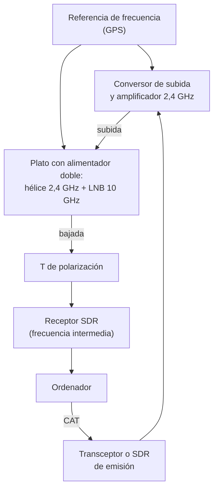

# Satélites

Con un portátil bibanda y una antena directiva que sostienes con la mano puedes hablar a través de un satélite que pasa a cientos de kilómetros de altura, y con una parabólica de televisión puedes oír, día y noche, un transpondedor fijo en el cielo que cubre media Tierra. En este capítulo aprenderás qué órbitas usan los satélites de aficionado y qué significa cada una para tu estación, en qué bandas y modos trabajan, cómo se corrige el efecto Doppler, cómo se trabajan los satélites FM y los lineales, qué hace falta para el QO-100, qué radio lleva la Estación Espacial Internacional y qué herramientas y organizaciones hay detrás. Para el examen interesan sobre todo los conceptos (órbitas, Doppler, transpondedores); el resto te servirá en tu primer pase.

Los satélites cambian deprisa: se lanzan nuevos, se averían, se quedan sin batería o reentran en la atmósfera. Aquí solo aparecen los que, en noviembre de 2026, figuraban en las listas de frecuencias de AMSAT y tenían informes recientes de estaciones que los habían oído en la [página de estado de AMSAT](https://status.amsat.org/) (comprobado el 10 de noviembre de 2026). Antes de salir a trabajar uno, comprueba que sigue activo.

Los indicativos de los ejemplos son **ficticios** y siguen la convención del [capítulo 10](10-operacion.md): llevan la cifra 0, que no puede coincidir con la de ninguna estación permanente.

## Las órbitas

### Por qué un satélite no se cae

Un satélite está cayendo siempre hacia la Tierra, pero avanza tan deprisa que el suelo se curva por debajo antes de que llegue a él. En una órbita circular, la velocidad necesaria y el tiempo que tarda en dar una vuelta, el **periodo**, solo dependen del radio de la órbita:

$$
v = \sqrt{\frac{\mu}{r}} \qquad\qquad T = 2\pi \sqrt{\frac{r^3}{\mu}}
$$

donde $r$ es el radio de la órbita medido desde el centro de la Tierra, en kilómetros (el radio terrestre, unos 6371 km, más la altura); $\mu = 398\,600\ \text{km}^3/\text{s}^2$ es la constante gravitatoria de la Tierra; $v$ sale en km/s y $T$ en segundos. Cuanto más alta es la órbita, más despacio va el satélite y más tarda en dar la vuelta.

**Ejemplo.** Un satélite a 800 km de altura tiene $r = 6371 + 800 = 7171\ \text{km}$. Su velocidad es $v = \sqrt{398\,600 / 7171} \approx 7{,}46\ \text{km/s}$ y su periodo, $T = 2\pi \sqrt{7171^3 / 398\,600} \approx 6040\ \text{s}$, unos **101 minutos**. Da unas 14 vueltas al día.

### La órbita baja

Casi todos los satélites de aficionado están en **órbita baja** (*LEO*, *low Earth orbit*), entre unos 400 y 1000 km de altura. Muchos son **cubesats**, satélites pequeños construidos por universidades y asociaciones, y suelen ir en órbitas casi polares, que con el giro de la Tierra los hacen pasar sobre cualquier punto del planeta varias veces al día.

Desde tu estación, un satélite de órbita baja solo se ve durante un **pase**: aparece por el horizonte (la **adquisición de señal**, *AOS*, de *acquisition of signal*), sube hasta una elevación máxima y desaparece por el lado contrario (la **pérdida de señal**, *LOS*, de *loss of signal*). El pase más largo es el que pasa justo por encima de tu cabeza. Mientras dura, tú y el satélite estáis dentro de su **huella**, la zona de la Tierra que lo ve sobre el horizonte; dos estaciones dentro de la huella a la vez pueden comunicar a través de él.

Si desprecias el giro de la Tierra, la huella tiene un radio, medido sobre la superficie, de $R \arccos(R/r)$, y el pase cenital dura la fracción $2\arccos(R/r)/360°$ del periodo, con $R$ el radio terrestre.

**Ejemplo.** Para el satélite anterior, $\arccos(6371/7171) \approx 27{,}3°$. La huella tiene un radio de $6371 \cdot 27{,}3° \cdot \pi/180° \approx 3040\ \text{km}$: desde la Península alcanza buena parte de Europa y el norte de África. Un pase cenital dura $2 \cdot 27{,}3/360 \cdot 101 \approx 15\ \text{min}$. Para una órbita de 400 km, del orden de la de la Estación Espacial Internacional (ISS, *International Space Station*), el pase cenital se queda en unos 10 minutos y la huella en unos 2200 km. Los pases bajos, que apenas asoman sobre el horizonte, duran mucho menos.

### La órbita geoestacionaria

Si la órbita está sobre el ecuador y su periodo coincide con el de rotación de la Tierra, el satélite gira a la vez que el suelo y parece quieto en el cielo. Es la **órbita geoestacionaria** (*GEO*, *geostationary orbit*). Despejando $r$ de la fórmula del periodo con $T = 86\,164\ \text{s}$ (un día sidéreo, el tiempo que tarda la Tierra en girar una vez respecto a las estrellas) sale $r \approx 42\,164\ \text{km}$, es decir, unos **35 786 km** sobre el ecuador.

Un satélite geoestacionario ve casi un hemisferio entero y no se mueve, así que la antena se apunta una vez y se deja fija. A cambio, está unas 45 veces más lejos que uno de órbita baja: la señal llega mucho más débil y tarda en ir y volver.

*Figura 13.1. A la izquierda, la órbita baja y la geoestacionaria a escala. A la derecha, el tramo de órbita baja que ve una estación durante un pase cenital.*

### Qué significa para ti

| | Órbita baja | Órbita geoestacionaria |
|---|---|---|
| Altura | 400 – 1000 km | 35 786 km |
| Visibilidad | Pases de 5 a 15 minutos | Permanente |
| Antena | Hay que seguir al satélite | Fija, apuntada una vez |
| Distancia y pérdidas | Pocas: basta un portátil | Muchas: parabólica y microondas |
| Efecto Doppler | Grande, hay que corregirlo | Prácticamente nulo |
| Retardo de ida y vuelta | Unos milisegundos | Un cuarto de segundo |
| Ejemplos | Satélites FM, lineales, la ISS | QO-100 |

!!! tip "Para el examen"
    Cuanto más alta la órbita, más lento el satélite y más largo el periodo: unos 90 a 100 minutos en órbita baja y un día sidéreo en la geoestacionaria, a 35 786 km sobre el ecuador. Los de órbita baja se oyen en pases cortos, con Doppler, y hay que seguirlos; el geoestacionario está fijo y no tiene Doppler apreciable.

## Modos y bandas

### En qué bandas trabajan

Los satélites usan las bandas de aficionado que ya viste en el [capítulo 5](05-propagacion-bandas.md#tabla-de-bandas). La [Orden IET/1311/2013](https://www.boe.es/buscar/act.php?id=BOE-A-2013-7624) te autoriza a emitir en las bandas del servicio de aficionados y del de aficionados por satélite, pero limita las emisiones de este último a las bandas que el CNAF le atribuye (artículo 5.3 de la Orden IET/1311/2013; comprobado en noviembre de 2026). La nota 5.282 del CNAF ([Cuadro Nacional de Atribución de Frecuencias](https://www.boe.es/buscar/act.php?id=BOE-A-2026-15661), aprobado por la Orden TDF/732/2026) permite el servicio de aficionados por satélite en 435 – 438 MHz, 1260 – 1270 MHz y 2400 – 2450 MHz, entre otras, siempre que no cause interferencias a otros servicios; en 1260 – 1270 MHz, solo en sentido Tierra-espacio (comprobado en noviembre de 2026).

Dentro de cada banda, el plan de la IARU Región 1 reserva tramos para los satélites, que viste en el [capítulo 9](09-reglamentacion/index.md#los-planes-de-2-m-y-70-cm): **145,806 – 146,000 MHz** en 2 m y **435 – 438 MHz** en 70 cm. No pongas ahí repetidores, hotspots ni contactos terrestres: un satélite oye media Europa a la vez, y tu señal le llega a él igual que a tu corresponsal.

Para nombrar el **modo** de un satélite se escriben dos letras: la de la banda de **subida** (de la Tierra al satélite), en mayúscula, y la de la de **bajada** (del satélite a la Tierra), en minúscula. **V** es 2 m, **U** es 70 cm, **a** es 10 m, **S** es 13 cm y **X**, 3 cm. Un satélite en **V/u** te escucha en 2 m y te contesta en 70 cm; uno en **U/v**, al revés. Algunos programas y listas usan aún la notación antigua de una sola letra (modo B, modo J), que verás en libros antiguos.

### Repetidores FM y transpondedores lineales

Hay dos formas de retransmitir:

- Un **repetidor FM** funciona como los repetidores terrestres del [capítulo 10](10-operacion.md#los-repetidores): recibe un solo canal de FM y lo vuelve a emitir en otra banda. Solo cabe un contacto a la vez, y quien llega con más señal tapa a los demás.
- Un **transpondedor lineal** recibe un tramo entero de banda, de 20 a 100 kHz en los de órbita baja, y lo vuelve a emitir en otra banda sin demodularlo, como un convertidor de frecuencia con amplificador. Dentro de ese **pasabanda** caben a la vez muchos contactos en BLU y en CW, cada uno en su frecuencia. Tiene que ser **lineal**, como el amplificador de BLU del [capítulo 4](04-teoria-radio.md#transmisor-de-blu), para no mezclar unas señales con otras.

Muchos transpondedores lineales son **inversores**: el borde inferior de la subida sale por el borde superior de la bajada, y la banda lateral también se invierte. Si subes en LSB, bajas en USB. La suma de las frecuencias de subida y de bajada es constante:

$$
f_{\text{subida}} + f_{\text{bajada}} = C
$$

donde $C$ es una constante propia de cada satélite. Verás enseguida por qué se diseñan así.

### Oírte a ti mismo

En los satélites se trabaja en **dúplex completo**: mientras transmites en una banda, escuchas tu propia señal de bajada en la otra. Es la única forma de saber si llegas al satélite, de ajustar la frecuencia con el Doppler y de no transmitir encima de nadie. Con un bibanda que lo permita, o con dos equipos, uno para cada banda, oyes tu voz retrasada unos milisegundos (o un cuarto de segundo en el geoestacionario). Usa auriculares: si el altavoz se oye en el micrófono, se acopla.

## El efecto Doppler

### Cuánto se desplaza la frecuencia

En el [capítulo 5](05-propagacion-bandas.md#efecto-doppler-y-satelites) viste la fórmula del Doppler, $\Delta f = f \cdot v/c$, donde $v$ es la velocidad con que el satélite se acerca o se aleja de ti. Esa velocidad, la **velocidad radial**, no es la orbital: solo cuenta la componente a lo largo de la línea que os une. Es máxima cuando el satélite aparece o desaparece por el horizonte y vale cero en el punto más cercano del pase. Para un pase cenital, la velocidad radial máxima es

$$
v_{\text{r,máx}} \approx v \cdot \frac{R}{r}
$$

con $v$ la velocidad orbital, $R$ el radio terrestre y $r$ el radio de la órbita, en las mismas unidades.

**Ejemplo.** Para el satélite a 800 km, $v_{\text{r,máx}} = 7{,}46 \cdot 6371 / 7171 \approx 6{,}6\ \text{km/s}$. Si su bajada está en 436,795 MHz, al aparecer la recibes $436{,}795 \cdot 10^6 \cdot 6{,}62 / 299\,792 \approx 9{,}6\ \text{kHz}$ por **encima** de la nominal; al desaparecer, 9,6 kHz por **debajo**. En su subida de 145,850 MHz el desplazamiento es tres veces menor, unos 3,2 kHz.

Lo que más se nota no es el desplazamiento en sí, sino lo deprisa que cambia cerca del punto más alto de un pase cenital: en un par de minutos la frecuencia salta de un extremo a otro.

*Figura 13.2. Desplazamiento Doppler en 437 MHz durante un pase cenital y un pase bajo, de unos 10° de elevación máxima, de un satélite a 800 km (cálculo sin el giro de la Tierra).*

### Cómo se corrige en un satélite FM

El receptor de FM del satélite tolera unos kilohercios de error, y el de tu portátil también. En la práctica:

- Corriges sobre todo la frecuencia de **70 cm**, que es la que más se desplaza. La de 2 m la dejas en su valor nominal.
- Programas varias memorias para el pase, en pasos de 5 kHz. Para una bajada en 436,795 MHz: 436,805 al principio, 436,800, 436,795 en el centro, 436,790 y 436,785 al final. Vas saltando de una a otra según la oyes peor.
- Si la frecuencia de 70 cm es la de subida (satélite en U/v), aplicas la corrección al revés: transmites **por debajo** de la nominal al principio del pase, porque el satélite, que se acerca, te recibirá más arriba.

### Cómo se corrige en un satélite lineal

En un transpondedor lineal la exigencia es mayor: en BLU, 100 Hz de error ya cambian la voz. El objetivo es que tu señal se quede **siempre en el mismo punto del pasabanda** del satélite, para que tu corresponsal no tenga que perseguirte. La pauta habitual cuando se corrige a mano es dejar fija la frecuencia de la banda más baja y ajustar continuamente la de la más alta, que es la que más se mueve; si todos lo hacen igual, todas las señales derivan a la vez y despacio. Los programas de seguimiento lo hacen mejor: calculan el Doppler de las dos frecuencias y las corrigen a la vez por el control CAT de la radio que viste en el [capítulo 12](12-modos-digitales.md#la-radio-y-el-ordenador).

Aquí se ve la ventaja del transpondedor **inversor**. Si subes con un Doppler a favor, el satélite te recibe más alto; al invertir, te devuelve más bajo, y la bajada suma su propio Doppler en sentido contrario. En primera aproximación, el desplazamiento total que oyes es

$$
\Delta f_{\text{total}} \approx \frac{v_r}{c}\,\left(f_{\text{bajada}} - f_{\text{subida}}\right)
$$

en un transpondedor inversor, frente a $\frac{v_r}{c}\,(f_{\text{bajada}} + f_{\text{subida}})$ en uno que no invierte.

**Ejemplo.** En un satélite V/u inversor con la subida en 145,965 MHz y la bajada en 435,640 MHz, con $v_r = 6{,}62\ \text{km/s}$, tu propia señal se desplaza $6{,}62 / 299\,792 \cdot (435{,}640 - 145{,}965) \cdot 10^{6} \approx 6{,}4\ \text{kHz}$. Si el transpondedor no invirtiera, serían $6{,}62 / 299\,792 \cdot (435{,}640 + 145{,}965) \cdot 10^{6} \approx 12{,}8\ \text{kHz}$, el doble.

!!! tip "Para el examen"
    El Doppler es proporcional a la frecuencia y a la velocidad radial: máximo al aparecer y al desaparecer el satélite, cero en el punto más cercano, y con el signo cambiado entre una mitad y otra del pase. Cuando el satélite se acerca, la frecuencia recibida sube. En 70 cm el desplazamiento es tres veces mayor que en 2 m.

## Satélites FM de órbita baja

### Los que puedes trabajar

Son la puerta de entrada a los satélites: se trabajan con equipo de FM normal. Estos son los repetidores FM de órbita baja con informes de escucha en los días anteriores al 10 de noviembre de 2026, con los datos de la [lista de satélites FM de AMSAT](https://www.amsat.org/live-fm-satellites/) (actualizada el 31 de octubre de 2026; comprobado en noviembre de 2026):

| Satélite | Subida (MHz) | Bajada (MHz) | Tono CTCSS | Observaciones |
|---|---|---|---|---|
| SO-50 | 145,850 | 436,795 | 67 Hz | Se activa con 2 s de portadora con tono de 74,4 Hz; queda encendido 10 minutos |
| AO-123 | 145,850 | 435,400 | 67 Hz | |
| ISS | 145,990 | 437,800 | 67 Hz | Repetidor de la Estación Espacial; se ve más adelante |

Los dos primeros comparten la frecuencia de subida, pero no suelen pasar a la vez; el programa de seguimiento te dice cuál está sobre el horizonte. El tono de activación del SO-50 se manda solo cuando el repetidor está apagado: si ya lo oyes, transmite con el tono normal de 67 Hz.

### El equipo

Para empezar te basta con:

- Un **portátil bibanda** de 2 m y 70 cm, que admita tonos CTCSS y memorias. Si puede transmitir en una banda y escuchar en la otra a la vez (dúplex completo), mejor; si no, un segundo portátil o un receptor SDR para la bajada.
- Una **antena directiva de mano**: una Yagi bibanda ligera, con dos o tres elementos para 2 m y algunos más para 70 cm en el mismo boom, como la del [capítulo 6](06-antenas-lineas.md#antena-yagi). Su ganancia compensa la poca potencia y su directividad rechaza el ruido de los alrededores.
- **Auriculares** y una **grabadora** (o la del móvil) para anotar después los indicativos que oíste, porque durante el pase tienes las dos manos ocupadas.

Con la antena en la mano sigues al satélite por el cielo y, además, giras la antena sobre su eje cuando la señal se desvanece. La polarización de la onda que llega cambia a lo largo del pase, porque el satélite gira sobre sí mismo y porque la ionosfera hace rotar el plano de polarización (**efecto Faraday**). Una antena de polarización circular, como las del [capítulo 6](06-antenas-lineas.md#antenas-de-apertura-parabolicas-y-bocinas), reduce el problema; con la Yagi de mano lo resuelves con la muñeca.

**Ejemplo: por qué importa la elevación.** La distancia al satélite de 800 km es de 800 km cuando está en la vertical y de unos 3290 km cuando asoma por el horizonte. La pérdida en el espacio libre del [capítulo 5](05-propagacion-bandas.md#atenuacion-en-el-espacio-libre) en 145,85 MHz pasa de $32{,}44 + 20 \log 800 + 20 \log 145{,}85 \approx 133{,}8\ \text{dB}$ a 146,1 dB: **12,3 dB** más, casi como pasar de 5 W a 0,3 W. Por eso los primeros y los últimos minutos del pase son los más difíciles, y una Yagi de unos 7 dBi frente a la antena de goma del portátil marca la diferencia.

### El seguimiento del pase

Antes de salir, el programa de seguimiento te da para cada pase la hora de aparición, la de máxima elevación y la de desaparición, y la dirección (**azimut**) y la altura sobre el horizonte (**elevación**) en cada momento. Con una brújula y esa tabla sabes por dónde aparecerá el satélite y hacia dónde irá. Para el primer intento elige un pase que suba por encima de 30° o 40°: es más largo y la señal es más fuerte.

Un satélite que pasa cerca de la vertical recorre el cielo muy deprisa en el centro del pase; si sigues la trayectoria con la antena por encima de tu cabeza en lugar de girarte, no pierdes la señal.

### Cómo es un contacto

En un repetidor FM caben pocas estaciones y el pase dura minutos, así que los contactos son mínimos: los dos **indicativos** y el **cuadrado del localizador** de cada uno, que es lo que se usa para los diplomas. Por ejemplo, entre dos estaciones con indicativos ficticios:

> —ED0QXV, IN80.  
> —ED0QXV, de EA0JKW, IM87.  
> —EA0JKW, gracias, IM87 copiado. ED0QXV.

Las normas de convivencia son las del [capítulo 10](10-operacion.md#la-etica-del-radioaficionado), llevadas al extremo:

- **No transmitas si no oyes el satélite.** Si no lo oyes, no sabes si está encendido ni si hay alguien hablando.
- **Escucha antes**, comprueba que te oyes y no repitas la llamada sin parar: un repetidor ocupado por una sola estación es inútil para todos.
- **Usa la potencia mínima** que te permita oírte. Más potencia no te hace mejor operador; solo tapa a los demás.
- Un contacto por pase con la misma estación es suficiente, y deja hueco a quien está pidiendo su primer contacto.

!!! example "En la práctica"
    Antes de transmitir, dedica algunos pases solo a escuchar. Aprenderás cuánto cambia el Doppler, cuándo se oye mejor y cómo suenan los contactos. Cuando te decidas, prueba en un pase alto, con la Yagi, de 2 a 5 W y los auriculares puestos. Si al final del pase te sobran indicativos, anota los que oíste y comunica en la [página de estado de AMSAT](https://status.amsat.org/) que el satélite funciona: así ayudas a mantener al día la información que usas.

## Satélites lineales

### Cómo se trabajan

Los transpondedores lineales se trabajan en BLU y en CW, normalmente con un transceptor multibanda con dúplex completo o con dos equipos, cada uno con su antena para 2 m y 70 cm, y casi siempre con el ordenador corrigiendo el Doppler. Al haber sitio para varios contactos a la vez, son más tranquilos que los FM y permiten conversaciones algo más largas.

El procedimiento básico es: sintoniza la bajada en un hueco libre del pasabanda, transmite unas palabras o unos puntos de CW y mueve la subida hasta que te oigas en la bajada. A partir de ahí, corrige el Doppler para no moverte del sitio. La **baliza** de cada satélite, una señal continua de telemetría en una frecuencia fija, te sirve para comprobar que lo recibes antes de transmitir.

Como con cualquier BLU, la potencia se ajusta para que tu señal en la bajada no sea más fuerte que la de la baliza: el transpondedor reparte su potencia entre todas las señales que entran, y una estación demasiado fuerte se la quita a las demás.

### Los que puedes trabajar

Estos tenían informes de escucha en los días anteriores al 10 de noviembre de 2026, con los datos de la [lista de satélites lineales de AMSAT](https://www.amsat.org/live-linear-satellites/) (actualizada el 31 de octubre de 2026; comprobado en noviembre de 2026):

| Satélite | Modo | Subida (MHz) | Bajada (MHz) | Inversor | Observaciones |
|---|---|---|---|---|---|
| RS-44 | V/u | 145,935 – 145,995 (LSB) | 435,610 – 435,670 (USB) | Sí | Baliza de CW en 435,605 MHz |
| FO-29 | V/u | 145,900 – 146,000 (LSB) | 435,800 – 435,900 (USB) | Sí | Se enciende según un horario, mientras tenga energía; baliza de CW en 435,795 MHz |
| AO-7 | U/v | 432,125 – 432,175 (LSB) | 145,925 – 145,975 (USB) | Sí | Solo funciona con luz solar |
| AO-7 | V/a | 145,850 – 145,950 (USB) | 29,400 – 29,500 (USB) | No | Solo funciona con luz solar; bajada en 10 m |
| JO-97 | U/v | 435,100 – 435,120 (LSB) | 145,855 – 145,875 (USB) | Sí | Sin telemetría, pero el transpondedor funciona |
| AO-73 | U/v | 435,130 – 435,150 (LSB) | 145,950 – 145,970 (USB) | Sí | Transpondedor solo en eclipse; en los informes recientes se oye casi siempre solo la telemetría |

**Ejemplo con el RS-44.** La constante del transpondedor es $C = 145{,}935 + 435{,}670 = 581{,}605\ \text{MHz}$, y sale lo mismo con el otro extremo: $145{,}995 + 435{,}610 = 581{,}605$. Si quieres bajar en 435,640 MHz, el centro del pasabanda, subes en $581{,}605 - 435{,}640 = 145{,}965\ \text{MHz}$, en LSB, y te oirás en USB. Estas son las frecuencias nominales, vistas desde el satélite; en el aire hay que sumarles el Doppler del apartado anterior.

## El QO-100

### Qué es

El **QO-100** es un transpondedor de aficionado instalado en el satélite geoestacionario de comunicaciones **Es'hail-2**, de la empresa catarí Es'hailSat, fruto de un proyecto conjunto con la asociación de radioaficionados de Catar (QARS) y AMSAT-DL. Está en la órbita geoestacionaria a **25,9° Este** ([web del receptor del QO-100 del BATC](https://eshail.batc.org.uk/); comprobado en noviembre de 2026). Desde Europa, África, Oriente Medio, buena parte de Asia y el este de Brasil se ve las 24 horas, sin Doppler apreciable, con una antena fija.

Tiene dos transpondedores, que suben en 13 cm y bajan en 3 cm (modo S/x). Los datos son del [plan de banda estrecha de AMSAT-DL](https://amsat-dl.org/en/p4-a-nb-transponder-bandplan-and-operating-guidelines/), del [plan de banda ancha de AMSAT-DL](https://amsat-dl.org/en/p4-a-wb-transponder-bandplan-and-operating-guidelines/) y de la [lista de satélites lineales de AMSAT](https://www.amsat.org/live-linear-satellites/) (comprobados en noviembre de 2026):

| | Banda estrecha (NB) | Banda ancha (WB) |
|---|---|---|
| Uso | BLU, CW y modos digitales estrechos | Televisión digital de aficionado (DATV) |
| Subida | 2400,000 – 2400,500 MHz | 2401,500 – 2409,500 MHz |
| Bajada | 10 489,500 – 10 490,000 MHz | 10 491,000 – 10 499,000 MHz |
| Polarización | Subida circular a derechas; bajada vertical | — |
| Balizas | 10 489,500 y 10 490,000 MHz (CW); 10 489,750 MHz (BPSK) | 10 491,5 MHz (DVB-S2) |

El transpondedor de banda estrecha **no es inversor**: la diferencia entre bajada y subida es constante, de 8089,5 MHz. Si subes en 2400,200 MHz en USB, te oyes en $2400{,}200 + 8089{,}5 = 10\,489{,}700\ \text{MHz}$, también en USB.

*Figura 13.3. Plan de banda del transpondedor estrecho del QO-100, según AMSAT-DL. «Dig.» son los modos digitales de hasta 500 Hz de ancho; «Digital», los de hasta 2700 Hz.*

### Las normas del transpondedor estrecho

AMSAT-DL publica unas normas de operación que conviene saberse antes de transmitir (comprobadas en noviembre de 2026):

- Tu señal en la bajada **no puede ser más fuerte que la baliza**. Si lo es, el transpondedor se satura y perjudica a todos; un sistema automático marca con una señal de alarma a las estaciones demasiado fuertes, que tienen que bajar potencia en el acto.
- **Nada de FM** ni de ninguna modulación de más de 2700 Hz de ancho, ni de voz digital del tipo C4FM o D-STAR.
- No transmitas por debajo de la baliza inferior ni por encima de la superior, y deja libres las bandas de guarda de las balizas.
- **Dúplex completo obligatorio**: tienes que poder oír tu propia bajada mientras transmites.
- Nada de pasarelas ni de retransmitir otras señales, salvo en comunicaciones de socorro. El plan reserva en la bajada una **frecuencia de emergencia** en 10 489,860 MHz.

En el transpondedor ancho, el plan de AMSAT-DL pide emisiones breves, en DVB-S2 siempre que sea posible, y con la mínima potencia: una emisión QPSK debe llegar con una densidad de potencia al menos 1 dB por debajo de la de la baliza (comprobado en noviembre de 2026).

### Visibilidad desde España

Toda España ve el QO-100 hacia el **sureste**, a una elevación de entre unos 30° y 40°, sin obstáculos que salvar salvo los edificios o los montes de tu horizonte. El azimut y la elevación salen de la posición del satélite y de la tuya; estos son los de algunas capitales (cálculo propio para un satélite a 25,9° E):

| Lugar | Azimut | Elevación | Distancia al satélite |
|---|---|---|---|
| A Coruña | 135° | 29° | 38 670 km |
| Madrid | 139° | 34° | 38 240 km |
| Sevilla | 134° | 35° | 38 150 km |
| Barcelona | 146° | 36° | 38 070 km |
| Las Palmas de Gran Canaria | 118° | 34° | 38 240 km |

El azimut se mide desde el norte geográfico, no desde el magnético. Con una brújula, tienes que corregir la **declinación magnética** de tu zona, que en España es de pocos grados; la forma más fina de apuntar es mover el plato poco a poco mientras miras en la pantalla del receptor la baliza.

**Ejemplo.** Desde Madrid, tu señal recorre $2 \cdot 38\,240 = 76\,480\ \text{km}$ hasta que vuelve a tu receptor, y tarda $76\,480 / 299\,792 \approx 0{,}26\ \text{s}$. En un contacto en BLU oyes tu voz con un cuarto de segundo de retraso, y la pérdida en el espacio libre de la bajada, en 10 489,75 MHz, es de $32{,}44 + 20 \log 38\,240 + 20 \log 10\,489{,}75 \approx 204{,}5\ \text{dB}$. Esa enorme pérdida es la razón de que haga falta una parabólica.

### La recepción

La bajada se recibe con el mismo material que la televisión por satélite:

- Una **parabólica** de 60 cm a 1 m. En el [capítulo 6](06-antenas-lineas.md#antenas-de-apertura-parabolicas-y-bocinas) calculaste que un plato de 80 cm tiene unos 36,7 dBi en 10 489,5 MHz.
- Un **LNB** (*low noise block*), el conversor de bajo ruido que va en el foco del plato. Amplifica la señal y la baja a una **frecuencia intermedia** que se lleva por cable coaxial al receptor; con un oscilador local de 9750 MHz, la baliza inferior sale en $10\,489{,}5 - 9750 = 739{,}5\ \text{MHz}$. El LNB se alimenta por el mismo coaxial, con una **T de polarización** (*bias tee*) que inyecta la tensión continua.
- Un **receptor SDR** que cubra esa frecuencia intermedia, conectado al ordenador.

El problema es la estabilidad. Un error de solo 25 partes por millón en el oscilador de 9750 MHz desplaza la señal $9750 \cdot 10^6 \cdot 25 \cdot 10^{-6} \approx 244\ \text{kHz}$, la mitad del transpondedor, y además deriva con la temperatura. En BLU necesitas acertar en unas decenas de hercios. Por eso se usan LNB con oscilador enganchado a una referencia externa, a menudo un oscilador disciplinado por GPS, y programas que miden la **baliza** y corrigen automáticamente cualquier desviación.

Antes de montar nada, puedes oír el transpondedor por Internet en el [receptor web del BATC](https://eshail.batc.org.uk/), que muestra en directo el de banda estrecha y el espectro del de banda ancha (comprobado en noviembre de 2026).

### La transmisión

Para subir en 2400 MHz necesitas un transmisor de 13 cm: un **transversor** o **conversor de subida** que lleve a esa banda la señal de un transceptor o de un SDR, un amplificador de algunos vatios y una antena que ilumine el mismo plato con polarización circular a derechas. Es habitual un **alimentador doble** en el foco: una hélice o un parche para la subida de 2,4 GHz y la bocina del LNB para la bajada.

*Figura 13.4. Estación para el transpondedor estrecho del QO-100: subida en 13 cm y bajada en 3 cm por el mismo plato, con la misma referencia de frecuencia para los dos conversores.*

Antes de transmitir, ten en cuenta qué te permite la normativa española en 13 cm.

**El régimen general.** La disposición adicional segunda de la [Orden IET/1311/2013](https://www.boe.es/buscar/act.php?id=BOE-A-2013-7624), en la redacción de la Orden IET/614/2015, incluye la banda de 2300 – 2450 MHz, salvo el tramo de 2316 a 2332 MHz, entre las que solo puedes usar con una **autorización especial**, como prevé el artículo 16 de la Orden IET/1311/2013 para las bandas secundarias con riesgo de interferencia ([capítulo 9](09-reglamentacion/espanol.md#autorizaciones-especiales)). La subida del QO-100, en 2400 MHz, cae dentro. Como la banda es secundaria, su límite de potencia es de 500 W de p. i. r. e., la mitad de los 1000 W de la tabla del apartado 3.1 del anexo I de la Orden IET/1311/2013, por el apartado 3.2 del anexo I de la Orden IET/1311/2013 ([capítulo 5](05-propagacion-bandas.md#la-regla-del-50-en-las-bandas-secundarias)) (comprobado en noviembre de 2026).

**La autorización para el QO-100.** Para la subida al satélite, el Ministerio no te pide que solicites nada por tu cuenta: desde 2009 dicta cada año una resolución de uso temporal y experimental que vale para **todos los titulares** de una autorización de radioaficionado. La vigente es de diciembre de 2025 y te permite transmitir, desde cualquier punto de España y **hasta el 26 de diciembre de 2026**, con estas condiciones:

- solo en **2400 – 2410 MHz**;
- con **1500 W de p. i. r. e.** como máximo;
- con antenas directivas de **21,5 dBi o más**;
- solo hacia el **QO-100**, en 25,9° E;
- sin causar interferencias a otros servicios ni reclamar protección frente a ellas.

Antes de transmitir, comprueba que la resolución se ha prorrogado para el año en curso en la página de [autorizaciones de uso temporal y experimental](https://digital.gob.es/telecomunicaciones-infraestructuras-digitales/areas-interes/espectro-radioelectrico/radioaficionados-cb27/autorizaciones/autorizacion-uso-temporal) del Ministerio para la Transformación Digital y de la Función Pública. Fuera de esa autorización, por ejemplo en otra parte de la banda o hacia otro destino, se aplica el régimen general: autorización especial y 500 W de p. i. r. e. (comprobado en noviembre de 2026).

**Interferencias ICM.** La banda de 2400 – 2450 MHz está destinada a aplicaciones industriales, científicas y médicas, como el wifi o los hornos de microondas, y por el apartado 3.4 del anexo I de la Orden IET/1311/2013 tienes que aceptar sus interferencias (comprobado en noviembre de 2026).

**Ejemplo: la p. i. r. e. de tu estación.** La ganancia de un plato es $G = \eta\,(\pi D/\lambda)^2$, como en el [capítulo 6](06-antenas-lineas.md#antenas-de-apertura-parabolicas-y-bocinas), con $\eta$ su rendimiento, $D$ su diámetro y $\lambda$ la longitud de onda, en las mismas unidades. En 2400 MHz, $\lambda \approx 12{,}5\ \text{cm}$. Un plato de 75 cm con $\eta = 0{,}6$ tiene $G = 0{,}6 \cdot (\pi \cdot 75 / 12{,}5)^2 \approx 213$, unos 23,3 dBi. Supera los 21,5 dBi que exige la autorización, y con 2 W la p. i. r. e. es $2 \cdot 213 \approx 427\ \text{W}$, dentro del límite de 1500 W. Con un plato de 1,2 m (27,4 dBi) y 10 W llegarías a unos 5470 W, más de tres veces y media el límite; con ese plato, la potencia máxima es $1500 / 549 \approx 2{,}7\ \text{W}$. En microondas, la ganancia de la antena hace casi todo el trabajo.

La ganancia mínima también cuenta. Un plato de 60 cm, con el mismo rendimiento, da $G = 0{,}6 \cdot (\pi \cdot 60 / 12{,}5)^2 \approx 137$, unos 21,4 dBi: justo en el límite, una décima por debajo. Cumplirlo depende de su rendimiento real, que tendría que ser del 62 % como mínimo. Con un plato algo mayor, de 75 cm o más, no tienes esa duda.

!!! danger "Peligro"
    Un plato concentra la potencia en un haz estrecho, y justo delante del alimentador la densidad de potencia es la más alta de toda la instalación. Comprueba con los cálculos del [capítulo 3](03-seguridad.md#pire-y-distancia-de-seguridad) que se respetan los niveles de referencia donde pueda haber personas, no te pongas delante del plato con el transmisor encendido y apágalo antes de tocar el alimentador.

## La Estación Espacial Internacional

### La radio a bordo

La **Estación Espacial Internacional** (ISS) lleva estaciones de radioaficionado gestionadas por el programa internacional **ARISS** (*Amateur Radio on the International Space Station*). A 4 de noviembre de 2026, según la [página de estado de ARISS](https://www.ariss.org/current-status-of-iss-stations.html), estaban instalados (comprobado en noviembre de 2026):

- En el laboratorio europeo **Columbus**, un transceptor Kenwood D710GA, con el indicativo NA1SS, **en modo repetidor de voz**, y un sistema de televisión de aficionado (HamTV) emitiendo una señal de prueba en 2395 MHz.
- En el módulo de servicio ruso **Zvezda**, otro D710GA, con el indicativo RS0ISS, todavía en pruebas, con el **APRS activo en 437,825 MHz**.

Los informes de estaciones de tierra en la [página de estado de AMSAT](https://status.amsat.org/) confirman entre el 5 y el 10 de noviembre de 2026 el repetidor, el APRS en 70 cm y la SSTV; el digipeater de 2 m no se oía (comprobado el 10 de noviembre de 2026).

### Las frecuencias

Estas son las frecuencias que publica [ARISS](https://www.ariss.org/contact-the-iss.html) (comprobadas en noviembre de 2026). No todos los modos están activos a la vez:

| Uso | Subida | Bajada |
|---|---|---|
| Voz con la tripulación (Región 1) | 145,200 MHz | 145,800 MHz |
| Repetidor FM | 145,990 MHz (CTCSS 67 Hz) | 437,800 MHz |
| Paquetes y APRS en 2 m | 145,825 MHz | 145,825 MHz |
| Paquetes y APRS en 70 cm | 437,825 MHz | 437,825 MHz |
| SSTV | — | 437,550 MHz |

**Nunca transmitas en 145,800 MHz**, la bajada de voz: es la frecuencia que escuchan en todo el mundo para oír a los astronautas. Para hablar con ellos se sube en 145,200 MHz desde la Región 1. Los astronautas solo hacen contactos no programados en su tiempo libre, y no a diario, así que oírlos es una suerte.

### El repetidor y el APRS

El **repetidor** se trabaja exactamente como un satélite FM, con el mismo equipo y las mismas normas. La ISS está en una órbita del orden de 400 km, más baja que la de los satélites anteriores: los pases son más cortos y el Doppler algo mayor. Con una velocidad radial máxima de unos 7,2 km/s, la bajada de 437,800 MHz llega desplazada hasta unos ±10,5 kHz, y la subida de 145,990 MHz, unos ±3,5 kHz.

El **APRS** de la ISS funciona como un digipeater del [capítulo 12](12-modos-digitales.md#digipeaters-e-igates) en órbita: repite los paquetes que recibe y las estaciones de tierra con iGate los pasan a Internet. Con una ruta que use el alias ARISS, un portátil con APRS y un mensaje corto puedes ver tu posición en los mapas de Internet, recogida a cientos de kilómetros. Comprueba antes en qué banda está activo, porque cambia según la radio que funcione.

### La SSTV

En fechas anunciadas, la ISS emite imágenes en **SSTV** (*televisión de barrido lento*, del [capítulo 12](12-modos-digitales.md#sstv)). Basta con un receptor de FM, una antena sencilla y un programa que descodifique el audio. El último evento comprobado empezaba el 9 de noviembre de 2026 a las 17:45 UTC y acababa el 16 de noviembre a las 08:15 UTC, en 437,550 MHz, en el modo **Robot 36**, con una imagen cada dos minutos aproximadamente; quien envía sus imágenes descodificadas a la galería de ARISS recibe un certificado ([eventos de SSTV de ARISS](https://www.ariss.org/upcoming-sstv-events.html); comprobado en noviembre de 2026). Es una de las mejores formas de estrenarte: no transmites nada y la señal es fuerte.

### Los contactos ARISS

El objetivo principal de ARISS es educativo: organiza **contactos programados** entre un astronauta y un centro escolar, en los que los alumnos hacen sus preguntas durante los diez minutos de un pase, tras meses de preparación. ARISS estima que organiza entre 60 y 100 contactos al año. Se hacen desde una estación instalada en el propio centro o a través de una estación de tierra que enlaza con la escuela (*telebridge*).

En Europa se solicitan a **ARISS-Europe** con un formulario en línea, en convocatorias anuales. La de 2026 estuvo abierta del 1 de septiembre al 23 de octubre de 2026, para contactos entre julio y diciembre de 2027, y la organización advierte de que no puede garantizar que cada contacto se realice ([convocatoria de ARISS-Europe](https://www.ariss-eu.org/index.php/school-contacts/announcement); comprobado en noviembre de 2026). Si tu radioclub colabora con un colegio, es un proyecto que merece la pena preparar con tiempo.

## Software y servicios de seguimiento

### Los elementos orbitales

Para saber dónde estará un satélite, el programa necesita sus **elementos orbitales**: unos pocos números que describen la órbita en un instante dado. El formato tradicional son los **TLE** (*two-line elements*), que en radioafición también se llaman **elementos keplerianos**. Los programas los introducen en el modelo matemático SGP4, el que usan casi todos los programas de seguimiento, y calculan la posición en cualquier momento. Con el tiempo, el rozamiento con la atmósfera y otras perturbaciones alejan la órbita real de la calculada, así que los elementos hay que **actualizarlos**: según AMSAT, una vez por semana basta para la mayoría de los satélites de aficionado, pero la ISS, que corrige su órbita a menudo, necesita elementos diarios ([recursos de elementos keplerianos de AMSAT](https://www.amsat.org/keplerian-elements-resources/); comprobado en noviembre de 2026).

La fuente más usada es [CelesTrak](https://celestrak.org/NORAD/elements/), que tiene un grupo específico de satélites de aficionado. Ojo con un cambio reciente: el 11 de julio de 2026 se acabaron los números de catálogo de cinco cifras, y los objetos catalogados desde entonces tienen números de seis cifras que el formato TLE no admite. Para ellos solo hay elementos en los formatos nuevos (**OMM**, en XML, JSON o texto), así que comprueba que tu programa los lee (comprobado en noviembre de 2026).

### Los programas

- **Gpredict** es un programa de seguimiento en tiempo real, con mapas, listas de pases y control de la radio y del rotor de antenas a través de los servidores rigctld y rotctld de la biblioteca Hamlib; así corrige el Doppler y apunta la antena él solo. La última versión es la 2.7, del 1 de noviembre de 2026; para Linux hay paquetes y una versión en Flatpak, y en macOS se instala con MacPorts o Homebrew ([versiones de Gpredict](https://github.com/csete/gpredict/releases); comprobado en noviembre de 2026).
- La [predicción de pases de AMSAT](https://www.amsat.org/track/) funciona en el navegador: eliges el satélite, introduces tu posición o tu cuadrado del localizador y te da los próximos pases, con las horas, el azimut y la elevación (comprobado en noviembre de 2026).

### El estado de los satélites

La [página de estado de AMSAT](https://status.amsat.org/) recoge los informes que envían los operadores: para cada satélite y cada modo, si se oyó funcionando, si solo se oyó la telemetría o si no se oyó, con la hora y el localizador de quien lo informa. Es la mejor forma de saber si merece la pena esperar a un pase, y tus propios informes la mantienen al día.

## La organización: AMSAT

### AMSAT

**AMSAT** (*Radio Amateur Satellite Corporation*) nació en 1969 en Washington, como organización educativa sin ánimo de lucro, para fomentar la participación de los radioaficionados en la investigación y las comunicaciones espaciales. Su antecedente fue el **Project OSCAR**, que lanzó el primer satélite de aficionado, el OSCAR 1, el 12 de diciembre de 1961 ([AMSAT](https://www.amsat.org/about-amsat/); comprobado en noviembre de 2026). De ahí vienen las designaciones de los satélites: cuando uno funciona en órbita, AMSAT puede asignarle un **número OSCAR** (*Orbiting Satellite Carrying Amateur Radio*), precedido de una letra que suele indicar el país o la organización que lo construyó, y una O de OSCAR: SO-50, AO-123.

Hoy hay organizaciones AMSAT en casi treinta países, independientes entre sí, que construyen satélites, coordinan proyectos y publican información ([AMSATs en el mundo](https://www.amsat.org/amsats-around-the-world/); comprobado en noviembre de 2026). Algunas de las que verás citadas:

- **AMSAT-DL**, en Alemania, socia del proyecto QO-100 y autora de sus planes de banda.
- **AMSAT-UK**, en el Reino Unido, que aloja la página de coordinación de frecuencias de la IARU.
- **AMSAT-EA**, en España: una asociación cultural sin ánimo de lucro, con sede en Madrid, dedicada al estudio, la difusión y el desarrollo de satélites, que ostenta la vocalía de satélites de la URE. Ha construido y puesto en órbita varios satélites pequeños, como los de la serie HADES, con repetidores y modos digitales para los radioaficionados; varios ya han reentrado en la atmósfera, así que consulta en [su web](https://www.amsat-ea.org/) cuáles siguen activos (comprobado en noviembre de 2026).

### La coordinación de frecuencias

Un satélite oye y emite sobre medio continente, así que sus frecuencias no se pueden elegir a la ligera. El **panel de coordinación de frecuencias de satélites de la IARU** asesora a quienes construyen satélites de aficionado y coordina sus frecuencias para que no se interfieran entre sí ni salgan de los tramos de satélites; lleva más de mil solicitudes tramitadas ([coordinación de satélites de la IARU](https://www.iaru.org/reference/satellites/); comprobado en noviembre de 2026). Además, el número 25.11 del [Reglamento de Radiocomunicaciones](https://www.itu.int/pub/R-REG-RR-2024), edición de 2024, obliga a la administración que autoriza un satélite de aficionado a asegurarse de que, **antes del lanzamiento**, hay estaciones terrenas de control suficientes para suprimir de inmediato cualquier interferencia perjudicial que cause, como viste en el [capítulo 9](09-reglamentacion/internacional.md#el-articulo-25-las-reglas-del-servicio) (comprobado en noviembre de 2026). La nota 5.282 del CNAF remite a ese número para las bandas de satélites (comprobado en noviembre de 2026).

## Resumen

- Los satélites de **órbita baja** (400 – 1000 km) dan una vuelta en 90 a 100 minutos y se ven en **pases** de 5 a 15 minutos; los **geoestacionarios**, a 35 786 km sobre el ecuador, están fijos en el cielo.
- El modo se nombra con la banda de subida en mayúscula y la de bajada en minúscula: **V/u** sube en 2 m y baja en 70 cm. Los tramos de satélites del plan de la IARU son 145,806 – 146,000 MHz y 435 – 438 MHz.
- Un **repetidor FM** atiende un contacto a la vez; un **transpondedor lineal** retransmite un pasabanda entero en BLU y CW, y si es **inversor** reduce el Doppler total.
- El **Doppler** es máximo al aparecer y al desaparecer el satélite, cero en el punto más cercano, y tres veces mayor en 70 cm que en 2 m. En FM se corrige con memorias en pasos de 5 kHz; en los lineales, mejor con el ordenador.
- Para los satélites FM bastan un **portátil bibanda**, una **Yagi de mano**, auriculares y una tabla de pases. Contactos cortos: indicativo y localizador; no transmitas si no oyes el satélite.
- El **QO-100** está a 25,9° E. Su transpondedor estrecho sube en 2400,0 – 2400,5 MHz y baja en 10 489,5 – 10 490,0 MHz, sin invertir. Desde España se ve hacia el sureste a unos 30° – 40°. Tu señal no debe superar la baliza. En España, una resolución anual del Ministerio autoriza a todos los radioaficionados a subir al QO-100 en 2400 – 2410 MHz con hasta **1500 W de p. i. r. e.** y antenas de **21,5 dBi** o más; la vigente vale hasta el 26 de diciembre de 2026. Fuera de ella, 13 cm requiere **autorización especial** y su límite es de 500 W de p. i. r. e.
- La **ISS** lleva un repetidor FM (145,990 / 437,800 MHz), APRS, SSTV y voz; **nunca transmitas en 145,800 MHz**. ARISS organiza contactos con escuelas.
- Los programas de seguimiento necesitan **elementos orbitales** actualizados (TLE u OMM). **AMSAT**, con sus organizaciones nacionales como AMSAT-EA, construye y mantiene los satélites, y la **IARU** coordina sus frecuencias.

## Autoevaluación

**1.** Un satélite está en una órbita circular a 800 km de altura. ¿Cuál es aproximadamente su periodo? (Radio terrestre 6371 km; $\mu = 398\,600\ \text{km}^3/\text{s}^2$.)

a) 24 horas  
b) 101 minutos  
c) 45 minutos  
d) 12 horas

??? success "Solución"
    **b)** $r = 7171\ \text{km}$ y $T = 2\pi\sqrt{7171^3/398\,600} \approx 6040\ \text{s}$, unos 101 minutos. Las 24 horas corresponden, más exactamente, a un día sidéreo en la órbita geoestacionaria, a 35 786 km; ninguna órbita alrededor de la Tierra tiene un periodo de 45 minutos, porque incluso rozando la superficie el periodo es de unos 84 minutos.

**2.** Escuchas el repetidor de la ISS en 437,800 MHz cuando la estación aparece por el horizonte y se acerca a unos 7 km/s. ¿Dónde la oyes?

a) Unos 10 kHz por debajo de 437,800 MHz  
b) Unos 10 kHz por encima de 437,800 MHz  
c) Unos 3,4 kHz por encima de 437,800 MHz  
d) Exactamente en 437,800 MHz

??? success "Solución"
    **b)** $\Delta f = 437{,}8 \cdot 10^{6} \cdot 7 / 299\,792 \approx 10{,}2\ \text{kHz}$, y como se acerca, la frecuencia recibida sube. Los 3,4 kHz serían el desplazamiento en 2 m, tres veces menor. Recibirías la frecuencia nominal solo en el punto más cercano del pase, cuando la velocidad radial es cero.

**3.** ¿Por qué no hace falta seguir al QO-100 con la antena ni corregir su Doppler?

a) Porque emite con mucha potencia.  
b) Porque está en órbita geoestacionaria y no se mueve respecto a tu estación.  
c) Porque su transpondedor no es inversor.  
d) Porque usa polarización circular.

??? success "Solución"
    **b)** En la órbita geoestacionaria el satélite gira a la vez que la Tierra: no cambia de posición en tu cielo, así que la antena se queda fija, y sin velocidad radial no hay Doppler apreciable. La deriva que sí tienes que corregir es la de tu propio LNB, no la del satélite.

**4.** Quieres oírte en 435,655 MHz a través del RS-44, cuya subida va de 145,935 a 145,995 MHz y cuya bajada va de 435,610 a 435,670 MHz, con un transpondedor inversor. ¿En qué frecuencia nominal subes?

a) 145,950 MHz  
b) 145,980 MHz  
c) 145,965 MHz  
d) 145,995 MHz

??? success "Solución"
    **a)** En un inversor la suma es constante: $145{,}935 + 435{,}670 = 581{,}605\ \text{MHz}$, así que subes en $581{,}605 - 435{,}655 = 145{,}950\ \text{MHz}$. La b) sale de suponer que no invierte (desplazar la subida en el mismo sentido que la bajada); la c) es el centro del pasabanda.

**5.** Un satélite FM de órbita baja está en tu vertical a 800 km. Al principio del pase estaba a unos 3290 km. ¿Cuántos decibelios más de pérdida en el espacio libre tenías al principio?

a) Unos 6 dB  
b) Unos 12 dB  
c) Unos 24 dB  
d) Ninguno, porque la frecuencia es la misma

??? success "Solución"
    **b)** La pérdida crece con $20 \log d$: $20 \log (3290 / 800) \approx 12{,}3\ \text{dB}$. La frecuencia es la misma, pero la distancia no. Por eso los pases altos son los más fáciles y por eso conviene una antena directiva.

**6.** Estás en un pase del SO-50 y no oyes el satélite. ¿Qué haces?

a) Llamas igualmente, por si te oye alguien.  
b) Subes la potencia al máximo.  
c) No transmites hasta oír el satélite.  
d) Transmites en 145,800 MHz.

??? success "Solución"
    **c)** Si no lo oyes, no sabes si está encendido, si está sobre tu horizonte ni si hay alguien hablando, y una llamada a ciegas solo estorba. En el SO-50, si está apagado, se activa con 2 s de portadora con tono de 74,4 Hz, pero solo cuando el pase ya ha empezado. La d) es la bajada de voz de la ISS, en la que nunca se transmite.

**7.** Desde Madrid, ¿hacia dónde apuntas el plato para recibir el QO-100?

a) Al sur exacto, a unos 45° de elevación.  
b) Al sureste, a unos 34° de elevación.  
c) Al suroeste, a unos 34° de elevación.  
d) Al este, a 10° de elevación.

??? success "Solución"
    **b)** El QO-100 está sobre el ecuador a 25,9° E, al este de Madrid, así que lo ves hacia el sureste: unos 139° de azimut y 34° de elevación. Desde cualquier punto de España lo verás hacia el sureste, entre unos 30° y 40° de elevación.

**8.** Usas para la subida del QO-100 un plato de 1,2 m con 27,4 dBi en 2400 MHz. Si la autorización para el QO-100 fija un límite de 1500 W de p. i. r. e., ¿qué potencia máxima puedes aplicar a la antena?

a) Unos 1500 W  
b) Unos 0,9 W  
c) Unos 2,7 W  
d) Unos 55 W

??? success "Solución"
    **c)** 27,4 dBi equivalen a $10^{2{,}74} \approx 549$ veces, y la p. i. r. e. es la potencia por la ganancia: $1500 / 549 \approx 2{,}7\ \text{W}$. La a) olvida la ganancia de la antena; la b) aplica los 500 W del régimen general, que no es el de esta autorización; la d) divide entre 27,4 dB como si fueran veces. En microondas, con platos grandes, el límite de p. i. r. e. se alcanza con muy poca potencia.

**9.** ¿Para qué sirven los elementos orbitales (TLE u OMM) en un programa de seguimiento?

a) Para fijar el tono CTCSS de cada satélite.  
b) Para calcular la posición del satélite en cada momento y, con ella, los pases, el apuntado y el Doppler.  
c) Para identificar la estación en la telemetría.  
d) Para conocer el estado de las baterías del satélite.

??? success "Solución"
    **b)** Describen la órbita en un instante, y el modelo SGP4 calcula a partir de ellos dónde estará el satélite. De esa posición salen las horas de los pases, el azimut y la elevación, y la velocidad radial con que se corrige el Doppler. Como la órbita real se aparta con el tiempo, hay que actualizarlos: semanalmente para la mayoría de los satélites de aficionado y a diario para la ISS.
