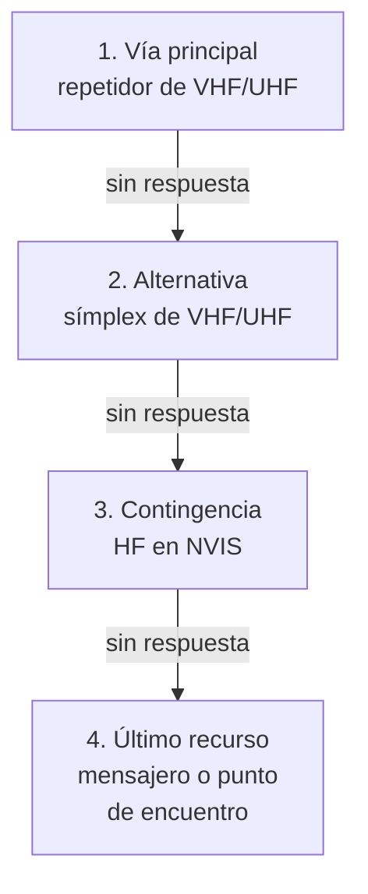

# Comunicaciones de emergencia

Cuando una riada, un incendio o un apagón largo dejan sin servicio la telefonía y los datos móviles, una estación de radio con su propia batería y su propia antena sigue funcionando. Por eso la radioafición tiene un papel reconocido en las emergencias, tanto en la normativa internacional como en la española. En este capítulo aprenderás qué te permite y qué te exige la ley española en una emergencia, cómo se organiza la colaboración con Protección Civil a través de la REMER, qué frecuencias recomienda la IARU, cómo se reconocen las señales de socorro, urgencia y seguridad, y cómo prepararte de verdad: un plan de comunicaciones con alternativas, la energía para que funcione, un equipo listo para salir, la disciplina de una red dirigida y el formato de los mensajes. Al final, en una página aparte, verás por qué [Meshtastic](meshtastic.md), muy popular en este campo, no es radioafición.

## El marco legal en España

### Lo que dice la orden

El artículo 30 de la [Orden IET/1311/2013, de 9 de julio, por la que se aprueba el Reglamento de uso del dominio público radioeléctrico por radioaficionados](https://www.boe.es/buscar/act.php?id=BOE-A-2013-7624#a30), contiene las tres reglas que importan en una emergencia (comprobado en noviembre de 2026):

- **Tráfico de terceros.** El artículo 30.3 de la Orden IET/1311/2013 solo permite transmitir comunicaciones **en nombre de terceros** en casos de **emergencia o desastre**. Fuera de ellos, no puedes pasar por radio el mensaje de otra persona, aunque te lo pida.
- **Obligación de colaborar.** El artículo 30.4 de la Orden IET/1311/2013 obliga a todo titular de una autorización a colaborar con sus medios radioeléctricos, **en las bandas de aficionado**, cuando se lo requiera la Dirección General de Protección Civil y Emergencias del Ministerio del Interior, en operaciones de socorro y seguridad en caso de catástrofe.
- **Comunicaciones de socorro.** Según el artículo 30.5 de la Orden IET/1311/2013, si captas una comunicación de socorro tienes que hacer lo posible para que llegue cuanto antes a esa Dirección General.

Recuerda que la regla del cifrado no se suspende en una emergencia: el artículo 30.2 de la Orden IET/1311/2013 prohíbe codificar las transmisiones para ocultar su significado (comprobado en noviembre de 2026). Si los mensajes contienen datos de personas, piensa antes qué hace falta transmitir de verdad, porque cualquiera puede escucharlos.

La obligación del artículo 30.4 de la Orden IET/1311/2013 es **legal**, como viste en el [capítulo 9](../09-reglamentacion/espanol.md#lo-que-dice-el-articulo-30). Encaja con el deber general de la [Ley 17/2015, de 9 de julio, del Sistema Nacional de Protección Civil](https://www.boe.es/buscar/act.php?id=BOE-A-2015-7730): según el artículo 7 bis de la Ley 17/2015, los ciudadanos están obligados a colaborar, personal o materialmente, en la protección civil cuando lo requiera la autoridad competente (comprobado en noviembre de 2026).

??? note "Para saber más"
    El [Real Decreto 328/2026, de 22 de abril](https://www.boe.es/buscar/doc.php?id=BOE-A-2026-9079), creó en el Ministerio del Interior la **Secretaría General de Protección Civil y Emergencias**, que asume las funciones que tenía la Dirección General y de la que esta pasa a depender (comprobado en noviembre de 2026). Las órdenes de 2013 y de 2018 que verás en este capítulo siguen hablando de la Dirección General, y la web de Protección Civil ya habla de la Secretaría General. Es el mismo caso que el de los organismos antiguos de la orden, del [capítulo 9](../09-reglamentacion/index.md#por-que-la-orden-habla-de-organismos-que-ya-no-existen).

### Lo que dice el Reglamento de Radiocomunicaciones

El artículo 30 de la orden traslada a España dos reglas del artículo 25 de la [edición de 2024 del Reglamento de Radiocomunicaciones](https://www.itu.int/pub/R-REG-RR-2024) de la UIT, que viste en el [capítulo 9](../09-reglamentacion/internacional.md#el-articulo-25-las-reglas-del-servicio) (comprobado en noviembre de 2026):

- El número **25.3** limita las comunicaciones internacionales **en nombre de terceros** a las situaciones de emergencia o de socorro en caso de desastre, y deja a cada administración decidir si aplica esa disposición a sus estaciones.
- El número **25.9A** insta a las administraciones a preparar a sus estaciones de aficionado para dar comunicaciones en apoyo de las operaciones de socorro.

### La REMER

La **Red Nacional de Radio de Emergencia** (**REMER**) es la red de radioaficionados de Protección Civil. La regula la [Orden INT/1149/2018, de 29 de octubre, por la que se regula la organización y el funcionamiento de la Red Nacional de Radio de Emergencia](https://www.boe.es/buscar/act.php?id=BOE-A-2018-14902), cuyo texto consolidado no ha cambiado desde su publicación (comprobado en noviembre de 2026). La [página de la REMER](https://www.proteccioncivil.es/coordinacion/redes/remer) en la web de Protección Civil la sigue presentando como red activa (comprobado en noviembre de 2026). Lo esencial de la Orden INT/1149/2018 (comprobado en noviembre de 2026):

- **Qué es.** Según el artículo 1 de la Orden INT/1149/2018, una red de ámbito estatal **alternativa y complementaria** a las demás redes de comunicaciones de Protección Civil. Su objetivo, según el artículo 2 de la Orden INT/1149/2018, es recoger información sobre la emergencia y hacer llegar mensajes a quien no tenga otros medios de comunicación operativos.
- **Quién la forma.** Radioaficionados acreditados, que son **colaboradores voluntarios permanentes** del Sistema Nacional de Protección Civil y usan **sus propios equipos** (artículo 3 de la Orden INT/1149/2018).
- **Quién puede entrar.** Según el artículo 8 de la Orden INT/1149/2018, las personas mayores de edad residentes en España, españolas o extranjeras, con **autorización de radioaficionado en vigor** y sin sanciones en materia de radioaficionados, previa solicitud y autorización expresa. La solicitud se puede presentar en la sede electrónica del Ministerio del Interior o en la Delegación o Subdelegación del Gobierno (artículo 9 de la Orden INT/1149/2018), y la pertenencia se renueva cada tres años (artículo 10 de la Orden INT/1149/2018). La orden no prevé la entrada de usuarios de la banda ciudadana.
- **Cómo se organiza.** Según el artículo 5 de la Orden INT/1149/2018, hay una estación directora central en el Centro Nacional de Seguimiento y Coordinación de Emergencias (**CENEM**), estaciones directoras provinciales en las Delegaciones y Subdelegaciones del Gobierno, estaciones de zona donde la provincia las organice y las estaciones fijas, móviles y portátiles de los colaboradores.
- **Quién la activa.** Según el artículo 6 de la Orden INT/1149/2018, el director general en el ámbito nacional y los delegados y subdelegados del Gobierno en el de su comunidad autónoma o provincia, cuando haga falta recoger información o dar soporte de comunicaciones porque los canales habituales tienen limitaciones.
- **Qué frecuencias usa.** El artículo 7 de la Orden INT/1149/2018 distingue dos cosas. Las **frecuencias REMER** son de Protección Civil, que tiene la autorización, y solo las usan los miembros de la red con los modos definidos para ella. Las **bandas de aficionado** están abiertas a cualquier radioaficionado al que se lo requiera Protección Civil.

En situaciones de emergencia declaradas, el artículo 8.4 de la Orden INT/1149/2018 permite incorporar a la REMER, de forma extraordinaria y temporal, a radioaficionados que no pertenecen a ella (comprobado en noviembre de 2026). Y el artículo 7 quáter.3 de la Ley 17/2015 reconoce que la red de comunicaciones de emergencia formada por radioaficionados voluntarios puede complementar las de los servicios de protección civil (comprobado en noviembre de 2026).

Además de la REMER, las asociaciones de radioaficionados y algunas comunidades autónomas y ayuntamientos tienen sus propios grupos de emergencia. Si te interesa, infórmate en tu zona: cada grupo tiene su organización, sus frecuencias y sus ejercicios, y lo importante es que sepas a quién te debes en una emergencia antes de que ocurra.

!!! tip "Para el examen"
    Tres ideas: el tráfico **en nombre de terceros** solo se permite en **emergencia o desastre** (artículo 30.3 de la Orden IET/1311/2013 y número 25.3 del Reglamento de Radiocomunicaciones); colaborar con Protección Civil cuando te lo requiere es una **obligación**, en las **bandas de aficionado** (artículo 30.4 de la Orden IET/1311/2013); y si captas una llamada de **socorro**, tienes que hacerla llegar a Protección Civil (artículo 30.5 de la Orden IET/1311/2013).

### Los centros de actividad de emergencia de la IARU

El plan de HF de la IARU Región 1, en vigor desde el 16 de octubre de 2020, señala estos **centros de actividad de emergencia**; el ámbito de cada uno es el que les da el *HF Manager's Handbook* de la misma región (comprobado en noviembre de 2026):

| Frecuencia | Ámbito |
|---|---|
| 3760 kHz | Región 1 |
| 7110 kHz | Región 1 |
| 14 300 kHz | Mundial |
| 18 160 kHz | Mundial |
| 21 360 kHz | Mundial |

Son los mismos del apartado 2.1.5 del [HF Manager's Handbook](https://www.iaru-r1.org/reference/handbooks/), que viste en el [capítulo 10](../10-operacion.md#si-la-frecuencia-es-de-todos), y los tienes en el plan de HF del [capítulo 9](../09-reglamentacion/index.md#el-plan-de-hf). No son frecuencias reservadas ni exclusivas: son puntos de encuentro para que las estaciones que manejan tráfico de emergencia se encuentren sin buscar. Si no participas en una emergencia, no llames CQ en ellas y déjalas libres si hay tráfico.

El procedimiento de emergencia en HF de la IARU, adoptado por las tres regiones y publicado en la [página de procedimientos de emergencia de la IARU Región 1](https://www.iaru-r1.org/about-us/committees-and-working-groups/emcomm/emergency-operating-procedures/), da una regla sencilla: si oyes la palabra «emergency» o la abreviatura **QUF**, **deja de transmitir y escucha**. Anota lo que oigas, no abandones la frecuencia hasta estar seguro de que no puedes ayudar y otro lo está haciendo, y no transmitas hasta estar seguro de que puedes ayudar (comprobado en noviembre de 2026).

## Las señales de socorro, urgencia y seguridad

El temario del examen incluye las señales internacionales de socorro, urgencia y seguridad (punto 4 de la parte segunda del [anexo II de la Orden IET/1311/2013](https://www.boe.es/buscar/act.php?id=BOE-A-2013-7624#anii); comprobado en noviembre de 2026). Las define el capítulo VII del [Reglamento de Radiocomunicaciones](https://www.itu.int/pub/R-REG-RR-2024), pensado sobre todo para los barcos: según su número 30.1, contiene las disposiciones del sistema mundial de socorro y seguridad marítimos y las de las llamadas de socorro, urgencia y seguridad por radiotelefonía en 156,8 MHz, el canal 16 de la banda marina (comprobado en noviembre de 2026). Pero las tres señales son universales, y tienes que reconocerlas oigas donde las oigas.

| Señal | Se pronuncia | Qué indica | RR |
|---|---|---|---|
| **MAYDAY** | «medé» | **Socorro**: una unidad móvil o una persona está amenazada por un peligro grave e inminente y necesita auxilio inmediato | 32.9 y 32.13BA |
| **PAN PAN** | «pan pan» | **Urgencia**: la estación tiene que transmitir un mensaje muy urgente sobre la seguridad de una unidad móvil o de una persona | 33.10 y 33.11 |
| **SÉCURITÉ** | como en francés | **Seguridad**: la estación tiene que transmitir un aviso náutico o meteorológico importante | 33.33 y 33.34 |

En la llamada, cada señal se transmite **tres veces**. En la de socorro le siguen las palabras «THIS IS» y el nombre de la estación en peligro, también tres veces: «MAYDAY MAYDAY MAYDAY, THIS IS…» (número 32.13C). En las de urgencia y seguridad, antes de «THIS IS» va el nombre de la estación llamada o «ALL STATIONS», tres veces (números 33.12 y 33.35). Las transmisiones se hacen despacio, separando bien las palabras, y con el cuadro de deletreo cuando haga falta (números 32.6 y 32.7). La estación que coordina el tráfico de socorro puede imponer silencio con la señal **SILENCE MAYDAY**, pronunciada «siláns medé» (número 32.47), y ninguna estación que no participe en ese tráfico ni esté en peligro puede transmitir en su frecuencia hasta que se anuncie que ha terminado (número 32.49). En telegrafía y en los modos digitales se usa la abreviatura **QUF**, «he recibido la señal de socorro», de la Recomendación UIT-R M.1172, a la que remite el número 32.7 y que el Reglamento incorpora por referencia en su volumen 4 (todo comprobado en noviembre de 2026).

Dos reglas te afectan directamente como radioaficionado:

- **Nada impide pedir auxilio.** Según el número 4.9 del Reglamento de Radiocomunicaciones, ninguna disposición del Reglamento puede impedir a una estación en peligro, ni a la que la asiste, usar todos los medios de radiocomunicación de que disponga para llamar la atención, señalar su estado y su posición y obtener o prestar auxilio (comprobado en noviembre de 2026). En una situación de peligro real, la frecuencia y la banda pasan a segundo plano.
- **Si la oyes, haz que llegue.** El artículo 30.5 de la Orden IET/1311/2013 te obliga a hacer lo posible para que la comunicación de socorro que captes llegue cuanto antes a Protección Civil, como viste al principio del capítulo. En la práctica: deja de transmitir, anota todo (hora, frecuencia, quién llama, dónde está, qué le pasa, qué necesita) y llama al **112**. No respondas ni intentes coordinar nada salvo que seas la única estación que la oye y puedas ayudar de verdad.

!!! danger "Peligro"
    No uses nunca MAYDAY ni PAN PAN para probar el equipo ni en broma, ni siquiera en un simulacro: en un ejercicio, los mensajes van marcados como de ejercicio y no llevan estas señales. Una falsa llamada de socorro moviliza medios de rescate que pueden faltar en otro sitio.

## El plan de comunicaciones

### Alternativas escalonadas

Una emergencia no es el momento de improvisar. Un **plan de comunicaciones** dice, por escrito y antes de que haga falta, cómo te vas a comunicar, con quién y qué haces si la primera opción falla. La idea central es tener **varias vías independientes**, ordenadas de la más cómoda a la más robusta, y pasar a la siguiente según una regla acordada, no a ojo.



*Figura 15.1. Plan de comunicaciones con cuatro vías escalonadas.*

Cada paso resuelve el fallo del anterior:

1. **Vía principal: un repetidor.** Da la mayor cobertura con portátiles, pero depende de una instalación que puede quedarse sin energía o sin antena.
2. **Alternativa: símplex.** Sin repetidor, de equipo a equipo. Menos alcance, pero no depende de nadie. Conviene tener elegidas de antemano una o dos frecuencias símplex libres según el plan de bandas.
3. **Contingencia: HF.** En 80 o 60 m, y en 40 m de día, la propagación por incidencia casi vertical (**NVIS**) cubre un círculo de unos cientos de kilómetros sin depender de la visión directa ni de ninguna infraestructura. La viste en el [capítulo 5](../05-propagacion-bandas.md#incidencia-casi-vertical-nvis).
4. **Último recurso: sin radio.** Un mensajero, una nota en un sitio acordado o un punto de encuentro a una hora fija.

Para cada vía, el plan anota la frecuencia o el canal, el modo, el tono si lo hay, y **cuándo se pasa a la siguiente**: por ejemplo, después de tres llamadas sin respuesta separadas un minuto, o si no hay contacto a la hora en punto. Las horas fijas de escucha (por ejemplo, los cinco primeros minutos de cada hora) ahorran batería: nadie tiene que estar escuchando todo el día.

!!! example "En la práctica"
    Un plan familiar ficticio cabe en una tarjeta plastificada: «Vía 1: repetidor de la zona. Vía 2: símplex en la frecuencia acordada. Vía 3: 40 m a las horas en punto, de 9 a 21 h. Si no hay contacto en 24 horas: punto de encuentro acordado a las 12 h». Lleva una copia en cada equipo y otra en la mochila. Y pruébalo: un plan que nadie ha probado no es un plan.

### Qué información tiene que estar en papel

En una emergencia, el móvil puede estar sin batería y el ordenador, sin red. Imprime y guarda junto al equipo:

- El propio plan, con todas las frecuencias, modos y tonos.
- Los indicativos y los nombres de las estaciones con las que tienes que contactar.
- Las instrucciones básicas de tus equipos: cómo cambiar de canal, de potencia y de tono a mano, sin el programa del ordenador.
- Impresos de mensaje en blanco y un registro de la estación.

## La energía

### Por qué es lo primero que falla

En un apagón, la radio funciona mientras dure la batería. La autonomía es la diferencia entre colaborar tres horas o tres días, y se calcula con lo que ya viste en el [capítulo 2](../02-electricidad-electronica.md#energia-y-capacidad-de-las-baterias).

Un transceptor consume mucho más transmitiendo que recibiendo. Si transmite una fracción $D$ del tiempo, la **corriente media** es:

$$
I_\text{media} = D \cdot I_\text{TX} + (1 - D) \cdot I_\text{RX}
$$

donde $I_\text{TX}$ es la corriente en transmisión y $I_\text{RX}$ la corriente en recepción, en amperios, y $D$ es la fracción de tiempo en transmisión, entre 0 y 1. La **autonomía** es la capacidad útil de la batería dividida por esa corriente:

$$
t = \frac{C \cdot p}{I_\text{media}}
$$

donde $t$ está en horas, $C$ es la capacidad nominal en amperios hora y $p$ es la **profundidad de descarga** que admite la batería sin dañarse, entre 0 y 1.

La profundidad de descarga depende del tipo de batería. Las de **plomo** se estropean si se descargan mucho: para que duren, no conviene pasar del 50 %. Las de **litio-ferrofosfato** (**LiFePO₄**) admiten descargas mucho más profundas, del orden del 80 % o más, y pesan menos de la mitad para la misma energía. Son las más usadas hoy en portable y en emergencias. Comprueba siempre lo que dice el fabricante de la tuya.

**Ejemplo.** Un transceptor móvil de VHF/UHF consume 10 A transmitiendo y 0,8 A recibiendo. En una red de emergencia, transmite el 10 % del tiempo. La corriente media es

$$
I_\text{media} = 0{,}10 \cdot 10 + 0{,}90 \cdot 0{,}8 = 1{,}72\ \text{A}
$$

Con una batería LiFePO₄ de 12,8 V y 40 Ah descargada hasta el 80 %:

$$
t = \frac{40 \cdot 0{,}8}{1{,}72} = \frac{32}{1{,}72} \approx 18{,}6\ \text{h}
$$

La misma capacidad en plomo, descargada solo hasta el 50 %, da $20 / 1{,}72 \approx 11{,}6$ horas. Y si la red está muy activa y transmites el 25 % del tiempo, la corriente media sube a 3,1 A y la LiFePO₄ dura solo unas 10,3 horas. Por eso la **disciplina de red** también ahorra energía: cada transmisión inútil cuesta batería.

Ten en cuenta que estas cifras son optimistas: la capacidad baja con el frío, con las corrientes altas y con la edad de la batería. Deja siempre un margen.

### Recargar con el sol

Un **panel solar** permite seguir operando cuando el apagón dura días. Lo que produce en un día depende de las **horas solares pico** (**HSP**): el número de horas equivalentes a pleno sol, que varía con la estación, el lugar y las nubes. A esa energía hay que descontar las pérdidas del regulador, de los cables y de la carga de la batería, que se resumen en un **rendimiento global** $\eta$:

$$
E = P_\text{panel} \cdot \text{HSP} \cdot \eta
$$

donde $E$ es la energía diaria en vatios hora, $P_\text{panel}$ la potencia nominal del panel en vatios, HSP las horas solares pico y $\eta$ el rendimiento, entre 0 y 1.

**Ejemplo.** Un panel de 100 W, en un día de invierno con 3 horas solares pico y un rendimiento global de 0,75, produce $100 \cdot 3 \cdot 0{,}75 = 225$ Wh, unos 17,6 Ah a 12,8 V. El transceptor del ejemplo anterior gasta en 24 horas $1{,}72 \cdot 24 \approx 41{,}3$ Ah, unos 528 Wh. Para reponerlos cada día con esas condiciones harían falta unos

$$
P_\text{panel} = \frac{528}{3 \cdot 0{,}75} \approx 235\ \text{W}
$$

de panel. Con 100 W, la batería se vacía poco a poco, aunque mucho más despacio. Si no puedes tener tanto panel, reduce el consumo: menos potencia, menos tiempo de transmisión y horas fijas de escucha en lugar de escucha continua.

Entre el panel y la batería va siempre un **regulador de carga** adecuado a la química de la batería; nunca conectes el panel directamente.

### Los portátiles

Un portátil de mano tiene la misma cuenta a menor escala. **Ejemplo.** Un portátil con una batería de 7,4 V y 2000 mAh (unos 14,8 Wh) consume 1,5 A transmitiendo y 0,15 A recibiendo. Con un 10 % de transmisión, la corriente media es $0{,}10 \cdot 1{,}5 + 0{,}90 \cdot 0{,}15 = 0{,}285$ A, y descargando el 90 % de la batería dura $2 \cdot 0{,}9 / 0{,}285 \approx 6{,}3$ horas. Para una jornada completa, lleva una batería de repuesto cargada o un portapilas para pilas alcalinas, que se encuentran en cualquier tienda incluso cuando no hay electricidad.

!!! danger "Peligro"
    Una batería grande en un sitio improvisado es un riesgo. Pon siempre un **fusible** en el positivo, lo más cerca posible de la batería, y calculado para el consumo del equipo. Usa el cargador adecuado a su química, no la cargues sin vigilancia ni sobre superficies inflamables y, si es de plomo, cárgala en un lugar ventilado. Los detalles están en el [capítulo 3](../03-seguridad.md#baterias). Y nunca uses un grupo electrógeno en un espacio cerrado: el monóxido de carbono no se ve ni se huele.

## El equipo preparado

Una emergencia no te da tiempo a buscar el cable que falta. Ten un equipo preparado, revisado y en un sitio conocido, que puedas coger y llevarte en minutos. Una lista orientativa:

- [ ] Un **portátil** de VHF/UHF con su batería cargada, una de repuesto y un portapilas.
- [ ] Una **antena** mejor que la de serie para el portátil y una antena exterior sencilla, con cable coaxial y adaptadores.
- [ ] Si tienes HF, un **transceptor** y una **antena de hilo** que puedas tender rápido, con cuerda.
- [ ] **Batería** principal cargada, con fusible y cables con conectores de los que se usen en tu grupo.
- [ ] **Cargadores**: de red, de mechero de coche y, si lo tienes, regulador y panel solar.
- [ ] **Auriculares**, para oír en sitios ruidosos sin molestar.
- [ ] Un **receptor** de radiodifusión con pilas, para seguir las noticias y los avisos oficiales.
- [ ] **Papel**: el plan de comunicaciones, la lista de frecuencias, impresos de mensaje, el registro, lápices y bolígrafos.
- [ ] **Linterna** o frontal, pilas de repuesto, cinta aislante, una navaja multiusos.
- [ ] Ropa de abrigo, agua, comida para un día y tus medicinas, si las tomas.
- [ ] Una **copia de tu autorización** y, si perteneces a un grupo, tu acreditación.

Revisa el equipo cada pocos meses: las baterías se descargan solas, los cables se pierden y las listas de frecuencias cambian. Una buena costumbre es revisarlo cada vez que cambies la hora del reloj en primavera y en otoño.

## La red dirigida

### Por qué hace falta un director

En una emergencia, muchas estaciones quieren transmitir a la vez y casi todas tienen algo importante que decir. Si cada uno llama cuando quiere, la frecuencia se colapsa. La solución es una **red dirigida** (*directed net*): una **estación de control de la red** (*net control station*, **NCS**) decide quién transmite y cuándo. Ninguna estación transmite sin que el control se lo permita, salvo para pasar un mensaje de emergencia. La guía de emergencias de la IARU lo resume así: en una red dirigida, el control lleva todas las operaciones de la red (*IARU Emergency Telecommunications Guide*, revisión 1 de septiembre de 2016, [publicada por la IARU](https://www.iaru.org/reference/resources-for-member-societies/iaru-emergency-telecommunications-guide/); comprobado en noviembre de 2026).

La estación de control:

- **Abre la red**: anuncia para qué es, quién la controla y cómo se va a trabajar.
- **Pide altas** (*check-ins*), a menudo primero las estaciones con tráfico de emergencia, después las demás.
- **Lleva la lista** de estaciones presentes, dónde está cada una y qué mensajes tiene pendientes.
- **Da paso** a cada estación para que pase su mensaje, por orden de prioridad.
- **Manda a otra frecuencia** a dos estaciones que tienen mucho que hablar, para que no ocupen la red.
- **Cierra la red** o la entrega a otra estación de control en el relevo de turno.

Lo contrario es una **red abierta**, en la que las estaciones se llaman directamente. Funciona cuando hay poco tráfico, y suele empezar así una emergencia hasta que alguien asume el control.

### Cómo se trabaja en ella

Un ejemplo de red dirigida en fonía, con indicativos ficticios (el distrito 0 no existe en España):

```text
EA0ZZZ:  Aquí EA0ZZZ, estación de control de la red de ejercicio. Red dirigida.
         Estaciones con tráfico de emergencia, llamen ahora.
         (silencio)
         Sin tráfico de emergencia. Altas, por favor, solo indicativo.
EB0QQQ:  EB0QQQ.
EC0XXX:  EC0XXX, con tráfico.
EA0ZZZ:  Recibido EB0QQQ y EC0XXX con tráfico. ¿Alguna estación más?
         (silencio)
         EC0XXX, pase su tráfico.
EC0XXX:  EA0ZZZ de EC0XXX, un mensaje prioridad para el puesto de mando, cambio.
EA0ZZZ:  EC0XXX de EA0ZZZ, adelante con el mensaje, cambio.
```

Reglas de una buena estación en red:

- **Escucha antes de nada.** Entra en la red en silencio y entiende cómo funciona antes de darte de alta.
- **Altas breves**: tu indicativo y, si lo tienes, «con tráfico». Nada de saludos ni de informes de señal.
- **No transmitas sin permiso del control**, salvo una emergencia. Si es una emergencia, dilo: «emergencia» o «tráfico de emergencia».
- **Piensa antes de pulsar** y habla claro, sin prisa. Deletrea con el alfabeto de la UIT ([capítulo 10](../10-operacion.md#el-alfabeto-de-deletreo)) los nombres propios y lo que pueda confundirse.
- **Avisa si te vas** de la red o cambias de lugar.
- **Identifícate** como siempre: al principio y al final de cada emisión, y al menos cada diez minutos en las largas, según el artículo 29 de la Orden IET/1311/2013 ([capítulo 9](../09-reglamentacion/espanol.md#como-identificas-tus-emisiones)).

## El formato de los mensajes

### Por qué un formato fijo

En una red de emergencia no se charla: se pasan **mensajes**. Un mensaje bien formado llega a su destino tal como salió, aunque pase por varias estaciones, y permite comprobar que no se ha perdido ni se ha cambiado nada. La regla de oro del procedimiento de la IARU es que el mensaje llegue a su destino escrito exactamente como lo dio el que lo originó. Por eso el que lo origina lo escribe primero, en estilo telegráfico, con un destinatario y una firma suficientes (comprobado en noviembre de 2026).

### El radiograma de la IARU

El *HF International Emergency Operating Procedure* de la IARU, publicado en la [página de procedimientos de emergencia de la IARU Región 1](https://www.iaru-r1.org/about-us/committees-and-working-groups/emcomm/emergency-operating-procedures/), define un mensaje con cuatro partes: **preámbulo**, **dirección**, **texto** y **firma** (comprobado en noviembre de 2026). El preámbulo lo compone la estación que mete el mensaje en la red de radioaficionados, y lleva estos datos **en este orden**:

| Campo | Qué es |
|---|---|
| **Número** | Número de serie que da al mensaje la estación de origen |
| **Precedencia** | La importancia del mensaje (ver más abajo) |
| **Estación de origen** | Indicativo de la estación que lo transmitió por primera vez |
| **Control** (*check*) | Número de palabras del texto |
| **Lugar de origen** | Pueblo, ciudad o barco desde donde se envía |
| **Hora** | Hora en que se originó, en UTC |
| **Fecha** | Fecha en que se originó |

La **precedencia** del procedimiento puede ser **emergencia** (*emergency*), **prioridad** (*priority*, abreviada P) o **rutina** (*routine*, abreviada R). La guía de emergencias de la IARU de 2016 añade una cuarta, **salud y bienestar** (*health and welfare*), para las preguntas y noticias sobre el estado o el paradero de las personas de la zona afectada, y fija el orden de despacho: primero emergencia, después prioridad, después salud y bienestar y, por último, rutina (comprobado en noviembre de 2026). La IARU Región 1 publica también un [impreso de mensaje](https://www.iaru-r1.org/wp-content/uploads/2019/09/IARU-msg1.pdf) con esos campos y un recuadro para que el operador anote de quién lo recibió y a quién lo pasó, con fecha y hora.

Para las redes de FM en VHF, donde la comunicación es más fácil, el mismo procedimiento admite un **preámbulo corto** con solo el número, la estación de origen y la hora.

**Ejemplo.** Un mensaje ficticio, con un pueblo y un indicativo inventados:

```text
NR 7 P EA0ZZZ 14 VALDEPRUEBA 1435 MAR 12
PUESTO DE MANDO AVANZADO VALDEPRUEBA
NECESITAMOS DOS GRUPOS ELECTROGENOS Y AGUA POTABLE PARA CIEN PERSONAS
EN EL POLIDEPORTIVO MUNICIPAL
ALCALDIA DE VALDEPRUEBA
```

Es el mensaje número 7, de precedencia prioridad, que EA0ZZZ metió en la red; su texto tiene 14 palabras; se originó en Valdeprueba a las 14:35 UTC del 12 de marzo. Cuenta las palabras del texto: *necesitamos, dos, grupos, electrógenos, y, agua, potable, para, cien, personas, en, el, polideportivo, municipal*. Son 14, y por eso el control es 14. La estación que lo recibe cuenta las palabras: si no le salen 14, sabe que ha perdido o ha añadido algo y pide que se lo repitan.

Algunas costumbres que ayudan:

- **Textos cortos.** La guía de la IARU recomienda, cuando se pueda, no pasar de 25 palabras (comprobado en noviembre de 2026).
- **Sin tildes ni signos**, que no se transmiten bien en todos los modos. Los números, como se dicen.
- **Cada palabra cuenta** para el control, también los números y la palabra «stop» si se usa como punto. Acuerda en tu grupo cómo se cuentan los casos dudosos.
- **Registra** cada mensaje: cuándo lo recibiste, de quién, cuándo lo pasaste y a quién.

!!! tip "Para el examen"
    Recuerda el orden del preámbulo: **número, precedencia, estación de origen, control (número de palabras), lugar, hora y fecha**. Y que el **control** es el **número de palabras del texto**, no un código ni una suma.

## Los simulacros

Las comunicaciones de emergencia solo funcionan si se practican. Lo que no has hecho nunca en calma no te va a salir bien con prisas. Un buen ejercicio prueba todo el plan, no solo la radio:

- **Montar la estación** con el equipo preparado, sin red eléctrica y en un sitio distinto de casa. Cronometra cuánto tardas.
- **Pasar mensajes reales** con el formato de la IARU, a través de varias estaciones, y comprobar al final que el texto ha llegado igual que salió.
- **Cambiar de vía** según el plan: apagar el repetidor (o hacer como que se ha caído) y pasar a símplex, y después a HF.
- **Medir la autonomía** real de las baterías, en lugar de fiarte de la cuenta.
- **Revisar lo que ha fallado** y corregir el plan. El informe posterior es la parte más útil del ejercicio.

Los grupos de emergencia y la REMER hacen ejercicios periódicos: el artículo 12 de la Orden INT/1149/2018 reconoce el derecho de sus miembros a participar en los ejercicios y simulacros de la red (comprobado en noviembre de 2026). En el ámbito internacional, la IARU celebra desde 2006 las pruebas **GlobalSET** (*Global Simulated Emergency Test*), entre cuyos objetivos su [página en la IARU Región 1](https://www.iaru-r1.org/about-us/committees-and-working-groups/emcomm/globalset/) cita aumentar el interés por las comunicaciones de emergencia, comprobar si sirven los centros de actividad de emergencia entre las regiones de la UIT y practicar el paso de mensajes en todos los modos (comprobado en noviembre de 2026).

En un simulacro, todos los mensajes llevan una marca que diga que son de ejercicio, al principio y al final, para que nadie que los oiga los tome por reales.

## Resumen

- El artículo 30 de la **Orden IET/1311/2013** permite el tráfico **en nombre de terceros** solo en **emergencia o desastre**, **obliga** a colaborar con Protección Civil en las **bandas de aficionado** cuando lo requiera y obliga a hacerle llegar las llamadas de **socorro**. El cifrado sigue prohibido (comprobado en noviembre de 2026).
- La **REMER** (Orden INT/1149/2018) es la red de radioaficionados voluntarios de Protección Civil: estación central en el CENEM, directoras provinciales y colaboradores con sus propios equipos. Usa sus propias frecuencias y, si hace falta, las bandas de aficionado. Desde abril de 2026 depende de la Secretaría General de Protección Civil y Emergencias (comprobado en noviembre de 2026).
- Centros de actividad de emergencia de la IARU: **3760 y 7110 kHz** (Región 1), **14 300, 18 160 y 21 360 kHz** (mundiales). No son exclusivos, pero se dejan libres. Si oyes «emergency» o **QUF**, deja de transmitir y escucha.
- Señales del RR: **MAYDAY** (socorro, peligro grave e inminente), **PAN PAN** (urgencia) y **SÉCURITÉ** (seguridad), tres veces cada una. **SILENCE MAYDAY** impone silencio y **QUF** significa «he recibido la señal de socorro». Si captas una, deja de transmitir, anótala y avisa al **112** (artículo 30.5 de la Orden IET/1311/2013).
- Un **plan de comunicaciones** tiene varias vías escalonadas (repetidor, símplex, HF en NVIS, mensajero) y reglas claras para pasar de una a otra, en papel.
- **Autonomía**: $I_\text{media} = D \cdot I_\text{TX} + (1-D) \cdot I_\text{RX}$ y $t = C \cdot p / I_\text{media}$. Plomo hasta el 50 %, LiFePO₄ en torno al 80 %. Panel solar: $E = P \cdot \text{HSP} \cdot \eta$. Siempre con fusible y regulador.
- En una **red dirigida**, la **estación de control** decide quién transmite. Altas breves y nada de transmitir sin permiso, salvo emergencia.
- **Radiograma de la IARU**: preámbulo (número, precedencia, estación de origen, control, lugar, hora y fecha), dirección, texto y firma. El **control** es el número de palabras del texto. Precedencias: emergencia, prioridad, (salud y bienestar) y rutina.
- Los **simulacros** prueban todo el plan y terminan con una revisión de lo que ha fallado.

## Autoevaluación

**1.** Un vecino te pide que pases por radio un mensaje a su hija, que vive en otra provincia, para felicitarla por su cumpleaños. No hay ninguna emergencia. ¿Puedes hacerlo?

a) Sí, siempre que te identifiques con tu indicativo.  
b) Sí, si la hija también es radioaficionada.  
c) No: el tráfico en nombre de terceros solo se permite en emergencia o desastre.  
d) Solo si lo pasas por un repetidor.

??? success "Solución"
    **c)** El artículo 30.3 de la Orden IET/1311/2013 solo permite transmitir comunicaciones en nombre de terceros en casos de emergencia o desastre. Que te identifiques (a) es obligatorio siempre, pero no lo permite. Que la destinataria sea radioaficionada (b) tampoco cambia nada: el mensaje sigue siendo de tu vecino.

**2.** La Delegación del Gobierno te requiere, en una catástrofe, para pasar información en las bandas de aficionado. No perteneces a la REMER. ¿Qué dice la normativa?

a) Que puedes negarte, porque la colaboración solo es obligatoria para los miembros de la REMER.  
b) Que estás obligado a colaborar con tus medios en las bandas de aficionado, y que la REMER puede incorporarte de forma extraordinaria y temporal.  
c) Que tienes que usar las frecuencias REMER.  
d) Que tienes que pedir antes una autorización especial a tu Jefatura Provincial.

??? success "Solución"
    **b)** El artículo 30.4 de la Orden IET/1311/2013 obliga a todo titular de una autorización, no solo a los miembros de la REMER, y el artículo 8.4 de la Orden INT/1149/2018 permite incorporar de forma extraordinaria y temporal a radioaficionados que no pertenecen a la red en emergencias declaradas. Las frecuencias REMER (c) son de Protección Civil y se usan solo con los modos definidos para la red. En las bandas de aficionado no necesitas ninguna autorización especial (d).

**3.** Estás haciendo un contacto en 7110 kHz y oyes a una estación decir «emergency». ¿Qué haces?

a) Sigues con tu contacto, porque la frecuencia no está reservada.  
b) Dejas de transmitir y escuchas, anotas lo que oyes y solo transmites si estás seguro de poder ayudar.  
c) Le preguntas a la estación qué ocurre.  
d) Cambias de banda.

??? success "Solución"
    **b)** Es lo que pide el procedimiento de emergencia en HF de la IARU. 7110 kHz es además un centro de actividad de emergencia de la Región 1. Preguntar (c) añade una transmisión más sin ayudar, y marcharte (d) puede dejar sin respuesta una llamada que quizá solo tú oyes.

**4.** Un transceptor consume 8 A transmitiendo y 0,5 A recibiendo. Transmite el 20 % del tiempo. Lo alimentas con una batería LiFePO₄ de 30 Ah que descargas hasta el 80 %. ¿Cuánto dura aproximadamente?

a) 3 h  
b) 12 h  
c) 15 h  
d) 48 h

??? success "Solución"
    **b)** Corriente media: $0{,}20 \cdot 8 + 0{,}80 \cdot 0{,}5 = 1{,}6 + 0{,}4 = 2$ A. Capacidad útil: $30 \cdot 0{,}8 = 24$ Ah. Autonomía: $24 / 2 = 12$ h. La a) sale de dividir la capacidad útil entre la corriente de transmisión, como si transmitieras todo el tiempo; la c), de no aplicar la profundidad de descarga ($30 / 2$).

**5.** Un panel de 60 W recibe 4 horas solares pico, con un rendimiento global de 0,75. ¿Qué energía da al día?

a) 60 Wh  
b) 180 Wh  
c) 240 Wh  
d) 320 Wh

??? success "Solución"
    **b)** $E = 60 \cdot 4 \cdot 0{,}75 = 180$ Wh. La c) olvida las pérdidas del regulador, los cables y la carga. A 12,8 V, son unos 14 Ah al día.

**6.** En el preámbulo de un radiograma de la IARU, ¿qué es el control (*check*)?

a) Un código secreto para autenticar el mensaje.  
b) La suma de los números que aparecen en el texto.  
c) El número de palabras del texto.  
d) El número de estaciones por las que ha pasado el mensaje.

??? success "Solución"
    **c)** Sirve para que la estación que recibe el mensaje compruebe que no se ha perdido ni se ha añadido ninguna palabra. La a) sería además ilegal: el artículo 30.2 de la Orden IET/1311/2013 prohíbe codificar las transmisiones para ocultar su significado.

**7.** El texto de un mensaje es «EVACUADAS TREINTA PERSONAS AL COLEGIO PUBLICO SIN HERIDOS». ¿Qué control lleva?

a) 6  
b) 8  
c) 30  
d) 52

??? success "Solución"
    **b)** *Evacuadas, treinta, personas, al, colegio, publico, sin, heridos*: 8 palabras. El número «treinta» cuenta como una palabra más; no se suma su valor (c).

**8.** ¿Qué hace la estación de control en una red dirigida?

a) Retransmite automáticamente todos los mensajes a otra frecuencia.  
b) Decide qué estación transmite y cuándo, lleva la lista de estaciones y da paso a los mensajes por orden de prioridad.  
c) Transmite solo los mensajes de emergencia; los demás se pasan entre las estaciones libremente.  
d) Comprueba que las estaciones tienen autorización antes de dejarlas transmitir.

??? success "Solución"
    **b)** En una red dirigida ninguna estación transmite sin que el control se lo permita, salvo para pasar tráfico de emergencia. La a) describe un repetidor, no una estación de control. La d) no es su función: la autorización la da la Administración.

**9.** Escuchando en VHF oyes «PAN PAN, PAN PAN, PAN PAN» seguido de un mensaje. ¿Qué significa?

a) Que una persona está en peligro grave e inminente y necesita auxilio inmediato.  
b) Que la estación va a transmitir un mensaje muy urgente sobre la seguridad de una unidad móvil o de una persona.  
c) Que va a transmitir un aviso meteorológico importante.  
d) Que el tráfico de socorro ha terminado.

??? success "Solución"
    **b)** Es la señal de urgencia (números 33.10 y 33.11 del Reglamento de Radiocomunicaciones). La a) es MAYDAY, la señal de socorro, y la c) es SÉCURITÉ, la de seguridad. Urgencia no es socorro: no hay un peligro inminente, pero el mensaje tiene prioridad sobre todo lo demás salvo el socorro.
